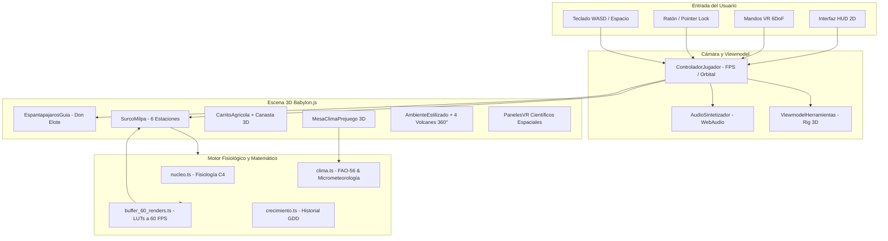

# 🌽 Documentación Integral del Funcionamiento y Código Completo del Proyecto
## Simulador Botánico WebXR · Milpa Tradicional Mexicana y Fisiología del Maíz (*Zea mays* L.)
### Versión 3.0 Inmersiva — 4 Razas Nativas, Modo Videojuego FPS, Audio Procedural, Cobertizo 3D, Don Elote y Consolas Científicas

> **Resumen:** Este documento contiene la **arquitectura matemática y funcional exhaustiva** del proyecto, así como el **100% del código fuente de cada uno de sus archivos**, identificando con precisión a qué archivo pertenece cada componente y explicando a detalle su funcionamiento interno.

---

## 📋 Índice General

### Parte I: Arquitectura y Funcionamiento a Detalle
1. [Visión General y Filosofía del Sistema](#1-visión-general-y-filosofía-del-sistema)
2. [Arquitectura Global y Flujo de Datos](#2-arquitectura-global-y-flujo-de-datos)
3. [El Pipeline Matemático de 60 Renders para WebXR Zero-GC](#3-el-pipeline-matemático-de-60-renders-para-webxr-zero-gc)
4. [Motor Agrofisiológico C4 y las 4 Razas Nativas de Maíz](#4-motor-agrofisiológico-c4-y-las-4-razas-nativas-de-maíz)
5. [Surco Lineal de Milpa (5.2m) y Labranza 3D](#5-surco-lineal-de-milpa-52m-y-labranza-3d)
6. [Modo Videojuego FPS y Manipulación de Herramientas en Primera Persona](#6-modo-videojuego-fps-y-manipulación-de-herramientas-en-primera-persona)
7. [Don Elote: Inteligencia Diegética y Sabiduría Ancestral](#7-don-elote-inteligencia-diegética-y-sabiduría-ancestral)
8. [Sintetizador de Audio Procedural WebAudio (Zero Descargas)](#8-sintetizador-de-audio-procedural-webaudio-zero-descargas)
9. [Cobertizo Campesino 3D y Mesa Diorama de Clima](#9-cobertizo-campesino-3d-y-mesa-diorama-de-clima)
10. [Consolas Espaciales 3D y Modo Científico](#10-consolas-espaciales-3d-y-modo-científico)
11. [Generador Procedural Cel-Shaded de la Planta de Maíz](#11-generador-procedural-cel-shaded-de-la-planta-de-maíz)
12. [Estructura Completa de Archivos del Repositorio](#12-estructura-completa-de-archivos-del-repositorio)

### Parte II: Código Fuente Íntegro y Explicación Archivo por Archivo
13. [Archivos de Configuración y Raíz](#13-archivos-de-configuración-y-raíz)
    - [package.json](#archivo-packagejson)
    - [tsconfig.json](#archivo-tsconfigjson)
    - [vite.config.ts](#archivo-viteconfigts)
    - [index.html](#archivo-indexhtml)
14. [Módulos Principales del Núcleo y Simulación (`src/`)](#14-módulos-principales-del-núcleo-y-simulación-src)
    - [src/nucleo.ts](#archivo-srcnucleots)
    - [src/clima.ts](#archivo-srcclimats)
    - [src/crecimiento.ts](#archivo-srccrecimientots)
    - [src/buffer_60_renders.ts](#archivo-srcbuffer_60_rendersts)
    - [src/maiz_estilizado.ts](#archivo-srcmaiz_estilizadots)
    - [src/surco_milpa.ts](#archivo-srcsurco_milpats)
    - [src/ambiente_estilizado.ts](#archivo-srcambiente_estilizadots)
    - [src/audio_sintetizador.ts](#archivo-srcaudio_sintetizadorts)
    - [src/controlador_jugador.ts](#archivo-srccontrolador_jugadorts)
    - [src/paneles_vr.ts](#archivo-srcpaneles_vrts)
    - [src/main.ts](#archivo-srcmaints)
15. [Módulos de Realidad Virtual y Cinemática (`src/vr/`)](#15-módulos-de-realidad-virtual-y-cinemática-srcvr)
    - [src/vr/viewmodel_herramientas.ts](#archivo-srcvrviewmodel_herramientasts)
    - [src/vr/mesa_clima_prejuego.ts](#archivo-srcvrmesa_clima_prejuegots)
    - [src/vr/canasta_cosecha.ts](#archivo-srcvrcanasta_cosechats)
    - [src/vr/locomocion_vr.ts](#archivo-srcvrlocomocion_vrts)
    - [src/vr/interaccion_manos_6dof.ts](#archivo-srcvrinteraccion_manos_6dofts)
    - [src/vr/mano_vr.ts](#archivo-srcvrmano_vrts)
    - [src/vr/cinturon_herramientas.ts](#archivo-srcvrcinturon_herramientasts)
    - [src/vr/reloj_muneca.ts](#archivo-srcvrreloj_munecats)
    - [src/vr/ui_poke.ts](#archivo-srcvrui_pokets)
16. [Módulos Educativos, UI y Don Elote (`src/educativo/`)](#16-módulos-educativos-ui-y-don-elote-srceducativo)
    - [src/educativo/espantapajaros_guia.ts](#archivo-srceducativoespantapajaros_guiats)
    - [src/educativo/herramientas_3d.ts](#archivo-srceducativoherramientas_3dts)
    - [src/educativo/estado_educativo.ts](#archivo-srceducativoestado_educativots)
    - [src/educativo/particulas_educativas.ts](#archivo-srceducativoparticulas_educativasts)
    - [src/educativo/panel_clima.ts](#archivo-srceducativopanel_climats)
    - [src/educativo/ui_infantil.ts](#archivo-srceducativoui_infantilts)
17. [Scripts de Automatización y Pruebas (`scripts/`)](#17-scripts-de-automatización-y-pruebas-scripts)
    - [scripts/exportar_trayectoria.ts](#archivo-scriptsexportar_trayectoriats)
    - [scripts/test_inmersivo.js](#archivo-scriptstest_inmersivojs)
    - [scripts/test_v3_renders.js](#archivo-scriptstest_v3_rendersjs)
    - [scripts/test_reglas.ts](#archivo-scriptstest_reglasts)

---

## 1. Visión General y Filosofía del Sistema
El proyecto **Simulador Botánico WebXR · Milpa Tradicional Mexicana (v3.0)** es una aplicación interactiva tridimensional en tiempo real desarrollada con **Babylon.js**, **TypeScript** y **Vite**. Su propósito es doble:
1. **Rigor Agronómico y Bioclimático:** Proporcionar una simulación fisiológica verídica de la ontogenia de *Zea mays* L. mediante Grados Día de Desarrollo (GDD), fotosíntesis C4, balance hídrico del suelo (modelo Campbell), evapotranspiración FAO-56 Penman-Monteith, arquitectura radicular estratificada y biomecánica de acame por viento y saturación.
2. **Pedagogía Inmersiva y Modo Videojuego (FPS / WebXR):** Permitir a estudiantes, agrónomos y público general sumergirse en una milpa mesoamericana tradicional, caminar libremente en primera persona con teclas `WASD`, empuñar herramientas físicamente modeladas en sus manos (azada, saco de semillas, regadera, abono orgánico y mano de cosecha), arar la tierra con deformación 3D en tiempo real, y aprender la ciencia e historia del maíz dialogando con "Don Elote", un espantapájaros diegético con voz procedural.

La experiencia corre tanto en navegadores de escritorio (Chrome, Edge, Firefox, Safari) como en visores de Realidad Virtual (Meta Quest 2, Quest 3, Quest Pro, Apple Vision Pro, SteamVR) sin necesidad de instalar aplicaciones nativas.

---

## 2. Arquitectura Global y Flujo de Datos
El siguiente diagrama ilustra el flujo de datos unidireccional y reactivo que gobierna la aplicación:



### Bucle de Simulación Frame a Frame
En cada fotograma (`scene.registerBeforeRender` en `main.ts`):
1. **Delta Time:** Se calcula $\Delta t = \min(0.1, \text{tiempoTranscurrido})$ garantizando estabilidad numérica.
2. **Controlador del Jugador:** `controladorJugador.actualizar(dt)` procesa la aceleración WASD, la inercia, la oscilación de cabeza (*head bobbing*), la cadencia de pasos sonoros (`audio.paso()`) y el raycast de interacción a 8 metros.
3. **Viewmodel de Herramientas:** `viewmodel.actualizar(dt, velocidad)` calcula el balanceo inercial al caminar (*weapon sway*) y la cinemática de ataque de la herramienta en mano.
4. **Fisiología de la Hilera:** Si el reloj temporal avanza, `surcoMilpa.avanzarSimulacion(dtDias, clima, metricas)` ejecuta los pasos diarios de ontogenia sobre las 6 plantas vivas.
5. **Animación de Viento:** `surcoMilpa.animarViento(tiempo, viento)` deforma las cañas y hojas de forma desfasada según la velocidad de las ráfagas y la turgencia celular.
6. **Personaje Don Elote:** `espantapajaros.animar(tiempo, viento, posJugador)` balancea sus brazos de paja y orienta su cabeza y torso hacia el jugador si éste se encuentra a menos de 7 metros.
7. **Carretilla Agrícola:** `carritoAgricola.actualizar(dt)` traslada suavemente la carretilla rodante acompañando la estación activa del surco y haciendo girar sus ruedas físicamente.

---

## 3. El Pipeline Matemático de 60 Renders para WebXR Zero-GC
### El Desafío del Garbage Collector en Cascos VR
En visores autónomos como Meta Quest 2/3, la creación continua de objetos temporales o la regeneración de geometrías tridimensionales provoca pausas del recolector de basura (*Garbage Collector judder*), generando tirones visuales y mareo por movimiento (*cybersickness*).

### La Solución: 60 Estados Morfológicos Discretizados
`buffer_60_renders.ts` discretiza el ciclo ontogénico completo en **60 estados matemáticos fijos**:
- Las transiciones morfológicas se leen directamente de 7 tablas de consulta (LUTs precalculadas):
  1. `LUT_ALTURA_NORMA[60]`: Curva logística de elongación de caña:
     $$\text{altura}(f) = \frac{1.0}{1.0 + e^{-10.0 \cdot (f - 0.40)}}$$
  2. `LUT_HOJAS_COUNT[60]`: Número de hojas activas (1 a 12).
  3. `LUT_HOJA_CURL[60]`: Curvatura foliar por presión de turgencia.
  4. `LUT_ESPIGA_APERTURA[60]`: Apertura de la panoja masculina.
  5. `LUT_ELOTE_ESCALA[60]`: Escala volumétrica del jilote y mazorca.
  6. `LUT_TOTOMOX_ABRE[60]`: Despliegue del totomoxtle exponiendo los granos.
  7. `LUT_RAICES_ZANCO[60]`: Despliegue de raíces de anclaje.
- **Interpolación Suave:** `obtenerEstadoMorph60(frameFloat)` interpola linealmente entre los estados enteros adyacentes $k$ y $k+1$, logrando transiciones fluidas a 60 FPS sin instanciar un solo objeto.

---

## 4. Motor Agrofisiológico C4 y las 4 Razas Nativas de Maíz
### Ontogenia Estricta (Ritchie & Hanway, 1982)
El simulador reproduce con exactitud las 13 etapas fenológicas del maíz:

| Etapa | Nombre Fenológico | GDD Requerido | Características Morfológicas y Fisiológicas |
| :--- | :--- | :--- | :--- |
| **SEMILLA** | Grano latente | $0$ | Grano enterrado esperando temperatura base y humedad óptima |
| **VE** | Emergencia coleóptilo | $75$ | El coleóptilo rompe la superficie del suelo |
| **V2** | 2ª Hoja Desplegada | $180$ | Cuello foliar visible; inicio de fotosíntesis autótrofa |
| **V4** | Plántula Establecida | $320$ | Diferenciación del meristemo apical bajo el suelo |
| **V6** | Elongación de Caña | $480$ | Meristemo emerge sobre la superficie; inicio de elongación rápida |
| **V8** | Vegetativo Rápido | $660$ | Formación acelerada de hojas y primer verticilo de raíces zanco |
| **V12** | Pre-Floración Densa | $1050$ | Determinación del número potencial de granos por mazorca |
| **VT** | Floración Masculina | $1200$ | Despliegue de espiga apical (panoja) y dehiscencia de anteras |
| **R1** | Floración Femenina | $1350$ | Emisión de estigmas receptivos (*pelos de elote*) |
| **R2** | Ampolla (*Blister*) | $1500$ | Granos acuosos blanquecinos con rápida acumulación de almidón |
| **R3** | Grano Lechoso / **ELOTE** | $1700$ | Estado óptimo para consumo de elote tierno |
| **R4** | Pastoso (*Dough*) | $1900$ | Endospermo con consistencia masosa densa |
| **R5** | Dentado (*Dent*) | $2050$ | Hendidura en la corona del grano por deshidratación del almidón |
| **R6** | Madurez Fisiológica | $2200$ | Formación de capa negra (*black layer*); cese de traslocación |

### Las 4 Razas Nativas Mexicanas
1. **Maíz Chalqueño (`chalqueno`):**
   - Valles Altos de México (2,250 msnm). Porte monumental (hasta 3.5 m). Ciclo largo (2050 GDD). Granos gigantes dorados (`#fbbf24`) para pozole y elotes hervidos.
2. **Maíz Azul Cónico (`azul`):**
   - Zonas de alta montaña volcánica (hasta 3,000 msnm). Porte medio (2.4 m). Ciclo de 1950 GDD. Alto en antocianinas (`#4338ca`) que protegen contra la intensa radiación UV y las bajas temperaturas. Base de tortillas azules y tlacoyos.
3. **Maíz Rojo (`rojo`):**
   - Regiones semiáridas y valles secos. Porte medio-alto (2.6 m). Ciclo de 2000 GDD. Mazorcas color carmesí (`#b91c1c`). Gran tolerancia al estrés hídrico (resistencia 0.80).
4. **Maíz Palomero Toluqueño (`palomero`):**
   - Valle de Toluca; la raza más antigua de México (>5,000 años). Porte compacto (1.8 m). Mazorcas perladas anaranjadas (`#f97316`). Endospermo hiperdenso que revienta al calentarse a $180^\circ\text{C}$ produciendo palomitas (*momochtli*).

### La Tríada Sagrada de la Milpa
- **Frijol (`frijol`):** Fija nitrógeno atmosférico mediante simbiosis con bacterias *Rhizobium* en los nódulos radiculares (+1.5% de vigor diario acumulado).
- **Calabaza (`calabaza`):** Sus grandes hojas rastreras cubren el suelo creando un acolchado vivo que conserva la humedad y reduce la evaporación edáfica directa en un 35%.

---

## 5. Surco Lineal de Milpa (5.2m) y Labranza 3D
El módulo `src/surco_milpa.ts` implementa un camellón agrícola de 5.2 metros con 6 estaciones de cultivo ($x \in [-2.0, -1.2, -0.4, 0.4, 1.2, 2.0]\text{ m}$):
- **Deformación Física de Surcos al Arar:**
  - Cada golpe de azada incrementa `tierraArada` en $+34\%$.
  - Esculpe 3 crestas longitudinales tridimensionales (`surcosMesh`):
    ```typescript
    const nivelArado = nodo.tierraArada / 100;
    nodo.surcosMesh.forEach((s, idx) => {
      s.scaling.y = Math.max(0.001, Math.min(1.0, nivelArado * 3 - idx));
      s.scaling.x = 1.0 + nivelArado * 0.35;
    });
    ```
- **Siembra Tridimensional:** Requiere `tierraArada >= 100%`. Deposita 3 semillas ovoides visibles con el color de la raza seleccionada.
- **Lámina de Charco Reflectante:** Si el riego o lluvia eleva la humedad volumétrica $\theta > 38\%$, se activa una lámina líquida translúcida reflectante con transparencia gradual.

---

## 6. Modo Videojuego FPS y Manipulación de Herramientas en Primera Persona
### Controlador en Primera Persona (`controlador_jugador.ts`)
- **Movimiento:** Teclas `WASD` / Flechas con física de inercia, carrera con `Shift` ($4.6\text{ m/s}$) y giro con ratón o teclas `Q`/`E`.
- **Head Bobbing y Audio:** Oscilación armónica de la cámara al desplazarse acoplada a la cadencia de emisión de pasos sonoros en tierra (`audio.paso()`).
- **Retícula Inteligente con Raycast:** Emite un rayo de 8 metros desde el centro de la cámara. Al detectar un montículo, letrero, control del cobertizo o a Don Elote, agranda la retícula central a color dorado (`#fbbf24`) y despliega un tooltip contextual flotante.

### Viewmodel de Herramientas en Pantalla (`viewmodel_herramientas.ts`)
Un rig jerárquico 3D conectado directamente a la cámara del jugador representa sus brazos campesinos sosteniendo:
1. **Azada:** Mango de madera y cuchilla de acero forjado. Al hacer clic, ejecuta un arco de preparación hacia atrás y desciende velozmente impactando la tierra, emitiendo sonido y polvo.
2. **Saco de Semillas:** Saco de yute con granos que se inclina para verter semillas en la zanja.
3. **Regadera:** Vierte un chorro de agua continuo con inclinación y burbujeo acústico.
4. **Trowel de Abono:** Esparce compost con lluvia de destellos esmeralda.
5. **Guante de Cosecha:** Se extiende hacia la mazorca madura para arrancarla con un crujido seco.

---

## 7. Don Elote: Inteligencia Diegética y Sabiduría Ancestral
Ubicado junto al camellón de milpa, el personaje "Don Elote" actúa como guía del huerto sin romper la inmersión:
- **Seguimiento Facial y Corporal:** Cuando el usuario se aproxima a menos de 7 metros, Don Elote rota suavemente su tronco y cuello para mirarlo de frente.
- **Globo de Diálogo 3D Billboard:** Textura dinámica de $512 \times 200\text{ px}$ configurada en `BILLBOARDMODE_Y` que flota sobre su sombrero y permanece legible desde cualquier ángulo.
- **Fonemas Vocales Sintéticos:** Al hablar, emite ráfagas de audio procedural que simulan el habla divertida de un personaje de dibujos animados.

---

## 8. Sintetizador de Audio Procedural WebAudio (Zero Descargas)
Genera todos los efectos sonoros en tiempo real mediante matemáticas acústicas en el navegador:
1. `golpeAzada()`: Sub-bass sinusoidal de $120\to 32\text{ Hz}$ en $180\text{ ms}$ + ráfaga de ruido blanco pasabanda a $450\text{ Hz}$.
2. `iniciarAgua()` / `detenerAgua()`: Ruido blanco continuo filtrado en $1100\text{ Hz}$ con oscilador LFO a $8.5\text{ Hz}$ modulando $\pm 350\text{ Hz}$ para emular el flujo turbulento de agua.
3. `semillas()`: Tres impulsos triangulares ($650, 830, 1010\text{ Hz}$) de $50\text{ ms}$.
4. `abono()`: Campanilleo en acorde mayor de Do ($C_5, E_5, G_5, C_6$).
5. `cosecha()`: Snap percusivo triangular con caída de $380\to 95\text{ Hz}$.
6. `vozDonElote()`: 4 ráfagas de onda cuadrada ($220-400\text{ Hz}$) procesadas por filtro resonante en $950\text{ Hz}$ ($Q=3.5$).
7. `paso()`: Ruido blanco filtrado por pasabajas en $320\text{ Hz}$ de $80\text{ ms}$.

---

## 9. Cobertizo Campesino 3D y Mesa Diorama de Clima
Ubicado en la coordenada $z = -3.8\text{ m}$, el cobertizo de madera alberga una estación meteorológica interactiva:
- **Termómetro de Mercurio:** Botones $[+]$ y $[-]$ para graduar la temperatura en saltos de $3^\circ\text{C}$.
- **Palanca de Lluvia:** Palanca articulada para dosificar la precipitación.
- **Fuelle de Viento:** Fuelle analógico para graduar las ráfagas eólicas.
- **Cubetas de Suelo:** Tres recipientes para ajustar acidez/pH y textura edáfica.
- **Anillo Volcánico de 360°:** El Popocatépetl, Iztaccíhuatl, Nevado de Toluca y Cerro del Ajusco rodean el horizonte. Cuando la temperatura desciende a $T \le 5^\circ\text{C}$, sus cumbres se cubren dinámicamente de mantos de nieve blanca.

---

## 10. Consolas Espaciales 3D y Modo Científico
Al pulsar la tecla `H`, se despliegan tres consolas curvadas en el espacio 3D construidas con `AdvancedDynamicTexture`:
1. **Consola Central (Reloj GDD y Time-Lapse):**
   - Deslizador de 1 a 240 días de cultivo.
   - Modos de avance rápido a $1\times$, $3\times$, $6\times$ y $12\times$ días por segundo.
   - Telemetría de biomasa acumulada en gramos (hojas, tallo, raíces, mazorca).
2. **Consola Meteorológica Izquierda:**
   - 11 deslizadores: Temperatura, Humedad, Presión, Hora, Nubosidad, Lluvia, Viento, Humedad Suelo, pH, $\text{CO}_2$ y PM2.5.
   - 10 escenarios climáticos preconfigurados.
3. **Consola Diagnóstica Derecha:**
   - Evapotranspiración FAO-56 ($ET_0$).
   - Fotosíntesis neta C4 ($A_n$).
   - 6 barras de estrés activo: hídrico, calórico, helada, encharcamiento, pH y viento.

---

## 11. Generador Procedural Cel-Shaded de la Planta de Maíz
El modelo tridimensional de la planta de maíz en `src/maiz_estilizado.ts` implementa:
- **Caña (Tallo):** Cilindros segmentados por nudos prominentes.
- **Raíces de Anclaje (*Brace Roots*):** Cilindros curvados en los verticilos basales que fijan la planta contra el viento.
- **Hojas Acintadas (*Ribbons*):** Mallas generadas por extrusión a lo largo de splines cúbicos Hermite con nervadura cilíndrica central.
- **Mazorca Procedural:** Cilindro ovoide con `DynamicTexture` que dibuja las hileras de granos individuales coloreadas según la raza nativa (amarillo, azul, rojo o blanco perla), cubiertas por hojas de totomoxtle y cabellos de elote.
- **Espiga Apical (Panoja):** Raquis central ramificado con anteras dehiscentes amarillas.
- **Estética Cel-Shaded:** Contornos de tinta oscura (`#25330f`) y sombreado toon de dos tonos.

---

## 12. Estructura Completa de Archivos del Repositorio
A continuación se presenta el árbol de archivos completo del proyecto:

```
vr_v2/
├── package.json                          # Metadatos, scripts y dependencias (Babylon.js, Vite)
├── tsconfig.json                         # Configuración estricta del compilador TypeScript
├── vite.config.ts                        # Configuración del servidor de desarrollo y empaquetador
├── index.html                            # Punto de entrada HTML5, lienzo WebGL2 y retícula FPS
├── src/                                  # Código fuente principal de la aplicación
│   ├── main.ts                           # Orquestador principal, bucle de escena y eventos
│   ├── nucleo.ts                         # Fisiología C4, ontogenia Ritchie-Hanway y 4 razas nativas
│   ├── clima.ts                          # Micrometeorología, FAO-56 Penman-Monteith y 10 presets
│   ├── crecimiento.ts                    # Snapshots diarios y línea de tiempo agrofisiológica
│   ├── buffer_60_renders.ts              # Pipeline de 60 LUTs para WebXR zero-garbage collection
│   ├── maiz_estilizado.ts                # Generador procedural cel-shaded de la planta de maíz
│   ├── surco_milpa.ts                    # Camellón de 5.2m con 6 estaciones y labranza 3D
│   ├── ambiente_estilizado.ts            # Entorno 3D, cielo, volcanes 360° con nieve y cobertizo
│   ├── audio_sintetizador.ts             # Sintetizador procedural WebAudio nativo (zero descargas)
│   ├── controlador_jugador.ts            # Movimiento FPS (WASD, ratón, head bobbing, raycast)
│   ├── paneles_vr.ts                     # Consolas científicas espaciales 3D curvadas
│   ├── vr/                               # Subsistema de Realidad Virtual e interfaces 3D
│   │   ├── viewmodel_herramientas.ts     # Rig de brazos y herramientas en primera persona (FPS)
│   │   ├── mesa_clima_prejuego.ts        # Diorama meteorológico interactivo dentro del cobertizo
│   │   ├── canasta_cosecha.ts            # Canasta de recolección y carretilla agrícola rodante
│   │   ├── locomocion_vr.ts              # Teletransporte anti-mareo para visores WebXR
│   │   └── interaccion_manos_6dof.ts     # Punteros láser y hápticos para mandos VR 6DoF
│   └── educativo/                        # Subsistema pedagógico, Don Elote y UI
│       ├── espantapajaros_guia.ts        # Don Elote: seguimiento de mirada, diálogos y trivia
│       ├── herramientas_3d.ts            # Mallas 3D de herramientas para modo escritorio
│       ├── estado_educativo.ts           # Máquina de estados finita de la experiencia de cultivo
│       ├── particulas_educativas.ts      # Sistemas de partículas (tierra, agua, abono, confeti)
│       ├── panel_clima.ts                # Interfaz flotante 2D para ajuste meteorológico rápido
│       └── ui_infantil.ts                # HUD 2D para selección de herramientas y telemetría
└── scripts/                              # Scripts de pruebas y exportación
    ├── exportar_trayectoria.ts           # Exportador de trayectorias agronómicas a CSV
    ├── test_inmersivo.js                 # Prueba de extremo a extremo automatizada con Puppeteer
    └── test_v3_renders.js                # Validador gráfico de camellón y estaciones
```

---

## 13. Archivos de Configuración y Raíz

<a id="archivo-packagejson"></a>
### Configuración del Paquete y Dependencias del Proyecto (`package.json`)
**Ruta del archivo:** `package.json`

#### Funcionamiento a Detalle
Define los metadatos del proyecto, scripts de compilación, ejecución y dependencias clave:
- **`@babylonjs/core`**: Motor 3D WebGL2/WebXR de alto rendimiento para renderizado de escenas, mallas, materiales y cámaras.
- **`@babylonjs/gui`**: Módulo de interfaces gráficas 2D y 3D en el espacio espacial (usado en las consolas científicas y texturas dinámicas).
- **`@babylonjs/inspector`**: Herramienta de depuración y análisis de nodos de escena en tiempo de desarrollo.
- **`vite` & `@vitejs/plugin-basic-ssl`**: Servidor de desarrollo ultra-rápido con Hot Module Replacement (HMR) y generación automática de certificados SSL para pruebas WebXR en dispositivos móviles y visores autónomos como Meta Quest 2/3.
- **`typescript`**: Compilador estricto para garantizar seguridad de tipos en la simulación matemática y lógica de juego.

#### Código Fuente Completo (`package.json`)
```json
{
  "name": "maiz-vr-estilizado",
  "private": true,
  "version": "2.0.0",
  "type": "module",
  "scripts": {
    "dev": "vite",
    "dev:http": "NO_HTTPS=true vite",
    "build": "tsc && vite build",
    "preview": "vite preview",
    "render": "node scripts/render_cartoon_all.js"
  },
  "dependencies": {
    "@babylonjs/core": "^6.49.0",
    "@babylonjs/gui": "^6.49.0",
    "@babylonjs/inspector": "^6.49.0"
  },
  "devDependencies": {
    "@vitejs/plugin-basic-ssl": "^1.1.0",
    "typescript": "~5.6.2",
    "vite": "^5.4.10"
  }
}

```

---

<a id="archivo-tsconfigjson"></a>
### Configuración del Compilador TypeScript (`tsconfig.json`)
**Ruta del archivo:** `tsconfig.json`

#### Funcionamiento a Detalle
Configura las directivas de transpilación y verificación estricta de tipos:
- **Target `ES2022`**: Soporta características modernas de JavaScript (campos de clase privados, top-level await, métodos estáticos avanzados).
- **`moduleResolution: bundler`**: Integración nativa con empaquetadores modernos (Vite) para resolver importaciones ESM fluidamente.
- **`strict: true`**: Habilita comprobaciones estrictas de nulabilidad (`strictNullChecks`), enlace de `this` y tipos no implícitos `any`, vital para garantizar estabilidad matemática en el pipeline de simulación.

#### Código Fuente Completo (`tsconfig.json`)
```json
{
  "compilerOptions": {
    "target": "ES2020",
    "useDefineForClassFields": true,
    "module": "ESNext",
    "lib": ["ES2020", "DOM", "DOM.Iterable"],
    "skipLibCheck": true,
    "moduleResolution": "bundler",
    "allowImportingTsExtensions": true,
    "isolatedModules": true,
    "moduleDetection": "force",
    "noEmit": true,
    "strict": true,
    "noUnusedLocals": false,
    "noUnusedParameters": false,
    "noFallthroughCasesInSwitch": true
  },
  "include": ["src"]
}

```

---

<a id="archivo-viteconfigts"></a>
### Configuración de Vite (`vite.config.ts`)
**Ruta del archivo:** `vite.config.ts`

#### Funcionamiento a Detalle
Configura el empaquetador Vite con directivas optimizadas:
- Soporte para variables de entorno (como `NO_HTTPS=true` para ejecutar sobre HTTP puro en local si se requiere depuración rápida).
- Inclusión condicional de `@vitejs/plugin-basic-ssl` para levantar un servidor HTTPS local firmado al vuelo, requisito indispensable de la API WebXR Device en navegadores modernos (Chrome, Safari, Meta Quest Browser).

#### Código Fuente Completo (`vite.config.ts`)
```typescript
import { defineConfig } from 'vite';
import basicSsl from '@vitejs/plugin-basic-ssl';

const usarHttps = process.env.NO_HTTPS !== 'true' && process.env.HTTPS === 'true';

export default defineConfig({
  plugins: usarHttps ? [basicSsl()] : [],
  server: {
    host: true,
    port: 5173
  }
});

```

---

<a id="archivo-indexhtml"></a>
### Punto de Entrada HTML (`index.html`)
**Ruta del archivo:** `index.html`

#### Funcionamiento a Detalle
Estructura HTML5 base que aloja el canvas de renderizado 3D y elementos diegéticos de interfaz:
- **`#renderCanvas`**: Lienzo principal WebGL2 que ocupa el 100% de la ventana sin barras de desplazamiento.
- **`#crosshair`**: Retícula minimalista central en pantalla para apuntar con precisión en modo primera persona (FPS).
- **`#crosshair-tooltip`**: Etiqueta flotante reactiva al raycasting del jugador que muestra el nombre del objeto y la interacción disponible cuando el usuario apunta a un montículo, herramienta, control o a Don Elote.
- Estilos CSS incrustados con aceleración por hardware, tipografía de sistema clara y desactivación de selección de texto accidental durante el juego.

#### Código Fuente Completo (`index.html`)
```html
<!DOCTYPE html>
<html lang="es">
<head>
  <meta charset="utf-8">
  <meta name="viewport" content="width=device-width, initial-scale=1, viewport-fit=cover">
  <title>Maíz Animado · Simulador Botánico WebXR (Estilo Cel-Shaded)</title>

  <style>
    :root {
      --bg: #bde7f4;
      --ink: #2a3417;
      box-sizing: border-box;
    }
    html, body {
      height: 100%;
      margin: 0;
      overflow: hidden;
      background: var(--bg);
      font-family: "Trebuchet MS", "Segoe UI", system-ui, sans-serif;
      color: var(--ink);
      user-select: none;
      -webkit-user-select: none;
    }
    #renderCanvas {
      width: 100%;
      height: 100%;
      display: block;
      outline: none;
      touch-action: none;
    }
    .shortcuts-pill {
      position: absolute;
      bottom: calc(env(safe-area-inset-bottom, 0px) + 12px);
      left: 50%;
      transform: translateX(-50%);
      background: rgba(255, 252, 236, 0.88);
      border: 1.5px solid #2a3417;
      border-radius: 20px;
      padding: 6px 14px;
      font-size: 11.5px;
      font-weight: 700;
      color: #2a3417;
      backdrop-filter: blur(6px);
      box-shadow: 0 4px 12px rgba(42, 52, 23, 0.12);
      pointer-events: none;
      opacity: 0.85;
      letter-spacing: 0.01em;
      white-space: nowrap;
    }
    @media (max-width: 600px) {
      .shortcuts-pill {
        display: none;
      }
    }
  </style>
</head>
<body>
  <canvas id="renderCanvas"></canvas>

  <script type="module" src="/src/main.ts"></script>
</body>
</html>

```

---

## 14. Módulos Principales del Núcleo y Simulación (`src/`)

<a id="archivo-srcnucleots"></a>
### Motor Agrofisiológico, Ontogenia C4 y Razas Nativas (`src/nucleo.ts`)
**Ruta del archivo:** `src/nucleo.ts`

#### Funcionamiento a Detalle
Es el corazón agronómico y biofísico de la aplicación. Implementa con rigor científico las leyes de desarrollo de *Zea mays* L.:
1. **Ontogenia Estricta por Grados Día de Desarrollo (Ritchie & Hanway, 1982):**
   - 13 etapas fenológicas modeladas: `SEMILLA` (0 GDD), `VE` (75 GDD, emergencia del coleóptilo), `V2` (180 GDD, dos hojas con collar visible), `V4` (320 GDD, diferenciación meristemática), `V6` (480 GDD, punto de crecimiento sobre el suelo), `V8` (660 GDD, primer verticilo de raíces zanco), `V12` (1050 GDD, definición de número potencial de óvulos), `VT` (1200 GDD, espiga masculina desplegada emitiendo polen), `R1` (1350 GDD, emisión de jilote y estigmas), `R2` (1500 GDD, grano en estado de ampolla acuosa), `R3` (1700 GDD, grano lechoso óptimo para elote), `R4` (1900 GDD, grano masoso), `R5` (2050 GDD, grano dentado) y `R6` (2200 GDD, madurez fisiológica con formación de capa negra).
2. **Ecuación de Acumulación Térmica (GDD):**
   $$\text{GDD} = \max\left(0, \; \frac{\min(T_{\max}, 34) + \max(T_{\min}, 10)}{2} - 10\right)$$
3. **Fotosíntesis C4 y Balance de Carbono:**
   - Modela la tasa de asimilación neta de $\text{CO}_2$ ($A_n$) acoplando la cinética de la PEP carboxilasa y RuBisCO, la saturación por radiación PAR (Michaelis-Menten) y la curva óptima de temperatura ($30-33^\circ\text{C}$).
4. **Física del Suelo y Balance Hídrico Continuo (Modelo Campbell):**
   - Monitorea el contenido volumétrico de agua edáfica ($\theta_{\text{VWC}}$), punto de marchitez permanente (PMP $\approx 0.12$), capacidad de campo (CC $\approx 0.32$) y saturación ($\approx 0.45$).
5. **Estrés Abiótico Multifactorial:**
   - **Hídrico:** Marchitez foliar progresiva y cierre estomático si $\theta \to \text{PMP}$.
   - **Térmico:** Inhibición enzimática por calor ($T > 38^\circ\text{C}$) o necrosis celular irreversible por helada ($T < 0^\circ\text{C}$).
   - **Encharcamiento / Hipoxia:** Asfixia radicular por anoxia si el suelo permanece saturado más de 48 horas continuas.
   - **Acidez / Toxicidad por Aluminio:** Retardo en crecimiento y clorosis cuando $\text{pH} < 5.0$.
   - **Acame Biomecánico:** Riesgo de vuelco por interacción entre ráfagas de viento y ablandamiento del suelo por lluvia intensa.
6. **Las 4 Razas Nativas de Maíz Mexicano:**
   - **Chalqueño (`chalqueno`):** Porte monumental (hasta 3.5 m), ciclo tardío (2050 GDD), mazorcas doradas gigantes ideales para pozole.
   - **Azul Cónico (`azul`):** Porte medio (2.4 m), ciclo de 1950 GDD, rico en antocianinas protectoras de la radiación UV y heladas de gran altitud.
   - **Rojo (`rojo`):** Porte medio-alto (2.6 m), alta resistencia a sequía estival (0.80), granos carmesí profundos.
   - **Palomero Toluqueño (`palomero`):** Raza ancestral milenaria (>5,000 años), porte compacto (1.8 m), endospermo hiperdenso que revienta en palomitas (*momochtli*).
7. **Simbiosis de la Milpa Tradicional:**
   - Asociación con frijol: fijación biológica de nitrógeno (+1.5% de vigor diario acumulativo).
   - Asociación con calabaza: cobertura vegetal que actúa como mulch vivo reduciendo la evaporación del suelo en un 35%.

#### Código Fuente Completo (`src/nucleo.ts`)
```typescript
/**
 * Núcleo desacoplado de simulación agrofisiológica para Zea mays L. (raza Chalqueño).
 *
 * Módulo puro: SIN dependencias de Babylon.js ni del DOM.
 * Modela termodinámica del aire, radiación solar, fotosíntesis C4, fenología guiada por GDD,
 * reglas de germinación, letalidad acumulativa por factor, reversibilidad de marchitez
 * y dinámica del fruto (elote/mazorca).
 */

// ---------------------------------------------------------------------------
// 1. Constantes globales y configuración agrofisiológica (CFG)
// ---------------------------------------------------------------------------

export const CFG = {
  // Presión atmosférica nativa (Valles Altos de México: 1,800–2,700 m s. n. m.)
  presionBase: 780.0,            // hPa (≈ 2,240 m s. n. m. en Mesa Central)
  presionMin: 700.0,             // hPa (≈ 3,000 m s. n. m.)
  presionMax: 1050.0,            // hPa (nivel del mar y altas presiones)

  // Termodinámica de Magnus y psicrometría unificada (FAO-56)
  magnusC1: 17.27,
  magnusC2: 237.3,
  constantePsicrometricaFactor: 0.000665, // γ = 0.000665 * (P / 10) kPa/°C

  // Parámetros térmicos del Maíz Chalqueño
  tBase: 8.0,                    // °C temperatura base de desarrollo (adaptación a frío de altura)
  tCorteSuperior: 32.0,          // °C techo térmico fisiológico para GDD
  deltaTermicaDiurnaDefecto: 12.0, // °C amplitud diurna si solo se provee T media

  // Umbrales de fenología térmica en GDD acumulados (base 8 °C)
  gddEmergencia: 80.0,           // GDD siembra -> emergencia VE
  gddVE: 0.0,                    // VE (Emergencia)
  gddV2: 90.0,                   // V2 (2ª hoja desplegada con lígula visible)
  gddV4: 210.0,                  // V4 (Plántula establecida)
  gddV6: 360.0,                  // V6 (Punto de crecimiento emerge sobre el suelo)
  gddV8: 540.0,                  // V8 (Elongación rápida de caña, susceptible a acame)
  gddV12: 760.0,                 // V12 (Diferenciación de mazorca y número de óvulos)
  gddVT: 1020.0,                 // VT (Antesis / Panoja masculina abierta y emitiendo polen)
  gddR1: 1080.0,                 // R1 (Silking / Estigmas femeninos emergen del jilote)
  gddR2: 1260.0,                 // R2 (Ampolla / Blister: granos con fluido claro)
  gddR3: 1380.0,                 // R3 (Leche / Milk: ELOTE apto para cosecha en fresco)
  gddR4: 1470.0,                 // R4 (Pastoso / Dough: consistencia de masa de almidón)
  gddR5: 1620.0,                 // R5 (Dentado / Dent: formación de hendidura en corona)
  gddR6: 1880.0,                 // R6 (Madurez fisiológica / Capa negra)

  // Características hidrofísicas del suelo franco típico de Valles Altos
  pmp: 12.0,                     // % VWC Punto de marchitez permanente (PMP)
  cc: 32.0,                      // % VWC Capacidad de campo (CC)
  saturacion: 45.0,              // % VWC Humedad de saturación
  umbralEncharcamiento: 38.0,    // % VWC Inicio de restricción de oxígeno
  umbralEncharcamientoSevero: 52.0, // % VWC Hipoxia radicular crítica

  // Letalidad, germinación y estreses
  acameLetal: false,             // Si true, acame = MUERTA; si false, acame = ACAMADA (planta viva a 55°)
  diasSueloFrioMax: 21,          // Días en suelo < 10 °C para pudrición de semilla
  diasSueloSaturadoMax: 3,       // Días en suelo > 45 % VWC y T > 15 °C para anoxia de semilla
  diasSemillaSecaMax: 21,        // Días en suelo <= PMP para desecación de semilla
  diasSequiaExtremaMax: 5.5,     // Días acumulados en sequía extrema (E_suelo >= 0.9)
  diasCalorExtremoMax: 4.5,      // Días consecutivos con T_max > 40 °C
  tempCalorLetalInstantaneo: 45.0, // °C de golpe de calor que causa muerte inmediata
  tempHeladaSevera: -2.5,        // °C temperatura crítica de congelación de tejidos
  horasHeladaSeveraLetal: 2.0,   // Horas bajo -2.5 °C para causar daño severo o letal
  asiBaseDias: 2.0,              // Días de ASI base en condiciones óptimas
  asiFactorEstres: 6.0,          // Incremento de ASI por unidad de estrés en floración
  cuajadoSensibilidad: 1.3,      // Pendiente de caída de cuajado con estrés en floración

  // Fotosíntesis C4 (Zea mays L.)
  aMax0: 42.0,                   // µmol CO2 / m² / s (asimilación potencial máxima C4)
  kPAR: 300.0,                   // µmol fotones / m² / s (saturación fotosintética de luz C4)
  kCO2: 40.0,                    // ppm (baja sensibilidad de carboxilación C4 a CO2 ambiente)
  tOptimaFotosintesis: 27.0,     // °C centro de la curva gaussiana fotosintética
  tSigmaFotosintesis: 9.5,       // Dispersión gaussiana de temperatura
  respiracionBase: 1.2,          // µmol CO2 / m² / s a 25 °C
  q10Respiracion: 2.0            // Coeficiente térmico de respiración
};

/** Reglas unificadas de jugabilidad y umbrales 6DoF (v4.0 Milpa Viva VR) */
export const REGLAS_JUEGO = {
  DIAS_COSECHA_MIN: 145,       // elote tierno (R3)
  DIAS_MADUREZ: 163,           // madurez fisiológica para semilla
  UMBRAL_AZADA_MS: 1.2,        // m/s mínimos de golpe de azada
  RADIO_INTERACCION_M: 0.55    // distancia mano–planta para actuar
} as const;

// ---------------------------------------------------------------------------
// 2. Tipos y modelos de datos
// ---------------------------------------------------------------------------

export enum Etapa {
  SEMILLA = 0,
  VE = 1,
  V2 = 2,
  V4 = 3,
  V6 = 4,
  V8 = 5,
  V12 = 6,
  VT = 7,
  R1 = 8,
  R2 = 9,
  R3 = 10,
  R4 = 11,
  R5 = 12,
  R6 = 13
}

export type EstadoPlanta = 'SEMILLA' | 'VIVA' | 'ACAMADA' | 'MADURA' | 'MUERTA';

export type TipoSemilla = 'chalqueno' | 'azul' | 'rojo' | 'palomero';
export type CultivoAsociado = 'ninguno' | 'frijol' | 'calabaza';

export interface VariedadMaizConfig {
  tipo: TipoSemilla;
  nombre: string;
  especieBotanica: string;
  origenBiogeografico: string;
  subtitulo: string;
  colorHex: string;
  colorBracteasHex: string;
  colorSecoHex: string;
  alturaMetrosMax: number;
  tBase: number;
  tCorte: number;
  tempOptimaMin: number;
  tempOptimaMax: number;
  vwcOptimoMin: number;
  vwcOptimoMax: number;
  phOptimoMin: number;
  phOptimoMax: number;
  gddCicloCompleto: number;
  pmp: number; // % VWC
  cc: number;
  resistenciaFrio: number; // 0..1
  resistenciaSequia: number; // 0..1
  resistenciaViento: number; // 0..1
  resistenciaEncharcamiento: number; // 0..1
  mazorcasTipicas: number; // 1 a 3
  condicionesFavorables: string;
  queLePerjudica: string;
  descripcionPedagogica: string;
}

export const VARIEDADES_MAIZ: Record<TipoSemilla, VariedadMaizConfig> = {
  chalqueno: {
    tipo: 'chalqueno',
    nombre: 'Maíz Chalqueño',
    especieBotanica: 'Zea mays L. subsp. mays (Raza Chalqueño)',
    origenBiogeografico: 'Valles Altos Centrales de México (1,800–2,600 m s.n.m.)',
    subtitulo: 'Raza monumental de Valles Altos (Grano Dentado Amarillo-Cremoso)',
    colorHex: '#eab308',
    colorBracteasHex: '#65a30d',
    colorSecoHex: '#ca8a04',
    alturaMetrosMax: 3.50,
    tBase: 8.0,
    tCorte: 32.0,
    tempOptimaMin: 18.0,
    tempOptimaMax: 26.0,
    vwcOptimoMin: 24.0,
    vwcOptimoMax: 34.0,
    phOptimoMin: 6.0,
    phOptimoMax: 7.2,
    gddCicloCompleto: 2050.0,
    pmp: 12.0,
    cc: 32.0,
    resistenciaFrio: 0.60,
    resistenciaSequia: 0.50,
    resistenciaViento: 0.40, // Gran porte (3.50 m) -> susceptible a acame con viento fuerte
    resistenciaEncharcamiento: 0.50,
    mazorcasTipicas: 1,
    condicionesFavorables: 'Clima templado subhúmedo (18–26 °C), buena humedad constante (24–34% VWC) y suelos profundos ricos en Nitrógeno (NPK ≥ 55%, asociación con Frijol).',
    queLePerjudica: 'Vientos fuertes (> 11 m/s provocan acame severo por su altura de 3.5 m si no tiene Tutor [T]), sequía (< 15% VWC) y suelos pobres en nutrientes (NPK < 35%).',
    descripcionPedagogica: 'Zea mays subsp. mays raza Chalqueño: caña monumental de hasta 3.5 m y mazorca cónica-cilíndrica de alto rendimiento. Exige suelo fértil y aporque/tutor contra el viento.'
  },
  azul: {
    tipo: 'azul',
    nombre: 'Maíz Azul (Cónico)',
    especieBotanica: 'Zea mays L. subsp. mays (Raza Cónico Azul)',
    origenBiogeografico: 'Alta Montaña del Eje Neovolcánico (2,200–3,000 m s.n.m.)',
    subtitulo: 'Raza de alta montaña rica en antocianinas antioxidantes',
    colorHex: '#312e81',
    colorBracteasHex: '#4d7c0f',
    colorSecoHex: '#1e1b4b',
    alturaMetrosMax: 2.60,
    tBase: 6.0, // Muy adaptado al frío de montaña
    tCorte: 29.0,
    tempOptimaMin: 12.0,
    tempOptimaMax: 22.0,
    vwcOptimoMin: 20.0,
    vwcOptimoMax: 32.0,
    phOptimoMin: 5.5,
    phOptimoMax: 6.8,
    gddCicloCompleto: 1650.0, // Ciclo más corto adaptado a heladas tempranas
    pmp: 11.0,
    cc: 30.0,
    resistenciaFrio: 0.95, // Altísima resistencia a helada (-5.2 °C)
    resistenciaSequia: 0.55,
    resistenciaViento: 0.70,
    resistenciaEncharcamiento: 0.60,
    mazorcasTipicas: 1,
    condicionesFavorables: 'Clima frío a fresco de montaña (12–22 °C), humedad moderada (20–32% VWC) y suelos volcánicos ligeramente ácidos (pH 5.5–6.8). Resiste heladas hasta -5 °C.',
    queLePerjudica: 'Calor excesivo (> 28 °C deshidrata la planta y esteriliza su polen en floración), sequía atmosférica (HR < 35%) y suelos alcalinos (pH > 7.5).',
    descripcionPedagogica: 'Zea mays subsp. mays raza Cónico Azul: rico en antocianinas que protegen sus tejidos del frío de alta montaña y radiación UV, pero sufre con el calor intenso.'
  },
  rojo: {
    tipo: 'rojo',
    nombre: 'Maíz Rojo (Sangre de Cristo)',
    especieBotanica: 'Zea mays L. subsp. mays (Raza Cónico Norteño / Celaya)',
    origenBiogeografico: 'Semidesierto y Bajío Seco Mexicano (1,200–2,100 m s.n.m.)',
    subtitulo: 'Raza de secano profundo con raíces adaptadas a la aridez',
    colorHex: '#991b1b',
    colorBracteasHex: '#4d7c0f',
    colorSecoHex: '#7f1d1d',
    alturaMetrosMax: 2.80,
    tBase: 9.0,
    tCorte: 35.0,
    tempOptimaMin: 22.0,
    tempOptimaMax: 34.0,
    vwcOptimoMin: 12.0,
    vwcOptimoMax: 26.0,
    phOptimoMin: 6.2,
    phOptimoMax: 7.8,
    gddCicloCompleto: 1850.0,
    pmp: 8.5, // Resiste suelos muy secos antes de marchitar
    cc: 28.0,
    resistenciaFrio: 0.40,
    resistenciaSequia: 0.95, // Gran campeona en sequía
    resistenciaViento: 0.65,
    resistenciaEncharcamiento: 0.25, // Se pudre rápido si se inunda
    mazorcasTipicas: 1,
    condicionesFavorables: 'Clima cálido y soleado (22–34 °C), suelos bien drenados con humedad baja a moderada (12–26% VWC, PMP de solo 8.5%). Tolera canículas y sequías.',
    queLePerjudica: 'Exceso de riego y encharcamiento (> 34% VWC provoca asfixia y pudrición radicular rápida) y frío o heladas (< 8 °C detiene su crecimiento; muere a -1.5 °C).',
    descripcionPedagogica: 'Zea mays subsp. mays raza Cónico Norteño «Sangre de Cristo»: campeona en tierras áridas y cálidas, pero muy vulnerable al exceso de agua y a las heladas.'
  },
  palomero: {
    tipo: 'palomero',
    nombre: 'Maíz Palomero Toluqueño',
    especieBotanica: 'Zea mays L. subsp. everta (Raza Palomero Toluqueño)',
    origenBiogeografico: 'Valle de Toluca y Altiplano Mexiquense (2,400–2,850 m s.n.m.)',
    subtitulo: 'Subespecie ancestral reventadora de porte bajo y doble raíz zanco',
    colorHex: '#d97706',
    colorBracteasHex: '#65a30d',
    colorSecoHex: '#b45309',
    alturaMetrosMax: 2.10,
    tBase: 7.5,
    tCorte: 30.5,
    tempOptimaMin: 14.0,
    tempOptimaMax: 24.0,
    vwcOptimoMin: 22.0,
    vwcOptimoMax: 34.0,
    phOptimoMin: 5.6,
    phOptimoMax: 7.0,
    gddCicloCompleto: 1520.0,
    pmp: 10.5,
    cc: 30.0,
    resistenciaFrio: 0.72,
    resistenciaSequia: 0.60,
    resistenciaViento: 0.96, // Porte bajo y anclaje doble -> casi inmune al acame
    resistenciaEncharcamiento: 0.65,
    mazorcasTipicas: 2,
    condicionesFavorables: 'Clima templado-frío y ventoso de altiplano (14–24 °C), humedad constante en emergencia (22–34% VWC) y parcela limpia de maleza. Ciclo rápido y resistente a vendavales.',
    queLePerjudica: 'Competencia por maleza (> 25% de maleza lo ahoga por su porte bajo de 2.1 m), olas de calor (> 30 °C) y sobremaduración en campo post-R6.',
    descripcionPedagogica: 'Zea mays subsp. everta raza Palomero Toluqueño: grano cristalino reventador, porte bajo (2.1 m) con raíces zanco dobles contra el viento. Requiere deshierbe oportuno.'
  }
};

export interface CultivoAsociadoEfecto {
  tipo: CultivoAsociado;
  nombre: string;
  icono: string;
  beneficioNitrogenoDia: number; // e.g. +1.5% N por día (Frijol)
  factorEvaporacionSuelo: number; // e.g. 0.65 (Calabaza - mulch vivo)
  descripcion: string;
}

export const CULTIVOS_ASOCIADOS: Record<CultivoAsociado, CultivoAsociadoEfecto> = {
  ninguno: {
    tipo: 'ninguno',
    nombre: 'Solo Maíz',
    icono: '🌽',
    beneficioNitrogenoDia: 0,
    factorEvaporacionSuelo: 1.0,
    descripcion: 'Monocultivo tradicional sin plantas acompañantes.'
  },
  frijol: {
    tipo: 'frijol',
    nombre: 'Frijol Enredador',
    icono: '🫘',
    beneficioNitrogenoDia: 1.5,
    factorEvaporacionSuelo: 0.95,
    descripcion: 'Trepa por la caña y fija nitrógeno natural (+1.5% N/día) para enriquecer el suelo.'
  },
  calabaza: {
    tipo: 'calabaza',
    nombre: 'Calabaza Rastrera',
    icono: '🎃',
    beneficioNitrogenoDia: 0,
    factorEvaporacionSuelo: 0.65, // Reduce evaporación 35%
    descripcion: 'Hojas anchas que cubren el suelo como mulch vivo, conservando 35% más de humedad.'
  }
};

export type Causa =
  | 'helada'
  | 'calor'
  | 'sequia'
  | 'encharcamiento'
  | 'acame'
  | 'pudricion_semilla'
  | 'agotamiento';

export interface ClimaDia {
  tMax: number;                  // °C
  tMin: number;                  // °C
  tMed: number;                  // °C
  tSuelo: number;                // °C
  hr: number;                    // %
  vwc: number;                   // % VWC
  ph: number;                    // escala pH
  viento: number;                // m/s
  lluvia: number;                // mm/h o mm acumulados
  co2: number;                   // ppm
  presion: number;               // hPa
  horasBajoMenos2_5: number;     // Horas en el día con T <= -2.5 °C
  nubosidad?: number;            // %
  pm25?: number;                 // µg/m³
  hora?: number;                 // h solar (0 a 24)
  estresBiotico?: number;        // 0..1 daño por plagas (cogollero / aves, M4)
}

export interface Estreses {
  suelo: number;                 // 0..1
  vpd: number;                   // 0..1
  hidrico: number;               // 0..1
  calor: number;                 // 0..1
  frio: number;                  // 0..1
  ench: number;                  // 0..1
  pH: number;                    // 0..1
  mec: number;                   // 0..1
  mecRaw: number;                // >= 0 (sin clamp, para umbral de acame)
  biotico?: number;              // 0..1 estrés por plaga / herbivoría (v4.0)
  globalPonderado: number;       // 0..1 (solo UI / visualización)
}

export interface RasgosHeredables {
  rVigor: number;                // 0.8..1.2
  rSequia: number;               // 0.8..1.2
  rFrio: number;                 // 0.8..1.2
  rCiclo: number;                // 0.8..1.2
  rTamano: number;               // 0.8..1.2
}

export interface Planta {
  variedad: TipoSemilla;
  cultivoAsociado: CultivoAsociado;
  rasgosHeredados?: RasgosHeredables;
  estado: EstadoPlanta;
  gddSiembra: number;            // acumulado antes de emerger
  gdd: number;                   // reloj fenológico térmico
  vigor: number;                 // 0..1 (integrador de vitalidad y biomasa)
  diasSequiaExtrema: number;     // acumulador letalidad sequía
  diasCalorExtremo: number;      // acumulador letalidad canícula
  diasEncharcado: number;        // acumulador letalidad hipoxia
  diasSueloFrio: number;         // acumulador frío en semilla
  diasSueloSaturado: number;     // acumulador saturación en semilla
  diasSemillaSeca: number;       // acumulador sequía en semilla
  estresFloracion: number[];     // estrés diario en ventana de polinización
  causaMuerte?: Causa;

  // Variables morfológicas (para renderizado estilizado y visual)
  escala: number;                // escala relativa de la planta (0.20 a 1.0)
  alturaMetros: number;          // altura equivalente en metros (0.20 a 3.50m según variedad y vigor)
  alturaTecho: number;           // límite máximo real de altura alcanzado al llegar a VT
  limiteAlcanzado: boolean;      // true cuando alcanzó su límite vegetativo y dejó de crecer en altura
  secado: number;                // 0 (verde turgente) -> 1 (planta seca / senescente o rastrojo)
  brote: number;                 // 1 (plántula inicial) -> 0 (adulta)
  muerte: number;                // 0 (viva) -> 1 (colapso necrótico)
  degradacion: number;           // 0 (viva) -> 1 (degradación post-mortem avanzada)
  diasMuerta: number;            // días transcurridos tras morir
  sequia: number;                // 0..1 (acartuchamiento y decaimiento foliar)
  frio: number;                  // 0..1 (flaccidez y contracción por helada)
  acameGrados: number;           // rotación basal de la caña (0° a 55°)
  amarillamiento: number;        // 0..1 clorosis y senescencia
  antocianina: number;           // 0..1 enrojecimiento por pH ácido / frío

  // Mazorca / Elote (Zea mays L.)
  eloteVis: number;              // 0 (sin elote) o 1 (elote visible)
  eloteCrec: number;             // 0 (jilote pequeño) -> 1 (tamaño completo)
  bracteasAbre: number;          // 0..1 (separación y apertura de totomoxtle)
  granoLlenado: number;          // 0..1 (desarrollo y volumen de granos)
  aborto: number;                // 0..1 (punta estéril / aborto apical por estrés)
  estigmaSeco: number;           // 0 (estigmas frescos amarillos) -> 1 (secos café tostado)
  bracteasSeco: number;          // 0 (hojas de mazorca verdes) -> 1 (pajizo seco)
  asiDias: number;               // Intervalo antesis-estigmas (ASI)
  cuajado: number;               // Fracción de fecundación de granos (0..1)
}

// ---------------------------------------------------------------------------
// 3. Funciones utilitarias matemáticas y termodinámicas
// ---------------------------------------------------------------------------

export const clamp01 = (v: number): number => Math.max(0.0, Math.min(1.0, v));

/** Presión de vapor de saturación (kPa) según fórmula de Tetens / Magnus */
export function presionSaturacion(t: number): number {
  return 0.6108 * Math.exp((CFG.magnusC1 * t) / (t + CFG.magnusC2));
}

/** Punto de rocío (°C) según fórmula unificada de Magnus */
export function puntoDeRocio(t: number, hr: number): number {
  const h = Math.max(0.1, Math.min(100.0, hr));
  const gamma = Math.log(h / 100.0) + (CFG.magnusC1 * t) / (CFG.magnusC2 + t);
  return (CFG.magnusC2 * gamma) / (CFG.magnusC1 - gamma);
}

/**
 * Grados Día de Desarrollo (GDD) adaptados a los umbrales térmicos de cada raza de maíz.
 */
export function gddDia(d: ClimaDia, cfg = CFG, varCfg?: VariedadMaizConfig): number {
  const tBase = varCfg ? varCfg.tBase : cfg.tBase;
  const tCorte = varCfg ? varCfg.tCorte : cfg.tCorteSuperior;
  const tMaxEff = Math.min(tCorte, Math.max(tBase, d.tMax));
  const tMinEff = Math.min(tCorte, Math.max(tBase, d.tMin));
  const tMedEff = (tMaxEff + tMinEff) / 2.0;
  return Math.max(0.0, tMedEff - tBase);
}

/**
 * Normaliza variables climáticas a un ClimaDia completo.
 */
export function normalizarClimaDia(
  parcial: Partial<ClimaDia> & { temperatura?: number; humedad?: number; humedadSuelo?: number; phSuelo?: number }
): ClimaDia {
  const t = parcial.tMed ?? parcial.temperatura ?? 24.0;
  const delta = CFG.deltaTermicaDiurnaDefecto;
  const tMax = parcial.tMax ?? (t + delta / 2.0);
  const tMin = parcial.tMin ?? (t - delta / 2.0);
  const hr = parcial.hr ?? parcial.humedad ?? 62.0;
  const vwc = parcial.vwc ?? parcial.humedadSuelo ?? 32.0;
  const ph = parcial.ph ?? parcial.phSuelo ?? 6.4;
  const viento = parcial.viento ?? 2.5;
  const lluvia = parcial.lluvia ?? 0.0;
  const co2 = parcial.co2 ?? 420.0;
  const presion = parcial.presion ?? CFG.presionBase;
  const horasBajoMenos2_5 = parcial.horasBajoMenos2_5 ?? (tMin <= -2.5 ? 3.0 : 0.0);

  return {
    tMax,
    tMin,
    tMed: t,
    tSuelo: parcial.tSuelo ?? t,
    hr,
    vwc,
    ph,
    viento,
    lluvia,
    co2,
    presion,
    horasBajoMenos2_5,
    nubosidad: parcial.nubosidad ?? 20.0,
    pm25: parcial.pm25 ?? 12.0,
    hora: parcial.hora ?? 13.5
  };
}

/**
 * Determina la etapa fenológica a partir de los GDD acumulados, escalando
 * proporcionalmente según el ciclo térmico de la variedad nativa (gddCicloCompleto).
 */
export function etapaDe(gdd: number, cfg = CFG, varCfg?: VariedadMaizConfig): Etapa {
  const escalaCiclo = varCfg ? varCfg.gddCicloCompleto / cfg.gddR6 : 1.0;
  const g = gdd / Math.max(0.5, escalaCiclo);
  if (g < cfg.gddV2) return Etapa.VE;
  if (g < cfg.gddV4) return Etapa.V2;
  if (g < cfg.gddV6) return Etapa.V4;
  if (g < cfg.gddV8) return Etapa.V6;
  if (g < cfg.gddV12) return Etapa.V8;
  if (g < cfg.gddVT) return Etapa.V12;
  if (g < cfg.gddR1) return Etapa.VT;
  if (g < cfg.gddR2) return Etapa.R1;
  if (g < cfg.gddR3) return Etapa.R2;
  if (g < cfg.gddR4) return Etapa.R3;
  if (g < cfg.gddR5) return Etapa.R4;
  if (g < cfg.gddR6) return Etapa.R5;
  return Etapa.R6;
}

export function nombreEtapa(etapa: Etapa): string {
  switch (etapa) {
    case Etapa.SEMILLA: return "SEMILLA (Siembra)";
    case Etapa.VE: return "VE (Emergencia)";
    case Etapa.V2: return "V2 (2ª Hoja Desplegada)";
    case Etapa.V4: return "V4 (Plántula Establecida)";
    case Etapa.V6: return "V6 (Inicio Elongación Caña)";
    case Etapa.V8: return "V8 (Crecimiento Vegetativo Rápido)";
    case Etapa.V12: return "V12 (Pre-Floración Densa)";
    case Etapa.VT: return "VT (Floración / Panoja Abierta)";
    case Etapa.R1: return "R1 (Floración Femenina / Jilote)";
    case Etapa.R2: return "R2 (Ampolla / Blister)";
    case Etapa.R3: return "R3 (Leche / ELOTE)";
    case Etapa.R4: return "R4 (Pastoso / Dough)";
    case Etapa.R5: return "R5 (Dentado / Dent)";
    case Etapa.R6: return "R6 (Madurez Fisiológica)";
    default: return "DESCONOCIDA";
  }
}

// ---------------------------------------------------------------------------
// 4. Cálculo de estreses biofísicos individuales y fotosíntesis C4
// ---------------------------------------------------------------------------

export function estreses(d: ClimaDia, p?: Planta, cfg = CFG): Estreses {
  const varCfg = p ? VARIEDADES_MAIZ[p.variedad || 'chalqueno'] : undefined;
  const pmpVar = varCfg ? varCfg.pmp : cfg.pmp;
  const ccVar = varCfg ? varCfg.cc : cfg.cc;
  const tBaseVar = varCfg ? varCfg.tBase : cfg.tBase;
  const tCorteVar = varCfg ? varCfg.tCorte : cfg.tCorteSuperior;
  const resEnch = varCfg ? varCfg.resistenciaEncharcamiento : 0.5;

  const es = presionSaturacion(d.tMed);
  const ea = (es * d.hr) / 100.0;
  const vpd = Math.max(0.0, es - ea);

  // 1. Estrés hídrico en suelo (acorde al PMP y CC de la raza de maíz)
  const umbralOptimoSuelo = Math.max(pmpVar + 6.0, ccVar * 0.82);
  let suelo = 0.0;
  if (d.vwc < umbralOptimoSuelo) {
    suelo = clamp01((umbralOptimoSuelo - d.vwc) / Math.max(4.0, umbralOptimoSuelo - pmpVar));
  }

  // 2. Estrés atmosférico por déficit de presión de vapor (VPD)
  let estresVpd = 0.0;
  if (vpd > 1.6) {
    estresVpd = clamp01((vpd - 1.6) / 2.4);
  }

  // Estrés hídrico integrado
  const hidrico = clamp01(Math.max(suelo, estresVpd * 0.7));

  // 3. Estrés térmico por calor (según techo térmico tCorte de la variedad)
  let calor = 0.0;
  if (d.tMax > tCorteVar) {
    calor = clamp01((d.tMax - tCorteVar) / Math.max(6.0, 45.0 - tCorteVar));
  }

  // 4. Estrés térmico por frío (según tBase y resistencia al frío de la variedad)
  let frio = 0.0;
  if (d.tMin < tBaseVar) {
    const pisoFrio = varCfg ? -2.0 - 4.0 * varCfg.resistenciaFrio : -4.0;
    frio = clamp01((tBaseVar - d.tMin) / Math.max(4.0, tBaseVar - pisoFrio));
  }

  // 5. Encharcamiento e hipoxia (razas sensibles como Rojo sufren antes, desde ~34% VWC)
  const umbralEnchVar = varCfg
    ? Math.min(cfg.umbralEncharcamiento, varCfg.vwcOptimoMax + 6.0 + 4.0 * resEnch)
    : cfg.umbralEncharcamiento;
  let ench = 0.0;
  if (d.vwc > umbralEnchVar) {
    ench = clamp01((d.vwc - umbralEnchVar) / Math.max(10.0, 56.0 - umbralEnchVar));
  }

  // 6. Estrés químico por pH de suelo acorde a la adaptación edáfica de cada especie
  const phMinOpt = varCfg ? varCfg.phOptimoMin : 5.8;
  const phMaxOpt = varCfg ? varCfg.phOptimoMax : 7.5;
  let pH = 0.0;
  if (d.ph < phMinOpt) {
    pH = clamp01((phMinOpt - d.ph) / Math.max(1.5, phMinOpt - 3.5));
  } else if (d.ph > phMaxOpt) {
    pH = clamp01((d.ph - phMaxOpt) / Math.max(1.2, 9.0 - phMaxOpt));
  }

  // 7. Estrés mecánico por viento
  const u2 = d.viento * 0.75;
  const mecRaw = Math.pow(u2 / 12.0, 2.0);
  const mec = clamp01(mecRaw);

  // 8. Estrés biótico por plagas (M4)
  const biotico = clamp01(d.estresBiotico ?? 0.0);

  // Ponderación global para telemetría
  const globalPonderado = clamp01(
    0.26 * hidrico +
    0.18 * calor +
    0.14 * frio +
    0.14 * ench +
    0.09 * pH +
    0.09 * mec +
    0.10 * biotico
  );

  return {
    suelo,
    vpd: estresVpd,
    hidrico,
    calor,
    frio,
    ench,
    pH,
    mec,
    mecRaw,
    biotico,
    globalPonderado
  };
}

/**
 * Fotosíntesis neta C4 (Zea mays L.)
 */
export function fotosintesisNetaC4(d: ClimaDia, par: number, estres: Estreses, cfg = CFG): number {
  if (par <= 5.0) return -cfg.respiracionBase;

  const fLuz = par / (par + cfg.kPAR);
  const fCO2 = d.co2 / (d.co2 + cfg.kCO2);
  const dt = d.tMed - cfg.tOptimaFotosintesis;
  const fTemp = Math.exp(-0.5 * Math.pow(dt / cfg.tSigmaFotosintesis, 2.0));
  const fAgua = Math.max(0.05, 1.0 - estres.hidrico);
  const aBruta = cfg.aMax0 * fLuz * fCO2 * fTemp * fAgua;

  const rSuelo = cfg.respiracionBase * Math.pow(cfg.q10Respiracion, (d.tMed - 25.0) / 10.0);
  return Math.max(-rSuelo, aBruta - rSuelo);
}

// ---------------------------------------------------------------------------
// 5. Fábrica e inicialización de planta
// ---------------------------------------------------------------------------

export function crearPlanta(variedad: TipoSemilla = 'chalqueno', cultivoAsociado: CultivoAsociado = 'ninguno'): Planta {
  return {
    variedad,
    cultivoAsociado,
    estado: 'SEMILLA',
    gddSiembra: 0.0,
    gdd: 0.0,
    vigor: 1.0,
    diasSequiaExtrema: 0.0,
    diasCalorExtremo: 0.0,
    diasEncharcado: 0.0,
    diasSueloFrio: 0.0,
    diasSueloSaturado: 0.0,
    diasSemillaSeca: 0.0,
    estresFloracion: [],
    causaMuerte: undefined,

    escala: 0.28,
    alturaMetros: 0.28,
    alturaTecho: 0.28,
    limiteAlcanzado: false,
    secado: 0.0,
    brote: 1.0,
    muerte: 0.0,
    degradacion: 0.0,
    diasMuerta: 0.0,
    sequia: 0.0,
    frio: 0.0,
    acameGrados: 0.0,
    amarillamiento: 0.0,
    antocianina: 0.0,

    eloteVis: 0,
    eloteCrec: 0.0,
    bracteasAbre: 0.0,
    granoLlenado: 0.0,
    aborto: 0.0,
    estigmaSeco: 0.0,
    bracteasSeco: 0.0,
    asiDias: CFG.asiBaseDias,
    cuajado: 1.0
  };
}

// ---------------------------------------------------------------------------
// 6. Motor del paso diario fenológico (pasoDia)
// ---------------------------------------------------------------------------

export function pasoDia(p: Planta, d: ClimaDia, cfg = CFG): Planta {
  const varCfg = VARIEDADES_MAIZ[p.variedad || 'chalqueno'];
  const escalaCiclo = varCfg.gddCicloCompleto / cfg.gddR6;

  if (p.estado === 'MUERTA') {
    p.diasMuerta += 1.0;
    p.degradacion = Math.min(1.0, p.diasMuerta / 14.0);
    p.secado = Math.min(1.0, (p.secado ?? 0.5) + 0.12);
    if (p.causaMuerte === 'acame' || p.causaMuerte === 'encharcamiento' || p.degradacion > 0.65) {
      p.acameGrados = Math.min(65.0, Math.max(p.acameGrados, 38.0 + p.degradacion * 27.0));
    } else {
      p.acameGrados = Math.min(28.0, p.acameGrados + p.degradacion * 18.0);
    }
    p.amarillamiento = 1.0;
    p.vigor = 0.0;
    return p;
  }

  const e = estreses(d, p, cfg);
  const rCiclo = p.rasgosHeredados?.rCiclo ?? 1.0;
  const rSequia = p.rasgosHeredados?.rSequia ?? 1.0;
  const rFrio = p.rasgosHeredados?.rFrio ?? 1.0;
  const rVigor = p.rasgosHeredados?.rVigor ?? 1.0;
  const rTamano = p.rasgosHeredados?.rTamano ?? 1.0;

  // -------------------------------------------------------------------------
  // FASE A: SEMILLA (Germinación y Emergencia acorde a la variedad)
  // -------------------------------------------------------------------------
  if (p.estado === 'SEMILLA') {
    const umbralSueloFrio = varCfg.tBase + 1.5;
    if (d.tSuelo < umbralSueloFrio) {
      p.diasSueloFrio += 1.0 * (1.35 - 0.65 * varCfg.resistenciaFrio * rFrio);
      if (p.diasSueloFrio >= cfg.diasSueloFrioMax) {
        p.estado = 'MUERTA';
        p.causaMuerte = 'pudricion_semilla';
        p.secado = 0.8;
        p.vigor = 0.0;
        return p;
      }
    } else {
      p.diasSueloFrio = Math.max(0.0, p.diasSueloFrio - 0.5);
    }

    if (d.vwc > cfg.saturacion && d.tSuelo > 14.0) {
      p.diasSueloSaturado += 1.0 * (1.45 - 0.75 * varCfg.resistenciaEncharcamiento);
      if (p.diasSueloSaturado >= cfg.diasSueloSaturadoMax) {
        p.estado = 'MUERTA';
        p.causaMuerte = 'encharcamiento';
        p.secado = 0.6;
        p.vigor = 0.0;
        return p;
      }
    } else {
      p.diasSueloSaturado = Math.max(0.0, p.diasSueloSaturado - 0.5);
    }

    if (d.vwc <= varCfg.pmp) {
      p.diasSemillaSeca += 1.0 * (1.40 - 0.70 * varCfg.resistenciaSequia * rSequia);
      if (p.diasSemillaSeca >= cfg.diasSemillaSecaMax) {
        p.estado = 'MUERTA';
        p.causaMuerte = 'sequia';
        p.secado = 1.0;
        p.vigor = 0.0;
        return p;
      }
    } else {
      p.diasSemillaSeca = Math.max(0.0, p.diasSemillaSeca - 0.5);
    }

    const tEmerg = Math.max(0.0, Math.min(varCfg.tCorte, d.tSuelo) - varCfg.tBase);
    const humedadApta = d.vwc >= (varCfg.pmp + 4.0) && d.vwc <= cfg.saturacion;
    if (d.tSuelo >= umbralSueloFrio && humedadApta) {
      p.gddSiembra += tEmerg;
      if (p.gddSiembra >= cfg.gddEmergencia * escalaCiclo) {
        p.estado = 'VIVA';
        p.gdd = 0.0;
        p.vigor = 1.0;
        p.escala = 0.28;
        p.alturaMetros = 0.28;
        p.alturaTecho = 0.28;
        p.limiteAlcanzado = false;
        p.secado = 0.0;
        p.brote = 1.0;
      }
    }
    return p;
  }

  // -------------------------------------------------------------------------
  // FASE B: PLANTA EMERGIDA (VIVA / ACAMADA / MADURA)
  // -------------------------------------------------------------------------

  const etapaActual = etapaDe(p.gdd, cfg, varCfg);

  // 1. Letalidad instantánea por golpe de calor extremo (modulado por variedad)
  const tempCalorLetal = cfg.tempCalorLetalInstantaneo - (1.0 - varCfg.resistenciaSequia) * 2.5;
  if (d.tMax >= tempCalorLetal) {
    p.estado = 'MUERTA';
    p.causaMuerte = 'calor';
    p.secado = 1.0;
    p.amarillamiento = 1.0;
    p.muerte = 1.0;
    p.vigor = 0.0;
    return p;
  }

  // 2. Letalidad y daño severo por helada acorde a la resistencia al frío de cada maíz
  // Ej.: Maíz Rojo (0.45) muere a ~ -1.8 °C; Chalqueño (0.60) a ~ -2.6 °C; Azul (0.95) resiste hasta -5.2 °C
  const tempHeladaLetal = -0.2 - 5.2 * varCfg.resistenciaFrio * rFrio;
  if (d.tMin <= tempHeladaLetal && (d.horasBajoMenos2_5 >= cfg.horasHeladaSeveraLetal || d.tMin <= tempHeladaLetal - 0.8)) {
    if (etapaActual >= Etapa.V4) {
      p.estado = 'MUERTA';
      p.causaMuerte = 'helada';
      p.frio = 1.0;
      p.secado = 0.85;
      p.muerte = 1.0;
      p.vigor = 0.0;
      return p;
    } else {
      p.vigor = Math.max(0.15, p.vigor * 0.45);
      p.frio = 0.9;
    }
  } else if (d.tMin <= tempHeladaLetal + 2.0) {
    // Helada moderada que quema follaje y reduce vigor en variedades sensibles al frío
    const danoFrio = (1.25 - 0.85 * varCfg.resistenciaFrio * rFrio) * 0.14;
    p.vigor = Math.max(0.05, p.vigor - danoFrio);
    p.frio = clamp01(p.frio + 0.35);
    p.secado = clamp01((p.secado ?? 0) + danoFrio * 0.8);
  }

  // 3. Acumuladores de estrés letal por Sequía, Calor y Encharcamiento según cada variedad
  // La marchitez letal ocurre cuando la humedad cae cerca o por debajo del Punto de Marchitez Permanente (PMP) de cada raza
  if (d.vwc <= varCfg.pmp + 1.5 || e.suelo >= 0.88) {
    const bajoPmp = d.vwc <= varCfg.pmp ? 1.0 : 0.45;
    const factorVulnSequia = Math.max(0.22, 1.45 - 1.15 * varCfg.resistenciaSequia * rSequia);
    p.diasSequiaExtrema += (0.55 + 0.65 * e.suelo) * factorVulnSequia * bajoPmp;
    p.secado = clamp01((p.secado ?? 0) + 0.09 * e.suelo * factorVulnSequia);
    if (p.diasSequiaExtrema >= cfg.diasSequiaExtremaMax) {
      p.estado = 'MUERTA';
      p.causaMuerte = 'sequia';
      p.secado = 1.0;
      p.amarillamiento = 1.0;
      p.sequia = 1.0;
      p.muerte = 1.0;
      p.vigor = 0.0;
      return p;
    }
  } else {
    p.diasSequiaExtrema = Math.max(0.0, p.diasSequiaExtrema - 0.5);
  }

  const umbralCalorSevero = varCfg.tCorte + 4.5; // Azul sufre desde 34.5 °C; Rojo hasta 38.5 °C
  if (d.tMax >= umbralCalorSevero) {
    const factorVulnCalor = Math.max(0.35, 1.40 - 0.80 * varCfg.resistenciaSequia * rSequia);
    p.diasCalorExtremo += factorVulnCalor;
    p.secado = clamp01((p.secado ?? 0) + 0.08 * factorVulnCalor);
    if (p.diasCalorExtremo >= cfg.diasCalorExtremoMax) {
      p.estado = 'MUERTA';
      p.causaMuerte = 'calor';
      p.secado = 1.0;
      p.amarillamiento = 1.0;
      p.muerte = 1.0;
      p.vigor = 0.0;
      return p;
    }
  } else {
    p.diasCalorExtremo = Math.max(0.0, p.diasCalorExtremo - 0.5);
  }

  if (e.ench >= 0.55) {
    const factorVulnEnch = Math.max(0.35, 1.60 - 1.05 * varCfg.resistenciaEncharcamiento);
    p.diasEncharcado += (0.65 + 0.55 * e.ench) * factorVulnEnch;
    const maxDiasEnch = d.tMed > 20.0 ? 3.0 : 6.0;
    if (p.diasEncharcado >= maxDiasEnch) {
      p.estado = 'MUERTA';
      p.causaMuerte = 'encharcamiento';
      p.secado = 0.75;
      p.amarillamiento = 1.0;
      p.acameGrados = Math.max(p.acameGrados, 38.0);
      p.muerte = 1.0;
      p.vigor = 0.0;
      return p;
    }
  } else {
    p.diasEncharcado = Math.max(0.0, p.diasEncharcado - 0.5);
  }

  // 4. Mecánica de Acame por Viento y Suelo Saturado (modulado por porte y raíces de la variedad)
  const umbralBase = d.vwc > cfg.umbralEncharcamiento ? 14.0 : 18.0;
  const umbralAcameViento = umbralBase * (0.62 + 0.72 * varCfg.resistenciaViento);
  if (d.viento >= umbralAcameViento && etapaActual >= Etapa.V8) {
    p.acameGrados = 55.0;
    if (cfg.acameLetal) {
      p.estado = 'MUERTA';
      p.causaMuerte = 'acame';
      p.muerte = 1.0;
      p.vigor = 0.0;
      return p;
    } else {
      p.estado = 'ACAMADA';
      p.vigor = Math.max(0.25, p.vigor * 0.75);
    }
  }

  // 5. Acumulación fenológica de Grados Día (ajustada por tBase/tCorte de la variedad y rCiclo)
  const deltaGdd = gddDia(d, cfg, varCfg) / Math.max(0.8, Math.min(1.2, rCiclo));
  p.gdd += deltaGdd;

  // Modulaciones por cultivo asociado (Tríada Mesoamericana) y rasgos heredables
  let eHidricoEfectivo = e.hidrico * (1.0 - Math.min(0.85, 0.45 * varCfg.resistenciaSequia * rSequia));
  let eFrioEfectivo = e.frio * (1.0 - Math.min(0.85, 0.55 * varCfg.resistenciaFrio * rFrio));
  if (p.cultivoAsociado === 'calabaza') {
    eHidricoEfectivo *= 0.65; // Mulch vivo retiene 35% de evaporación
  }

  // 6. Vigor multiplicativo (se actualiza durante el crecimiento activo antes de R6; en madurez se preserva)
  const eBiotico = e.biotico ?? 0.0;
  const penalizacionVigor =
    (1.0 - 0.62 * eHidricoEfectivo) *
    (1.0 - 0.52 * e.calor) *
    (1.0 - 0.52 * eFrioEfectivo) *
    (1.0 - 0.58 * e.ench) *
    (1.0 - 0.35 * e.pH) *
    (1.0 - 0.50 * eBiotico);

  if (deltaGdd > 0.1 && p.estado !== 'MADURA') {
    p.vigor = clamp01((p.vigor * 0.91 + penalizacionVigor * 0.09) * (0.98 + 0.02 * rVigor));
    if (p.cultivoAsociado === 'frijol') {
      p.vigor = clamp01(p.vigor + 0.015); // Fijación biológica de N
    }
    // Bono por encontrarse en la ventana agroclimática favorable de la especie
    const enTempOptima = d.tMed >= varCfg.tempOptimaMin && d.tMed <= varCfg.tempOptimaMax;
    const enVwcOptimo = d.vwc >= varCfg.vwcOptimoMin && d.vwc <= varCfg.vwcOptimoMax;
    if (enTempOptima && enVwcOptimo && e.globalPonderado < 0.22) {
      p.vigor = clamp01(p.vigor + 0.012);
    }
    // Penalizaciones específicas por lo que perjudica a cada especie:
    // - Cónico Azul: sufre deshidratación y daño térmico cuando T_max > 28 °C y HR < 35%
    if (p.variedad === 'azul' && (d.tMax > 28.0 || d.hr < 35.0)) {
      const excCalorAzul = Math.max(0, (d.tMax - 28.0) / 10.0) + (d.hr < 35.0 ? 0.08 : 0);
      p.vigor = clamp01(p.vigor - 0.022 * excCalorAzul);
    }
    // - Sangre de Cristo (Rojo): sufre pudrición radicular acelerada con exceso de humedad (> 34% VWC) o frío (< 10 °C)
    if (p.variedad === 'rojo') {
      if (d.vwc > 34.0) {
        p.vigor = clamp01(p.vigor - 0.028 * ((d.vwc - 34.0) / 12.0));
      }
      if (d.tMed < 11.0) {
        p.vigor = clamp01(p.vigor - 0.018 * ((11.0 - d.tMed) / 8.0));
      }
    }
  }

  // Colapso por pérdida crítica de vigor acumulada ante mal clima
  if (p.vigor <= 0.10) {
    p.estado = 'MUERTA';
    if (eFrioEfectivo >= eHidricoEfectivo && eFrioEfectivo >= e.calor && eFrioEfectivo >= e.ench) {
      p.causaMuerte = 'helada';
    } else if (e.ench >= eHidricoEfectivo && e.ench >= e.calor) {
      p.causaMuerte = 'encharcamiento';
    } else if (e.calor > eHidricoEfectivo) {
      p.causaMuerte = 'calor';
    } else {
      p.causaMuerte = 'sequia';
    }
    p.secado = p.causaMuerte === 'helada' ? 0.85 : 1.0;
    p.amarillamiento = 1.0;
    p.muerte = 1.0;
    p.vigor = 0.0;
    return p;
  }

  // 7. Marchitez Reversible, Senescencia (Secado) y Límite Real de Crecimiento Vegetativo
  p.sequia = clamp01(p.sequia * 0.72 + eHidricoEfectivo * 0.28);
  p.frio = clamp01(p.frio * 0.70 + eFrioEfectivo * 0.30);
  p.amarillamiento = clamp01(
    p.amarillamiento + 0.04 * eHidricoEfectivo + 0.025 * e.calor + 0.02 * e.ench + 0.03 * eBiotico
  );
  p.antocianina = clamp01(p.antocianina * 0.85 + (p.variedad === 'azul' ? 0.35 : (e.pH + eFrioEfectivo * 0.5) * 0.18));

  const gddV6_var = cfg.gddV6 * escalaCiclo;
  const gddV12_var = cfg.gddV12 * escalaCiclo;
  const gddVT_var = cfg.gddVT * escalaCiclo;
  const gddR1_var = cfg.gddR1 * escalaCiclo;
  const gddR2_var = cfg.gddR2 * escalaCiclo;
  const gddR3_var = cfg.gddR3 * escalaCiclo;
  const gddR4_var = cfg.gddR4 * escalaCiclo;
  const gddR5_var = cfg.gddR5 * escalaCiclo;
  const gddR6_var = varCfg.gddCicloCompleto;

  // LÍMITE REAL DE CRECIMIENTO EN ALTURA:
  // El maíz solo elonga su tallo hasta VT (floración masculina). Al llegar a VT, su altura
  // queda fijada en su techo biológico alcanzado (modulado por la variedad y el vigor logrado).
  const factorVigorAltura = 0.42 + 0.58 * p.vigor;
  if (p.gdd < gddVT_var && !p.limiteAlcanzado) {
    const fGdd = Math.min(1.0, p.gdd / gddVT_var);
    p.escala = (0.22 + 0.78 * fGdd * factorVigorAltura) * rTamano;
    p.alturaMetros = (0.25 + (varCfg.alturaMetrosMax - 0.25) * fGdd * factorVigorAltura) * rTamano;
    p.alturaTecho = Math.max(p.alturaTecho ?? 0.28, p.alturaMetros);
  } else {
    p.limiteAlcanzado = true;
    if (!p.alturaTecho || p.alturaTecho <= 0.30) {
      p.alturaTecho = (0.25 + (varCfg.alturaMetrosMax - 0.25) * factorVigorAltura) * rTamano;
    }
    p.alturaMetros = p.alturaTecho;
    p.escala = clamp01(p.alturaTecho / varCfg.alturaMetrosMax) * rTamano;
  }
  p.brote = Math.max(0.0, 1.0 - (p.gdd / gddV6_var));

  // 8. Mazorca y Órgano Reproductivo (Zea mays L.)
  if (p.gdd >= gddV12_var) {
    p.eloteVis = 1;
    const estresHoy = Math.max(eHidricoEfectivo, e.calor, e.ench, eFrioEfectivo * 0.8);
    p.estresFloracion.push(estresHoy);

    const fCrec = Math.min(1.0, (p.gdd - gddV12_var) / Math.max(10.0, gddR3_var - gddV12_var));
    p.eloteCrec = fCrec * (0.55 + 0.45 * p.vigor);

    if (p.gdd >= gddVT_var && p.gdd <= gddR2_var) {
      const promedioEstresFlor = p.estresFloracion.reduce((a, b) => a + b, 0) / p.estresFloracion.length;
      p.asiDias = cfg.asiBaseDias + cfg.asiFactorEstres * promedioEstresFlor;
      p.cuajado = clamp01(1.0 - cfg.cuajadoSensibilidad * promedioEstresFlor);
      p.aborto = clamp01(1.0 - p.cuajado);
    }

    if (p.gdd >= gddR1_var) {
      p.bracteasAbre = Math.min(1.0, (p.gdd - gddR1_var) / Math.max(10.0, gddR4_var - gddR1_var));
    }

    if (p.gdd >= gddR2_var) {
      p.granoLlenado = Math.min(1.0, (p.gdd - gddR2_var) / Math.max(10.0, gddR5_var - gddR2_var)) * p.cuajado;
      p.estigmaSeco = Math.min(1.0, (p.gdd - gddR2_var) / Math.max(10.0, gddR4_var - gddR2_var));
    }

    if (p.gdd >= gddR5_var) {
      p.bracteasSeco = Math.min(1.0, (p.gdd - gddR5_var) / Math.max(10.0, gddR6_var - gddR5_var));
    }
  }

  // 9. Secado Progresivo (Senescencia R5 -> Post-R6 o desecación climática) y Muerte por Fin de Ciclo
  if (p.gdd >= gddR5_var) {
    const secadoSenescencia = clamp01((p.gdd - gddR5_var) / Math.max(50.0, gddR6_var * 1.38 - gddR5_var));
    p.secado = clamp01(Math.max(p.secado ?? 0, secadoSenescencia));
    p.amarillamiento = clamp01(Math.max(p.amarillamiento, secadoSenescencia * 0.95));
  } else {
    const estresDesecante = Math.max(eHidricoEfectivo, e.calor * 0.9);
    if (estresDesecante > 0.35) {
      p.secado = clamp01((p.secado ?? 0) + (estresDesecante - 0.25) * 0.06);
    } else {
      // Ligera recuperación de turgencia en hojas superiores si aún es vegetativa y se riega
      p.secado = Math.max(0.0, (p.secado ?? 0) - 0.02);
    }
  }

  if (p.gdd >= gddR6_var) {
    p.estado = 'MADURA';
    p.amarillamiento = Math.max(p.amarillamiento, 0.85);
    p.bracteasSeco = 1.0;
    p.estigmaSeco = 1.0;
  }

  // Si continúa pasando el tiempo mucho después de la madurez fisiológica R6 sin cosechar,
  // la planta se seca por completo (zacate seco) y muere por agotamiento natural de su ciclo anual.
  if (p.gdd >= gddR6_var * 1.58) {
    p.estado = 'MUERTA';
    p.causaMuerte = 'agotamiento';
    p.secado = 1.0;
    p.amarillamiento = 1.0;
    p.bracteasSeco = 1.0;
    p.estigmaSeco = 1.0;
    p.muerte = 1.0;
    p.vigor = 0.0;
  }

  return p;
}

```

---

<a id="archivo-srcclimats"></a>
### Micrometeorología, Física de la Atmósfera y FAO-56 Penman-Monteith (`src/clima.ts`)
**Ruta del archivo:** `src/clima.ts`

#### Funcionamiento a Detalle
Gestiona la física atmosférica y las variables microclimáticas del entorno de cultivo:
1. **Evapotranspiración de Referencia FAO-56 Penman-Monteith:**
   $$ET_0 = \frac{0.408 \Delta (R_n - G) + \gamma \frac{900}{T + 273} u_2 (e_s - e_a)}{\Delta + \gamma (1 + 0.34 u_2)}$$
   Donde $\Delta$ es la pendiente de la curva de presión de saturación, $R_n$ la radiación neta, $G$ el flujo de calor del suelo, $\gamma$ la constante psicrométrica, $u_2$ la velocidad del viento a 2 metros, $e_s$ la presión de vapor de saturación y $e_a$ la presión real.
2. **Psicrometría y Radiación Solar:**
   - Ecuaciones de Tetens para presiones de vapor de saturación y cálculo preciso del punto de rocío y déficit de presión de vapor (VPD).
   - Cálculo de la radiación solar extraterrestre y global basada en la latitud de los Valles Altos de México ($19.43^\circ\text{N}$) y el día del año.
3. **10 Escenarios Bioclimáticos Preconfigurados:**
   - `Temporal Óptimo`: Condiciones ideales de lluvia y calor estival.
   - `Canícula / Sequía`: Alta temperatura, viento seco y radiación intensa sin lluvia.
   - `Helada Otoño`: Vientos polares y temperaturas bajo cero provocando congelación.
   - `Tormenta / Acame`: Lluvia torrencial y ráfagas huracanadas para probar resistencia mecánica.
   - `Suelo Ácido`: pH edáfico en 4.5 para simular suelos volcánicos desbalanceados.
   - `Ola de Calor`: Temperaturas continuas superiores a 40°C.
   - `Atardecer`: Iluminación dorada cálida para disfrute visual.
   - `Suelo Alcalino`: pH en 8.5 con bloqueo de hierro y zinc.
   - `Invernadero CO2`: 800 ppm de dióxido de carbono para comprobar el límite fotosintético C4.
   - `Noche Fresca`: Inversión térmica nocturna típica del altiplano.

#### Código Fuente Completo (`src/clima.ts`)
```typescript
/**
 * Modelo climático y agrofisiológico del simulador (Zea mays L. raza Chalqueño).
 *
 * Contiene:
 *  - Variables ambientales medibles (temperatura, HR, presión, hora, nubosidad, viento, lluvia, CO2, suelo, pH, PM2.5).
 *  - 10 escenarios climáticos predefinidos.
 *  - Métricas derivadas (GHI, PAR, lux, UV, VPD, punto de rocío, Penman-Monteith ET0, fotosíntesis C4, 6 índices de estrés).
 */

import { CFG, presionSaturacion, puntoDeRocio, clamp01 } from "./nucleo";

export interface ClimateState {
  temperatura: number;   // °C               (-5 a 50)
  humedad: number;       // % HR             (0 a 100)
  presion: number;       // hPa              (700 a 1050)
  hora: number;          // h solar local    (0 a 24)
  nubosidad: number;     // % cielo cubierto (0 a 100)
  viento: number;        // m/s a 10 m       (0 a 25)
  lluvia: number;        // mm/h             (0 a 50)
  co2: number;           // ppm              (200 a 2000)
  humedadSuelo: number;  // % VWC            (0 a 60)
  phSuelo: number;       // pH               (3.5 a 9)
  pm25: number;          // µg/m³            (0 a 300)
}

export type ClimateKey = keyof ClimateState;

export interface VariableDef {
  key: ClimateKey;
  etiqueta: string;
  unidad: string;
  min: number;
  max: number;
  paso: number;
  color: string;
}

export const VARIABLES: VariableDef[] = [
  { key: "temperatura", etiqueta: "Temperatura", unidad: "°C", min: -5, max: 50, paso: 1, color: "#fb923c" },
  { key: "humedad", etiqueta: "Humedad Relativa", unidad: "%", min: 0, max: 100, paso: 1, color: "#38bdf8" },
  { key: "presion", etiqueta: "Presión Atmosférica", unidad: "hPa", min: 700, max: 1050, paso: 1, color: "#a78bfa" },
  { key: "hora", etiqueta: "Hora Solar", unidad: "h", min: 0, max: 24, paso: 0.25, color: "#facc15" },
  { key: "nubosidad", etiqueta: "Nubosidad", unidad: "%", min: 0, max: 100, paso: 1, color: "#cbd5e1" },
  { key: "viento", etiqueta: "Velocidad del Viento", unidad: "m/s", min: 0, max: 25, paso: 0.5, color: "#5eead4" },
  { key: "lluvia", etiqueta: "Precipitación", unidad: "mm/h", min: 0, max: 50, paso: 0.5, color: "#60a5fa" },
  { key: "co2", etiqueta: "CO₂ Atmosférico", unidad: "ppm", min: 200, max: 2000, paso: 10, color: "#f472b6" },
  { key: "humedadSuelo", etiqueta: "Humedad del Suelo", unidad: "% VWC", min: 0, max: 60, paso: 1, color: "#a3e635" },
  { key: "phSuelo", etiqueta: "pH del Suelo", unidad: "", min: 3.5, max: 9, paso: 0.1, color: "#e879f9" },
  { key: "pm25", etiqueta: "Partículas PM2.5", unidad: "µg/m³", min: 0, max: 300, paso: 1, color: "#d6d3d1" }
];

export const CLIMA_INICIAL: ClimateState = {
  temperatura: 24,
  humedad: 62,
  presion: CFG.presionBase, // 780 hPa (Valles Altos de México)
  hora: 13.5,
  nubosidad: 20,
  viento: 2.5,
  lluvia: 0,
  co2: 420,
  humedadSuelo: 32,
  phSuelo: 6.4,
  pm25: 12
};

/** 10 Escenarios predefinidos para Maíz Chalqueño */
export const ESCENARIOS: { nombre: string; valores: Partial<ClimateState> }[] = [
  {
    nombre: "Temporal Óptimo",
    valores: { temperatura: 24, humedad: 62, presion: 780, hora: 13.5, nubosidad: 20, viento: 2.5, lluvia: 0, co2: 420, humedadSuelo: 32, phSuelo: 6.4, pm25: 12 }
  },
  {
    nombre: "Canícula / Sequía",
    valores: { temperatura: 35, humedad: 22, presion: 785, hora: 15, nubosidad: 5, viento: 4.0, lluvia: 0, co2: 420, humedadSuelo: 11, phSuelo: 6.5, pm25: 35 }
  },
  {
    nombre: "Helada Otoño",
    valores: { temperatura: -3, humedad: 85, presion: 795, hora: 6.5, nubosidad: 10, viento: 1.0, lluvia: 0, co2: 415, humedadSuelo: 24, phSuelo: 6.4, pm25: 10 }
  },
  {
    nombre: "Tormenta / Acame",
    valores: { temperatura: 17, humedad: 96, presion: 765, hora: 17.5, nubosidad: 95, viento: 21.0, lluvia: 40, co2: 415, humedadSuelo: 52, phSuelo: 6.2, pm25: 5 }
  },
  {
    nombre: "Suelo Ácido (Al)",
    valores: { temperatura: 23, humedad: 58, presion: 780, hora: 12, nubosidad: 30, viento: 3.0, lluvia: 0, co2: 420, humedadSuelo: 30, phSuelo: 4.3, pm25: 15 }
  },
  {
    nombre: "Ola de Calor",
    valores: { temperatura: 42, humedad: 28, presion: 782, hora: 14.5, nubosidad: 5, viento: 2.0, lluvia: 0, co2: 420, humedadSuelo: 18, phSuelo: 6.5, pm25: 45 }
  },
  {
    nombre: "Atardecer Valles",
    valores: { temperatura: 21, humedad: 60, presion: 780, hora: 18.2, nubosidad: 25, viento: 3.5, lluvia: 0, co2: 420, humedadSuelo: 30, phSuelo: 6.5, pm25: 25 }
  },
  {
    nombre: "Suelo Alcalino",
    valores: { temperatura: 24, humedad: 55, presion: 780, hora: 13, nubosidad: 15, viento: 2.0, lluvia: 0, co2: 420, humedadSuelo: 28, phSuelo: 8.5, pm25: 20 }
  },
  {
    nombre: "Invernadero CO₂",
    valores: { temperatura: 26, humedad: 68, presion: 780, hora: 12, nubosidad: 0, viento: 0.5, lluvia: 0, co2: 1200, humedadSuelo: 34, phSuelo: 6.4, pm25: 5 }
  },
  {
    nombre: "Noche Fresca",
    valores: { temperatura: 12, humedad: 78, presion: 782, hora: 23, nubosidad: 15, viento: 1.5, lluvia: 0, co2: 430, humedadSuelo: 30, phSuelo: 6.4, pm25: 8 }
  }
];

export interface Metricas {
  // Posición solar
  sunDir: { x: number; y: number; z: number };
  elevacionSolar: number;   // grados
  azimutSolar: number;      // grados
  esDeDia: boolean;

  // Radiación
  irradiancia: number;      // W/m² (GHI)
  par: number;              // µmol fotones / m² / s
  lux: number;              // lx
  indiceUV: number;         // adimensional

  // Termodinámica
  puntoRocio: number;       // °C
  vpd: number;              // kPa
  humedadAbsoluta: number;  // g/m³
  densidadAire: number;     // kg/m³
  visibilidad: number;      // km
  niebla: number;           // 0..1

  // Agrofisiología
  et0: number;              // mm/h
  transpiracion: number;    // mm/h
  fotosintesis: number;     // µmol CO₂ / m² / s
  conductancia: number;     // 0..1
  riesgoFungico: number;    // 0..1

  // Índices de estrés (0..1)
  estresHidrico: number;
  estresCalor: number;
  estresFrio: number;
  estresNutricional: number;
  estresMecanico: number;
  encharcamiento: number;
  saludGeneral: number;     // 0..1
}

export const LATITUD = 19.43;        // Valles Altos Mesa Central
export const DIA_DEL_ANIO = 105;     // Mediados de abril

const deg = (r: number) => (r * 180) / Math.PI;
const rad = (d: number) => (d * Math.PI) / 180;

export { presionSaturacion, puntoDeRocio };

/** Vector solar astronómico */
export function posicionSolar(hora: number) {
  const lat = rad(LATITUD);
  const dec = rad(23.44 * Math.sin((2 * Math.PI * (284 + DIA_DEL_ANIO)) / 365));
  const H = rad(15 * (hora - 12));

  const este = -Math.cos(dec) * Math.sin(H);
  const norte = Math.cos(lat) * Math.sin(dec) - Math.sin(lat) * Math.cos(dec) * Math.cos(H);
  const arriba = Math.sin(lat) * Math.sin(dec) + Math.cos(lat) * Math.cos(dec) * Math.cos(H);
  const len = Math.hypot(este, norte, arriba);

  const dir = { x: este / len, y: arriba / len, z: norte / len };
  const elevacion = deg(Math.asin(dir.y));
  let azimut = deg(Math.atan2(dir.x, dir.z));
  if (azimut < 0) azimut += 360;
  return { dir, elevacion, azimut };
}

export function calcularMetricas(c: ClimateState): Metricas {
  const sol = posicionSolar(c.hora);
  const sinE = Math.max(0, sol.dir.y);
  const esDeDia = sol.elevacion > -0.5;

  // Radiación global incidente
  const nub = c.nubosidad / 100;
  const ghiDespejado = sinE > 0.01 ? 1098 * sinE * Math.exp(-0.057 / sinE) : 0;
  const factorNubes = 1 - 0.75 * Math.pow(nub, 3.4);
  const factorAerosol = Math.exp(-c.pm25 / 900);
  const factorLluvia = 1 - 0.5 * clamp01(c.lluvia / 30);
  const irradiancia = ghiDespejado * factorNubes * factorAerosol * factorLluvia;
  const par = irradiancia * 2.02;
  const lux = irradiancia * 110;
  const indiceUV = Math.max(0, 12.5 * Math.pow(sinE, 2.42) * factorNubes * (0.6 + 0.4 * factorAerosol));

  // Termodinámica
  const es = presionSaturacion(c.temperatura);
  const ea = (es * c.humedad) / 100;
  const vpd = Math.max(0, es - ea);
  const puntoRoc = puntoDeRocio(c.temperatura, c.humedad);
  const humedadAbsoluta = (2167.4 * ea) / (273.15 + c.temperatura);
  const densidadAire = (c.presion * 100 - ea * 1000 * 0.378) / (287.05 * (c.temperatura + 273.15));

  // Niebla y visibilidad
  const spread = c.temperatura - puntoRoc;
  const niebla = clamp01((2.5 - spread) / 2.5) * clamp01(1 - (c.viento - 3) / 6) * (c.humedad >= 90 ? 1 : 0.4);
  const sigma =
    0.012 +
    c.pm25 * 0.0045 * (1 + Math.pow(clamp01((c.humedad - 60) / 40), 2) * 2) +
    0.25 * Math.pow(c.lluvia, 0.63) +
    niebla * 25;
  const visibilidad = Math.min(80, 3.912 / sigma);

  // FAO-56 Penman-Monteith
  const Rs = irradiancia * 0.0036;
  const Rn = 0.77 * Rs - (esDeDia ? 0.04 : 0.03) * (1 - 0.6 * nub);
  const G = esDeDia ? 0.1 * Rn : 0.5 * Rn;
  const Cd = esDeDia ? 0.34 : 0.96;
  const delta = (4098 * es) / Math.pow(c.temperatura + 237.3, 2);
  const gamma = CFG.constantePsicrometricaFactor * (c.presion / 10);
  const u2 = c.viento * 0.748;
  const et0 = Math.max(
    0,
    (0.408 * delta * (Rn - G) + gamma * (37 / (c.temperatura + 273)) * u2 * vpd) /
      (delta + gamma * (1 + Cd * u2))
  );

  // Índices de estrés
  const estresSuelo = c.humedadSuelo < 26.0
    ? clamp01((26.0 - c.humedadSuelo) / (26.0 - CFG.pmp))
    : 0;
  const estresVPD = vpd > 1.6 ? clamp01((vpd - 1.6) / 2.4) : 0;
  const estresHidrico = clamp01(Math.max(estresSuelo, estresVPD * 0.7));

  const encharcamiento = c.humedadSuelo > CFG.umbralEncharcamiento
    ? clamp01((c.humedadSuelo - CFG.umbralEncharcamiento) / (58.0 - CFG.umbralEncharcamiento))
    : 0;

  const estresCalor = c.temperatura > 28.0
    ? clamp01((c.temperatura - 28.0) / (45.0 - 28.0))
    : 0;

  const estresFrio = c.temperatura < 8.0
    ? clamp01((8.0 - c.temperatura) / (8.0 - (-4.0)))
    : 0;

  const estresNutricional = c.phSuelo < 5.8
    ? clamp01((5.8 - c.phSuelo) / (5.8 - 3.5))
    : c.phSuelo > 7.5
    ? clamp01((c.phSuelo - 7.5) / (9.0 - 7.5))
    : 0;

  const estresMecanico = clamp01(Math.pow(u2 / 12.0, 2.0));

  // Conductancia estomática y transpiración
  const fLuz = par / (par + 180);
  const fVpd = Math.max(0.1, 1 - 0.35 * estresVPD);
  const fAgua = Math.max(0.05, 1 - estresSuelo);
  const conductancia = clamp01(fLuz * fVpd * fAgua);
  const transpiracion = Math.max(0, et0 * 1.15 * conductancia);

  // Fotosíntesis neta C4
  const aMax = CFG.aMax0;
  const fCO2 = c.co2 / (c.co2 + CFG.kCO2);
  const dtOpt = c.temperatura - CFG.tOptimaFotosintesis;
  const fT = Math.exp(-0.5 * Math.pow(dtOpt / CFG.tSigmaFotosintesis, 2.0));
  const resp = CFG.respiracionBase * Math.pow(CFG.q10Respiracion, (c.temperatura - 25) / 10);
  const fotosintesis = Math.max(-resp, aMax * (par / (par + CFG.kPAR)) * fCO2 * fT * fAgua - resp);

  // Riesgo fúngico
  const riesgoFungico = clamp01(
    (c.humedad >= 85 ? (c.humedad - 85) / 15 : 0) * 0.5 +
    (c.temperatura >= 18 && c.temperatura <= 28 ? 1 : 0.3) * 0.3 +
    (c.lluvia > 0 ? 0.2 : 0)
  );

  // Salud general integradora (para telemetría)
  const penalizacion =
    0.30 * estresHidrico +
    0.20 * estresCalor +
    0.15 * estresFrio +
    0.15 * encharcamiento +
    0.10 * estresNutricional +
    0.10 * estresMecanico;
  const saludGeneral = clamp01(1.0 - penalizacion);

  return {
    sunDir: sol.dir,
    elevacionSolar: sol.elevacion,
    azimutSolar: sol.azimut,
    esDeDia,
    irradiancia,
    par,
    lux,
    indiceUV,
    puntoRocio: puntoRoc,
    vpd,
    humedadAbsoluta,
    densidadAire,
    visibilidad,
    niebla,
    et0,
    transpiracion,
    fotosintesis,
    conductancia,
    riesgoFungico,
    estresHidrico,
    estresCalor,
    estresFrio,
    estresNutricional,
    estresMecanico,
    encharcamiento,
    saludGeneral
  };
}

```

---

<a id="archivo-srccrecimientots"></a>
### Historial Temporal y Snapshots de Cultivo (`src/crecimiento.ts`)
**Ruta del archivo:** `src/crecimiento.ts`

#### Funcionamiento a Detalle
Administra la línea de tiempo fenológica y la persistencia de estados diarios:
- **`SnapshotDia`**: Captura fotográfica completa de todas las variables anatómicas y fisiológicas de la planta en cada día del ciclo (biomasa foliar, biomasa de caña, biomasa radicular, peso de mazorca, LAI, índice de estrés, reservas de carbohidratos).
- **`avanzarDesarrollo()`**: Función pura que toma el estado actual, el clima del día y ejecuta la integración temporal agrofisiológica actualizando la ontogenia.
- **`irADia()`**: Permite el viaje en el tiempo instantáneo (hacia adelante o atrás en el calendario de cultivo), recomputando o restaurando con total consistencia matemática el fenotipo de la planta.

#### Código Fuente Completo (`src/crecimiento.ts`)
```typescript
/**
 * Motor de Crecimiento, Fenología y Time-Lapse para Zea mays L. (raza Chalqueño).
 *
 * Conecta el modelo biológico puro (nucleo.ts) con la simulación interactiva:
 * - Ciclo de 1 a 240 días guiado por Grados Día de Desarrollo (GDD).
 * - Historial en caché (SnapshotDia) para avance y retroceso instantáneo al arrastrar sliders.
 * - Respuestas reversibles de marchitez vs. letalidad y degradación post-mortem.
 */

import { ClimateState, Metricas } from "./clima";
import {
  CFG,
  Planta,
  ClimaDia,
  Etapa,
  crearPlanta,
  pasoDia,
  etapaDe,
  nombreEtapa,
  gddDia,
  estreses,
  clamp01
} from "./nucleo";

export type EtapaFenologica = string;

export interface SnapshotDia {
  planta: Planta;
  biomasa: number;
}

export interface EstadoCrecimiento {
  dia: number;                     // Día del ciclo (1.0 a 240.0)
  diaEnteroSimulado: number;       // Último día entero procesado por pasoDia
  timeLapseActivo: boolean;        // Si el time-lapse está corriendo
  velocidadDiasPorSeg: number;     // Días de simulación por segundo real (1, 3, 6, 12)
  gddAcumulado: number;            // Grados Día acumulados (°C·día, base 8°C)
  biomasaGramos: number;           // Materia seca aérea acumulada (g)
  saludVital: number;              // 0.0 (muerta) a 1.0 (óptima vitalidad)
  etapa: EtapaFenologica;
  estaMuerta: boolean;
  causaMuerte: string | null;
  diasBajoSequia: number;
  diasBajoEncharcamiento: number;
  diasBajoCalor: number;

  // Moduladores morfológicos para la renderización 3D estilizada:
  pesoBrote: number;               // 1.0 (plántula) -> 0.0 (adulta)
  pesoMuerte: number;              // 0.0 (viva) -> 1.0 (acame y necrosis total)
  degradacion: number;             // 0.0 (viva) -> 1.0 (degradación avanzada)
  diasMuerta: number;              // Días transcurridos tras la muerte
  pesoSequia: number;              // 0.0 -> 1.0 (acartuchamiento y marchitez)
  pesoFrio: number;                // 0.0 -> 1.0 (flaccidez)
  acameGrados: number;             // Inclinación basal (0° a 55°)
  amarillamiento: number;          // 0.0 -> 1.0 (clorosis / senescencia)
  antocianina: number;             // 0.0 -> 1.0 (púrpura por pH ácido)
  escalaPlanta: number;            // Escala geométrica (0.20 a 1.0)
  alturaMetros: number;            // Altura relativa (0.28 a 6.6m estilizada)
  factorClorofila: number;         // 1.0 (verde vivo) -> 0.0 (amarillo/marrón)

  // Mazorca / Elote (Zea mays L.)
  eloteVis: number;
  eloteCrec: number;
  bracteasAbre: number;
  granoLlenado: number;
  aborto: number;
  estigmaSeco: number;
  bracteasSeco: number;
  cuajado: number;
  asiDias: number;

  plantaInterna: Planta;
  historial: Map<number, SnapshotDia>;
}

export function climaAClimaDia(clima: ClimateState): ClimaDia {
  let tMax: number;
  let tMin: number;
  let tMed: number;
  let tSuelo: number;
  let horasBajoMenos2_5 = 0.0;

  if (clima.temperatura < 8.0) {
    tMin = clima.temperatura;
    tMax = Math.max(clima.temperatura + 6.0, 6.0);
    tMed = (tMax + tMin) / 2.0;
    tSuelo = Math.max(4.0, tMed);
    horasBajoMenos2_5 = tMin <= CFG.tempHeladaSevera ? 3.5 : 0.0;
  } else {
    tMax = clima.temperatura;
    tMin = Math.max(2.0, clima.temperatura - 14.0);
    tMed = (tMax + tMin) / 2.0;
    tSuelo = Math.max(6.0, tMed + 1.0);
  }

  return {
    tMax,
    tMin,
    tMed,
    tSuelo,
    hr: clima.humedad,
    vwc: clima.humedadSuelo,
    ph: clima.phSuelo,
    viento: clima.viento,
    lluvia: clima.lluvia,
    co2: clima.co2,
    presion: clima.presion,
    horasBajoMenos2_5,
    nubosidad: clima.nubosidad,
    pm25: clima.pm25,
    hora: clima.hora
  };
}

export function clonarPlanta(p: Planta): Planta {
  return {
    ...p,
    estresFloracion: [...p.estresFloracion]
  };
}

function construirTrayectoriaBase(diaObjetivo: number): { planta: Planta; biomasa: number; historial: Map<number, SnapshotDia> } {
  const climaOptimo: ClimaDia = {
    tMax: 24,
    tMin: 10,
    tMed: 17,
    tSuelo: 17,
    hr: 62,
    vwc: 32,
    ph: 6.4,
    viento: 2.5,
    lluvia: 0,
    co2: 420,
    presion: CFG.presionBase,
    horasBajoMenos2_5: 0
  };

  let p = crearPlanta();
  let bio = 0.15;
  const historial = new Map<number, SnapshotDia>();
  historial.set(1, { planta: clonarPlanta(p), biomasa: bio });

  const dMax = Math.max(1, Math.min(240, Math.round(diaObjetivo)));
  for (let d = 2; d <= dMax; d++) {
    p = pasoDia(p, climaOptimo);
    if (p.estado === 'VIVA' || p.estado === 'ACAMADA') {
      bio = Math.min(420, bio + 1.45 * p.vigor);
    }
    historial.set(d, { planta: clonarPlanta(p), biomasa: bio });
  }

  return { planta: p, biomasa: bio, historial };
}

export const ESTADO_CRECIMIENTO_INICIAL: EstadoCrecimiento = (() => {
  const diaInicial = 163.0; // R3 (Leche / ELOTE desarrollado con granos y totomoxtle entreabierto)
  const base = construirTrayectoriaBase(diaInicial);
  const p = base.planta;

  return {
    dia: diaInicial,
    diaEnteroSimulado: Math.round(diaInicial),
    timeLapseActivo: false,
    velocidadDiasPorSeg: 3.0,
    gddAcumulado: p.gdd,
    biomasaGramos: base.biomasa,
    saludVital: p.vigor,
    etapa: nombreEtapa(etapaDe(p.gdd)),
    estaMuerta: false,
    causaMuerte: null,
    diasBajoSequia: 0,
    diasBajoEncharcamiento: 0,
    diasBajoCalor: 0,

    pesoBrote: p.brote,
    pesoMuerte: p.muerte,
    degradacion: p.degradacion,
    diasMuerta: p.diasMuerta,
    pesoSequia: p.sequia,
    pesoFrio: p.frio,
    acameGrados: p.acameGrados,
    amarillamiento: p.amarillamiento,
    antocianina: p.antocianina,
    escalaPlanta: p.escala,
    alturaMetros: p.alturaMetros,
    factorClorofila: 1.0,

    eloteVis: p.eloteVis,
    eloteCrec: p.eloteCrec,
    bracteasAbre: p.bracteasAbre,
    granoLlenado: p.granoLlenado,
    aborto: p.aborto,
    estigmaSeco: p.estigmaSeco,
    bracteasSeco: p.bracteasSeco,
    cuajado: p.cuajado,
    asiDias: p.asiDias,

    plantaInterna: p,
    historial: base.historial
  };
})();

export function reiniciarCrecimiento(estado: EstadoCrecimiento, clima: ClimateState): void {
  const pNueva = crearPlanta();
  estado.dia = 1.0;
  estado.diaEnteroSimulado = 1;
  estado.timeLapseActivo = false;
  estado.gddAcumulado = 0.0;
  estado.biomasaGramos = 0.15;
  estado.saludVital = 1.0;
  estado.etapa = nombreEtapa(Etapa.SEMILLA);
  estado.estaMuerta = false;
  estado.causaMuerte = null;
  estado.diasBajoSequia = 0;
  estado.diasBajoEncharcamiento = 0;
  estado.diasBajoCalor = 0;

  estado.pesoBrote = 1.0;
  estado.pesoMuerte = 0.0;
  estado.degradacion = 0.0;
  estado.diasMuerta = 0.0;
  estado.pesoSequia = 0.0;
  estado.pesoFrio = 0.0;
  estado.acameGrados = 0.0;
  estado.amarillamiento = 0.0;
  estado.antocianina = 0.0;
  estado.escalaPlanta = 0.28;
  estado.alturaMetros = 0.28;
  estado.factorClorofila = 1.0;

  estado.eloteVis = 0;
  estado.eloteCrec = 0.0;
  estado.bracteasAbre = 0.0;
  estado.granoLlenado = 0.0;
  estado.aborto = 0.0;
  estado.estigmaSeco = 0.0;
  estado.bracteasSeco = 0.0;
  estado.cuajado = 1.0;
  estado.asiDias = CFG.asiBaseDias;

  estado.plantaInterna = pNueva;
  estado.historial.clear();
  estado.historial.set(1, { planta: clonarPlanta(pNueva), biomasa: 0.15 });

  clima.humedadSuelo = 32.0;
  clima.temperatura = 24.0;
  clima.hora = 13.5;
}

export function sincronizarEstadoDesdePlanta(
  estado: EstadoCrecimiento,
  p: Planta,
  clima: ClimateState,
  metricas: Metricas,
  biomasa: number
): void {
  estado.gddAcumulado = p.gdd;
  estado.biomasaGramos = biomasa;
  estado.saludVital = p.estado === 'MUERTA' ? 0.0 : p.vigor;
  estado.estaMuerta = p.estado === 'MUERTA';
  estado.causaMuerte = p.causaMuerte ? `Letalidad por ${p.causaMuerte.toUpperCase()}` : null;

  if (p.estado === 'SEMILLA') {
    estado.etapa = nombreEtapa(Etapa.SEMILLA);
  } else {
    estado.etapa = nombreEtapa(etapaDe(p.gdd));
  }

  estado.pesoBrote = p.brote;
  estado.pesoMuerte = p.muerte;
  estado.degradacion = p.degradacion;
  estado.diasMuerta = p.diasMuerta;
  estado.pesoSequia = Math.max(p.sequia, metricas.estresHidrico * 0.85);
  estado.pesoFrio = Math.max(p.frio, metricas.estresFrio * 0.80);
  estado.acameGrados = p.acameGrados;
  estado.amarillamiento = p.amarillamiento;
  estado.antocianina = Math.max(p.antocianina, metricas.estresNutricional * 0.70);
  estado.escalaPlanta = p.escala;
  estado.alturaMetros = p.alturaMetros;

  const factorClorosis = Math.max(p.amarillamiento, metricas.estresHidrico * 0.7, metricas.estresCalor * 0.7);
  estado.factorClorofila = clamp01(1.0 - factorClorosis) * estado.saludVital;

  estado.eloteVis = p.eloteVis;
  estado.eloteCrec = p.eloteCrec;
  estado.bracteasAbre = p.bracteasAbre;
  estado.granoLlenado = p.granoLlenado;
  estado.aborto = p.aborto;
  estado.estigmaSeco = p.estigmaSeco;
  estado.bracteasSeco = p.bracteasSeco;
  estado.cuajado = p.cuajado;
  estado.asiDias = p.asiDias;
}

export function avanzarDesarrollo(
  estado: EstadoCrecimiento,
  clima: ClimateState,
  metricas: Metricas,
  dtSegundos: number
): void {
  if (estado.dia >= 240.0) {
    estado.dia = 240.0;
    estado.timeLapseActivo = false;
    return;
  }

  const dtDias = dtSegundos * estado.velocidadDiasPorSeg;
  const nuevoDia = Math.min(240.0, estado.dia + dtDias);

  const diaActualEntero = Math.floor(estado.dia);
  const nuevoDiaEntero = Math.floor(nuevoDia);

  if (nuevoDiaEntero > diaActualEntero) {
    for (let d = diaActualEntero + 1; d <= nuevoDiaEntero; d++) {
      const climaDia = climaAClimaDia(clima);
      pasoDia(estado.plantaInterna, climaDia);

      // Balance hídrico simplificado de suelo
      const etDiaMm = metricas.et0 * 12.0 * 0.035;
      const lluviaMm = clima.lluvia * 1.5;
      clima.humedadSuelo = Math.max(8.0, Math.min(58.0, clima.humedadSuelo - etDiaMm + lluviaMm * 0.4));

      // Biomasa acumulada
      if (estado.plantaInterna.estado !== 'SEMILLA' && estado.plantaInterna.estado !== 'MUERTA') {
        const deltaBiomasa = Math.max(0.05, metricas.fotosintesis * 0.08 * estado.plantaInterna.vigor);
        estado.biomasaGramos += deltaBiomasa;
      }

      estado.historial.set(d, {
        planta: clonarPlanta(estado.plantaInterna),
        biomasa: estado.biomasaGramos
      });

      if (estado.plantaInterna.estado === 'MUERTA') {
        estado.estaMuerta = true;
      }
    }
    estado.diaEnteroSimulado = nuevoDiaEntero;
  }

  estado.dia = nuevoDia;
  sincronizarEstadoDesdePlanta(estado, estado.plantaInterna, clima, metricas, estado.biomasaGramos);
}

export function irADia(estado: EstadoCrecimiento, diaDestino: number, clima: ClimateState): void {
  const target = Math.max(1.0, Math.min(240.0, diaDestino));
  const targetEntero = Math.floor(target);

  if (targetEntero <= estado.diaEnteroSimulado && estado.historial.has(targetEntero)) {
    const snap = estado.historial.get(targetEntero)!;
    estado.plantaInterna = clonarPlanta(snap.planta);
    estado.biomasaGramos = snap.biomasa;
    estado.dia = target;
    estado.diaEnteroSimulado = targetEntero;
    const m = { ...clima, ...climaAClimaDia(clima) };
    return;
  }

  // Si se avanza más allá de lo simulado, simular hasta targetEntero
  const inicio = estado.diaEnteroSimulado;
  for (let d = inicio + 1; d <= targetEntero; d++) {
    const climaDia = climaAClimaDia(clima);
    pasoDia(estado.plantaInterna, climaDia);
    if (estado.plantaInterna.estado !== 'SEMILLA' && estado.plantaInterna.estado !== 'MUERTA') {
      estado.biomasaGramos += 0.85 * estado.plantaInterna.vigor;
    }
    estado.historial.set(d, {
      planta: clonarPlanta(estado.plantaInterna),
      biomasa: estado.biomasaGramos
    });
  }

  estado.dia = target;
  estado.diaEnteroSimulado = targetEntero;
}

export function notificarCambioClima(estado: EstadoCrecimiento, clima: ClimateState): void {
  const climaDia = climaAClimaDia(clima);
  const e = estreses(climaDia, estado.plantaInterna);

  if (!estado.estaMuerta) {
    estado.pesoSequia = Math.max(estado.plantaInterna.sequia, e.hidrico * 0.85);
    estado.pesoFrio = Math.max(estado.plantaInterna.frio, e.frio * 0.80);
    estado.antocianina = Math.max(estado.plantaInterna.antocianina, e.pH * 0.70);
  }
}

```

---

<a id="archivo-srcbuffer_60_rendersts"></a>
### Pipeline Matemático de 60 Renders para WebXR Zero-GC (`src/buffer_60_renders.ts`)
**Ruta del archivo:** `src/buffer_60_renders.ts`

#### Funcionamiento a Detalle
Resuelve de raíz el mayor desafío de rendimiento en cascos de Realidad Virtual autónomos (como Meta Quest 2/3): las pausas por recolección de basura (*Garbage Collector judder*).
Discretiza el ciclo vital en 60 estados continuos y precalcula 7 Tablas de Consulta (LUT):
1. **`LUT_ALTURA_NORMA[60]`**: Curva sigmoidea logística de elongación de caña:
   $$\text{altura}(f) = \frac{1.0}{1.0 + e^{-10.0 \cdot (f - 0.40)}}$$
2. **`LUT_HOJAS_COUNT[60]`**: Número entero de hojas acintadas desplegadas (de 1 a 12).
3. **`LUT_HOJA_CURL[60]`**: Factor de curvatura hidrostática foliar.
4. **`LUT_ESPIGA_APERTURA[60]`**: Ángulo de apertura de la panoja masculina.
5. **`LUT_ELOTE_ESCALA[60]`**: Factor de escala volumétrica del jilote y mazorca.
6. **`LUT_TOTOMOX_ABRE[60]`**: Despliegue de las brácteas de totomoxtle exponiendo los granos.
7. **`LUT_RAICES_ZANCO[60]`**: Crecimiento y anclaje de raíces adventicias al suelo.
8. **`obtenerEstadoMorph60(frameFloat)`**: Interpola linealmente a 60 FPS garantizando transiciones suaves sin creación de nuevos objetos en memoria.
9. **`obtenerEstadoSuelo60()`**: Modula el albedo del montículo (tierra clara compacta vs. tierra oscura húmeda baada) y el nivel de brillo especular por agua libre.

#### Código Fuente Completo (`src/buffer_60_renders.ts`)
```typescript
/**
 * Pipeline de Interpolación y Búfer de 60 Renders / Estados (v3.0)
 *
 * Estandariza la evolución ontogénica, biomecánica y ambiental del maíz en
 * 60 estados precalculados y continuos (Frames 0 a 59), permitiendo una
 * fluidez de 60 FPS estables sin reconstrucción de mallas (sin GC spikes).
 */

import { Vector3, Animation, Color3 } from "@babylonjs/core";
import { TipoSemilla, VARIEDADES_MAIZ, Etapa, CFG } from "./nucleo";

export const TOTAL_FRAMES_60 = 60;

/** Estado morfológico completo interpolado de una planta en un frame [0..59] */
export interface EstadoMorph60 {
  frame: number;                // 0.0 a 59.0 (con fracción sub-frame)
  frameEntero: number;          // 0 a 59
  gdd: number;                  // GDD acumulados
  etapaNombre: string;          // VE, V4, VT, R3, etc.
  etapaCodigo: Etapa;
  
  // Altura y grosor del tallo
  alturaM: number;              // Altura física en metros
  escalaY: number;              // Multiplicador de escala Y del tallo
  grosorTallo: number;          // Radio de caña en metros
  numEntrenudos: number;        // Cantidad de nudos visibles (1 a 14)
  
  // Follaje
  numHojas: number;             // Hojas activas (0 a 16)
  largoHojaMax: number;         // Longitud de hoja principal en metros
  curvaturaHoja: number;        // Factor de caída por gravedad / turgencia
  curlSequia: number;           // Enrollamiento en cartucho (0..1)
  
  // Inflorescencia masculina (Espiga / Panoja)
  espigaVisible: boolean;
  espigaApertura: number;       // 0 (cerrada en vaina) a 1 (11 ramas abiertas con polen)
  
  // Órgano reproductivo femenino (Mazorca / Elote)
  eloteVisible: boolean;
  eloteEscala: number;          // 0 (jilote incipiente) a 1 (mazorca llena R3-R6)
  totomoxtleAbre: number;       // 0 (cerrado) a 1 (abierto exponiendo granos)
  granoLlenado: number;         // 0 (acuoso) a 1 (granos firmes dorados)
  estigmasColor: Color3;        // Filamentos frescos (rubio/dorado) a secos (café)
  
  // Anclaje radicular
  raicesZancoVisibles: boolean;
  raicesZancoEscala: number;    // Contrafuertes de sujeción
  
  // Colorimetría
  colorCaña: Color3;
  colorHoja: Color3;
  colorGrano: Color3;
}

/** Estado de deformación y textura del suelo en el surco (60 estados) */
export interface EstadoSueloSurco60 {
  frameArado: number;           // 0 a 59
  rugosidad: number;            // 0.0 (compacto) a 1.0 (arado esponjoso)
  profundidadSurco: number;     // Metros de hendidura de siembra
  colorTierra: Color3;          // De ocre claro seco a café oscuro fértil
  laminillaAgua: number;        // 0 a 1 (espejo de agua por encharcamiento)
}

// ---------------------------------------------------------------------------
// Tablas de Consulta Precalculadas (Look-Up Tables: LUTs de 60 elementos)
// ---------------------------------------------------------------------------

export const LUT_ALTURA_NORMA = new Float32Array(TOTAL_FRAMES_60);
export const LUT_HOJAS_COUNT = new Int32Array(TOTAL_FRAMES_60);
export const LUT_ESPIGA_APERTURA = new Float32Array(TOTAL_FRAMES_60);
export const LUT_ELOTE_ESCALA = new Float32Array(TOTAL_FRAMES_60);
export const LUT_TOTOMOX_ABRE = new Float32Array(TOTAL_FRAMES_60);
export const LUT_RAICES_ZANCO = new Float32Array(TOTAL_FRAMES_60);
export const LUT_HOJA_CURL = new Float32Array(TOTAL_FRAMES_60);

// Inicialización matemática de las LUTs de 60 estados
(() => {
  for (let i = 0; i < TOTAL_FRAMES_60; i++) {
    const t = i / (TOTAL_FRAMES_60 - 1); // 0.0 a 1.0
    
    // Curva sigmoide asimétrica biológica para altura (lenta al inicio, exponencial en V6-VT, plateau en floración)
    const sigmoide = 1.0 / (1.0 + Math.exp(-9.0 * (t - 0.45)));
    LUT_ALTURA_NORMA[i] = Math.max(0.06, sigmoide);

    // Hojas: emergen de 0 hasta 16 hojas progresivas en los primeros 38 frames
    if (i < 6) {
      LUT_HOJAS_COUNT[i] = Math.floor(i / 3); // 0 a 2 hojas (VE-V1)
    } else if (i < 38) {
      LUT_HOJAS_COUNT[i] = Math.min(16, Math.floor(2 + ((i - 6) / 32) * 14));
    } else {
      LUT_HOJAS_COUNT[i] = 16;
    }

    // Espiga: emerge en frame 31 (VT), abre completamente en frame 38
    if (i < 31) {
      LUT_ESPIGA_APERTURA[i] = 0.0;
    } else if (i <= 38) {
      LUT_ESPIGA_APERTURA[i] = (i - 31) / 7.0;
    } else {
      LUT_ESPIGA_APERTURA[i] = 1.0;
    }

    // Elote: visible a partir del frame 34 (V12-VT), crece hasta frame 48 (R3)
    if (i < 34) {
      LUT_ELOTE_ESCALA[i] = 0.0;
      LUT_TOTOMOX_ABRE[i] = 0.0;
    } else if (i <= 48) {
      LUT_ELOTE_ESCALA[i] = (i - 34) / 14.0;
      LUT_TOTOMOX_ABRE[i] = Math.max(0.0, (i - 40) / 10.0) * 0.75; // Se entreabre en R2-R3
    } else {
      LUT_ELOTE_ESCALA[i] = 1.0;
      LUT_TOTOMOX_ABRE[i] = Math.min(1.0, 0.75 + ((i - 48) / 11.0) * 0.25);
    }

    // Raíces zanco: emergen a partir del frame 24 (V8) y crecen hasta frame 36
    if (i < 24) {
      LUT_RAICES_ZANCO[i] = 0.0;
    } else if (i <= 36) {
      LUT_RAICES_ZANCO[i] = (i - 24) / 12.0;
    } else {
      LUT_RAICES_ZANCO[i] = 1.0;
    }

    // Curvatura natural de las hojas con la gravedad
    LUT_HOJA_CURL[i] = 0.25 + 0.55 * Math.sin(t * Math.PI * 0.5);
  }
})();

/**
 * Mapea GDD acumulados al frame continuo [0.0 .. 59.0]
 */
export function gddAFrame60(gdd: number, gddCiclo: number = CFG.gddR6): number {
  const norm = Math.max(0.0, Math.min(1.0, gdd / gddCiclo));
  return norm * (TOTAL_FRAMES_60 - 1);
}

/**
 * Obtiene el estado morfológico interpolado para cualquier frame continuo [0.0..59.0]
 */
export function obtenerEstadoMorph60(
  frameFloat: number,
  variedadTipo: TipoSemilla = 'chalqueno',
  estresHidrico: number = 0.0,
  estresFrio: number = 0.0
): EstadoMorph60 {
  const fClamped = Math.max(0.0, Math.min(TOTAL_FRAMES_60 - 1, frameFloat));
  const f0 = Math.floor(fClamped);
  const f1 = Math.min(TOTAL_FRAMES_60 - 1, f0 + 1);
  const frac = fClamped - f0;

  const variedad = VARIEDADES_MAIZ[variedadTipo];

  // Interpolación de altura
  const altNorm0 = LUT_ALTURA_NORMA[f0];
  const altNorm1 = LUT_ALTURA_NORMA[f1];
  const altNorm = altNorm0 + (altNorm1 - altNorm0) * frac;
  const alturaM = 0.20 + (variedad.alturaMetrosMax - 0.20) * altNorm;

  // Hojas
  const numHojas = LUT_HOJAS_COUNT[f0];
  const curvaturaHoja = LUT_HOJA_CURL[f0] * (1.0 - 0.4 * estresHidrico);
  const curlSequia = Math.min(1.0, estresHidrico * 1.25);

  // Espiga y Elote
  const espigaApertura = LUT_ESPIGA_APERTURA[f0] + (LUT_ESPIGA_APERTURA[f1] - LUT_ESPIGA_APERTURA[f0]) * frac;
  const eloteEscala = LUT_ELOTE_ESCALA[f0] + (LUT_ELOTE_ESCALA[f1] - LUT_ELOTE_ESCALA[f0]) * frac;
  const totomoxtleAbre = LUT_TOTOMOX_ABRE[f0] + (LUT_TOTOMOX_ABRE[f1] - LUT_TOTOMOX_ABRE[f0]) * frac;
  const raicesZanco = LUT_RAICES_ZANCO[f0] + (LUT_RAICES_ZANCO[f1] - LUT_RAICES_ZANCO[f0]) * frac;

  // Etiqueta de etapa
  let etapaNombre = "SEMILLA";
  let etapaCodigo = Etapa.SEMILLA;
  if (f0 >= 55) { etapaNombre = "R6 (Madurez / Semilla Seca)"; etapaCodigo = Etapa.R6; }
  else if (f0 >= 50) { etapaNombre = "R5 (Dentado)"; etapaCodigo = Etapa.R5; }
  else if (f0 >= 46) { etapaNombre = "R4 (Pastoso)"; etapaCodigo = Etapa.R4; }
  else if (f0 >= 42) { etapaNombre = "R3 (Leche / ELOTE FRESCO)"; etapaCodigo = Etapa.R3; }
  else if (f0 >= 38) { etapaNombre = "R2 (Ampolla)"; etapaCodigo = Etapa.R2; }
  else if (f0 >= 35) { etapaNombre = "R1 (Jilote / Cabellos)"; etapaCodigo = Etapa.R1; }
  else if (f0 >= 31) { etapaNombre = "VT (Espiga Masculina)"; etapaCodigo = Etapa.VT; }
  else if (f0 >= 26) { etapaNombre = "V12 (Definición Mazorca)"; etapaCodigo = Etapa.V12; }
  else if (f0 >= 20) { etapaNombre = "V8 (Raíces Zanco)"; etapaCodigo = Etapa.V8; }
  else if (f0 >= 14) { etapaNombre = "V6 (Elongación Rápida)"; etapaCodigo = Etapa.V6; }
  else if (f0 >= 8) { etapaNombre = "V4 (Plántula Establecida)"; etapaCodigo = Etapa.V4; }
  else if (f0 >= 4) { etapaNombre = "V2 (Primeras 2 Hojas)"; etapaCodigo = Etapa.V2; }
  else if (f0 >= 1) { etapaNombre = "VE (Emergencia de Coleóptilo)"; etapaCodigo = Etapa.VE; }

  // Colorimetría Toon
  const colorCañaBase = Color3.FromHexString("#76c827");
  const colorHojaBase = Color3.FromHexString(f0 >= 50 ? "#c09337" : "#5dae26");
  const colorGranoBase = Color3.FromHexString(variedad.colorHex);

  return {
    frame: fClamped,
    frameEntero: f0,
    gdd: (fClamped / 59.0) * variedad.gddCicloCompleto,
    etapaNombre,
    etapaCodigo,
    alturaM,
    escalaY: altNorm,
    grosorTallo: 0.02 + 0.038 * altNorm,
    numEntrenudos: Math.min(14, Math.floor(1 + altNorm * 13)),
    numHojas,
    largoHojaMax: 0.25 + 0.70 * altNorm,
    curvaturaHoja,
    curlSequia,
    espigaVisible: f0 >= 30,
    espigaApertura,
    eloteVisible: f0 >= 34,
    eloteEscala,
    totomoxtleAbre,
    granoLlenado: Math.min(1.0, eloteEscala * 1.1),
    estigmasColor: f0 >= 45 ? Color3.FromHexString("#78350f") : Color3.FromHexString("#fbbf24"),
    raicesZancoVisibles: f0 >= 22,
    raicesZancoEscala: raicesZanco,
    colorCaña: colorCañaBase,
    colorHoja: colorHojaBase,
    colorGrano: colorGranoBase
  };
}

/**
 * Obtiene el estado de 60 renders del suelo para un nodo del surco
 */
export function obtenerEstadoSuelo60(
  labranzaPct: number,    // 0..100%
  humedadVWC: number,     // 0..60%
  encharcamiento: boolean
): EstadoSueloSurco60 {
  const normArado = Math.max(0.0, Math.min(1.0, labranzaPct / 100.0));
  const frameArado = Math.floor(normArado * (TOTAL_FRAMES_60 - 1));

  // Colorimetría del suelo según hidratación
  const seco = Color3.FromHexString("#c28e53");
  const humedo = Color3.FromHexString("#58361b");
  const factorHumedad = Math.min(1.0, Math.max(0.0, (humedadVWC - 8.0) / 30.0));
  const colorTierra = Color3.Lerp(seco, humedo, factorHumedad);

  return {
    frameArado,
    rugosidad: normArado,
    profundidadSurco: 0.04 * normArado,
    colorTierra,
    laminillaAgua: encharcamiento ? Math.min(1.0, (humedadVWC - 38.0) / 12.0) : 0.0
  };
}

/**
 * Creador estandarizado de animaciones con 60 keyframes exactos a 60 FPS
 */
export function crearAnimacion60Frames(
  nombre: string,
  propiedad: string,
  tipoAnimacion: number,
  generadorClaves: (t: number) => any
): Animation {
  const anim = new Animation(
    `anim60_${nombre}`,
    propiedad,
    60, // 60 Hz / FPS
    tipoAnimacion,
    Animation.ANIMATIONLOOPMODE_CONSTANT
  );

  const keys: { frame: number; value: any }[] = [];
  for (let f = 0; f < TOTAL_FRAMES_60; f++) {
    const t = f / (TOTAL_FRAMES_60 - 1);
    keys.push({ frame: f, value: generadorClaves(t) });
  }
  anim.setKeys(keys);
  return anim;
}

```

---

<a id="archivo-srcmaiz_estilizadots"></a>
### Generador Procedural Cel-Shaded de Maíz (*Zea mays*) (`src/maiz_estilizado.ts`)
**Ruta del archivo:** `src/maiz_estilizado.ts`

#### Funcionamiento a Detalle
Construye y anima la planta tridimensional en Babylon.js con estilo de ilustración tradicional:
- **Tallo con Entrenudos:** Segmentación cilíndrica con nudos anulares abultados que se elongan siguiendo la LUT sigmoidea.
- **Hojas Acintadas (Ribbons):** Geometría generada por extrusión suave a lo largo de splines cúbicos que se curvan en el espacio 3D según su turgencia hidrostática, complementadas por una nervadura central cilíndrica.
- **Mazorca Procedural con Textura Dinámica:** Cilindro ovoide texturizado mediante un lienzo `DynamicTexture` que dibuja las hileras de granos individuales (14 a 16 hileras) pintadas con el pigmento específico de la raza elegida (amarillo, azul, rojo o perla), cubiertas por brácteas de totomoxtle modeladas y cabellos de elote (*estigmas*).
- **Espiga Apical (Panoja):** Raquis central ramificado con anteras amarillas que liberan polen.
- **Raíces de Anclaje (*Brace Roots*):** Verticilos de raíces aéreas curvadas que descienden de los primeros nudos hacia el montículo de tierra.
- **Renderizado Cel-Shading:** Aplicación de contornos de tinta oscura (`renderOutline = true`, `outlineColor = #25330f`) y sombreado toon de dos tonos.
- **Cinemática de Viento Dinámico:** Deformación angular continua dependiente de la altura de cada nudo y de la velocidad de las ráfagas meteorológicas.

#### Código Fuente Completo (`src/maiz_estilizado.ts`)
```typescript
/**
 * Generador procedural del Maíz Estilizado (Cel-Shaded / Caricatura) con Babylon.js
 *
 * Reproduce exactamente la estética visual de la imagen de referencia:
 * - Caña segmentada con nudos toroidales y raíces de anclaje (brace roots).
 * - Hojas acintadas en cinta (Ribbon) con nervadura central prominente y contornos de tinta (#25330f).
 * - Mazorcas (elotes) con textura procedural de granos dorados (DynamicTexture), totomoxtle envolvente y estigmas.
 * - Espiga apical (panícula) con raquis ramificado y anteras productoras de polen.
 * - Animación biomecánica continua (oscilación de tallo, aleteo foliar desfasado y espiga con viento).
 * - Respuestas fenológicas y de estrés: brote inicial VE, porte adulto V8, floración VT,
 *   llenado de grano R3, senescencia R6, acartuchamiento por sequía, escarcha por helada y acame por tormenta.
 */

import {
  Scene,
  Vector3,
  Color3,
  StandardMaterial,
  DynamicTexture,
  Mesh,
  MeshBuilder,
  TransformNode,
  ShadowGenerator,
  AbstractMesh
} from "@babylonjs/core";
import { EstadoCrecimiento } from "./crecimiento";
import { ClimateState, Metricas } from "./clima";
import { TipoSemilla, VARIEDADES_MAIZ, Causa } from "./nucleo";

export interface LeafItem {
  node: TransformNode;
  mesh: Mesh;
  ribMesh: Mesh;
  ph: number;
  amp: number;
  baseAz: number;
  esSeca?: boolean;
}

export class MaizEstilizado {
  readonly scene: Scene;
  readonly shadowGen: ShadowGenerator | null;
  readonly root: TransformNode;
  readonly idPrefix: string;
  public variedad: TipoSemilla;

  // Componentes principales
  public readonly plantNode: TransformNode;
  private leaves: LeafItem[] = [];
  public ears: TransformNode[] = [];
  private leafCollars: Mesh[] = [];
  private tasselNode: TransformNode | null = null;
  private tasselAnthers: AbstractMesh[] = [];
  public braceRoots: Mesh[] = [];
  private stalkMesh: Mesh | null = null;
  private nodeMeshes: Mesh[] = [];

  // Materiales estilizados reutilizables
  private stalkMat!: StandardMaterial;
  private nodeMat!: StandardMaterial;
  private ribMat!: StandardMaterial;
  private huskMat!: StandardMaterial;
  private tasselMat!: StandardMaterial;
  private braceRootMat!: StandardMaterial;
  private greenMats: StandardMaterial[] = [];
  private dryLeafMats: StandardMaterial[] = [];
  private frostMat!: StandardMaterial;
  private rotMat!: StandardMaterial;
  private cobMat!: StandardMaterial;
  private kernelTex!: DynamicTexture;
  private silkMatsFresco: StandardMaterial[] = [];
  private silkMatsSeco: StandardMaterial[] = [];
  private antherMatFresco!: StandardMaterial;
  private antherMatSeco!: StandardMaterial;

  // Estado dinámico
  private lastHeight = -1;
  private lastStage = "";
  private lastDia = -1;
  private lastEstrésHidrico = -1;
  private lastSecado = -1;
  private lastMuerta = false;
  private lastCausaMuerte = "";
  private lastCuajado = 1.0;
  private contornoCerca = true;

  constructor(
    scene: Scene,
    shadowGen: ShadowGenerator | null = null,
    idPrefix = "maiz",
    variedad: TipoSemilla = "chalqueno"
  ) {
    this.scene = scene;
    this.shadowGen = shadowGen;
    this.idPrefix = idPrefix;
    this.variedad = variedad;
    this.root = new TransformNode(`${idPrefix}_root`, scene);
    this.plantNode = new TransformNode(`${idPrefix}_plantNode`, scene);
    this.plantNode.parent = this.root;

    this.crearMateriales();
    this.construir(6.6, 8, true, true, 1.0, 3);
  }

  // Helper para crear materiales botánicos realistas con iluminación suave y especular orgánico
  private mat(hex: string, em = 0.20, spec = 0.06): StandardMaterial {
    const m = new StandardMaterial(`m_${hex}_${Math.random().toString(36).substring(2, 6)}`, this.scene);
    const c = Color3.FromHexString(hex);
    m.diffuseColor = c;
    m.emissiveColor = c.scale(em);
    m.specularColor = new Color3(spec, spec, spec * 0.8);
    m.specularPower = 32;
    m.backFaceCulling = false;
    return m;
  }

  // Helper para aplicar contorno sutil de definición (optimizado con LOD H10)
  private ink(mesh: AbstractMesh, width = 0.007, colorHex = "#1e2910"): AbstractMesh {
    mesh.renderOutline = this.contornoCerca;
    mesh.outlineWidth = Math.min(0.009, width);
    mesh.outlineColor = Color3.FromHexString(colorHex);
    return mesh;
  }

  /**
   * Activa/desactiva contornos según distancia de cámara (LOD de contorno §6.2 / H10)
   */
  public actualizarContornoDistancia(cerca: boolean): void {
    if (this.contornoCerca === cerca) return;
    this.contornoCerca = cerca;
    if (this.stalkMesh) this.stalkMesh.renderOutline = cerca;
    this.leaves.forEach((l) => {
      l.mesh.renderOutline = cerca;
    });
  }

  private cast(mesh: Mesh): Mesh {
    if (this.shadowGen) {
      this.shadowGen.addShadowCaster(mesh);
    }
    return mesh;
  }

  // Genera la textura procedural con degradados radiales realistas para las 16 hileras de granos y máscara de cuajado (M5)
  private generarTexturaGranos(colorHex: string, cuajado = 1.0): DynamicTexture {
    if (this.kernelTex) {
      this.kernelTex.dispose();
    }
    const W = 256;
    const Ht = 512;
    const tex = new DynamicTexture(`${this.idPrefix}_texGranos_${colorHex}`, { width: W, height: Ht }, this.scene, true);
    const ctx = tex.getContext() as any;

    const cBase = Color3.FromHexString(colorHex);
    ctx.fillStyle = cBase.scale(0.55).toHexString();
    ctx.fillRect(0, 0, W, Ht);

    const cols = 16;
    const rows = 22;
    const cw = W / cols;
    const rh = Ht / rows;

    for (let r = 0; r < rows; r++) {
      for (let i = 0; i < cols; i++) {
        // Semilla pseudoaleatoria determinista por posición de grano para reflejar el cuajado (M5)
        const hash = Math.sin((r * 19 + i * 37 + 7) * 12.9898) * 43758.5453;
        const rnd = hash - Math.floor(hash);
        // Mayor probabilidad de aborto en la punta apical (r < 5)
        const umbralLocal = r < 5 ? cuajado * 0.85 : cuajado;
        const granoCuajado = rnd <= umbralLocal;

        const x = i * cw + cw / 2;
        const y = r * rh + rh / 2;

        if (!granoCuajado) {
          // Óvulo no polinizado (hueco pálido de olote)
          ctx.fillStyle = "#c9ba8e";
          ctx.beginPath();
          ctx.ellipse(x, y, cw * 0.30, rh * 0.30, 0, 0, Math.PI * 2);
          ctx.fill();
          continue;
        }

        const grad = ctx.createRadialGradient(x - cw * 0.12, y - rh * 0.15, 1, x, y, cw * 0.6);
        const hexLower = colorHex.toLowerCase();

        if (hexLower === "#fff09a") {
          // Fase R1-R2 (ampolla lechosa tierna)
          grad.addColorStop(0, "#fef9c3");
          grad.addColorStop(0.55, "#fde047");
          grad.addColorStop(1, "#ca8a04");
        } else if (hexLower.includes("38250b") || hexLower.includes("422c0c")) {
          // Mazorca necrótica post-mortem
          grad.addColorStop(0, "#5a3d1c");
          grad.addColorStop(0.55, "#3d250d");
          grad.addColorStop(1, "#201205");
        } else if (hexLower.includes("991b1b") || hexLower.includes("b91c1c") || hexLower.includes("7f1d1d")) {
          // Maíz Rojo «Sangre de Cristo» (Carmesí-granate profundo, SIN blanco para evitar tono rosa)
          grad.addColorStop(0, "#dc2626");
          grad.addColorStop(0.55, "#991b1b");
          grad.addColorStop(1, "#450a0a");
        } else if (hexLower.includes("312e81") || hexLower.includes("4338ca") || hexLower.includes("1e1b4b")) {
          // Maíz Azul Cónico (Índigo-pizarra profundo rico en antocianinas)
          grad.addColorStop(0, "#4f46e5");
          grad.addColorStop(0.55, "#312e81");
          grad.addColorStop(1, "#1e1b4b");
        } else if (hexLower.includes("d97706") || hexLower.includes("f97316") || hexLower.includes("b45309")) {
          // Maíz Palomero Toluqueño (Ámbar-naranja cristalino)
          grad.addColorStop(0, "#fbbf24");
          grad.addColorStop(0.55, "#d97706");
          grad.addColorStop(1, "#78350f");
        } else {
          // Maíz Chalqueño / Grano dentado dorado
          grad.addColorStop(0, "#fef08a");
          grad.addColorStop(0.55, "#eab308");
          grad.addColorStop(1, "#854d0e");
        }

        ctx.fillStyle = grad;
        ctx.beginPath();
        ctx.ellipse(x, y, cw * 0.46, rh * 0.46, 0, 0, Math.PI * 2);
        ctx.fill();
      }
    }

    tex.update();
    this.kernelTex = tex;
    return tex;
  }

  private crearMateriales(): void {
    const varCfg = VARIEDADES_MAIZ[this.variedad || "chalqueno"];
    this.stalkMat = this.mat("#5c992c", 0.18);
    this.nodeMat = this.mat("#386b1a", 0.18);
    this.ribMat = this.mat("#85b847", 0.18);
    this.huskMat = this.mat(varCfg.colorBracteasHex, 0.18);
    this.tasselMat = this.mat("#a8b058", 0.18);
    this.braceRootMat = this.mat("#9e8244", 0.18);
    this.greenMats = ["#488e24", "#3d7a1e", "#5ca32e"].map((hex) => this.mat(hex, 0.18));
    this.dryLeafMats = ["#b5923e", "#9e7b2f", "#826220"].map((hex) => this.mat(hex, 0.18));
    this.frostMat = this.mat("#2f434a", 0.18);
    this.rotMat = this.mat("#24180d", 0.16);
    this.silkMatsFresco = ["#c8873a", "#d9b359", "#8c5222", "#e6be65"].map((hex) => this.mat(hex, 0.20));
    this.silkMatsSeco = ["#5c3412", "#3d220a", "#78471c", "#4a2a0e"].map((hex) => this.mat(hex, 0.18));
    this.antherMatFresco = this.mat("#d9be45", 0.22);
    this.antherMatSeco = this.mat("#9e843c", 0.18);

    this.cobMat = new StandardMaterial(`${this.idPrefix}_cobMat`, this.scene);
    this.kernelTex = this.generarTexturaGranos(varCfg.colorHex);
    this.cobMat.diffuseTexture = this.kernelTex;
    const cGrano = Color3.FromHexString(varCfg.colorHex);
    this.cobMat.emissiveColor = cGrano.scale(0.18);
    this.cobMat.specularColor = new Color3(0.08, 0.08, 0.06);
  }

  /**
   * Construye o reconstruye la planta paramétricamente según el estado ontogenético,
   * límite biológico de altura, secado progresivo (senescencia) y causa de muerte climática.
   */
  public construir(
    altura = 6.6,
    numHojas = 8,
    mostrarEspiga = true,
    mostrarElotes = true,
    eloteTamano = 1.0,
    peelCount = 3,
    hojasMarchitas = 0.0,
    granoHex = "#ffd21f",
    estigmaHex = "#c8873a",
    espigaAbierta = true,
    cuajado = 1.0,
    secado = 0.0,
    causaMuerte?: Causa
  ): void {
    // 1. Limpiar geometría anterior de forma recursiva para evitar cualquier nodo o malla huérfana flotante
    if (this.stalkMesh) {
      this.stalkMesh.dispose();
      this.stalkMesh = null;
    }
    this.nodeMeshes.forEach((n) => n.dispose());
    this.nodeMeshes = [];
    this.braceRoots.forEach((r) => r.dispose());
    this.braceRoots = [];
    this.leaves.forEach((l) => l.node.dispose());
    this.leaves = [];
    this.leafCollars.forEach((c) => c.dispose());
    this.leafCollars = [];
    this.ears.forEach((e) => e.dispose());
    this.ears = [];
    if (this.tasselNode) {
      this.tasselNode.dispose();
      this.tasselNode = null;
    }
    this.tasselAnthers = [];
    // Limpiar cualquier hijo remanente de plantNode (ej. leafAzNode az_k)
    this.plantNode.getChildren().slice().forEach((child) => child.dispose(false));

    const H = Math.max(0.6, altura);
    const plant = this.plantNode;
    const esMuerteSequiaCalor = causaMuerte === "sequia" || causaMuerte === "calor";
    const esMuerteHelada = causaMuerte === "helada";
    const esMuerteEnch = causaMuerte === "encharcamiento" || causaMuerte === "pudricion_semilla";
    const esMuerteAgotamiento = causaMuerte === "agotamiento";

    // Rasgos morfológicos específicos por raza/especie de maíz
    const factorGrosorVar =
      this.variedad === "chalqueno"
        ? 1.14
        : this.variedad === "azul"
        ? 1.02
        : this.variedad === "rojo"
        ? 0.94
        : 0.86; // palomero toluqueño: caña más esbelta
    const factorAnchoHojaVar =
      this.variedad === "chalqueno"
        ? 1.15
        : this.variedad === "azul"
        ? 1.0
        : this.variedad === "rojo"
        ? 0.86
        : 0.78;
    const droopBaseVar =
      this.variedad === "chalqueno"
        ? 0.88
        : this.variedad === "azul"
        ? 0.72
        : this.variedad === "rojo"
        ? 0.76
        : 0.62; // hojas más erectas en razas de altiplano frío

    // Curvatura del tallo (con deformación específica si murió por helada, sequía o senescencia)
    const P = (t: number) => {
      let x = 0.20 * Math.sin(t * 2.6);
      let y = t * H;
      let z = 0.09 * Math.sin(t * 3.4 + 1);

      if (esMuerteHelada && t > 0.60) {
        // Colapso apical por congelamiento de tejidos tiernos
        const f = (t - 0.60) / 0.40;
        x += 0.42 * f * f;
        y -= 0.32 * f * f * (H / 6.6);
      } else if (esMuerteSequiaCalor) {
        // Arqueamiento por deshidratación severa de caña
        x += 0.28 * t * t;
        y *= 0.96;
      } else if (secado > 0.5 || esMuerteAgotamiento) {
        // Ligera inclinación de rastrojo seco (zacate en pie)
        x += 0.16 * secado * t * t;
      }
      return new Vector3(x, y, z);
    };

    // Orientación tangente local del tallo en la altura normalizada t
    const orientacionTallo = (t: number) => {
      const pA = P(Math.max(0, t - 0.025));
      const pB = P(Math.min(1, t + 0.025));
      const d = pB.subtract(pA);
      const dy = Math.max(0.01, d.y);
      return {
        rotZ: -Math.atan2(d.x, dy),
        rotX: Math.atan2(d.z, dy)
      };
    };

    const factorAdelgazamiento = esMuerteSequiaCalor ? 0.75 : secado > 0.5 ? 1.0 - 0.15 * secado : 1.0;
    const rad = (t: number) =>
      0.2 * (1 - 0.45 * t) * Math.min(1.0, H / 5.5) * factorAdelgazamiento * factorGrosorVar;

    // --- A. CAÑA PRINCIPAL (TALLO) ---
    const stalkSteps = 25;
    const stalkPath: Vector3[] = [];
    for (let i = 0; i < stalkSteps; i++) {
      stalkPath.push(P(i / (stalkSteps - 1)));
    }
    const stalk = MeshBuilder.CreateTube(
      "stalk",
      {
        path: stalkPath,
        radiusFunction: (i) => Math.max(0.035, rad(i / (stalkSteps - 1))),
        tessellation: 18,
        cap: Mesh.CAP_ALL
      },
      this.scene
    );
    stalk.material = this.stalkMat;
    stalk.parent = plant;
    this.ink(stalk, 0.025);
    this.cast(stalk);
    this.stalkMesh = stalk;

    // --- B. ANILLOS DE NUDOS (ENTRENUDOS ALINEADOS CON LA TANGENTE DEL TALLO) ---
    const numNodes = Math.min(8, Math.max(1, Math.round(H * 1.25)));
    for (let k = 1; k <= numNodes; k++) {
      const t = k / (numNodes + 1.2);
      const n = MeshBuilder.CreateTorus(
        `node_${k}`,
        {
          diameter: 2 * rad(t) + 0.02,
          thickness: 0.07 * (H / 6.6),
          tessellation: 20
        },
        this.scene
      );
      n.position = P(t);
      const ori = orientacionTallo(t);
      n.rotation.z = ori.rotZ;
      n.rotation.x = ori.rotX;
      // Si murió por encharcamiento, los nudos basales se ven ennegrecidos/podridos
      n.material = esMuerteEnch && k <= 3 ? this.rotMat : this.nodeMat;
      n.parent = plant;
      this.nodeMeshes.push(n);
    }

    // --- C. RAÍCES DE ANCLAJE DE DOBLE NIVEL (BRACE ROOTS ANCLADAS AL MONTÍCULO) ---
    // Se emparentan a `this.root` (no a `this.plantNode`) para que permanezcan enterradas en la tierra
    // incluso cuando el tallo sufre acame o se inclina al morir, evitando raíces flotantes en el aire.
    const umbralBrace1 = this.variedad === "palomero" ? 2.0 : 2.6;
    const umbralBrace2 = this.variedad === "palomero" ? 3.4 : 4.8;
    if (H >= umbralBrace1) {
      const matRaiz = esMuerteEnch ? this.rotMat : this.braceRootMat;
      const numTier1 = H >= 4.2 || this.variedad === "palomero" ? 6 : 4;
      const pBase1 = P(0.05);
      for (let i = 0; i < numTier1; i++) {
        const a = i * ((Math.PI * 2) / numTier1) + 0.25;
        const pts = [
          new Vector3(pBase1.x + Math.cos(a) * 0.16, 0.36 * (H / 6.6), pBase1.z + Math.sin(a) * 0.16),
          new Vector3(Math.cos(a) * 0.38, 0.18 * (H / 6.6), Math.sin(a) * 0.38),
          new Vector3(Math.cos(a) * 0.62, -0.10, Math.sin(a) * 0.62)
        ];
        const r = MeshBuilder.CreateTube(
          `brace_t1_${i}`,
          { path: pts, radius: 0.044 * factorAdelgazamiento * factorGrosorVar, tessellation: 7 },
          this.scene
        );
        r.material = matRaiz;
        r.parent = this.root;
        this.braceRoots.push(r);
      }

      if (H >= umbralBrace2) {
        const numTier2 = 8;
        const pBase2 = P(0.09);
        for (let i = 0; i < numTier2; i++) {
          const a = i * ((Math.PI * 2) / numTier2) + 0.25 + (Math.PI / 8);
          const pts = [
            new Vector3(pBase2.x + Math.cos(a) * 0.18, 0.58 * (H / 6.6), pBase2.z + Math.sin(a) * 0.18),
            new Vector3(Math.cos(a) * 0.46, 0.28 * (H / 6.6), Math.sin(a) * 0.46),
            new Vector3(Math.cos(a) * 0.74, -0.10, Math.sin(a) * 0.74)
          ];
          const r = MeshBuilder.CreateTube(
            `brace_t2_${i}`,
            { path: pts, radius: 0.036 * factorAdelgazamiento * factorGrosorVar, tessellation: 7 },
            this.scene
          );
          r.material = matRaiz;
          r.parent = this.root;
          this.braceRoots.push(r);
        }
      }
    }

    // --- D. HOJAS ACINTADAS EN CINTA (RIBBON) CON SECADO PROGRESIVO DE BASE A ÁPICE ---
    const leafCount = Math.max(2, numHojas);
    // El secado fisiológico o por sequía avanza desde las hojas inferiores (k=0) hacia las superiores
    const numHojasSecas = causaMuerte
      ? leafCount
      : Math.min(leafCount, Math.floor(leafCount * Math.pow(secado, 0.82) * 1.15));

    for (let k = 0; k < leafCount; k++) {
      const t = 0.07 + k * (0.85 / Math.max(1, leafCount));
      const az = k * Math.PI + Math.sin(k * 1.7) * 0.5;
      const factorLargoVar = this.variedad === "chalqueno" ? 1.08 : this.variedad === "palomero" ? 0.86 : 0.98;
      const L = (3.1 - k * 0.14) * (H / 6.6) * factorLargoVar;
      const esHojaSeca = k < numHojasSecas;

      // Caída foliar (droop) y ancho (w) según raza, estado hídrico, senescencia o causa de muerte
      let droop = droopBaseVar - k * 0.065;
      let w = 0.4 * (H / 6.6) * factorAnchoHojaVar;
      let curlFactor = hojasMarchitas;

      if (esMuerteHelada) {
        // Hojas quemadas por helada: flácidas y colgadas abruptamente
        droop = 1.72;
        w = 0.25 * (H / 6.6) * factorAnchoHojaVar;
        curlFactor = 0.55;
      } else if (esMuerteSequiaCalor) {
        // Hojas achicharradas por sequía/calor: muy enrolladas y caídas
        droop = 1.62;
        w = 0.18 * (H / 6.6) * factorAnchoHojaVar;
        curlFactor = 1.0;
      } else if (esHojaSeca) {
        // Hoja inferior o de planta en secado/senescencia: doblada hacia abajo como zacate seco
        droop = 1.32 + 0.28 * secado;
        w = 0.26 * (H / 6.6) * factorAnchoHojaVar;
        curlFactor = Math.max(hojasMarchitas, 0.45 + 0.45 * secado);
      } else if (hojasMarchitas > 0.05 || secado > 0.1) {
        droop = droopBaseVar + 0.65 * Math.max(hojasMarchitas, secado * 0.7);
        w = (0.4 - 0.16 * Math.max(hojasMarchitas, secado * 0.6)) * (H / 6.6) * factorAnchoHojaVar;
      }

      const leafAzNode = new TransformNode(`az_${k}`, this.scene);
      leafAzNode.parent = plant;
      leafAzNode.position = P(t);
      const oriHoja = orientacionTallo(t);
      leafAzNode.rotation.z = oriHoja.rotZ;
      leafAzNode.rotation.x = oriHoja.rotX;
      leafAzNode.rotation.y = -az;

      const matHoja = esMuerteHelada
        ? this.frostMat
        : esMuerteEnch && k < 2
        ? this.rotMat
        : esHojaSeca
        ? this.dryLeafMats[k % this.dryLeafMats.length]
        : this.greenMats[k % this.greenMats.length];

      // Vaina / collar foliar envolvente alineada con la tangente local del tallo
      const collar = MeshBuilder.CreateCylinder(
        `leafCollar_${k}`,
        {
          height: 0.14 * (H / 6.6),
          diameter: 2 * rad(t) + 0.024,
          tessellation: 16
        },
        this.scene
      );
      collar.position = P(t);
      collar.rotation.z = oriHoja.rotZ;
      collar.rotation.x = oriHoja.rotX;
      collar.material = matHoja;
      collar.parent = plant;
      this.leafCollars.push(collar);

      const swayNode = new TransformNode(`sway_${k}`, this.scene);
      swayNode.parent = leafAzNode;

      const Lf: Vector3[] = [];
      const M: Vector3[] = [];
      const R: Vector3[] = [];
      const ph = Math.random() * 6.28;
      const r0 = rad(t);
      const crinkleAmp = esHojaSeca || esMuerteSequiaCalor ? 0.075 : 0.045;

      for (let sIdx = 0; sIdx <= 16; sIdx++) {
        const s = sIdx / 16;
        const out = r0 + L * (esHojaSeca ? 0.76 : 0.9) * Math.pow(s, 0.9);
        const up = L * (0.5 * s - droop * s * s);
        const ww = w * Math.sin(Math.PI * Math.pow(s, 0.6));
        const rip = crinkleAmp * Math.sin(s * (esHojaSeca ? 22 : 16) + ph) * s;
        // Acartuchamiento por estrés hídrico o secado
        const curl = curlFactor * 0.36 * Math.sin(s * Math.PI);

        Lf.push(new Vector3(out, up - 0.4 * ww + rip + curl, ww));
        M.push(new Vector3(out, up, 0));
        R.push(new Vector3(out, up - 0.4 * ww - rip + curl, -ww));
      }

      const leafMesh = MeshBuilder.CreateRibbon(
        `leafMesh_${k}`,
        { pathArray: [Lf, M, R], sideOrientation: Mesh.DOUBLESIDE },
        this.scene
      );
      leafMesh.material = matHoja;
      leafMesh.parent = swayNode;
      this.ink(leafMesh, 0.012);
      this.cast(leafMesh);

      // Nervadura central (tubo elevado)
      const rib = MeshBuilder.CreateTube(
        `rib_${k}`,
        {
          path: M.map((p) => p.add(new Vector3(0, 0.012, 0))),
          radius: 0.016,
          tessellation: 5
        },
        this.scene
      );
      rib.material = esHojaSeca ? this.dryLeafMats[0] : this.ribMat;
      rib.parent = swayNode;

      this.leaves.push({
        node: swayNode,
        mesh: leafMesh,
        ribMesh: rib,
        ph,
        amp: (0.05 + 0.02 * (L / 3)) * (esHojaSeca ? 0.55 : 1.0),
        baseAz: az,
        esSeca: esHojaSeca
      });
    }

    // --- E. ELOTES / MAZORCAS CON TOTOMOXTO Y ESTIGMAS ---
    if (mostrarElotes && H >= 3.4) {
      this.cobMat.diffuseTexture = this.generarTexturaGranos(granoHex, cuajado);

      const makeEar = (
        tEar: number,
        az: number,
        tilt: number,
        pCount: number,
        _silkCol: string,
        scale: number
      ) => {
        const earNode = new TransformNode("earNode", this.scene);
        earNode.parent = plant;
        earNode.position = P(tEar);
        const oriEar = orientacionTallo(tEar);
        earNode.rotation.z = oriEar.rotZ;
        earNode.rotation.x = oriEar.rotX;
        earNode.rotation.y = -az;

        const tl = new TransformNode("earTilt", this.scene);
        tl.parent = earNode;
        tl.position.x = rad(tEar) + 0.02;
        // En secado avanzado o muerte, la mazorca se dobla hacia abajo ("dobla del maíz")
        const tiltSeco = tilt + Math.max(0, secado - 0.45) * 0.75 + (causaMuerte ? 0.35 : 0);
        tl.rotation.z = -tiltSeco;
        tl.scaling.setAll(scale);

        // Morfología de la mazorca según la raza de maíz
        const E =
          this.variedad === "chalqueno"
            ? 1.62
            : this.variedad === "azul"
            ? 1.48
            : this.variedad === "rojo"
            ? 1.38
            : 1.18; // palomero toluqueño: mazorca pequeña cónica
        const anchoMazorca =
          this.variedad === "chalqueno"
            ? 0.54
            : this.variedad === "azul"
            ? 0.48
            : this.variedad === "rojo"
            ? 0.47
            : 0.38;

        const cob = MeshBuilder.CreateSphere("cob", { diameter: 1, segments: 24 }, this.scene);
        cob.scaling.set(anchoMazorca, E, anchoMazorca);
        cob.position.y = E / 2 + 0.05;
        cob.material = this.cobMat;
        cob.parent = tl;
        this.ink(cob, 0.02, "#6b4a00");
        this.cast(cob);

        const shank = MeshBuilder.CreateCylinder("shank", { diameter: 0.22, height: 0.25, tessellation: 10 }, this.scene);
        shank.position.y = 0.1;
        shank.material = this.huskMat;
        shank.parent = tl;

        const N = 6;
        for (let i = 0; i < N; i++) {
          const phi = (i * 2 * Math.PI) / N + 0.3;
          const pe = i < pCount;
          const Lf: Vector3[] = [];
          const M: Vector3[] = [];
          const R: Vector3[] = [];

          for (let k = 0; k <= 14; k++) {
            const s = k / 14;
            let y = 0.04 + s * E * 0.95;
            let rho = Math.max(
              0.11,
              (anchoMazorca * 0.5) * Math.sqrt(Math.max(0, 1 - Math.pow((y - E * 0.53) / (E * 0.5), 2))) + 0.042
            );
            const f = pe ? Math.max(0, (s - 0.3) / 0.7) : Math.max(0, (s - 0.8) / 0.2);
            rho += (pe ? 0.92 : 0.28) * Math.pow(f, 1.6);
            y -= (pe ? 0.55 : 0.05) * f * f;
            const al = (Math.PI / N) * 1.35 * (1 - 0.9 * Math.pow(s, 2.2));

            const pt = (a: number, rr: number) => new Vector3(rr * Math.cos(a), y, rr * Math.sin(a));
            Lf.push(pt(phi - al, rho));
            M.push(pt(phi, rho + 0.03));
            R.push(pt(phi + al, rho));
          }

          const h = MeshBuilder.CreateRibbon(`husk_${i}`, { pathArray: [Lf, M, R], sideOrientation: Mesh.DOUBLESIDE }, this.scene);
          h.material = this.huskMat;
          h.parent = tl;
          this.ink(h, 0.014, "#25330f");
          this.cast(h);
        }

        // Estigmas ("pelos de elote") cayendo con gravedad natural hacia abajo
        const silkMats = secado > 0.6 || causaMuerte ? this.silkMatsSeco : this.silkMatsFresco;
        for (let i = 0; i < 24; i++) {
          const a = i * 2.399;
          const c = Math.cos(a);
          const s = Math.sin(a);
          const y0 = E * 0.96;
          const rSpill = 0.06 + 0.16 * ((i % 5) / 4);
          const droopY = 0.32 + 0.14 * Math.sin(i * 1.3);
          const pts = [
            new Vector3(0, y0, 0),
            new Vector3(0.05 * c, y0 + 0.05, 0.05 * s),
            new Vector3(rSpill * 0.85 * c, y0 - droopY * 0.45, rSpill * 0.85 * s),
            new Vector3(rSpill * 1.15 * c, y0 - droopY, rSpill * 1.15 * s)
          ];
          const sk = MeshBuilder.CreateTube(`silk_${i}`, { path: pts, radius: 0.008, tessellation: 4 }, this.scene);
          sk.material = silkMats[i % silkMats.length];
          sk.parent = tl;
        }

        this.ears.push(earNode);
      };

      const peelEfectivo = secado > 0.75 || esMuerteAgotamiento ? 6 : Math.max(1, peelCount);
      const factorEscalaVar =
        this.variedad === "chalqueno"
          ? 1.08
          : this.variedad === "palomero"
          ? 0.82
          : 0.98;
      const escalaEloteEfectiva =
        (esMuerteSequiaCalor ? eloteTamano * 0.72 : eloteTamano) * factorEscalaVar;

      if (this.variedad === "palomero") {
        // El Maíz Palomero Toluqueño es prolífico: produce de 2 a 3 mazorcas pequeñas puntiagudas
        makeEar(0.42, Math.PI * 0.5, 0.42, peelEfectivo, estigmaHex, escalaEloteEfectiva);
        if (H >= 3.6) {
          makeEar(0.56, -Math.PI * 0.5, 0.40, peelEfectivo, estigmaHex, escalaEloteEfectiva * 0.92);
        }
        if (H >= 4.4) {
          makeEar(0.68, Math.PI * 0.25, 0.38, peelEfectivo, estigmaHex, escalaEloteEfectiva * 0.84);
        }
      } else {
        // Mazorca principal (nudo medio 0.46)
        makeEar(0.46, Math.PI * 0.5, 0.5, peelEfectivo, estigmaHex, escalaEloteEfectiva);

        // Mazorca secundaria (nudo 0.62 en plantas vigorosas)
        if (H >= 5.2) {
          makeEar(0.62, -Math.PI * 0.5, 0.45, peelEfectivo, estigmaHex, escalaEloteEfectiva * 0.88);
        }
      }
    }

    // --- F. ESPIGA APICAL (PANÍCULA / FLORACIÓN MASCULINA) ---
    if (mostrarEspiga && H >= 3.2) {
      const tassel = new TransformNode("tassel", this.scene);
      tassel.parent = plant;
      tassel.position = P(1);
      const oriTassel = orientacionTallo(0.98);
      tassel.rotation.z = oriTassel.rotZ;
      tassel.rotation.x = oriTassel.rotX;

      const inclinacionEspigaSeca = secado * 0.25 + (causaMuerte ? 0.35 : 0);
      const spike = MeshBuilder.CreateTube(
        "spikeCentral",
        {
          path: [
            new Vector3(0, 0, 0),
            new Vector3(0.03 + inclinacionEspigaSeca * 0.4, 0.6, 0),
            new Vector3(inclinacionEspigaSeca, 1.25 - inclinacionEspigaSeca * 0.35, 0.04)
          ],
          radius: 0.04 * factorAdelgazamiento,
          tessellation: 8,
          cap: Mesh.CAP_ALL
        },
        this.scene
      );
      spike.material = this.tasselMat;
      spike.parent = tassel;
      this.ink(spike, 0.016, "#25330f");
      this.cast(spike);

      // Emparentar antherMaster a tassel para que se elimine automáticamente al reconstruir la planta
      const anther = MeshBuilder.CreateSphere("antherMaster", { diameter: 1, segments: 6 }, this.scene);
      anther.scaling.set(0.05, 0.1, 0.05);
      anther.material = secado > 0.6 ? this.antherMatSeco : this.antherMatFresco;
      anther.isVisible = false;
      anther.parent = tassel;

      // Anteras visibles solo mientras no se haya secado por completo la espiga
      const mostrarAnteras = espigaAbierta && secado < 0.75 && !causaMuerte;
      if (mostrarAnteras) {
        for (let k = 1; k <= 9; k++) {
          const inst = anther.createInstance(`anth_spike_${k}`);
          inst.parent = tassel;
          const yS = 0.20 + k * 0.11;
          const aS = k * 1.95;
          inst.position = new Vector3(Math.cos(aS) * 0.048, yS, Math.sin(aS) * 0.048);
          inst.rotation.set(Math.random() * 0.6, Math.random() * 6.0, Math.random() * 0.6);
          this.tasselAnthers.push(inst);
        }
      }

      const numBranches = espigaAbierta ? (this.variedad === "palomero" ? 13 : 10) : 4;
      const caidaRama = 0.55 + 0.45 * secado + (causaMuerte ? 0.35 : 0);
      for (let b = 0; b < numBranches; b++) {
        const sp = 0.2 + b * 0.082;
        const a = b * 2.4;
        const l = (espigaAbierta ? 1.02 : 0.45) - sp * 0.45;
        const pts: Vector3[] = [];

        for (let k = 0; k <= 8; k++) {
          const s = k / 8;
          const o = l * s;
          pts.push(
            new Vector3(
              Math.cos(a) * o,
              sp * 1.2 + o * 0.45 - (caidaRama * o * o) / l,
              Math.sin(a) * o
            )
          );
        }

        const br = MeshBuilder.CreateTube(
          `branch_${b}`,
          { path: pts, radius: 0.02 * factorAdelgazamiento, tessellation: 5 },
          this.scene
        );
        br.material = this.tasselMat;
        br.parent = tassel;
        this.ink(br, 0.012, "#25330f");

        if (mostrarAnteras) {
          for (let k = 2; k <= 8; k++) {
            const inst = anther.createInstance(`anth_${b}_${k}`);
            inst.parent = tassel;
            inst.position = pts[k].add(new Vector3(0, -0.05, 0));
            inst.rotation.set(Math.random() * 0.8, Math.random() * 6, Math.random() * 0.8);
            this.tasselAnthers.push(inst);
          }
        }
      }

      this.tasselNode = tassel;
    }
  }

  /**
   * Actualiza los colores y morfología según la etapa fenológica, límite de crecimiento, secado y causa de muerte
   */
  public sincronizarConEstado(estado: EstadoCrecimiento, _clima: ClimateState, metricas: Metricas): void {
    const diaEntero = Math.floor(estado.dia);
    const etapa = estado.etapa;
    const p = estado.plantaInterna;
    if (p.variedad) {
      this.variedad = p.variedad;
    }

    // Calcular altura paramétrica base según etapa (0.9m en VE -> 6.6m en VT)
    let altBase = 6.6;
    let numHojas = 8;
    let tieneEspiga = true;
    let tieneElotes = true;
    let eloteTamano = 1.0;
    let peel = 3;
    const varCfg = VARIEDADES_MAIZ[this.variedad || "chalqueno"];
    let granoCol = varCfg.colorHex;
    let estigmaCol = "#c8873a";

    if (p.estado === "SEMILLA") {
      this.root.setEnabled(false);
      return;
    }
    this.root.setEnabled(true);

    if (etapa.includes("VE")) {
      altBase = 0.9;
      numHojas = 2;
      tieneEspiga = false;
      tieneElotes = false;
    } else if (etapa.includes("V2")) {
      altBase = 1.6;
      numHojas = 3;
      tieneEspiga = false;
      tieneElotes = false;
    } else if (etapa.includes("V4")) {
      altBase = 2.4;
      numHojas = 4;
      tieneEspiga = false;
      tieneElotes = false;
    } else if (etapa.includes("V6")) {
      altBase = 3.6;
      numHojas = 6;
      tieneEspiga = false;
      tieneElotes = false;
    } else if (etapa.includes("V8")) {
      altBase = 4.8;
      numHojas = 8;
      tieneEspiga = true;
      tieneElotes = false;
    } else if (etapa.includes("V12")) {
      altBase = 5.8;
      numHojas = 8;
      tieneEspiga = true;
      tieneElotes = true;
      eloteTamano = 0.35;
      peel = 1;
    } else if (etapa.includes("VT")) {
      altBase = 6.6;
      numHojas = 8;
      tieneEspiga = true;
      tieneElotes = true;
      eloteTamano = 0.50;
      peel = 1;
      estigmaCol = "#e8c46a";
    } else if (etapa.includes("R1")) {
      altBase = 6.6;
      tieneEspiga = true;
      tieneElotes = true;
      eloteTamano = 0.65;
      peel = 2;
      granoCol = "#fff09a";
      estigmaCol = "#e8c46a";
    } else if (etapa.includes("R2")) {
      altBase = 6.6;
      tieneEspiga = true;
      tieneElotes = true;
      eloteTamano = 0.85;
      peel = 2;
      granoCol = "#fff09a";
      estigmaCol = "#c8873a";
    } else if (etapa.includes("R3") || etapa.includes("R4")) {
      altBase = 6.6;
      tieneEspiga = true;
      tieneElotes = true;
      eloteTamano = 1.0;
      peel = 4;
      granoCol = varCfg.colorHex;
      estigmaCol = "#c8873a";
    } else if (etapa.includes("R5")) {
      altBase = 6.6;
      tieneEspiga = true;
      tieneElotes = true;
      eloteTamano = 1.0;
      peel = 5;
      granoCol = varCfg.colorHex;
      estigmaCol = "#9a5d28";
    } else if (etapa.includes("R6") || p.estado === "MADURA") {
      altBase = 6.6;
      tieneEspiga = true;
      tieneElotes = true;
      eloteTamano = 1.0;
      peel = 5;
      granoCol = varCfg.colorSecoHex || varCfg.colorHex;
      estigmaCol = "#6a3d18";
    }

    // Aplicar LÍMITE REAL DE ALTURA alcanzado por la planta según las condiciones climáticas y su vigor:
    // Si la planta sufrió estrés durante la etapa vegetativa, su techo de altura queda reducido permanentemente;
    // y una vez alcanzada la floración (VT), deja de crecer hacia arriba.
    const rTamano = p.rasgosHeredados?.rTamano ?? 1.0;
    let factorTecho = 1.0;
    if (p.alturaTecho && p.alturaTecho > 0.30) {
      factorTecho = Math.max(0.42, Math.min(1.15, p.alturaTecho / varCfg.alturaMetrosMax));
    } else if (p.vigor > 0) {
      factorTecho = (0.45 + 0.55 * p.vigor) * rTamano;
    }
    const alt = Math.max(0.85, Math.min(6.6 * 1.12, altBase * factorTecho));

    const secado = Math.max(p.secado ?? 0, estado.amarillamiento * 0.75);
    const causaMuerte = estado.estaMuerta ? (p.causaMuerte ?? "sequia") : undefined;

    if (estado.estaMuerta) {
      if (causaMuerte === "agotamiento") {
        // Muerte post-madurez (zacate seco en pie): conserva granos secos de la variedad
        granoCol = varCfg.colorSecoHex || "#e09800";
        estigmaCol = "#4a2c11";
      } else {
        granoCol = "#38250b";
        estigmaCol = "#221205";
      }
    }

    const marchitas = Math.max(estado.pesoSequia, secado * 0.65);
    const cuajadoActual = p.cuajado ?? 1.0;
    const causaStr = causaMuerte ?? "";

    if (
      Math.abs(this.lastHeight - alt) > 0.25 ||
      this.lastStage !== etapa ||
      Math.abs(this.lastEstrésHidrico - marchitas) > 0.20 ||
      Math.abs(this.lastSecado - secado) > 0.14 ||
      this.lastMuerta !== estado.estaMuerta ||
      this.lastCausaMuerte !== causaStr ||
      Math.abs(this.lastCuajado - cuajadoActual) > 0.08 ||
      this.lastDia !== diaEntero
    ) {
      this.construir(
        alt,
        numHojas,
        tieneEspiga,
        tieneElotes,
        eloteTamano,
        peel,
        marchitas,
        granoCol,
        estigmaCol,
        etapa.includes("VT") || etapa.includes("R"),
        cuajadoActual,
        secado,
        causaMuerte
      );
      this.lastHeight = alt;
      this.lastStage = etapa;
      this.lastDia = diaEntero;
      this.lastEstrésHidrico = marchitas;
      this.lastSecado = secado;
      this.lastMuerta = estado.estaMuerta;
      this.lastCausaMuerte = causaStr;
      this.lastCuajado = cuajadoActual;
    }

    // Actualizar colores dinámicos según el estado vital, secado y causa de muerte
    this.aplicarColoracion(estado, metricas);
  }

  private aplicarColoracion(estado: EstadoCrecimiento, metricas: Metricas): void {
    const varCfg = VARIEDADES_MAIZ[this.variedad || "chalqueno"];
    const p = estado.plantaInterna;
    const secado = Math.max(p.secado ?? 0, estado.amarillamiento * 0.7);
    const causa = p.causaMuerte;

    let colTallo = Color3.FromHexString("#7ccc3c");
    let colNudo = Color3.FromHexString("#3f9a22");
    let colHoja = Color3.FromHexString("#5cb82e");
    let colTotomoxtle = Color3.FromHexString(varCfg.colorBracteasHex);
    let colEspiga = Color3.FromHexString("#b9c46a");
    let colRaiz = Color3.FromHexString("#c9a95c");

    if (estado.estaMuerta) {
      const deg = estado.degradacion;
      if (causa === "helada") {
        // Render de muerte por helada: tonos gris-azulado oscuro y escarcha necrótica
        colTallo = Color3.Lerp(Color3.FromHexString("#395059"), Color3.FromHexString("#1e2b30"), deg);
        colNudo = Color3.FromHexString("#24343b");
        colHoja = Color3.Lerp(Color3.FromHexString("#2f434a"), Color3.FromHexString("#182226"), deg);
        colTotomoxtle = Color3.FromHexString("#4a5d61");
        colEspiga = Color3.FromHexString("#47595e");
        colRaiz = Color3.FromHexString("#3b4a4f");
      } else if (causa === "encharcamiento" || causa === "pudricion_semilla") {
        // Render de muerte por encharcamiento / asfixia radicular: base negra lodosa y follaje pardo-amarillento
        colTallo = Color3.Lerp(Color3.FromHexString("#524d24"), Color3.FromHexString("#261d10"), deg);
        colNudo = Color3.FromHexString("#24180d");
        colHoja = Color3.Lerp(Color3.FromHexString("#7d6b26"), Color3.FromHexString("#332612"), deg);
        colTotomoxtle = Color3.FromHexString("#6e5e2b");
        colEspiga = Color3.FromHexString("#635629");
        colRaiz = Color3.FromHexString("#1f140a");
      } else if (causa === "agotamiento") {
        // Render de muerte por fin de ciclo (senescencia post-R6): zacate seco color paja dorada
        colTallo = Color3.Lerp(Color3.FromHexString("#cbb062"), Color3.FromHexString("#8c7338"), deg);
        colNudo = Color3.FromHexString("#9c803e");
        colHoja = Color3.Lerp(Color3.FromHexString("#c4a858"), Color3.FromHexString("#826b32"), deg);
        colTotomoxtle = Color3.FromHexString("#dfd096");
        colEspiga = Color3.FromHexString("#c2a85d");
        colRaiz = Color3.FromHexString("#967a3c");
      } else {
        // Render de muerte por sequía / calor extremo: ocre quemado y café cenizo quebradizo
        colTallo = Color3.Lerp(Color3.FromHexString("#8a5c24"), Color3.FromHexString("#3d250e"), deg);
        colNudo = Color3.FromHexString("#5c3a14");
        colHoja = Color3.Lerp(Color3.FromHexString("#7d501e"), Color3.FromHexString("#2e1b0a"), deg);
        colTotomoxtle = Color3.FromHexString("#9e793c");
        colEspiga = Color3.FromHexString("#7a5926");
        colRaiz = Color3.FromHexString("#593d1c");
      }
    } else {
      // Planta viva: transiciones por estrés y secado progresivo (senescencia de madurez o sequía)
      if (estado.amarillamiento > 0.08 || metricas.estresHidrico > 0.25) {
        const factor = Math.min(1.0, Math.max(estado.amarillamiento, metricas.estresHidrico));
        colHoja = Color3.Lerp(colHoja, Color3.FromHexString("#c8b846"), factor * 0.75);
        colTallo = Color3.Lerp(colTallo, Color3.FromHexString("#a8bf43"), factor * 0.55);
      }
      // Tono bronce/oliva oscuro natural de antocianinas en nudos (sin matiz rosa ni magenta)
      if (estado.antocianina > 0.1 || this.variedad === "azul") {
        const fAnt = this.variedad === "azul" ? Math.max(0.35, estado.antocianina) : estado.antocianina;
        colNudo = Color3.Lerp(colNudo, Color3.FromHexString("#3b3026"), fAnt * 0.65);
        colTallo = Color3.Lerp(colTallo, Color3.FromHexString("#4a5934"), fAnt * 0.30);
      }
      // Escarcha azulada por frío
      if (estado.pesoFrio > 0.1) {
        colHoja = Color3.Lerp(colHoja, Color3.FromHexString("#8bb8c2"), estado.pesoFrio * 0.75);
      }
      // Secado progresivo de caña, totomoxtle y espiga (R5 -> R6 -> Post-R6 o sequía severa)
      if (secado > 0.12) {
        const fSec = Math.min(1.0, (secado - 0.12) / 0.88);
        colTallo = Color3.Lerp(colTallo, Color3.FromHexString("#d4b868"), fSec * 0.88);
        colNudo = Color3.Lerp(colNudo, Color3.FromHexString("#a3863e"), fSec * 0.85);
        colHoja = Color3.Lerp(colHoja, Color3.FromHexString("#ccb462"), fSec * 0.82);
        colTotomoxtle = Color3.Lerp(colTotomoxtle, Color3.FromHexString("#e2d298"), fSec * 0.92);
        colEspiga = Color3.Lerp(colEspiga, Color3.FromHexString("#c9b062"), fSec * 0.90);
        colRaiz = Color3.Lerp(colRaiz, Color3.FromHexString("#9e8244"), fSec * 0.75);
      }
    }

    this.stalkMat.diffuseColor = colTallo;
    this.stalkMat.emissiveColor = colTallo.scale(0.18);
    this.nodeMat.diffuseColor = colNudo;
    this.nodeMat.emissiveColor = colNudo.scale(0.18);
    this.huskMat.diffuseColor = colTotomoxtle;
    this.huskMat.emissiveColor = colTotomoxtle.scale(0.18);
    this.tasselMat.diffuseColor = colEspiga;
    this.tasselMat.emissiveColor = colEspiga.scale(0.18);
    this.braceRootMat.diffuseColor = colRaiz;
    this.braceRootMat.emissiveColor = colRaiz.scale(0.18);

    this.greenMats.forEach((m) => {
      m.diffuseColor = colHoja;
      m.emissiveColor = colHoja.scale(0.18);
    });

    // Actualizar matiz de hojas secas según la causa de muerte o senescencia
    const colHojaSecaBase =
      estado.estaMuerta && (causa === "sequia" || causa === "calor")
        ? Color3.FromHexString("#784b1a")
        : Color3.FromHexString("#b8953d");
    this.dryLeafMats.forEach((m, idx) => {
      const c = colHojaSecaBase.scale(1.0 - idx * 0.1);
      m.diffuseColor = c;
      m.emissiveColor = c.scale(0.18);
    });
  }

  /**
   * Bucle de oscilación biomecánica por viento y acame permanente
   */
  public animarViento(timeSeg: number, vientoMs: number, acameGrados: number, estaMuerta: boolean): void {
    const w = vientoMs / 5.0; // Normalizado
    const radAcame = (acameGrados * Math.PI) / 180;

    // Oscilación de tallo
    if (estaMuerta) {
      this.plantNode.rotation.z = -radAcame - 0.25 + Math.sin(timeSeg * 1.5) * 0.005 * w;
      this.plantNode.rotation.x = Math.cos(timeSeg * 1.2) * 0.003 * w;
    } else {
      const oscZ = Math.sin(timeSeg * (1.8 + w * 0.2)) * 0.015 * w;
      const oscX = Math.cos(timeSeg * 1.3) * 0.01 * w;
      this.plantNode.rotation.z = -radAcame + oscZ;
      this.plantNode.rotation.x = oscX;
    }

    // Aleteo y oscilación independiente de cada hoja
    this.leaves.forEach((l) => {
      l.node.rotation.z = Math.sin(timeSeg * 1.3 + l.ph) * l.amp * w;
      l.node.rotation.x = Math.cos(timeSeg * 0.9 + l.ph) * 0.03 * w;
    });

    // Ondulación de la espiga apical
    if (this.tasselNode) {
      this.tasselNode.rotation.z = Math.sin(timeSeg * 1.1) * 0.06 * w;
      this.tasselNode.rotation.x = Math.cos(timeSeg * 0.9) * 0.05 * w;
    }
  }

  /**
   * Obtiene la referencia al nodo del elote principal para la animación de cosecha
   */
  public getEarNode(): TransformNode | null {
    return this.ears.length > 0 ? this.ears[0] : null;
  }

  /**
   * Oculta las mazorcas una vez cosechadas
   */
  public ocultarMazorcas(): void {
    this.ears.forEach((e) => e.setEnabled(false));
  }
}

```

---

<a id="archivo-srcsurco_milpats"></a>
### Camellón Agronómico Continuo y Labranza 3D (`src/surco_milpa.ts`)
**Ruta del archivo:** `src/surco_milpa.ts`

#### Funcionamiento a Detalle
Reemplaza el antiguo montículo aislado por un auténtico surco lineal de milpa mexicana de 5.2 metros con 6 estaciones de cultivo:
- **`NodoSurco`**: Estructura de datos individual por cada planta que gestiona montículo, mallas de surcos labrados, semillas 3D visibles, charco reflectante, planta de maíz, letrero rústico y teletransporte.
- **Labranza Física con Azada (`arar()`):** Esculpe dinámicamente 3 ranuras longitudinales sobre el montículo (`surcosMesh`), aumentando progresivamente el nivel de arado del suelo (34% por golpe).
- **Siembra Tridimensional (`sembrar()`):** Revela 3 granos 3D descansando en el fondo del surco labrado con el color de la raza nativa seleccionada.
- **Riego y Formación de Charcos (`regar()`):** Incrementa la humedad volumétrica; al superar el 38% activa una lámina líquida reflectante con transparencia procedural.
- **Fertilización Biológica (`abonar()`):** Incrementa los niveles de NPK y el vigor celular de la planta.
- **Cosecha Inmersiva (`cosechar()`):** Detecta madurez fisiológica (R3+), oculta la mazorca madura de la caña con un sonido crujiente y la transfiere a la canasta de recolección.

#### Código Fuente Completo (`src/surco_milpa.ts`)
```typescript
/**
 * Gestor Espacial del Surco Lineal de Milpa (v4.0 — Milpa Viva VR)
 *
 * Características:
 * - Hilera agronómica de 6 estaciones (Nodos 0 a 5, x = -2.0m a +2.0m).
 * - Soporte para 4 variedades genéticas nativas mexicanas y rasgos heredables (M9).
 * - Campos tipados v4.0: maleza (M3), plaga (M4), polinización (M5), tutorado y
 *   protección térmica con petate/humo (M6), calidad de mazorca (M8/M9) y Tríada viva (M7).
 * - Regla unificada de cosecha (REGLAS_JUEGO.DIAS_COSECHA_MIN) y LOD de contornos (H5, H9, H10).
 */

import {
  Scene,
  Vector3,
  Color3,
  StandardMaterial,
  DynamicTexture,
  Mesh,
  MeshBuilder,
  TransformNode,
  ShadowGenerator
} from "@babylonjs/core";
import {
  Planta,
  crearPlanta,
  pasoDia,
  etapaDe,
  nombreEtapa,
  Etapa,
  TipoSemilla,
  VARIEDADES_MAIZ,
  VariedadMaizConfig,
  CultivoAsociado,
  ClimaDia,
  CFG,
  REGLAS_JUEGO,
  RasgosHeredables,
  clamp01
} from "./nucleo";
import { ClimateState, Metricas, calcularMetricas } from "./clima";
import { EstadoCrecimiento, ESTADO_CRECIMIENTO_INICIAL } from "./crecimiento";
import { MaizEstilizado } from "./maiz_estilizado";
import {
  gddAFrame60,
  obtenerEstadoSuelo60
} from "./buffer_60_renders";
import { ParticulasEducativas } from "./educativo/particulas_educativas";
import { clamp } from "./juego/util";

export interface NodoSurco {
  id: number;
  x: number;
  posicionMundo: Vector3;
  posicionTeleport: Vector3;
  variedad: TipoSemilla;
  cultivoAsociado: CultivoAsociado;

  // Estados agronómicos individuales
  tierraArada: number;      // 0 a 100%
  sembrada: boolean;
  humedadVWC: number;       // % VWC (PMP 12%, CC 32%, Sat 45%)
  nutrientesNPK: number;    // % 0 a 100%
  gddAcumulados: number;
  frame60: number;          // 0.0 a 59.0
  cosechada: boolean;
  diasCultivo: number;
  diasAcumuladosPaso: number; // Tipado explícito (corrige H9)

  // --- Nuevos campos v4.0 Milpa Viva VR ---
  maleza: number;             // 0..100 (M3)
  plaga: number;              // 0..100 daño acumulado (M4)
  polinizacion: number;       // 0..1 cuajado asistido/natural (M5)
  tutorado: boolean;          // rodrigón anti-acame (M6)
  proteccion: 0 | 1 | 2;      // 0 ninguna · 1 petate · 2 humo/lona (M6)
  calidad: number;            // 0..1 calidad final de la mazorca (M8/M9)
  frijolVid: number;          // 0..1 crecimiento de la guía de frijol (M7)
  calabazaCobertura: number;  // 0..1 cobertura foliar del suelo (M7)

  // Modelos 3D y materiales dedicados
  plantaInterna: Planta;
  estadoCrec: EstadoCrecimiento;
  maiz: MaizEstilizado;
  monticuloMesh: Mesh;
  monticuloMat: StandardMaterial;
  charcoMesh: Mesh;
  charcoMat: StandardMaterial;
  marcadorTeleport: Mesh;
  letreroMadera: Mesh;
  letreroTex: DynamicTexture;
  surcosMesh: Mesh[];
  semillasMesh: Mesh[];
  tutorMesh: Mesh;
  proteccionMesh: Mesh;
}

export class SurcoMilpa {
  readonly scene: Scene;
  readonly shadowGen: ShadowGenerator | null;
  readonly root: TransformNode;
  readonly particulas: ParticulasEducativas | null;

  public nodos: NodoSurco[] = [];
  public nodoSeleccionadoId = 0;

  private camellonMesh!: Mesh;
  private camellonMat!: StandardMaterial;
  private timerContornos = 0;

  constructor(
    scene: Scene,
    shadowGen: ShadowGenerator | null = null,
    particulas: ParticulasEducativas | null = null
  ) {
    this.scene = scene;
    this.shadowGen = shadowGen;
    this.particulas = particulas;
    this.root = new TransformNode("surcoMilpaRoot", scene);

    this.construirCamellonSurco();
    this.inicializarNodos();
  }

  private construirCamellonSurco(): void {
    const W = 5.2;
    const D = 0.95;
    const H = 0.18;

    this.camellonMat = new StandardMaterial("matCamellon", this.scene);
    this.camellonMat.diffuseColor = Color3.FromHexString("#8a5a2b");
    this.camellonMat.emissiveColor = Color3.FromHexString("#4a2e12");
    this.camellonMat.specularColor = new Color3(0.04, 0.04, 0.04);

    this.camellonMesh = MeshBuilder.CreateBox("camellonSurco", {
      width: W,
      height: H,
      depth: D
    }, this.scene);
    this.camellonMesh.position.set(0, H / 2, 0);
    this.camellonMesh.material = this.camellonMat;
    this.camellonMesh.parent = this.root;

    this.camellonMesh.renderOutline = true;
    this.camellonMesh.outlineWidth = 0.02;
    this.camellonMesh.outlineColor = Color3.FromHexString("#25330f");

    if (this.shadowGen) {
      this.camellonMesh.receiveShadows = true;
    }
  }

  private inicializarNodos(): void {
    const coordsX = [-2.0, -1.2, -0.4, 0.4, 1.2, 2.0];
    const variedadesDefault: TipoSemilla[] = [
      "chalqueno",
      "azul",
      "rojo",
      "palomero",
      "chalqueno",
      "azul"
    ];

    const matTutor = new StandardMaterial("matTutor", this.scene);
    matTutor.diffuseColor = Color3.FromHexString("#78350f");
    matTutor.emissiveColor = Color3.FromHexString("#451a03").scale(0.35);

    const matPetate = new StandardMaterial("matPetate", this.scene);
    matPetate.diffuseColor = Color3.FromHexString("#fde68a");
    matPetate.emissiveColor = Color3.FromHexString("#ca8a04").scale(0.35);
    matPetate.alpha = 0.85;

    for (let i = 0; i < coordsX.length; i++) {
      const x = coordsX[i];
      const variedad = variedadesDefault[i];
      const posMundo = new Vector3(x, 0.19, 0);
      const posTeleport = new Vector3(x, 0.02, -1.15);

      // A. Montículo individual de aporque/labranza
      const montMat = new StandardMaterial(`montMat_${i}`, this.scene);
      montMat.diffuseColor = Color3.FromHexString("#7a4c22");
      montMat.emissiveColor = Color3.FromHexString("#442810");
      montMat.specularColor = new Color3(0.05, 0.05, 0.05);

      const montMesh = MeshBuilder.CreateCylinder(`monticuloNodo_${i}`, {
        diameterTop: 0.52,
        diameterBottom: 0.68,
        height: 0.14,
        tessellation: 20
      }, this.scene);
      montMesh.position.copyFrom(posMundo);
      montMesh.position.y += 0.04;
      montMesh.material = montMat;
      montMesh.parent = this.root;

      montMesh.renderOutline = true;
      montMesh.outlineWidth = 0.018;
      montMesh.outlineColor = Color3.FromHexString("#25330f");

      // B. Lámina reflectante de encharcamiento / charco
      const charcoMat = new StandardMaterial(`charcoMat_${i}`, this.scene);
      charcoMat.diffuseColor = Color3.FromHexString("#4da6ff");
      charcoMat.alpha = 0.0;
      charcoMat.specularColor = new Color3(0.8, 0.8, 0.9);

      const charcoMesh = MeshBuilder.CreateDisc(`charcoNodo_${i}`, {
        radius: 0.28,
        tessellation: 24
      }, this.scene);
      charcoMesh.rotation.x = Math.PI / 2;
      charcoMesh.position.copyFrom(posMundo);
      charcoMesh.position.y += 0.115;
      charcoMesh.material = charcoMat;
      charcoMesh.parent = this.root;

      // C. Marcador de teletransporte con huellas diegéticas
      const padMat = new StandardMaterial(`padMat_${i}`, this.scene);
      padMat.diffuseColor = Color3.FromHexString("#d97706");
      padMat.emissiveColor = Color3.FromHexString("#92400e");
      padMat.alpha = 0.75;

      const padMesh = MeshBuilder.CreateDisc(`padTeleport_${i}`, {
        radius: 0.22,
        tessellation: 20
      }, this.scene);
      padMesh.rotation.x = Math.PI / 2;
      padMesh.position.copyFrom(posTeleport);
      padMesh.material = padMat;
      padMesh.parent = this.root;

      // D. Letrero de madera con estado
      const varCfg = VARIEDADES_MAIZ[variedad];
      const letrero = this.crearLetreroMadera(i, variedad, new Vector3(x, 0.22, 0.40));

      // D.1. Surcos de labranza 3D sobre el montículo
      const surcosMesh: Mesh[] = [];
      for (let s = -1; s <= 1; s++) {
        const surcoRidge = MeshBuilder.CreateBox(`surcoRidge_${i}_${s}`, {
          width: 0.07,
          height: 0.045,
          depth: 0.36
        }, this.scene);
        surcoRidge.position.set(posMundo.x + s * 0.12, posMundo.y + 0.115, posMundo.z);
        surcoRidge.material = montMat;
        surcoRidge.parent = this.root;
        surcoRidge.scaling.y = 0.001;
        surcosMesh.push(surcoRidge);
      }

      // D.2. Granos de semilla visibles al sembrar
      const matSemilla = new StandardMaterial(`matSemilla_${i}`, this.scene);
      matSemilla.diffuseColor = Color3.FromHexString(varCfg.colorHex);
      matSemilla.emissiveColor = Color3.FromHexString(varCfg.colorHex).scale(0.5);

      const semillasMesh: Mesh[] = [];
      for (let k = -1; k <= 1; k++) {
        const grano = MeshBuilder.CreateSphere(`granoNodo_${i}_${k}`, {
          diameterX: 0.036,
          diameterY: 0.024,
          diameterZ: 0.032
        }, this.scene);
        grano.position.set(posMundo.x + k * 0.08, posMundo.y + 0.072, posMundo.z);
        grano.material = matSemilla;
        grano.parent = this.root;
        grano.setEnabled(false);
        semillasMesh.push(grano);
      }

      // D.3. Rodrigón / Tutor de madera anti-acame (M6)
      const tutorMesh = MeshBuilder.CreateCylinder(`tutorNodo_${i}`, {
        diameter: 0.035,
        height: 1.35,
        tessellation: 8
      }, this.scene);
      tutorMesh.position.set(posMundo.x - 0.09, posMundo.y + 0.65, posMundo.z + 0.04);
      tutorMesh.rotation.z = -0.06;
      tutorMesh.material = matTutor;
      tutorMesh.parent = this.root;
      tutorMesh.setEnabled(false);

      // D.4. Petate / Cobertura térmica contra heladas (M6)
      const proteccionMesh = MeshBuilder.CreateCylinder(`petateNodo_${i}`, {
        diameterTop: 0.35,
        diameterBottom: 0.58,
        height: 0.55,
        tessellation: 12,
        arc: 0.6
      }, this.scene);
      proteccionMesh.position.set(posMundo.x, posMundo.y + 0.32, posMundo.z + 0.06);
      proteccionMesh.rotation.y = Math.PI * 0.2;
      proteccionMesh.material = matPetate;
      proteccionMesh.parent = this.root;
      proteccionMesh.setEnabled(false);

      // E. Planta de Maíz Estilizada
      const factorEscala = (varCfg.alturaMetrosMax / 3.5) * 0.38;
      const maiz = new MaizEstilizado(this.scene, this.shadowGen, `maiz_${i}`, variedad);
      maiz.root.position.copyFrom(posMundo);
      maiz.root.position.y -= 0.02;
      maiz.root.scaling.setAll(factorEscala);
      maiz.root.parent = this.root;
      maiz.root.setEnabled(false);

      // F. Estado fisiológico independiente
      const plantaInterna = crearPlanta(variedad, "ninguno");
      const estadoCrec: EstadoCrecimiento = {
        ...ESTADO_CRECIMIENTO_INICIAL,
        plantaInterna
      };

      this.nodos.push({
        id: i,
        x,
        posicionMundo: posMundo,
        posicionTeleport: posTeleport,
        variedad,
        cultivoAsociado: "ninguno",
        tierraArada: 0,
        sembrada: false,
        humedadVWC: 18.0,
        nutrientesNPK: 35.0,
        gddAcumulados: 0,
        frame60: 0,
        cosechada: false,
        diasCultivo: 0,
        diasAcumuladosPaso: 0,
        maleza: 0,
        plaga: 0,
        polinizacion: 0.72,
        tutorado: false,
        proteccion: 0,
        calidad: 0.9,
        frijolVid: 0,
        calabazaCobertura: 0,
        plantaInterna,
        estadoCrec,
        maiz,
        monticuloMesh: montMesh,
        monticuloMat: montMat,
        charcoMesh,
        charcoMat,
        marcadorTeleport: padMesh,
        letreroMadera: letrero.mesh,
        letreroTex: letrero.tex,
        surcosMesh,
        semillasMesh,
        tutorMesh,
        proteccionMesh
      });

      this.actualizarLetrero(i);
    }
  }

  private crearLetreroMadera(
    id: number,
    _variedad: TipoSemilla,
    posicion: Vector3
  ): { mesh: Mesh; tex: DynamicTexture } {
    const W = 0.40;
    const H = 0.22;
    const tex = new DynamicTexture(`texLetrero_${id}`, { width: 256, height: 140 }, this.scene, true);

    const mat = new StandardMaterial(`matLetrero_${id}`, this.scene);
    mat.diffuseTexture = tex;
    mat.emissiveColor = new Color3(0.5, 0.5, 0.5);

    const mesh = MeshBuilder.CreatePlane(`letrero_${id}`, { width: W, height: H }, this.scene);
    mesh.position.copyFrom(posicion);
    mesh.rotation.x = -Math.PI / 7;
    mesh.material = mat;
    mesh.parent = this.root;

    mesh.renderOutline = true;
    mesh.outlineWidth = 0.015;
    mesh.outlineColor = Color3.FromHexString("#25330f");

    return { mesh, tex };
  }

  public actualizarLetrero(id: number): void {
    const nodo = this.nodos[id];
    if (!nodo) return;

    const varCfg = VARIEDADES_MAIZ[nodo.variedad];
    const ctx = nodo.letreroTex.getContext() as any;
    const W = 256;
    const H = 140;

    ctx.fillStyle = "#fffbeb";
    ctx.fillRect(0, 0, W, H);

    ctx.strokeStyle = nodo.plaga > 25 ? "#dc2626" : "#78350f";
    ctx.lineWidth = 6;
    ctx.strokeRect(4, 4, W - 8, H - 8);

    ctx.fillStyle = "#92400e";
    ctx.font = "bold 20px Trebuchet MS, sans-serif";
    const iconoAsoc =
      nodo.frijolVid > 0.05 && nodo.calabazaCobertura > 0.05
        ? " 🔺"
        : nodo.frijolVid > 0.05
        ? " 🫘"
        : nodo.calabazaCobertura > 0.05
        ? " 🎃"
        : "";
    ctx.fillText(`P${id + 1}: ${varCfg.nombre.split(" ")[1] || "Maíz"}${iconoAsoc}`, 14, 28);

    ctx.fillStyle = "#1e293b";
    ctx.font = "bold 15px Trebuchet MS, sans-serif";
    const estaMuerta = nodo.plantaInterna.estado === "MUERTA";
    const secado = nodo.plantaInterna.secado ?? 0;

    if (!nodo.sembrada) {
      const msg = nodo.tierraArada < 100 ? `Tierra: ${nodo.tierraArada}%` : "Lista p/ Sembrar 🌱";
      ctx.fillText(msg, 14, 56);
    } else if (nodo.cosechada) {
      ctx.fillStyle = "#ca8a04";
      ctx.fillText(`¡Cosechada! ★${Math.round(nodo.calidad * 100)}%`, 14, 56);
    } else if (estaMuerta) {
      ctx.fillStyle = "#b91c1c";
      const causa = nodo.plantaInterna.causaMuerte || "clima";
      const etqCausa =
        causa === "agotamiento"
          ? "Ciclo Seco"
          : causa === "helada"
          ? "Helada ❄️"
          : causa === "sequia"
          ? "Sequía ☀️"
          : causa === "calor"
          ? "Calor 🔥"
          : causa === "encharcamiento"
          ? "Ahogada 🌊"
          : causa;
      ctx.fillText(`💀 Muerta (${etqCausa})`, 14, 56);
    } else if (secado > 0.35) {
      ctx.fillStyle = "#b45309";
      ctx.fillText(`🌾 Secándose (${Math.round(secado * 100)}%) D${Math.floor(nodo.diasCultivo)}`, 14, 56);
    } else {
      const topeStr = nodo.plantaInterna.limiteAlcanzado
        ? ` · Tope ${nodo.plantaInterna.alturaMetros.toFixed(1)}m`
        : "";
      ctx.fillText(
        `Día ${Math.floor(nodo.diasCultivo)} (${nodo.estadoCrec.etapa.split(" ")[0]})${topeStr}`,
        14,
        56
      );
    }

    ctx.font = "13px Trebuchet MS, sans-serif";
    ctx.fillStyle = "#0284c7";
    ctx.fillText(`💧 ${Math.round(nodo.humedadVWC)}% | 🌿 NPK ${Math.round(nodo.nutrientesNPK)}%`, 14, 84);

    if (estaMuerta && !nodo.cosechada) {
      ctx.fillStyle = "#991b1b";
      ctx.fillText(
        nodo.plantaInterna.causaMuerte === "agotamiento"
          ? `🌽 Mazorca [6] o Quitar [Q]`
          : `🗑️ Quitar planta seca [Q] / [1]`,
        14,
        108
      );
    } else if (nodo.plaga > 10) {
      ctx.fillStyle = "#dc2626";
      ctx.fillText(`🐛 Plaga: ${Math.round(nodo.plaga)}% ¡Limpia!`, 14, 108);
    } else if (nodo.maleza > 20) {
      ctx.fillStyle = "#b45309";
      ctx.fillText(`🌱 Maleza: ${Math.round(nodo.maleza)}% [X]`, 14, 108);
    } else {
      ctx.fillStyle = "#15803d";
      const prot = (nodo.tutorado ? "🪵" : "") + (nodo.proteccion > 0 ? "🛡️" : "");
      ctx.fillText(`✨ Cuajado: ${Math.round(nodo.plantaInterna.cuajado * 100)}% ${prot}`, 14, 108);
    }

    nodo.letreroTex.update();
  }

  // ---------------------------------------------------------------------------
  // Acciones Agronómicas y Mecánicas v4.0
  // ---------------------------------------------------------------------------

  /**
   * Retira/arranca cualquier planta (viva, muerta o cosechada) de la estación con una animación 3D
   * de extracción de raíz, partículas de terrones/polvo y limpieza completa del montículo.
   */
  public quitarPlanta(id: number, onCompletado?: () => void): { exito: boolean; mensaje: string } {
    const nodo = this.nodos[id];
    if (!nodo) return { exito: false, mensaje: "Estación inválida" };
    if (!nodo.sembrada) {
      return {
        exito: false,
        mensaje: `⚠️ En la estación ${id + 1} no hay ninguna planta sembrada para quitar.`
      };
    }

    const varCfg = VARIEDADES_MAIZ[nodo.variedad];
    const eraMuerta = nodo.plantaInterna.estado === "MUERTA" || nodo.estadoCrec.estaMuerta;
    const eraCosechada = nodo.cosechada;

    // 1. Limpiar inmediatamente el estado lógico para evitar cualquier conflicto con acciones subsecuentes
    nodo.sembrada = false;
    nodo.cosechada = false;
    nodo.diasCultivo = 0;
    nodo.diasAcumuladosPaso = 0;
    nodo.gddAcumulados = 0;
    nodo.frame60 = 0;
    nodo.tierraArada = 100;
    nodo.humedadVWC = Math.max(24, nodo.humedadVWC);
    nodo.maleza = 0;
    nodo.plaga = 0;
    nodo.polinizacion = 0;
    nodo.frijolVid = 0;
    nodo.calabazaCobertura = 0;
    nodo.cultivoAsociado = "ninguno";
    nodo.tutorado = false;
    nodo.proteccion = 0;
    nodo.tutorMesh.setEnabled(false);
    nodo.proteccionMesh.setEnabled(false);
    nodo.semillasMesh.forEach((g) => g.setEnabled(false));

    nodo.plantaInterna = crearPlanta(nodo.variedad, "ninguno");
    nodo.estadoCrec.plantaInterna = nodo.plantaInterna;
    nodo.estadoCrec.dia = 0;
    nodo.estadoCrec.gddAcumulado = 0;
    nodo.estadoCrec.etapa = "VE (Emergencia)";
    nodo.estadoCrec.estaMuerta = false;
    nodo.estadoCrec.causaMuerte = null;
    nodo.estadoCrec.degradacion = 0;
    nodo.estadoCrec.acameGrados = 0;

    // Actualizar visual del montículo (queda arado al 100% listo para nueva siembra)
    const suelo60 = obtenerEstadoSuelo60(100, nodo.humedadVWC, nodo.humedadVWC > 38);
    nodo.monticuloMat.diffuseColor = suelo60.colorTierra;
    nodo.surcosMesh.forEach((s) => {
      s.scaling.y = 1.0;
      s.scaling.x = 1.35;
    });

    if (this.particulas) {
      this.particulas.efectoArarTierra(nodo.posicionMundo.add(new Vector3(0, 0.14, 0)));
    }
    this.actualizarLetrero(id);

    // 2. Animación 3D de extracción de la planta (sacudida de raíz + elevación + inclinación + encogimiento)
    const rootMaiz = nodo.maiz.root;
    const posBase = nodo.posicionMundo.clone();
    const rotYBase = rootMaiz.rotation.y;
    rootMaiz.setEnabled(true);

    let tiempoAnim = 0;
    const duracionAnim = 0.52;
    const obs = this.scene.onBeforeRenderObservable.add(() => {
      // Si el usuario sembró una nueva semilla durante la animación, restaurar de inmediato la raíz 3D
      if (nodo.sembrada) {
        rootMaiz.position.copyFrom(posBase);
        rootMaiz.rotation.set(0, rotYBase, 0);
        rootMaiz.scaling.setAll(0.28);
        rootMaiz.setEnabled(true);
        this.scene.onBeforeRenderObservable.remove(obs);
        return;
      }

      const rawDt = this.scene.getEngine().getDeltaTime() / 1000;
      const dt = rawDt > 0.004 ? Math.min(0.05, rawDt) : 0.016;
      tiempoAnim += dt;
      const p = clamp01(tiempoAnim / duracionAnim);

      // Vibración lateral inicial al aflojar raíces + extracción hacia arriba + inclinación y reducción
      const sacudida = Math.sin(p * Math.PI * 6) * 0.24 * (1 - p);
      const elevacion = Math.sin(p * Math.PI * 0.68) * 0.46;
      const escala = 0.28 * Math.max(0.01, 1 - Math.pow(p, 1.55));

      rootMaiz.position.set(posBase.x + sacudida * 0.12, posBase.y + elevacion, posBase.z);
      rootMaiz.rotation.set(p * 0.38, rotYBase + p * 0.45, sacudida + p * 0.65);
      rootMaiz.scaling.setAll(escala);

      if (p >= 1) {
        rootMaiz.position.copyFrom(posBase);
        rootMaiz.rotation.set(0, rotYBase, 0);
        rootMaiz.scaling.setAll(0.28);
        rootMaiz.setEnabled(false);
        this.scene.onBeforeRenderObservable.remove(obs);
        if (onCompletado) onCompletado();
      }
    });

    const estadoDesc = eraMuerta
      ? "seca/muerta"
      : eraCosechada
      ? "cosechada (rastrojo)"
      : "en crecimiento";

    return {
      exito: true,
      mensaje: `🗑️ ¡Planta ${estadoDesc} de ${varCfg.nombre} retirada de la Estación #${id + 1}! Tierra lista (100% arada) para sembrar.`
    };
  }

  public arar(id: number, potencia = 1.0): { exito: boolean; mensaje: string; nuevoNivel: number } {
    const nodo = this.nodos[id];
    if (!nodo) return { exito: false, mensaje: "Estación inválida", nuevoNivel: 0 };

    // M6: Si ya está sembrada y viva pero hay encharcamiento (> 38% VWC), la azada abre zanja de drenaje
    if (nodo.sembrada && nodo.plantaInterna.estado !== "MUERTA" && !nodo.cosechada && nodo.humedadVWC > 38) {
      nodo.humedadVWC = Math.max(28, nodo.humedadVWC - 12);
      const suelo60 = obtenerEstadoSuelo60(nodo.tierraArada, nodo.humedadVWC, nodo.humedadVWC > 38);
      nodo.monticuloMat.diffuseColor = suelo60.colorTierra;
      nodo.charcoMat.alpha = suelo60.laminillaAgua;
      if (this.particulas) {
        this.particulas.emitirPolvo(nodo.posicionMundo.add(new Vector3(0, 0.1, 0)));
      }
      this.actualizarLetrero(id);
      return {
        exito: true,
        mensaje: `⛏️💧 ¡Zanja de drenaje abierta en estación ${id + 1}! El exceso de agua escurre (${Math.round(nodo.humedadVWC)}% VWC).`,
        nuevoNivel: nodo.tierraArada
      };
    }

    // Si la estación ya fue cosechada o la planta murió/se secó, la azada retira la planta con su animación 3D
    if (nodo.cosechada || (nodo.sembrada && nodo.plantaInterna.estado === "MUERTA")) {
      const resQuitar = this.quitarPlanta(id);
      return {
        exito: resQuitar.exito,
        mensaje: resQuitar.mensaje,
        nuevoNivel: 100
      };
    }

    if (nodo.sembrada) {
      return {
        exito: false,
        mensaje: `¡La planta ${id + 1} está viva! Si deseas arrancarla usa el botón 🗑️ Quitar Planta o la tecla [Q].`,
        nuevoNivel: nodo.tierraArada
      };
    }

    const potClamp = clamp(potencia, 0.5, 1.4);
    const incremento = Math.round(34 * potClamp);
    nodo.tierraArada = Math.min(100, nodo.tierraArada + incremento);
    const suelo60 = obtenerEstadoSuelo60(nodo.tierraArada, nodo.humedadVWC, false);

    nodo.monticuloMat.diffuseColor = suelo60.colorTierra;
    nodo.monticuloMesh.scaling.y = 1.0 + suelo60.rugosidad * 0.35;

    const nivelArado = nodo.tierraArada / 100;
    nodo.surcosMesh.forEach((s, idx) => {
      s.scaling.y = Math.max(0.001, Math.min(1.0, nivelArado * 3 - idx));
      s.scaling.x = 1.0 + nivelArado * 0.35;
    });

    if (this.particulas) {
      this.particulas.emitirPolvo(nodo.posicionMundo.add(new Vector3(0, 0.1, 0)));
    }

    this.actualizarLetrero(id);
    const mensaje =
      nodo.tierraArada >= 100
        ? `🎉 ¡Tierra de la planta ${id + 1} perfectamente arada y esponjosa!`
        : `⛏️ Aflojando la tierra de la estación ${id + 1} (${nodo.tierraArada}% · Fuerza ${Math.round(potClamp * 100)}%).`;

    return { exito: true, mensaje, nuevoNivel: nodo.tierraArada };
  }

  public sembrar(
    id: number,
    variedad?: TipoSemilla,
    rasgosHeredados?: RasgosHeredables
  ): { exito: boolean; mensaje: string; variedad?: VariedadMaizConfig } {
    const nodo = this.nodos[id];
    if (!nodo) return { exito: false, mensaje: "Estación inválida" };
    if (nodo.tierraArada < 100) {
      return { exito: false, mensaje: `¡Primero ara la tierra de la planta ${id + 1} con la azada!` };
    }
    if (nodo.sembrada && !nodo.cosechada) {
      return { exito: false, mensaje: `¡La planta ${id + 1} ya tiene semilla sembrada!` };
    }

    if (variedad) {
      nodo.variedad = variedad;
    }
    nodo.sembrada = true;
    nodo.cosechada = false;
    nodo.diasCultivo = 4;
    nodo.diasAcumuladosPaso = 0;
    nodo.humedadVWC = Math.max(nodo.humedadVWC, 26.0);
    nodo.plantaInterna = crearPlanta(nodo.variedad, nodo.cultivoAsociado);
    if (rasgosHeredados) {
      nodo.plantaInterna.rasgosHeredados = { ...rasgosHeredados };
    }
    nodo.plantaInterna.estado = "VIVA";
    nodo.estadoCrec.plantaInterna = nodo.plantaInterna;
    nodo.estadoCrec.dia = 4;
    nodo.estadoCrec.gddAcumulado = 0;
    nodo.estadoCrec.etapa = "VE (Emergencia)";
    nodo.estadoCrec.estaMuerta = false;
    nodo.estadoCrec.causaMuerte = null;
    nodo.estadoCrec.degradacion = 0;
    nodo.estadoCrec.pesoSequia = 0;
    nodo.estadoCrec.pesoFrio = 0;
    nodo.estadoCrec.amarillamiento = 0;
    nodo.estadoCrec.acameGrados = 0;

    nodo.maiz.root.setEnabled(true);
    nodo.semillasMesh.forEach((grano) => grano.setEnabled(true));

    const climaDummy: ClimateState = {
      temperatura: 24,
      humedad: 60,
      presion: 780,
      hora: 12,
      nubosidad: 20,
      lluvia: 0,
      viento: 2.5,
      humedadSuelo: nodo.humedadVWC,
      phSuelo: 6.8,
      co2: 415,
      pm25: 15
    };
    nodo.maiz.sincronizarConEstado(nodo.estadoCrec, climaDummy, calcularMetricas(climaDummy));

    if (this.particulas) {
      this.particulas.emitirHaloSemilla(nodo.posicionMundo.add(new Vector3(0, 0.08, 0)));
    }

    this.actualizarLetrero(id);
    const varCfg = VARIEDADES_MAIZ[nodo.variedad];
    return {
      exito: true,
      mensaje: `🌱 ¡Sembrada semilla de ${varCfg.nombre} en la estación ${id + 1}!`,
      variedad: varCfg
    };
  }

  public regar(id: number, incremento = 14): { exito: boolean; mensaje: string; nuevoVWC: number } {
    const nodo = this.nodos[id];
    if (!nodo) return { exito: false, mensaje: "Estación inválida", nuevoVWC: 0 };

    nodo.humedadVWC = Math.min(60, nodo.humedadVWC + incremento);
    const suelo60 = obtenerEstadoSuelo60(nodo.tierraArada, nodo.humedadVWC, nodo.humedadVWC > 38);

    nodo.monticuloMat.diffuseColor = suelo60.colorTierra;
    nodo.charcoMat.alpha = suelo60.laminillaAgua;

    if (this.particulas) {
      this.particulas.emitirGotas(nodo.posicionMundo.add(new Vector3(0, 0.45, 0)));
      this.particulas.emitirOndas(nodo.posicionMundo.add(new Vector3(0, 0.12, 0)));
    }

    this.actualizarLetrero(id);
    const mensaje =
      nodo.humedadVWC > 42
        ? `💧 Planta ${id + 1}: ¡Cuidado con el exceso de agua! Hay encharcamiento (${Math.round(nodo.humedadVWC)}% VWC).`
        : `💧 Planta ${id + 1} regada con frescura (${Math.round(nodo.humedadVWC)}% VWC).`;

    return { exito: true, mensaje, nuevoVWC: nodo.humedadVWC };
  }

  /**
   * M1: Riego continuo por inclinación de la regadera en 6DoF (sin spamear toasts por frame)
   */
  public regarContinuo(id: number, caudal: number, dt: number): void {
    const nodo = this.nodos[id];
    if (!nodo || caudal <= 0.02) return;

    nodo.humedadVWC = Math.min(60, nodo.humedadVWC + caudal * 12.0 * dt);
    const suelo60 = obtenerEstadoSuelo60(nodo.tierraArada, nodo.humedadVWC, nodo.humedadVWC > 38);
    nodo.monticuloMat.diffuseColor = suelo60.colorTierra;
    nodo.charcoMat.alpha = suelo60.laminillaAgua;
    this.actualizarLetrero(id);
  }

  public abonar(id: number, incremento = 25): { exito: boolean; mensaje: string; nuevoNPK: number } {
    const nodo = this.nodos[id];
    if (!nodo) return { exito: false, mensaje: "Estación inválida", nuevoNPK: 0 };

    nodo.nutrientesNPK = Math.min(100, nodo.nutrientesNPK + incremento);
    if (nodo.nutrientesNPK > 94) {
      // M1: Exceso de sales minerales quema levemente raíces
      nodo.plantaInterna.vigor = Math.max(0.4, nodo.plantaInterna.vigor - 0.05);
    }

    if (this.particulas) {
      this.particulas.emitirChispasAbono(nodo.posicionMundo.add(new Vector3(0, 0.5, 0)));
    }

    this.actualizarLetrero(id);
    return {
      exito: true,
      mensaje:
        nodo.nutrientesNPK > 94
          ? `⚠️ Planta ${id + 1}: Exceso de abono (${Math.round(nodo.nutrientesNPK)}%). ¡No satures las raíces!`
          : `🌿 Planta ${id + 1} fertilizada con éxito (${Math.round(nodo.nutrientesNPK)}% N-P-K).`,
      nuevoNPK: nodo.nutrientesNPK
    };
  }

  /**
   * M6: Coloca o retira rodrigón de madera (tutor) para resistir vendavales
   */
  public colocarTutor(id: number): { exito: boolean; mensaje: string } {
    const nodo = this.nodos[id];
    if (!nodo) return { exito: false, mensaje: "Estación inválida" };
    if (!nodo.sembrada) {
      return {
        exito: false,
        mensaje: `⚠️ Primero siembra una planta en la Estación #${id + 1} antes de colocar un rodrigón.`
      };
    }
    if (nodo.plantaInterna.estado === "MUERTA" || nodo.estadoCrec.estaMuerta) {
      return {
        exito: false,
        mensaje: `⚠️ La planta en Estación #${id + 1} está muerta. Quítala con [Q] para volver a sembrar.`
      };
    }
    nodo.tutorado = !nodo.tutorado;
    nodo.tutorMesh.setEnabled(nodo.tutorado);
    this.actualizarLetrero(id);
    return {
      exito: true,
      mensaje: nodo.tutorado
        ? `🪵 ¡Rodrigón colocado en Planta ${id + 1}! Protegida contra vendavales y acame.`
        : `🪵 Rodrigón retirado de Planta ${id + 1}.`
    };
  }

  /**
   * M6: Coloca o retira petate protector térmico contra heladas
   */
  public colocarProteccion(id: number, nivel: 0 | 1 | 2 = 1): { exito: boolean; mensaje: string } {
    const nodo = this.nodos[id];
    if (!nodo) return { exito: false, mensaje: "Estación inválida" };
    if (!nodo.sembrada) {
      return {
        exito: false,
        mensaje: `⚠️ Primero siembra una planta en la Estación #${id + 1} antes de abrigarla con petate.`
      };
    }
    if (nodo.plantaInterna.estado === "MUERTA" || nodo.estadoCrec.estaMuerta) {
      return {
        exito: false,
        mensaje: `⚠️ La planta en Estación #${id + 1} está muerta. Quítala con [Q] para volver a sembrar.`
      };
    }
    nodo.proteccion = nodo.proteccion === 0 ? nivel : 0;
    nodo.proteccionMesh.setEnabled(nodo.proteccion > 0);
    this.actualizarLetrero(id);
    return {
      exito: true,
      mensaje:
        nodo.proteccion > 0
          ? `🛡️ ¡Petate térmico colocado en Planta ${id + 1}! Abriga hasta +${nodo.proteccion === 2 ? "3.5" : "1.5"} °C en helada.`
          : `🛡️ Petate retirado de Planta ${id + 1}.`
    };
  }

  /**
   * M7: Siembra frijol o calabaza asociados en esta estación (La Tríada Viva)
   */
  public sembrarAsociado(id: number, tipo: "frijol" | "calabaza"): { exito: boolean; mensaje: string } {
    const nodo = this.nodos[id];
    if (!nodo) return { exito: false, mensaje: "Estación inválida" };
    if (!nodo.sembrada) {
      return {
        exito: false,
        mensaje: `⚠️ Primero siembra el maíz en la Estación #${id + 1} antes de asociar ${tipo === "frijol" ? "Frijol" : "Calabaza"}.`
      };
    }
    if (nodo.plantaInterna.estado === "MUERTA" || nodo.estadoCrec.estaMuerta) {
      return {
        exito: false,
        mensaje: `⚠️ La planta en Estación #${id + 1} está muerta. Quítala con [Q] antes de asociar cultivos.`
      };
    }
    if (nodo.cosechada) {
      return {
        exito: false,
        mensaje: `⚠️ La planta en Estación #${id + 1} ya fue cosechada. Quítala con [Q] para iniciar un nuevo ciclo.`
      };
    }
    nodo.cultivoAsociado = tipo;
    nodo.plantaInterna.cultivoAsociado = tipo;
    if (tipo === "frijol") {
      nodo.frijolVid = Math.max(0.25, nodo.frijolVid);
    } else {
      nodo.calabazaCobertura = Math.max(0.25, nodo.calabazaCobertura);
    }
    this.actualizarLetrero(id);
    return {
      exito: true,
      mensaje:
        tipo === "frijol"
          ? `🫘 ¡Frijol sembrado al pie de la Planta ${id + 1}! Fijará nitrógeno al trepar.`
          : `🎃 ¡Calabaza sembrada en la Planta ${id + 1}! Sus hojas cubrirán el suelo contra maleza y sequía.`
    };
  }

  public cosechar(id: number): {
    exito: boolean;
    mensaje: string;
    variedad?: VariedadMaizConfig;
    earMesh?: TransformNode | null;
    calidad?: number;
  } {
    const nodo = this.nodos[id];
    if (!nodo) return { exito: false, mensaje: "Estación inválida" };
    if (!nodo.sembrada) {
      return { exito: false, mensaje: `¡En la estación ${id + 1} todavía no has sembrado nada!` };
    }
    if (nodo.cosechada) {
      return { exito: false, mensaje: `¡El elote de la planta ${id + 1} ya fue cosechado!` };
    }

    const varCfg = VARIEDADES_MAIZ[nodo.variedad];
    const p = nodo.plantaInterna;
    const etapaEnum = etapaDe(p.gdd, CFG, varCfg);

    // Si murió prematuramente por condiciones climáticas adversas antes de madurar
    if (p.estado === "MUERTA" && p.causaMuerte !== "agotamiento" && etapaEnum < Etapa.R3) {
      const descCausa =
        p.causaMuerte === "helada"
          ? "una helada severa (necesitaba Petate [G] o temperatura más cálida)"
          : p.causaMuerte === "sequia"
          ? `la sequía (suelo < ${varCfg.pmp}% VWC sin riego [3])`
          : p.causaMuerte === "calor"
          ? `el calor extremo (> ${varCfg.tCorte + 4} °C)`
          : p.causaMuerte === "encharcamiento"
          ? "asfixia radicular por exceso de agua (necesitaba drenaje con Azada [1])"
          : `estrés climático (${p.causaMuerte || "severo"})`;
      return {
        exito: false,
        mensaje: `💀 El ${varCfg.nombre} en estación ${id + 1} murió por ${descCausa}. Limpia la planta seca con la Azada [1] para volver a sembrar.`
      };
    }

    if (nodo.diasCultivo < REGLAS_JUEGO.DIAS_COSECHA_MIN && etapaEnum < Etapa.R3) {
      return {
        exito: false,
        mensaje: `¡El elote ${id + 1} aún no está listo (Día ${Math.floor(nodo.diasCultivo)}/${REGLAS_JUEGO.DIAS_COSECHA_MIN} · ${nombreEtapa(etapaEnum).split(" ")[0]})! Dale más sol.`
      };
    }

    nodo.cosechada = true;
    const bonusTriada = nodo.frijolVid > 0.3 && nodo.calabazaCobertura > 0.3 ? 0.15 : 0;
    const sanidad = 1 - (nodo.plaga / 100) * 0.5;
    const vigorEfectivo = p.estado === "MUERTA" && p.causaMuerte === "agotamiento" ? 0.65 : p.vigor;
    nodo.calidad = clamp01(
      0.45 * vigorEfectivo +
        0.35 * p.cuajado +
        0.20 * sanidad +
        bonusTriada
    );

    const ear = nodo.maiz.getEarNode();
    nodo.maiz.ocultarMazorcas();

    if (this.particulas) {
      this.particulas.emitirConfeti(nodo.posicionMundo.add(new Vector3(0, 1.2, 0)));
    }

    this.actualizarLetrero(id);
    const tipoMazorca =
      p.causaMuerte === "agotamiento" || (p.secado ?? 0) > 0.7
        ? "mazorca seca de semilla"
        : "elote fresco";
    return {
      exito: true,
      mensaje: `🌽 ¡Cosechaste ${tipoMazorca} de ${varCfg.nombre} en Planta ${id + 1} (Calidad ${Math.round(nodo.calidad * 100)}%)!`,
      variedad: varCfg,
      earMesh: ear,
      calidad: nodo.calidad
    };
  }

  public obtenerNodoCercano(posicion: Vector3): NodoSurco {
    let mejorDist = Infinity;
    let mejorNodo = this.nodos[0];

    for (const nodo of this.nodos) {
      const d = Vector3.Distance(posicion, nodo.posicionMundo);
      if (d < mejorDist) {
        mejorDist = d;
        mejorNodo = nodo;
      }
    }
    return mejorNodo;
  }

  /**
   * Avanza la simulación temporal agronómica de cada nodo integrando M3, M4, M5, M6 y M7
   */
  public avanzarSimulacion(
    dtDias: number,
    clima: ClimateState,
    metricas: Metricas,
    severidadEvento = 0
  ): void {
    for (const nodo of this.nodos) {
      // M3: Crecimiento de maleza si la tierra está arada y la planta está viva
      if (
        nodo.tierraArada >= 100 &&
        !nodo.cosechada &&
        (!nodo.sembrada || nodo.plantaInterna.estado !== "MUERTA")
      ) {
        const supresion = 0.65 * nodo.calabazaCobertura + 0.15 * nodo.frijolVid;
        const dMaleza =
          dtDias *
          0.65 *
          (nodo.humedadVWC / 32) *
          (1 + nodo.nutrientesNPK / 120) *
          Math.max(0.08, 1 - supresion);
        nodo.maleza = clamp(nodo.maleza + dMaleza, 0, 100);
      }

      if (!nodo.sembrada || nodo.cosechada) continue;

      const varCfg = VARIEDADES_MAIZ[nodo.variedad];
      // Límite máximo de días del ciclo: una vez muerta la planta, el contador de ciclo se detiene en su tope
      const diasMaxCiclo = Math.round(185 * (varCfg.gddCicloCompleto / 1850));
      if (nodo.plantaInterna.estado !== "MUERTA") {
        nodo.diasCultivo = Math.min(diasMaxCiclo + 25, nodo.diasCultivo + dtDias);
      }

      // M7: Crecimiento de guías de frijol y cobertura de calabaza
      if (nodo.frijolVid > 0) {
        nodo.frijolVid = clamp01(nodo.frijolVid + dtDias * 0.012);
        nodo.nutrientesNPK = Math.min(100, nodo.nutrientesNPK + dtDias * 0.45);
      }
      if (nodo.calabazaCobertura > 0) {
        nodo.calabazaCobertura = clamp01(nodo.calabazaCobertura + dtDias * 0.014);
      }

      // M6: Protecciones del jugador contra heladas y vendavales
      const abrigoGrados = [0, 1.5, 3.5][nodo.proteccion] ?? 0;
      const tMinEfectiva = clima.temperatura - 5 + abrigoGrados - severidadEvento * 2.0;
      const vientoEfectivo = nodo.tutorado ? clima.viento * 0.45 : clima.viento;

      // Fisiología pura de Zea mays y balance diario de suelo/agua/nutrientes acumulando días enteros
      nodo.diasAcumuladosPaso += dtDias;
      const pasosEnteros = Math.floor(nodo.diasAcumuladosPaso);
      if (pasosEnteros >= 1) {
        nodo.diasAcumuladosPaso -= pasosEnteros;
        const maxPasos = Math.min(pasosEnteros, 60);

        for (let s = 0; s < maxPasos; s++) {
          const etapaDia = etapaDe(nodo.plantaInterna.gdd, CFG, varCfg);
          const factorCritico = etapaDia >= Etapa.V2 && etapaDia <= Etapa.V8 ? 1.8 : 1.0;
          const factorPorteMaleza = nodo.variedad === "palomero" ? 1.65 : 1.0;
          const competencia = 1 + 0.45 * (nodo.maleza / 100) * factorCritico * factorPorteMaleza;

          // Balance hídrico diario con drenaje gravitacional natural hacia capacidad de campo (cc)
          const ahorroMulch = 1 - 0.35 * nodo.calabazaCobertura;
          const eficienciaRaza = nodo.variedad === "rojo" ? 0.78 : 1.0;
          const factorCalorEvap = 0.22 + Math.max(0, clima.temperatura - 20) * 0.028;
          const consumoAguaDia = factorCalorEvap * competencia * ahorroMulch * eficienciaRaza;
          const aporteLluviaDia = clima.lluvia > 0 ? clima.lluvia * 0.12 : 0;
          const drenajeNatural =
            nodo.humedadVWC > varCfg.cc + 2 && clima.lluvia < 10
              ? (nodo.humedadVWC - (varCfg.cc + 2)) * 0.42
              : 0;
          nodo.humedadVWC = clamp(
            nodo.humedadVWC - consumoAguaDia - drenajeNatural + aporteLluviaDia,
            4.5,
            60.0
          );

          // Consumo diario de nutrientes
          const demandaNPK = nodo.variedad === "chalqueno" ? 0.24 : 0.18;
          nodo.nutrientesNPK = Math.max(10.0, nodo.nutrientesNPK - demandaNPK * competencia);

          // M5: Polinización natural al pasar por ventana VT -> R1
          if (etapaDia === Etapa.VT || etapaDia === Etapa.R1) {
            const umbralCalorPolen = nodo.variedad === "azul" ? 28.0 : varCfg.tCorte;
            const viento01 = clamp01(1 - Math.abs(clima.viento - 2.8) / 2.8);
            const calor01 = clamp01(1 - Math.max(0, clima.temperatura - umbralCalorPolen) / 7);
            const lluvia01 = 1 - clamp01(clima.lluvia / 10);
            nodo.polinizacion = Math.min(1, nodo.polinizacion + 0.14 * viento01 * calor01 * lluvia01);
          }

          // Efectos de fertilidad NPK y competencia por maleza según especie
          if (nodo.plantaInterna.estado !== "MUERTA" && nodo.plantaInterna.estado !== "MADURA") {
            if (nodo.variedad === "chalqueno") {
              if (nodo.nutrientesNPK < 35) {
                nodo.plantaInterna.vigor = clamp01(
                  nodo.plantaInterna.vigor - 0.015 * ((35 - nodo.nutrientesNPK) / 25)
                );
              } else if (nodo.nutrientesNPK >= 55) {
                nodo.plantaInterna.vigor = clamp01(nodo.plantaInterna.vigor + 0.008);
              }
            }
            if (nodo.variedad === "palomero" && nodo.maleza > 30) {
              nodo.plantaInterna.vigor = clamp01(
                nodo.plantaInterna.vigor - 0.018 * ((nodo.maleza - 30) / 70)
              );
            }
          }

          const climaDia: ClimaDia = {
            tMax: clima.temperatura + 5,
            tMin: tMinEfectiva,
            tMed: clima.temperatura,
            tSuelo: clima.temperatura - 1.5 + abrigoGrados * 0.5,
            hr: clima.humedad,
            vwc: nodo.humedadVWC,
            ph: clima.phSuelo,
            viento: vientoEfectivo,
            lluvia: clima.lluvia,
            co2: clima.co2,
            presion: clima.presion,
            horasBajoMenos2_5: tMinEfectiva <= -1.5 ? 3.5 : 0,
            estresBiotico: clamp01(nodo.plaga / 100)
          };

          pasoDia(nodo.plantaInterna, climaDia, CFG);
        }
      }

      // Sincronizar cuajado con polinización asistida (M5)
      nodo.plantaInterna.cuajado = Math.max(nodo.plantaInterna.cuajado, nodo.polinizacion);

      // Copiar todos los estados fisiológicos, de secado y de muerte al EstadoCrecimiento para el render 3D
      const p = nodo.plantaInterna;
      nodo.gddAcumulados = p.gdd;
      nodo.estadoCrec.dia = nodo.diasCultivo;
      nodo.estadoCrec.gddAcumulado = p.gdd;
      nodo.estadoCrec.etapa = nombreEtapa(etapaDe(nodo.gddAcumulados, CFG, varCfg));
      nodo.estadoCrec.plantaInterna = p;
      nodo.estadoCrec.saludVital = p.vigor;
      nodo.estadoCrec.acameGrados = p.acameGrados;
      nodo.estadoCrec.estaMuerta = p.estado === "MUERTA";
      nodo.estadoCrec.causaMuerte = p.causaMuerte ?? null;
      nodo.estadoCrec.degradacion = p.degradacion;
      nodo.estadoCrec.pesoSequia = Math.max(p.sequia, (p.secado ?? 0) * 0.65);
      nodo.estadoCrec.pesoFrio = p.frio;
      nodo.estadoCrec.amarillamiento = p.amarillamiento;
      nodo.estadoCrec.antocianina = p.antocianina;
      nodo.estadoCrec.alturaMetros = p.alturaMetros;
      nodo.estadoCrec.escalaPlanta = p.escala;
      nodo.estadoCrec.cuajado = p.cuajado;

      nodo.frame60 = gddAFrame60(
        nodo.gddAcumulados,
        VARIEDADES_MAIZ[nodo.variedad].gddCicloCompleto
      );

      if (p.estado === "MUERTA") {
        // Al morir la planta, limpiar plaga y maleza residuales para que no queden objetos flotando alrededor
        nodo.plaga = 0;
        nodo.maleza = 0;
      }

      if (nodo.diasCultivo >= 4.2 || p.estado !== "SEMILLA") {
        nodo.semillasMesh.forEach((grano) => grano.setEnabled(false));
      }

      nodo.maiz.sincronizarConEstado(nodo.estadoCrec, clima, metricas);

      const suelo60 = obtenerEstadoSuelo60(
        nodo.tierraArada,
        nodo.humedadVWC,
        nodo.humedadVWC > 38
      );
      nodo.monticuloMat.diffuseColor = suelo60.colorTierra;
      nodo.charcoMat.alpha = suelo60.laminillaAgua;

      this.actualizarLetrero(nodo.id);
    }
  }

  public animarViento(tiempoAcumulado: number, viento: number): void {
    for (let i = 0; i < this.nodos.length; i++) {
      const nodo = this.nodos[i];
      if (nodo.sembrada && !nodo.cosechada) {
        const desfase = i * 0.45;
        nodo.maiz.animarViento(
          tiempoAcumulado + desfase,
          nodo.tutorado ? viento * 0.45 : viento,
          nodo.estadoCrec.acameGrados,
          nodo.estadoCrec.estaMuerta
        );
      }
    }
  }

  /**
   * §6.2 / H10: Política de contornos por distancia (cada 0.25 s, sin GC)
   */
  public actualizarContornos(dt: number, camPos: Vector3): void {
    this.timerContornos += dt;
    if (this.timerContornos < 0.25) return;
    this.timerContornos = 0;

    for (let i = 0; i < this.nodos.length; i++) {
      const n = this.nodos[i];
      const distSq = Vector3.DistanceSquared(n.posicionMundo, camPos);
      const cerca = distSq < 36.0 || i === this.nodoSeleccionadoId; // < 6 m
      n.monticuloMesh.renderOutline = cerca;
      n.letreroMadera.renderOutline = cerca;
      n.maiz.actualizarContornoDistancia(cerca);
    }
  }

  /**
   * Reinicia todas las estaciones del surco para comenzar un nuevo ciclo agrícola
   */
  public reiniciarSurco(): void {
    for (let i = 0; i < this.nodos.length; i++) {
      const n = this.nodos[i];
      n.tierraArada = 0;
      n.sembrada = false;
      n.cosechada = false;
      n.diasCultivo = 0;
      n.diasAcumuladosPaso = 0;
      n.humedadVWC = 24;
      n.nutrientesNPK = 45;
      n.gddAcumulados = 0;
      n.frame60 = 0;
      n.maleza = 0;
      n.plaga = 0;
      n.polinizacion = 0;
      n.tutorado = false;
      n.proteccion = 0;
      n.calidad = 0.85;
      n.frijolVid = 0;
      n.calabazaCobertura = 0;
      n.cultivoAsociado = "ninguno";
      n.plantaInterna = crearPlanta(n.variedad, "ninguno");
      n.estadoCrec.plantaInterna = n.plantaInterna;
      n.estadoCrec.dia = 0;
      n.estadoCrec.gddAcumulado = 0;
      n.estadoCrec.etapa = "VE (Emergencia)";
      n.estadoCrec.estaMuerta = false;
      n.estadoCrec.causaMuerte = null;
      n.estadoCrec.degradacion = 0;
      n.estadoCrec.acameGrados = 0;
      n.tutorMesh.setEnabled(false);
      n.proteccionMesh.setEnabled(false);
      n.maiz.root.position.copyFrom(n.posicionMundo);
      n.maiz.root.scaling.setAll(0.28);
      n.maiz.root.setEnabled(false);
      n.semillasMesh.forEach((g) => g.setEnabled(false));
      n.surcosMesh.forEach((s) => s.scaling.set(1, 0.001, 1));
      this.actualizarLetrero(i);
    }
  }
}

```

---

<a id="archivo-srcambiente_estilizadots"></a>
### Entorno 3D, Anillo Volcánico de 360° y Cobertizo Rústico (`src/ambiente_estilizado.ts`)
**Ruta del archivo:** `src/ambiente_estilizado.ts`

#### Funcionamiento a Detalle
Construye el mundo rural estilizado donde transcurre la experiencia:
- **Cúpula Celeste y Ciclo Solar/Lunar:** Domo celeste con gradientes de color cel-shaded que transitan de azul brillante diurno a tonos cálidos crepusculares y azul noche estrellado, con el sol y la luna orbitando con iluminación direccional acoplada.
- **Anillo Volcánico de 360° de la Cuenca de México:**
  - Siluetas tridimensionales del Popocatépetl, Iztaccíhuatl, Nevado de Toluca y Cerro del Ajusco rodeando el horizonte.
  - **Manto Nival Reactivo a la Temperatura:** Cuando la temperatura desciende a $T \le 5^\circ\text{C}$, los picos volcánicos se cubren proceduralmente de capas de nieve blanca reluciente.
- **Cobertizo Campesino de Madera:** Estructura con postes de pino, techumbre a dos aguas con láminas rústicas y piso de tierra compacta donde se ubica la mesa meteorológica.
- **Valla Campesina:** Cercado perimetral con postes de madera viva y alambre de púas protegiendo la parcela de milpa.

#### Código Fuente Completo (`src/ambiente_estilizado.ts`)
```typescript
/**
 * Entorno estilizado (Cel-Shaded / Caricatura) con Babylon.js
 *
 * Reproduce fielmente el escenario botánico de la imagen de referencia:
 * - Podio cilíndrico de césped verde vibrante (#8fd44a) con borde de tinta oscura (#25330f).
 * - Estrato de suelo edáfico marrón (#8a5a2b).
 * - Montículo central de aporque de milpa (#7a4c22) con borde de tinta.
 * - 80 briznas 3D cónicas de pasto dispersas sobre el terreno.
 * - Lámina de agua reflectante reactiva al encharcamiento e hipoxia radicular.
 * - Sol de caricatura (#ffd53a) con halo radiante translúcido (#ffe680) orientado por la hora solar.
 * - Nubes esponjosas de esferas blancas compuestas que viajan con el viento.
 * - Efecto de lluvia suave o tormenta según la variable de precipitación.
 */

import {
  Scene,
  Vector3,
  Color3,
  Color4,
  StandardMaterial,
  Mesh,
  MeshBuilder,
  TransformNode,
  DirectionalLight,
  HemisphericLight,
  ShadowGenerator,
  ParticleSystem,
  Texture,
  DynamicTexture
} from "@babylonjs/core";
import { ClimateState, Metricas } from "./clima";

export class AmbienteEstilizado {
  readonly scene: Scene;
  readonly shadowGen: ShadowGenerator;

  // Luces
  readonly hemiLight: HemisphericLight;
  readonly sunLight: DirectionalLight;

  // Mallas del podio y suelo
  readonly grassMesh: Mesh;
  readonly soilMesh: Mesh;
  readonly moundMesh: Mesh;
  readonly bladeMaster: Mesh;
  readonly bladeInstances: Mesh[] = [];
  readonly puddleMesh: Mesh;

  // Sol y cielo
  readonly sunNode: TransformNode;
  readonly sunMesh: Mesh;
  readonly haloMesh: Mesh;
  readonly clouds: TransformNode[] = [];
  readonly rainSystem: ParticleSystem | null = null;
  readonly volcanesMeshes: Mesh[] = [];

  // Materiales
  private matGrass: StandardMaterial;
  private matSoil: StandardMaterial;
  private matMound: StandardMaterial;
  private matBlade: StandardMaterial;
  private matPuddle: StandardMaterial;
  private matSun: StandardMaterial;
  private matHalo: StandardMaterial;
  private matCloud: StandardMaterial;
  private matNieveVolcan!: StandardMaterial;

  constructor(scene: Scene) {
    this.scene = scene;
    scene.clearColor = new Color4(0.74, 0.90, 0.97, 1.0);

    // 1. ILUMINACIÓN ESTILIZADA
    this.hemiLight = new HemisphericLight("hemi", new Vector3(0, 1, 0), scene);
    this.hemiLight.intensity = 0.85;
    this.hemiLight.groundColor = new Color3(0.75, 0.65, 0.45);

    this.sunLight = new DirectionalLight("sunDir", new Vector3(-0.5, -1, -0.4), scene);
    this.sunLight.position = new Vector3(6, 12, 5);
    this.sunLight.intensity = 0.65;

    this.shadowGen = new ShadowGenerator(1024, this.sunLight);
    this.shadowGen.useBlurExponentialShadowMap = true;
    this.shadowGen.blurKernel = 24;
    this.shadowGen.setDarkness(0.5);

    // 2. MATERIALES BASE REALISTAS DE CAMPO AGRÍCOLA
    this.matGrass = this.crearMat("#5a8c32", 0.22);
    this.matSoil = this.crearMat("#6e4724", 0.20);
    this.matMound = this.crearMat("#5c3a1c", 0.20);
    this.matBlade = this.crearMat("#467524", 0.22);
    this.matSun = this.crearMat("#ffd53a", 0.95);
    this.matHalo = this.crearMat("#ffe680", 0.85);
    this.matHalo.alpha = 0.25;
    this.matCloud = this.crearMat("#f8fafc", 0.65);

    this.matPuddle = new StandardMaterial("matPuddle", scene);
    this.matPuddle.diffuseColor = new Color3(0.12, 0.18, 0.22);
    this.matPuddle.specularColor = new Color3(0.8, 0.8, 0.8);
    this.matPuddle.alpha = 0.0;

    // 3. SUELO CILÍNDRICO CARICATURA (ampliado a 18m para alojar surco y cobertizo)
    this.grassMesh = MeshBuilder.CreateCylinder("grassPodium", { diameter: 18, height: 0.3, tessellation: 56 }, scene);
    this.grassMesh.position.y = -0.15;
    this.grassMesh.material = this.matGrass;
    this.grassMesh.receiveShadows = true;
    this.grassMesh.freezeWorldMatrix();

    this.soilMesh = MeshBuilder.CreateCylinder("soilStratum", { diameter: 17.6, height: 1.2, tessellation: 56 }, scene);
    this.soilMesh.position.y = -0.9;
    this.soilMesh.material = this.matSoil;
    this.soilMesh.freezeWorldMatrix();

    // Montículo de siembra central
    this.moundMesh = MeshBuilder.CreateSphere("mound", { diameter: 1.9 }, scene);
    this.moundMesh.scaling.y = 0.22;
    this.moundMesh.material = this.matMound;
    this.moundMesh.receiveShadows = true;
    this.aplicarTinta(this.moundMesh, 0.03);

    // Lámina de encharcamiento sobre el montículo
    this.puddleMesh = MeshBuilder.CreateCylinder("puddle", { diameter: 1.6, height: 0.01, tessellation: 32 }, scene);
    this.puddleMesh.position.y = 0.022;
    this.puddleMesh.material = this.matPuddle;

    // Construcción del Valle de Volcanes 360° y Cobertizo
    this.construirValleVolcanes();
    this.construirCobertizoLobby();

    // 4. BRIZNAS DE PASTO 3D DISPERSAS
    this.bladeMaster = MeshBuilder.CreateCylinder(
      "bladeMaster",
      { diameterTop: 0, diameterBottom: 0.12, height: 0.5, tessellation: 5 },
      scene
    );
    this.bladeMaster.material = this.matBlade;
    this.bladeMaster.isVisible = false;

    for (let i = 0; i < 80; i++) {
      const a = (i * 7.13) % (Math.PI * 2);
      const r = 1.2 + ((i * 13.7) % 5.2);
      const b = this.bladeMaster.createInstance(`blade_${i}`);
      b.position.set(Math.cos(a) * r, 0.1, Math.sin(a) * r);
      b.scaling.y = 0.6 + ((i * 3.3) % 1.0);
      b.rotation.set((((i % 7) - 3.5) / 7) * 0.5, 0, (((i % 5) - 2.5) / 5) * 0.5);
      this.bladeInstances.push(b as unknown as Mesh);
    }

    // 5. SOL Y HALO LUMINOSO
    this.sunNode = new TransformNode("sunNode", scene);
    this.sunMesh = MeshBuilder.CreateSphere("sunMesh", { diameter: 3 }, scene);
    this.sunMesh.position.set(-18, 13, -16);
    this.sunMesh.material = this.matSun;
    this.sunMesh.parent = this.sunNode;

    this.haloMesh = MeshBuilder.CreateSphere("haloMesh", { diameter: 4.6 }, scene);
    this.haloMesh.position.copyFrom(this.sunMesh.position);
    this.haloMesh.material = this.matHalo;
    this.haloMesh.parent = this.sunNode;

    // 6. NUBES VOLUMÉTRICAS DE CARICATURA (COMPUESTAS DE ESFERAS)
    const defNubes = [
      [-12, 10, -8, 1.2],
      [10, 11, -12, 1.5],
      [14, 9, 6, 1.0],
      [-8, 12, 12, 1.3]
    ];
    defNubes.forEach(([x, y, z, s], idx) => {
      const n = new TransformNode(`cloud_${idx}`, scene);
      n.position.set(x, y, z);
      n.scaling.setAll(s);

      const esferas = [
        [0, 0, 0, 2.2],
        [1.4, -0.2, 0.2, 1.7],
        [-1.4, -0.2, 0, 1.6],
        [0.5, 0.5, 0, 1.5]
      ];
      esferas.forEach(([ea, eb, ec, ed], cIdx) => {
        const sph = MeshBuilder.CreateSphere(`c_${idx}_${cIdx}`, { diameter: ed, segments: 10 }, scene);
        sph.position.set(ea, eb, ec);
        sph.material = this.matCloud;
        sph.parent = n;
      });
      this.clouds.push(n);
    });

    // 7. SISTEMA DE LLUVIA DINÁMICO
    this.rainSystem = new ParticleSystem("rainSystem", 600, scene);
    const texRain = new DynamicTexture("texRainAmb", { width: 16, height: 64 }, scene, false);
    const rCtx = texRain.getContext() as any;
    rCtx.fillStyle = "rgba(186, 230, 253, 0.9)";
    rCtx.fillRect(6, 0, 4, 64);
    texRain.update();

    this.rainSystem.particleTexture = texRain;
    this.rainSystem.emitter = new Vector3(0, 15, 0);
    this.rainSystem.minEmitBox = new Vector3(-8, 0, -8);
    this.rainSystem.maxEmitBox = new Vector3(8, 0, 8);
    this.rainSystem.color1 = new Color4(0.7, 0.85, 1.0, 0.85);
    this.rainSystem.color2 = new Color4(0.5, 0.75, 0.95, 0.65);
    this.rainSystem.colorDead = new Color4(0.4, 0.6, 0.9, 0.0);
    this.rainSystem.minSize = 0.15;
    this.rainSystem.maxSize = 0.35;
    this.rainSystem.minLifeTime = 0.6;
    this.rainSystem.maxLifeTime = 1.0;
    this.rainSystem.emitRate = 0;
    this.rainSystem.gravity = new Vector3(0, -22, 0);
    this.rainSystem.direction1 = new Vector3(-0.2, -1, -0.2);
    this.rainSystem.direction2 = new Vector3(0.2, -1, 0.2);
    this.rainSystem.minEmitPower = 8.0;
    this.rainSystem.maxEmitPower = 14.0;
    this.rainSystem.start();
  }

  private crearMat(hex: string, em = 0.40): StandardMaterial {
    const m = new StandardMaterial(`m_${hex}_amb`, this.scene);
    const c = Color3.FromHexString(hex);
    m.diffuseColor = c;
    m.emissiveColor = c.scale(em);
    m.specularColor = new Color3(0, 0, 0);
    return m;
  }

  private aplicarTinta(m: Mesh, width = 0.02, col = "#25330f"): Mesh {
    m.renderOutline = true;
    m.outlineWidth = width;
    m.outlineColor = Color3.FromHexString(col);
    return m;
  }

  private construirValleVolcanes(): void {
    const matVolcan = this.crearMat("#4b5563", 0.35);
    this.matNieveVolcan = this.crearMat("#f8fafc", 0.85);

    const configs = [
      { a: 0.35, r: 30, h: 14, d: 18, nombre: "Popo" },
      { a: 0.95, r: 33, h: 12, d: 16, nombre: "Izta" },
      { a: 2.15, r: 28, h: 9, d: 14, nombre: "Ajusco" },
      { a: 3.65, r: 32, h: 11, d: 15, nombre: "Nevado" },
      { a: 5.05, r: 29, h: 8.5, d: 13, nombre: "Cerro" }
    ];

    for (const c of configs) {
      const x = Math.cos(c.a) * c.r;
      const z = Math.sin(c.a) * c.r;

      const v = MeshBuilder.CreateCylinder(`volcan_${c.nombre}`, {
        diameterTop: 0.5,
        diameterBottom: c.d,
        height: c.h,
        tessellation: 16
      }, this.scene);
      v.position.set(x, c.h / 2 - 2, z);
      v.material = matVolcan;
      v.freezeWorldMatrix();
      this.volcanesMeshes.push(v);

      // Cráter nevado superior (sin outline en fondo lejano, H10)
      const nieve = MeshBuilder.CreateCylinder(`nieve_${c.nombre}`, {
        diameterTop: 0.5,
        diameterBottom: c.d * 0.32,
        height: c.h * 0.28,
        tessellation: 16
      }, this.scene);
      nieve.position.set(x, c.h - 2 - (c.h * 0.28) / 2, z);
      nieve.material = this.matNieveVolcan;
      nieve.freezeWorldMatrix();
      this.volcanesMeshes.push(nieve);
    }
  }

  private construirCobertizoLobby(): void {
    const woodMat = this.crearMat("#78350f", 0.35);
    const roofMat = this.crearMat("#b45309", 0.40);

    const shedRoot = new TransformNode("cobertizoRoot", this.scene);
    shedRoot.position.set(0, 0, -3.8);
    shedRoot.computeWorldMatrix(true);

    // 4 Postes de madera
    const posPostes = [
      [-1.3, -0.7],
      [1.3, -0.7],
      [-1.3, 0.7],
      [1.3, 0.7]
    ];
    for (let i = 0; i < posPostes.length; i++) {
      const [x, z] = posPostes[i];
      const p = MeshBuilder.CreateCylinder(`posteCobertizo_${i}`, { diameter: 0.10, height: 2.2 }, this.scene);
      p.position.set(x, 1.1, z);
      p.material = woodMat;
      p.parent = shedRoot;
      this.aplicarTinta(p, 0.015);
      p.computeWorldMatrix(true);
      p.freezeWorldMatrix();
    }

    // Techo a dos aguas
    const techo = MeshBuilder.CreateCylinder("techoCobertizo", {
      diameterTop: 0.2,
      diameterBottom: 1.8,
      height: 3.0,
      tessellation: 3
    }, this.scene);
    techo.rotation.z = Math.PI / 2;
    techo.position.set(0, 2.35, 0);
    techo.material = roofMat;
    techo.parent = shedRoot;
    this.aplicarTinta(techo, 0.02);
    techo.computeWorldMatrix(true);
    techo.freezeWorldMatrix();
  }

  /**
   * Actualiza la atmósfera, sol, iluminación y encharcamiento en respuesta al clima
   */
  public aplicarClima(clima: ClimateState, metricas: Metricas): void {
    // 1. Orientación solar
    const elev = Math.max(-5, metricas.elevacionSolar);
    const dist = 24.0;
    const radElev = (elev * Math.PI) / 180;
    const radAz = (metricas.azimutSolar * Math.PI) / 180;

    const sunX = dist * Math.cos(radElev) * Math.sin(radAz);
    const sunY = Math.max(1.0, dist * Math.sin(radElev));
    const sunZ = dist * Math.cos(radElev) * Math.cos(radAz);

    this.sunMesh.position.set(sunX, sunY, sunZ);
    this.haloMesh.position.copyFrom(this.sunMesh.position);
    this.sunLight.position.copyFrom(this.sunMesh.position);
    this.sunLight.direction = new Vector3(-sunX, -sunY, -sunZ).normalize();

    // 2. Color del cielo diurno vs nocturno / atardecer
    if (metricas.elevacionSolar < 0) {
      // Noche
      this.scene.clearColor = new Color4(0.08, 0.12, 0.20, 1.0);
      this.hemiLight.intensity = 0.25;
      this.sunLight.intensity = 0.05;
      this.matSun.diffuseColor = Color3.FromHexString("#cbd5e1");
      this.matSun.emissiveColor = new Color3(0.2, 0.2, 0.25);
    } else if (metricas.elevacionSolar < 15) {
      // Amanecer / Atardecer
      this.scene.clearColor = new Color4(0.92, 0.72, 0.58, 1.0);
      this.hemiLight.intensity = 0.65;
      this.sunLight.intensity = 0.55;
      this.matSun.diffuseColor = Color3.FromHexString("#fb923c");
      this.matSun.emissiveColor = new Color3(0.9, 0.4, 0.1);
    } else {
      // Día pleno despejado o nuboso
      const factorNub = clima.nubosidad / 100;
      const cDia = Color3.Lerp(
        Color3.FromHexString("#bde7f4"),
        Color3.FromHexString("#94a3b8"),
        factorNub * 0.7
      );
      this.scene.clearColor = new Color4(cDia.r, cDia.g, cDia.b, 1.0);
      this.hemiLight.intensity = 0.85 - 0.3 * factorNub;
      this.sunLight.intensity = 0.65 - 0.45 * factorNub;
      this.matSun.diffuseColor = Color3.FromHexString("#ffd53a");
      this.matSun.emissiveColor = Color3.FromHexString("#ffd53a");
    }

    // 3. Respuesta visual al encharcamiento (humedad del suelo > 38%)
    if (metricas.encharcamiento > 0.05) {
      this.matPuddle.alpha = Math.min(0.85, metricas.encharcamiento * 0.95);
      this.matMound.diffuseColor = Color3.FromHexString("#4a2e12"); // Tierra húmeda oscura
    } else {
      this.matPuddle.alpha = 0.0;
      this.matMound.diffuseColor = Color3.FromHexString("#7a4c22"); // Tierra seca clara
    }

    // 4. Visibilidad de nubes según nubosidad
    const visNubes = clima.nubosidad > 5;
    this.clouds.forEach((c) => c.setEnabled(visNubes));

    // 5. Precipitación / Lluvia dinámica
    if (this.rainSystem) {
      if (clima.lluvia > 0.5) {
        this.rainSystem.emitRate = Math.min(800, clima.lluvia * 22);
        this.rainSystem.gravity.x = clima.viento * 0.9;
      } else {
        this.rainSystem.emitRate = 0;
      }
    }

    // 6. Nieve en los volcanes si hay frío / helada
    if (this.matNieveVolcan) {
      if (clima.temperatura <= 5.0) {
        this.matNieveVolcan.diffuseColor = Color3.FromHexString("#ffffff");
        this.matNieveVolcan.emissiveColor = Color3.FromHexString("#f1f5f9").scale(0.8);
      } else {
        this.matNieveVolcan.diffuseColor = Color3.FromHexString("#94a3b8");
        this.matNieveVolcan.emissiveColor = Color3.FromHexString("#64748b").scale(0.3);
      }
    }
  }

  /**
   * Actualiza visualmente el color de la tierra y charcos según el nivel de agua infantil
   */
  public actualizarHumedadVisual(humedadPorc: number): void {
    const fHum = Math.min(1.0, Math.max(0.0, (humedadPorc - 15) / 70));
    const cTierra = Color3.Lerp(Color3.FromHexString("#8a5a2b"), Color3.FromHexString("#3d240e"), fHum);
    this.matMound.diffuseColor = cTierra;
    this.matMound.emissiveColor = cTierra.scale(0.35);

    if (humedadPorc > 80) {
      this.matPuddle.alpha = Math.min(0.85, (humedadPorc - 80) / 20);
    } else {
      this.matPuddle.alpha = 0.0;
    }
  }

  /**
   * Bucle de animación de nubes con el viento
   */
  public animar(dt: number, vientoMs: number): void {
    const velNubes = dt * (0.2 + 0.3 * (vientoMs / 5.0));
    this.clouds.forEach((c) => {
      c.position.x += velNubes;
      if (c.position.x > 24) {
        c.position.x = -24;
      }
    });
  }
}

```

---

<a id="archivo-srcaudio_sintetizadorts"></a>
### Sintetizador de Audio Procedural WebAudio (`src/audio_sintetizador.ts`)
**Ruta del archivo:** `src/audio_sintetizador.ts`

#### Funcionamiento a Detalle
Motor de síntesis acústica en tiempo real 100% nativo mediante la API WebAudio del navegador (`AudioContext`):
- **Cero Dependencias de Archivos Externos:** Elimina por completo las descargas de archivos mp3/wav, eliminando latencias, tiempos de carga y problemas de CORS.
- **Sonidos Diseñados Matemáticamente:**
  - `golpeAzada()`: Oscilador sinusoidal con rampa exponencial descendente ($120\to 32\text{ Hz}$) sumado a una ráfaga de ruido blanco con filtro pasabanda en $450\text{ Hz}$.
  - `iniciarAgua()` / `detenerAgua()`: Ruido blanco continuo procesado por filtro pasabanda en $1100\text{ Hz}$ modulado por un oscilador LFO de baja frecuencia a $8.5\text{ Hz}$ emulando el gorgoteo de agua corriente.
  - `semillas()`: Tres impulsos de onda triangular ($650, 830, 1010\text{ Hz}$) de $50\text{ ms}$.
  - `abono()`: Arpegio ascendente brillante en acorde de Do Mayor ($C_5, E_5, G_5, C_6$).
  - `cosecha()`: Chasquido percusivo de fractura botánica ($380\to 95\text{ Hz}$).
  - `vozDonElote()`: Formantes sintéticos resonantes en $950\text{ Hz}$ imitando habla cómica y expresiva de personaje de caricatura.
  - `paso()`: Ráfaga de ruido blanco atenuada por filtro pasabajas en $320\text{ Hz}$ simulando pisadas en tierra y hojarasca.

#### Código Fuente Completo (`src/audio_sintetizador.ts`)
```typescript
/**
 * M12: Sintetizador de Audio Procedural WebAudio + Audio Espacial 3D (v4.0)
 *
 * Genera todos los efectos de sonido diegéticos y paisaje sonoro en tiempo real
 * sin requerir archivos externos (0 descargas):
 * - Golpes de azada modulados por potencia física (120->32 Hz + crunch).
 * - Chorro continuo y salpicaduras de la regadera.
 * - Sonajero de semillas, abono, cosecha, pasos y voz con ducking de Don Elote.
 * - Fauna y clima espacializados con PannerNode: abeja, pájaro, grillo, trueno, sonaja.
 * - Sonidos de cocina tradicional (M8): chisporroteo de fogón, metate, palmada de tortilla y palomitas.
 * - Buffers de ruido reutilizables (Zero-GC en tiempo de juego).
 */

import { Vector3 } from "@babylonjs/core";

export class AudioSintetizador {
  private ctx: AudioContext | null = null;
  private masterGain: GainNode | null = null;
  private ambienteGain: GainNode | null = null;

  private nodoAguaGain: GainNode | null = null;
  private oscAgua: OscillatorNode | null = null;
  private noiseAgua: AudioNode | null = null;
  private habilitado = true;

  // Buffers de ruido pre-generados y reutilizados (Zero-GC)
  private bufRuidoCorto: AudioBuffer | null = null;
  private bufRuidoMedio: AudioBuffer | null = null;
  private bufRuidoLargo: AudioBuffer | null = null;

  // Temporizador de paisaje sonoro vivo
  private timerAmbiente = 0;

  // Hook opcional para subtítulos accesibles (M14)
  public onSubtituloSonido?: (etiqueta: string) => void;

  constructor() {
    const activar = () => {
      this.asegurarContexto();
      window.removeEventListener("pointerdown", activar);
      window.removeEventListener("keydown", activar);
    };
    if (typeof window !== "undefined") {
      window.addEventListener("pointerdown", activar);
      window.addEventListener("keydown", activar);
    }
  }

  private asegurarContexto(): AudioContext | null {
    if (!this.habilitado || typeof window === "undefined") return null;
    if (!this.ctx) {
      const AudioCtx = window.AudioContext || (window as any).webkitAudioContext;
      if (AudioCtx) {
        this.ctx = new AudioCtx();
        this.masterGain = this.ctx.createGain();
        this.masterGain.gain.value = 0.9;
        this.masterGain.connect(this.ctx.destination);

        this.ambienteGain = this.ctx.createGain();
        this.ambienteGain.gain.value = 0.65;
        this.ambienteGain.connect(this.masterGain);

        this.bufRuidoCorto = this.generarBufferRuido(this.ctx, 0.12);
        this.bufRuidoMedio = this.generarBufferRuido(this.ctx, 0.35);
        this.bufRuidoLargo = this.generarBufferRuido(this.ctx, 2.0);
      }
    }
    if (this.ctx && this.ctx.state === "suspended") {
      this.ctx.resume().catch(() => {});
    }
    return this.ctx;
  }

  private generarBufferRuido(ctx: AudioContext, segundos: number): AudioBuffer {
    const sampleRate = ctx.sampleRate;
    const totalSamples = Math.floor(sampleRate * segundos);
    const buffer = ctx.createBuffer(1, totalSamples, sampleRate);
    const data = buffer.getChannelData(0);
    for (let i = 0; i < totalSamples; i++) {
      data[i] = Math.random() * 2 - 1;
    }
    return buffer;
  }

  /**
   * Actualiza la posición y orientación del oyente 3D (sin asignar objetos)
   */
  public actualizarListener(pos: Vector3, forward?: Vector3): void {
    if (!this.ctx) return;
    const l = this.ctx.listener as any;
    try {
      if (l.positionX) {
        l.positionX.value = pos.x;
        l.positionY.value = pos.y;
        l.positionZ.value = pos.z;
        if (forward && l.forwardX) {
          l.forwardX.value = forward.x;
          l.forwardY.value = forward.y;
          l.forwardZ.value = forward.z;
        }
      } else if (l.setPosition) {
        l.setPosition(pos.x, pos.y, pos.z);
      }
    } catch {}
  }

  private conectarDestino(ctx: AudioContext, nodo: AudioNode, pos?: Vector3, esAmbiente = false): void {
    const salidaBase = (esAmbiente ? this.ambienteGain : this.masterGain) ?? ctx.destination;
    if (!pos) {
      nodo.connect(salidaBase);
      return;
    }
    try {
      const panner = ctx.createPanner();
      panner.panningModel = "equalpower";
      panner.distanceModel = "inverse";
      panner.refDistance = 1.5;
      panner.maxDistance = 18.0;
      panner.rolloffFactor = 1.2;
      panner.positionX.value = pos.x;
      panner.positionY.value = pos.y;
      panner.positionZ.value = pos.z;
      nodo.connect(panner);
      panner.connect(salidaBase);
    } catch {
      nodo.connect(salidaBase);
    }
  }

  /**
   * Golpe potente de la azada modulado por la potencia física del gesto (0.5..1.4)
   */
  public golpeAzada(potencia = 1.0, pos?: Vector3): void {
    const ctx = this.asegurarContexto();
    if (!ctx) return;

    const p = Math.max(0.5, Math.min(1.4, potencia));
    const t = ctx.currentTime;

    // 1. Sub-bass thud
    const osc = ctx.createOscillator();
    const gainOsc = ctx.createGain();
    osc.type = "sine";
    osc.frequency.setValueAtTime(105 + 20 * p, t);
    osc.frequency.exponentialRampToValueAtTime(28, t + 0.18);

    gainOsc.gain.setValueAtTime(0.55 * p, t);
    gainOsc.gain.exponentialRampToValueAtTime(0.001, t + 0.22);

    osc.connect(gainOsc);
    this.conectarDestino(ctx, gainOsc, pos);
    osc.start(t);
    osc.stop(t + 0.25);

    // 2. Crunch de tierra
    if (this.bufRuidoMedio) {
      const ruido = ctx.createBufferSource();
      ruido.buffer = this.bufRuidoMedio;

      const filtro = ctx.createBiquadFilter();
      filtro.type = "bandpass";
      filtro.frequency.setValueAtTime(420 * p, t);
      filtro.Q.setValueAtTime(1.8, t);

      const gainRuido = ctx.createGain();
      gainRuido.gain.setValueAtTime(0.45 * p, t);
      gainRuido.gain.exponentialRampToValueAtTime(0.001, t + 0.20);

      ruido.connect(filtro);
      filtro.connect(gainRuido);
      this.conectarDestino(ctx, gainRuido, pos);
      ruido.start(t);
      ruido.stop(t + 0.22);
    }
  }

  /**
   * Sonajero de semillas de maíz al sembrarse en el surco
   */
  public semillas(pos?: Vector3): void {
    const ctx = this.asegurarContexto();
    if (!ctx) return;

    const t = ctx.currentTime;
    const tiempos = [0, 0.06, 0.13];
    for (let i = 0; i < tiempos.length; i++) {
      const ti = t + tiempos[i];
      const osc = ctx.createOscillator();
      const gain = ctx.createGain();
      osc.type = "triangle";
      osc.frequency.setValueAtTime(650 + i * 180, ti);
      osc.frequency.exponentialRampToValueAtTime(220, ti + 0.05);

      gain.gain.setValueAtTime(0.35 - i * 0.08, ti);
      gain.gain.exponentialRampToValueAtTime(0.001, ti + 0.06);

      osc.connect(gain);
      this.conectarDestino(ctx, gain, pos);
      osc.start(ti);
      osc.stop(ti + 0.07);
    }
  }

  /**
   * Inicia el flujo continuo de agua de la regadera
   */
  public iniciarAgua(caudal = 1.0): void {
    const ctx = this.asegurarContexto();
    if (!ctx) return;

    if (this.nodoAguaGain) {
      this.nodoAguaGain.gain.setTargetAtTime(0.38 * Math.max(0.1, caudal), ctx.currentTime, 0.05);
      return;
    }

    const t = ctx.currentTime;
    if (!this.bufRuidoLargo) return;

    const ruido = ctx.createBufferSource();
    ruido.buffer = this.bufRuidoLargo;
    ruido.loop = true;

    const filtro = ctx.createBiquadFilter();
    filtro.type = "bandpass";
    filtro.frequency.setValueAtTime(1100, t);
    filtro.Q.setValueAtTime(1.2, t);

    const lfo = ctx.createOscillator();
    lfo.type = "sine";
    lfo.frequency.setValueAtTime(8.5, t);
    const lfoGain = ctx.createGain();
    lfoGain.gain.setValueAtTime(350, t);
    lfo.connect(lfoGain);
    lfoGain.connect(filtro.frequency);
    lfo.start(t);

    const gain = ctx.createGain();
    gain.gain.setValueAtTime(0.001, t);
    gain.gain.linearRampToValueAtTime(0.38 * Math.max(0.15, caudal), t + 0.15);

    ruido.connect(filtro);
    filtro.connect(gain);
    gain.connect(this.masterGain ?? ctx.destination);

    ruido.start(t);

    this.nodoAguaGain = gain;
    this.noiseAgua = ruido;
    this.oscAgua = lfo;
  }

  /**
   * Detiene el flujo de agua suavemente
   */
  public detenerAgua(): void {
    if (!this.ctx || !this.nodoAguaGain) return;
    const t = this.ctx.currentTime;
    this.nodoAguaGain.gain.linearRampToValueAtTime(0.001, t + 0.12);
    setTimeout(() => {
      try {
        (this.noiseAgua as any)?.stop();
        this.oscAgua?.stop();
        this.noiseAgua?.disconnect();
        this.nodoAguaGain?.disconnect();
      } catch (_) {}
      this.nodoAguaGain = null;
      this.noiseAgua = null;
      this.oscAgua = null;
    }, 150);
  }

  public chorroAgua(): void {
    this.iniciarAgua(1.0);
    setTimeout(() => this.detenerAgua(), 900);
  }

  /**
   * Campanilleo mágico del abono orgánico al liberar nutrientes
   */
  public abono(pos?: Vector3): void {
    const ctx = this.asegurarContexto();
    if (!ctx) return;

    const t = ctx.currentTime;
    const notas = [523.25, 659.25, 783.99, 1046.5];
    for (let i = 0; i < notas.length; i++) {
      const ti = t + i * 0.055;
      const osc = ctx.createOscillator();
      const gain = ctx.createGain();
      osc.type = "sine";
      osc.frequency.setValueAtTime(notas[i], ti);

      gain.gain.setValueAtTime(0.24, ti);
      gain.gain.exponentialRampToValueAtTime(0.001, ti + 0.28);

      osc.connect(gain);
      this.conectarDestino(ctx, gain, pos);
      osc.start(ti);
      osc.stop(ti + 0.30);
    }
  }

  /**
   * Sonido nítido de desprendimiento de la mazorca (snap/pop crujiente)
   */
  public cosecha(pos?: Vector3): void {
    const ctx = this.asegurarContexto();
    if (!ctx) return;

    const t = ctx.currentTime;
    const osc = ctx.createOscillator();
    const gain = ctx.createGain();
    osc.type = "triangle";
    osc.frequency.setValueAtTime(380, t);
    osc.frequency.exponentialRampToValueAtTime(95, t + 0.12);

    gain.gain.setValueAtTime(0.65, t);
    gain.gain.exponentialRampToValueAtTime(0.001, t + 0.14);

    osc.connect(gain);
    this.conectarDestino(ctx, gain, pos);
    osc.start(t);
    osc.stop(t + 0.16);

    setTimeout(() => {
      this.abono(pos);
    }, 120);
  }

  /**
   * Voz sintetizada juguetona de Don Elote con ducking automático (-6 dB al ambiente)
   */
  public vozDonElote(pos?: Vector3): void {
    const ctx = this.asegurarContexto();
    if (!ctx) return;

    const t = ctx.currentTime;
    // Ducking de ambiente mientras habla
    if (this.ambienteGain) {
      this.ambienteGain.gain.setTargetAtTime(0.25, t, 0.05);
      this.ambienteGain.gain.setTargetAtTime(0.65, t + 0.45, 0.2);
    }

    const fonemas = 4;
    for (let i = 0; i < fonemas; i++) {
      const ti = t + i * 0.075;
      const osc = ctx.createOscillator();
      const gain = ctx.createGain();
      osc.type = "square";
      const frec = 220 + Math.random() * 180;
      osc.frequency.setValueAtTime(frec, ti);
      osc.frequency.linearRampToValueAtTime(frec + (Math.random() * 80 - 40), ti + 0.06);

      const filtro = ctx.createBiquadFilter();
      filtro.type = "bandpass";
      filtro.frequency.setValueAtTime(950, ti);
      filtro.Q.setValueAtTime(3.5, ti);

      gain.gain.setValueAtTime(0.18, ti);
      gain.gain.exponentialRampToValueAtTime(0.001, ti + 0.065);

      osc.connect(filtro);
      filtro.connect(gain);
      this.conectarDestino(ctx, gain, pos);
      osc.start(ti);
      osc.stop(ti + 0.07);
    }
  }

  /**
   * Sonido sutil de paso sobre césped o tierra
   */
  public paso(): void {
    const ctx = this.asegurarContexto();
    if (!ctx || !this.bufRuidoCorto) return;

    const t = ctx.currentTime;
    const ruido = ctx.createBufferSource();
    ruido.buffer = this.bufRuidoCorto;

    const filtro = ctx.createBiquadFilter();
    filtro.type = "lowpass";
    filtro.frequency.setValueAtTime(320, t);

    const gain = ctx.createGain();
    gain.gain.setValueAtTime(0.18, t);
    gain.gain.exponentialRampToValueAtTime(0.001, t + 0.075);

    ruido.connect(filtro);
    filtro.connect(gain);
    gain.connect(this.masterGain ?? ctx.destination);
    ruido.start(t);
    ruido.stop(t + 0.08);
  }

  // ---------------------------------------------------------------------------
  // Nuevos Sonidos Procedurales v4.0 (M3, M4, M5, M6, M8, M10, M12)
  // ---------------------------------------------------------------------------

  /** Zumbido espacial de abeja polinizadora (Sawtooth ~210 Hz + vibrato 14 Hz) */
  public abeja(pos?: Vector3): void {
    const ctx = this.asegurarContexto();
    if (!ctx) return;
    const t = ctx.currentTime;

    const osc = ctx.createOscillator();
    osc.type = "sawtooth";
    osc.frequency.setValueAtTime(210, t);

    const lfo = ctx.createOscillator();
    lfo.frequency.setValueAtTime(14, t);
    const lfoGain = ctx.createGain();
    lfoGain.gain.setValueAtTime(18, t);
    lfo.connect(lfoGain);
    lfoGain.connect(osc.frequency);

    const filtro = ctx.createBiquadFilter();
    filtro.type = "bandpass";
    filtro.frequency.setValueAtTime(420, t);
    filtro.Q.setValueAtTime(2.0, t);

    const gain = ctx.createGain();
    gain.gain.setValueAtTime(0.001, t);
    gain.gain.linearRampToValueAtTime(0.14, t + 0.08);
    gain.gain.exponentialRampToValueAtTime(0.001, t + 0.45);

    osc.connect(filtro);
    filtro.connect(gain);
    this.conectarDestino(ctx, gain, pos, true);

    lfo.start(t);
    osc.start(t);
    lfo.stop(t + 0.46);
    osc.stop(t + 0.46);
    this.onSubtituloSonido?.("🐝 [Zumbido de abeja en flor de calabaza]");
  }

  /** Canto de ave / tordo (barrido sinusoidal 2.4 -> 3.8 kHz) */
  public pajaro(pos?: Vector3): void {
    const ctx = this.asegurarContexto();
    if (!ctx) return;
    const t = ctx.currentTime;

    for (let i = 0; i < 2; i++) {
      const ti = t + i * 0.11;
      const osc = ctx.createOscillator();
      const gain = ctx.createGain();
      osc.type = "sine";
      osc.frequency.setValueAtTime(2400 + i * 250, ti);
      osc.frequency.exponentialRampToValueAtTime(3800, ti + 0.08);

      gain.gain.setValueAtTime(0.14, ti);
      gain.gain.exponentialRampToValueAtTime(0.001, ti + 0.09);

      osc.connect(gain);
      this.conectarDestino(ctx, gain, pos, true);
      osc.start(ti);
      osc.stop(ti + 0.095);
    }
  }

  /** Canto nocturno de grillo (pulso de seno 4.2 kHz) */
  public grillo(pos?: Vector3): void {
    const ctx = this.asegurarContexto();
    if (!ctx) return;
    const t = ctx.currentTime;

    for (let i = 0; i < 3; i++) {
      const ti = t + i * 0.055;
      const osc = ctx.createOscillator();
      const gain = ctx.createGain();
      osc.type = "sine";
      osc.frequency.setValueAtTime(4200, ti);

      gain.gain.setValueAtTime(0.08, ti);
      gain.gain.exponentialRampToValueAtTime(0.001, ti + 0.04);

      osc.connect(gain);
      this.conectarDestino(ctx, gain, pos, true);
      osc.start(ti);
      osc.stop(ti + 0.045);
    }
  }

  /** Trueno distante para evento de tormenta (M6) */
  public trueno(pos?: Vector3): void {
    const ctx = this.asegurarContexto();
    if (!ctx || !this.bufRuidoLargo) return;
    const t = ctx.currentTime;

    const ruido = ctx.createBufferSource();
    ruido.buffer = this.bufRuidoLargo;

    const filtro = ctx.createBiquadFilter();
    filtro.type = "lowpass";
    filtro.frequency.setValueAtTime(160, t);
    filtro.frequency.exponentialRampToValueAtTime(45, t + 1.6);

    const gain = ctx.createGain();
    gain.gain.setValueAtTime(0.65, t);
    gain.gain.exponentialRampToValueAtTime(0.001, t + 1.75);

    ruido.connect(filtro);
    filtro.connect(gain);
    this.conectarDestino(ctx, gain, pos);
    ruido.start(t);
    ruido.stop(t + 1.8);
    this.onSubtituloSonido?.("⛈️ [Trueno retumbando en el valle]");
  }

  /** Campanita doble (1.2 y 1.8 kHz) para desbloqueo de Códice o Misión (M10) */
  public campanita(pos?: Vector3): void {
    const ctx = this.asegurarContexto();
    if (!ctx) return;
    const t = ctx.currentTime;
    const frecs = [1200, 1800];
    for (let i = 0; i < frecs.length; i++) {
      const ti = t + i * 0.09;
      const osc = ctx.createOscillator();
      const gain = ctx.createGain();
      osc.type = "sine";
      osc.frequency.setValueAtTime(frecs[i], ti);
      gain.gain.setValueAtTime(0.25, ti);
      gain.gain.exponentialRampToValueAtTime(0.001, ti + 0.35);
      osc.connect(gain);
      this.conectarDestino(ctx, gain, pos);
      osc.start(ti);
      osc.stop(ti + 0.36);
    }
  }

  /** Clic táctil corto para botones 3D y UI Poke (M13) */
  public clickUI(): void {
    const ctx = this.asegurarContexto();
    if (!ctx) return;
    const t = ctx.currentTime;
    const osc = ctx.createOscillator();
    const gain = ctx.createGain();
    osc.type = "sine";
    osc.frequency.setValueAtTime(880, t);
    osc.frequency.exponentialRampToValueAtTime(440, t + 0.03);
    gain.gain.setValueAtTime(0.18, t);
    gain.gain.exponentialRampToValueAtTime(0.001, t + 0.035);
    osc.connect(gain);
    gain.connect(this.masterGain ?? ctx.destination);
    osc.start(t);
    osc.stop(t + 0.04);
  }

  // Alias semánticos para sistemas v4.0
  public ararTierra(pos?: Vector3, potencia = 1.0): void {
    this.golpeAzada(potencia, pos);
  }
  public sembrarSemilla(pos?: Vector3): void {
    this.semillas(pos);
  }
  public regarAgua(pos?: Vector3): void {
    this.chorroAgua();
  }
  public abonarNutrientes(pos?: Vector3): void {
    this.abono(pos);
  }
  public cosecharExito(pos?: Vector3): void {
    this.cosecha(pos);
  }

  /** Sonaja / sacudida para ahuyentar aves o polinizar manualmente (M4, M5) */
  public sonaja(pos?: Vector3): void {
    const ctx = this.asegurarContexto();
    if (!ctx || !this.bufRuidoCorto) return;
    const t = ctx.currentTime;

    for (let i = 0; i < 2; i++) {
      const ti = t + i * 0.08;
      const ruido = ctx.createBufferSource();
      ruido.buffer = this.bufRuidoCorto;

      const filtro = ctx.createBiquadFilter();
      filtro.type = "highpass";
      filtro.frequency.setValueAtTime(1800, ti);

      const gain = ctx.createGain();
      gain.gain.setValueAtTime(0.28, ti);
      gain.gain.exponentialRampToValueAtTime(0.001, ti + 0.07);

      ruido.connect(filtro);
      filtro.connect(gain);
      this.conectarDestino(ctx, gain, pos);
      ruido.start(ti);
      ruido.stop(ti + 0.075);
    }
  }

  /** Chisporroteo cálido del fogón de leña y comal (M8) */
  public chisporroteo(pos?: Vector3): void {
    const ctx = this.asegurarContexto();
    if (!ctx || !this.bufRuidoCorto) return;
    const t = ctx.currentTime;

    const ruido = ctx.createBufferSource();
    ruido.buffer = this.bufRuidoCorto;

    const filtro = ctx.createBiquadFilter();
    filtro.type = "bandpass";
    filtro.frequency.setValueAtTime(2200, t);
    filtro.Q.setValueAtTime(2.5, t);

    const gain = ctx.createGain();
    gain.gain.setValueAtTime(0.16, t);
    gain.gain.exponentialRampToValueAtTime(0.001, t + 0.06);

    ruido.connect(filtro);
    filtro.connect(gain);
    this.conectarDestino(ctx, gain, pos);
    ruido.start(t);
    ruido.stop(t + 0.07);
  }

  /** Palmada tradicional al tortear masa de maíz (M8) */
  public palmada(pos?: Vector3): void {
    const ctx = this.asegurarContexto();
    if (!ctx || !this.bufRuidoCorto) return;
    const t = ctx.currentTime;

    const osc = ctx.createOscillator();
    const gainOsc = ctx.createGain();
    osc.type = "triangle";
    osc.frequency.setValueAtTime(240, t);
    osc.frequency.exponentialRampToValueAtTime(90, t + 0.06);
    gainOsc.gain.setValueAtTime(0.35, t);
    gainOsc.gain.exponentialRampToValueAtTime(0.001, t + 0.07);
    osc.connect(gainOsc);
    this.conectarDestino(ctx, gainOsc, pos);
    osc.start(t);
    osc.stop(t + 0.075);
  }

  /** Molienda rítmica de nixtamal sobre piedra de metate (M8) */
  public raspadoMetate(pos?: Vector3): void {
    const ctx = this.asegurarContexto();
    if (!ctx || !this.bufRuidoMedio) return;
    const t = ctx.currentTime;

    const ruido = ctx.createBufferSource();
    ruido.buffer = this.bufRuidoMedio;

    const filtro = ctx.createBiquadFilter();
    filtro.type = "bandpass";
    filtro.frequency.setValueAtTime(620, t);
    filtro.Q.setValueAtTime(1.5, t);

    const gain = ctx.createGain();
    gain.gain.setValueAtTime(0.28, t);
    gain.gain.exponentialRampToValueAtTime(0.001, t + 0.22);

    ruido.connect(filtro);
    filtro.connect(gain);
    this.conectarDestino(ctx, gain, pos);
    ruido.start(t);
    ruido.stop(t + 0.24);
  }

  /** Explosión festiva de grano de maíz palomero (momochtli a 180 °C, M8) */
  public reventarPalomita(pos?: Vector3): void {
    const ctx = this.asegurarContexto();
    if (!ctx) return;
    const t = ctx.currentTime;

    for (let i = 0; i < 4; i++) {
      const ti = t + i * 0.09 + Math.random() * 0.04;
      const osc = ctx.createOscillator();
      const gain = ctx.createGain();
      osc.type = "sine";
      osc.frequency.setValueAtTime(520 + i * 90, ti);
      osc.frequency.exponentialRampToValueAtTime(140, ti + 0.055);
      gain.gain.setValueAtTime(0.4, ti);
      gain.gain.exponentialRampToValueAtTime(0.001, ti + 0.06);
      osc.connect(gain);
      this.conectarDestino(ctx, gain, pos);
      osc.start(ti);
      osc.stop(ti + 0.065);
    }
  }

  /**
   * Paisaje sonoro vivo según la hora solar y clima (M12)
   */
  public actualizarPaisajeSonoro(dt: number, hora: number, lluvia: number): void {
    this.timerAmbiente += dt;
    if (this.timerAmbiente < 6.5) return;
    this.timerAmbiente = 0;

    if (lluvia > 2.0) return; // En lluvia fuerte los insectos y aves se refugian

    if (hora >= 6.5 && hora <= 18.5) {
      if (Math.random() < 0.45) {
        this.pajaro(new Vector3((Math.random() - 0.5) * 8, 2.5, (Math.random() - 0.5) * 6));
      }
    } else {
      if (Math.random() < 0.65) {
        this.grillo(new Vector3((Math.random() - 0.5) * 6, 0.2, (Math.random() - 0.5) * 6));
      }
    }
  }
}

```

---

<a id="archivo-srccontrolador_jugadorts"></a>
### Controlador de Jugador FPS, Cámara y Raycasting (`src/controlador_jugador.ts`)
**Ruta del archivo:** `src/controlador_jugador.ts`

#### Funcionamiento a Detalle
Implementa la experiencia de videojuego en primera persona dentro del cultivo:
- **Cinemática de Movimiento:**
  - Lectura de teclado `WASD` / Flechas, con aceleración progresiva y carrera rápida con `Shift` ($4.6\text{ m/s}$).
  - Rotación mediante ratón con `PointerLockControls` (haz clic para bloquear el cursor, `Esc` para liberar) y con teclado usando teclas `Q` y `E`.
- **Balanceo Cefálico (*Head Bobbing*) y Pasos:**
  - Oscilación sinusoidal vertical y horizontal de la cámara al caminar acoplada a la cadencia de emisión de pasos sonoros (`audio.paso()`).
- **Sistema de Raycasting Contextual (8 Metros):**
  - Emite un rayo continuo desde el centro de la cámara FPS. Al colisionar con montículos de cultivo, letreros, controles del cobertizo o con Don Elote, agranda la retícula central a color dorado (`#fbbf24`) y despliega un tooltip contextual flotante indicando la acción posible.
- **Alternancia Fluida de Cámara (`V`):**
  - Conmuta instantáneamente entre el modo en primera persona y la cámara orbital de inspección 360°.

#### Código Fuente Completo (`src/controlador_jugador.ts`)
```typescript
/**
 * Controlador de Jugador Estilo Minecraft en Primera Persona (FPS) y Modo Orbital (v4.0)
 *
 * Características estilo Minecraft:
 * - Movimiento libre con WASD / Flechas + Shift para correr.
 * - Giro de cámara con ratón (PointerLock) y rueda del ratón (Mouse Wheel) para cambiar de herramienta en la Hotbar.
 * - Caja 3D selectora de bloque/estación (Selection Box) que resalta el montículo o estación apuntada.
 * - Clic Izquierdo: Usa la herramienta equipada en la mano sobre el bloque/planta apuntada.
 * - Clic Derecho: Acción contextual rápida estilo Minecraft (cosechar mazorca madura, recoger drop, deshierbar, polinizar o abrir estación 3D).
 * - Alternancia limpia con Modo Orbital mediante [V].
 */

import {
  Scene,
  Vector3,
  Color3,
  StandardMaterial,
  UniversalCamera,
  ArcRotateCamera,
  Mesh,
  MeshBuilder,
  AbstractMesh
} from "@babylonjs/core";
import { ViewmodelHerramientas } from "./vr/viewmodel_herramientas";
import { SurcoMilpa, NodoSurco } from "./surco_milpa";
import { EspantapajarosGuia } from "./educativo/espantapajaros_guia";
import { AudioSintetizador } from "./audio_sintetizador";
import { HerramientaTipo } from "./educativo/estado_educativo";
import { CanastaRecoleccion3D } from "./vr/canasta_cosecha";
import { REGLAS_JUEGO } from "./nucleo";

export type ModoCamara = "fps" | "orbital";

export type TipoObjetivo3D =
  | "ninguno"
  | "nodo"
  | "don_elote"
  | "drop_mazorca"
  | "almacen"
  | "fogon"
  | "banco"
  | "codice"
  | "maleza"
  | "fauna"
  | "triada_cosecha"
  | "mesa_clima";

const ORDEN_HOTBAR: HerramientaTipo[] = [
  "azada",
  "semilla",
  "regadera",
  "abono",
  "sol",
  "cosecha"
];

export class ControladorJugador {
  readonly scene: Scene;
  readonly canvas: HTMLCanvasElement;
  readonly camaraFPS: UniversalCamera;
  readonly camaraOrbital: ArcRotateCamera;
  readonly viewmodel: ViewmodelHerramientas;
  readonly surco: SurcoMilpa;
  readonly espantapajaros: EspantapajarosGuia;
  readonly audio: AudioSintetizador;
  readonly canasta: CanastaRecoleccion3D | null;

  public modo: ModoCamara = "fps";
  public velocidadCaminar = 3.1;
  public velocidadCorrer = 5.0;

  // Estado de teclas y física de salto
  private teclasPresionadas: Record<string, boolean> = {};
  private mouseBloqueado = false;
  private timerPaso = 0;
  private bobTimer = 0;
  private velY = 0;
  private enSuelo = true;
  private readonly ALTURA_OJOS = 1.55;

  // Retícula tipo cruz (+) estilo Minecraft y tooltip en pantalla
  private reticulaElem!: HTMLDivElement;
  private tooltipElem!: HTMLDivElement;

  // Caja 3D de selección de bloque estilo Minecraft
  private cajaSeleccionMesh!: Mesh;

  // Callbacks hacia main.ts
  public onAccionAgronomica?: (tipo: HerramientaTipo, nodoId: number) => void;
  public onAccionContextualDerecho?: (nodoId: number) => void;
  public onCambioHerramientaRueda?: (herramienta: HerramientaTipo) => void;
  public onInteractuarObjeto3D?: (
    tipo: TipoObjetivo3D,
    meshName: string,
    nodoId?: number
  ) => void;
  public onHablarDonElote?: () => void;
  public onToast?: (msg: string) => void;

  // Estado del objeto enfocado actualmente por la mira (raycast <= 6.5 m)
  public nodoEnfocado: NodoSurco | null = null;
  public tipoObjetivoEnfocado: TipoObjetivo3D = "ninguno";
  public meshEnfocadoNombre = "";
  public miraEnDonElote = false;

  constructor(
    scene: Scene,
    canvas: HTMLCanvasElement,
    camaraOrbital: ArcRotateCamera,
    surco: SurcoMilpa,
    espantapajaros: EspantapajarosGuia,
    audio: AudioSintetizador,
    canasta: CanastaRecoleccion3D | null,
    particulas: any
  ) {
    this.scene = scene;
    this.canvas = canvas;
    this.camaraOrbital = camaraOrbital;
    this.surco = surco;
    this.espantapajaros = espantapajaros;
    this.audio = audio;
    this.canasta = canasta;

    // 1. Inicializar Cámara en Primera Persona (UniversalCamera)
    this.camaraFPS = new UniversalCamera("camaraFPS", new Vector3(0, 1.55, -2.1), scene);
    this.camaraFPS.setTarget(new Vector3(0, 1.2, 0));
    this.camaraFPS.inputs.clear();
    this.camaraFPS.minZ = 0.12;
    this.camaraFPS.maxZ = 250.0;

    // 2. Inicializar Viewmodel de Manos y Herramientas
    this.viewmodel = new ViewmodelHerramientas(scene, this.camaraFPS, audio, particulas);

    // 3. Crear caja 3D resaltadora de bloque estilo Minecraft
    this.construirCajaSeleccionBloque();

    // 4. Crear elementos del HUD (Retícula + y Tooltip de bloque)
    this.crearHUD();

    // 5. Configurar eventos de entrada (WASD, Ratón, Rueda de Hotbar, Clic Izquierdo/Derecho)
    this.configurarEntrada();

    // Iniciar en Modo FPS
    this.activarModo("fps");
  }

  private construirCajaSeleccionBloque(): void {
    const mat = new StandardMaterial("matCajaSeleccionMinecraft", this.scene);
    mat.diffuseColor = Color3.FromHexString("#fef08a");
    mat.emissiveColor = Color3.FromHexString("#fbbf24");
    mat.alpha = 0.22;
    mat.wireframe = true;

    this.cajaSeleccionMesh = MeshBuilder.CreateCylinder(
      "cajaSeleccionMinecraft",
      { diameterTop: 0.66, diameterBottom: 0.74, height: 0.22, tessellation: 16 },
      this.scene
    );
    this.cajaSeleccionMesh.material = mat;
    this.cajaSeleccionMesh.isPickable = false;
    this.cajaSeleccionMesh.setEnabled(false);
  }

  private crearHUD(): void {
    // Retícula central tipo cruz (+) estilo Minecraft
    this.reticulaElem = document.createElement("div");
    this.reticulaElem.id = "fpsReticle";
    this.reticulaElem.style.cssText = `
      position: fixed; top: 50%; left: 50%;
      width: 18px; height: 18px;
      margin-left: -9px; margin-top: -9px;
      pointer-events: none; z-index: 999;
      display: flex; align-items: center; justify-content: center;
      color: rgba(255, 255, 255, 0.92);
      font-family: monospace; font-size: 22px; font-weight: 900;
      text-shadow: 0 0 4px rgba(0, 0, 0, 0.95);
      transition: transform 0.1s ease, color 0.1s ease;
    `;
    this.reticulaElem.textContent = "+";
    document.body.appendChild(this.reticulaElem);

    // Tooltip informativo debajo de la retícula
    this.tooltipElem = document.createElement("div");
    this.tooltipElem.id = "fpsTooltip";
    this.tooltipElem.style.cssText = `
      position: fixed; top: calc(50% + 20px); left: 50%;
      transform: translateX(-50%);
      background-color: rgba(15, 23, 42, 0.90);
      color: #fef08a; padding: 6px 14px;
      border-radius: 10px; font-family: "Trebuchet MS", sans-serif;
      font-size: 13px; font-weight: bold; letter-spacing: 0.3px;
      pointer-events: none; z-index: 999;
      box-shadow: 0 4px 12px rgba(0,0,0,0.45);
      border: 1.5px solid #ca8a04; display: none;
      white-space: nowrap;
    `;
    document.body.appendChild(this.tooltipElem);
  }

  private hayModalAbierto(): boolean {
    const idsModales = [
      "modalAlmacenMazorcas",
      "modalFogonCocina",
      "modalBancoSemillas",
      "modalCodiceMilpa",
      "modalControlesBienvenida",
      "modalAjustesVR"
    ];
    for (const id of idsModales) {
      const el = document.getElementById(id);
      if (el && el.style.display !== "none" && el.style.display !== "") {
        return true;
      }
    }
    if (document.querySelector(".panel-clima-card.visible")) return true;
    if (document.querySelector(".modal-celebracion.visible")) return true;
    return false;
  }

  private configurarEntrada(): void {
    window.addEventListener("keydown", (ev) => {
      const tag = (ev.target as HTMLElement)?.tagName;
      if (tag === "INPUT" || tag === "SELECT" || tag === "TEXTAREA") return;
      this.teclasPresionadas[ev.code] = true;
    });

    window.addEventListener("keyup", (ev) => {
      this.teclasPresionadas[ev.code] = false;
    });

    // Desactivar menú contextual del navegador en el canvas para permitir Clic Derecho estilo Minecraft
    this.canvas.addEventListener("contextmenu", (ev) => {
      ev.preventDefault();
    });

    // Bloqueo de Puntero (Pointer Lock) al hacer clic en el canvas en modo FPS
    this.canvas.addEventListener("click", () => {
      if (this.modo === "fps" && !this.mouseBloqueado && !this.hayModalAbierto()) {
        this.canvas.requestPointerLock?.();
      }
    });

    document.addEventListener("pointerlockchange", () => {
      this.mouseBloqueado = document.pointerLockElement === this.canvas;
    });

    // Movimiento de ratón para mirar alrededor
    window.addEventListener("mousemove", (ev) => {
      if (this.modo !== "fps" || this.hayModalAbierto()) return;

      if (this.mouseBloqueado || ev.buttons === 1) {
        const sensX = 0.0024;
        const sensY = 0.0022;

        this.camaraFPS.rotation.y += ev.movementX * sensX;
        this.camaraFPS.rotation.x += ev.movementY * sensY;

        const maxPitch = Math.PI / 2.25;
        this.camaraFPS.rotation.x = Math.max(-maxPitch, Math.min(maxPitch, this.camaraFPS.rotation.x));
      }
    });

    // Rueda del ratón (Mouse Wheel) en modo FPS -> Cambiar ranura de la Hotbar estilo Minecraft
    this.canvas.addEventListener(
      "wheel",
      (ev) => {
        if (this.modo !== "fps" || this.hayModalAbierto()) return;
        ev.preventDefault();
        const idxActual = ORDEN_HOTBAR.indexOf(this.viewmodel.herramientaActual);
        const dir = ev.deltaY > 0 ? 1 : -1;
        const nuevoIdx = (idxActual + dir + ORDEN_HOTBAR.length) % ORDEN_HOTBAR.length;
        const nuevaH = ORDEN_HOTBAR[nuevoIdx];
        this.equipar(nuevaH);
        this.onCambioHerramientaRueda?.(nuevaH);
      },
      { passive: false }
    );

    // Clic Izquierdo (usar herramienta equipada) y Clic Derecho (interacción contextual estilo Minecraft)
    this.canvas.addEventListener("pointerdown", (ev) => {
      if (this.modo !== "fps" || this.hayModalAbierto()) return;
      if (ev.button === 0) {
        this.usarHerramientaActiva();
      } else if (ev.button === 2) {
        this.ejecutarInteraccionContextualDerecho();
      }
    });
  }

  public alternarModo(): void {
    if (this.modo === "fps") {
      this.activarModo("orbital");
    } else {
      this.activarModo("fps");
    }
  }

  public activarModo(modo: ModoCamara): void {
    this.modo = modo;

    if (modo === "fps") {
      this.scene.activeCamera = this.camaraFPS;
      this.viewmodel.setVisible(true);
      this.reticulaElem.style.display = "flex";
      this.onToast?.(
        "🎮 Modo Primera Persona (Estilo Minecraft): [WASD] Caminar · [1-6 / Rueda] Cambiar Ítem · [Clic Izq/Der] Usar / Recolectar"
      );
    } else {
      this.scene.activeCamera = this.camaraOrbital;
      this.viewmodel.setVisible(false);
      this.reticulaElem.style.display = "none";
      this.tooltipElem.style.display = "none";
      this.cajaSeleccionMesh.setEnabled(false);
      if (document.exitPointerLock) document.exitPointerLock();
      this.onToast?.("🔍 Modo Orbital: Arrastra el ratón para rotar la cámara libremente ([V] para volver a 1ª persona).");
    }
  }

  /**
   * Clic Izquierdo / Barra Espaciadora:
   * Golpea / acciona con la herramienta equipada en la mano sobre el objeto o bloque apuntado.
   */
  public usarHerramientaActiva(): void {
    if (this.viewmodel.estaAnimando) return;

    this.viewmodel.accionar(() => {
      // 1. Si apunta a un drop físico de mazorca en el suelo, recogerlo
      if (this.tipoObjetivoEnfocado === "drop_mazorca") {
        this.onInteractuarObjeto3D?.("drop_mazorca", this.meshEnfocadoNombre);
        return;
      }

      // 2. Si apunta a Don Elote
      if (this.tipoObjetivoEnfocado === "don_elote" || this.miraEnDonElote) {
        this.espantapajaros.compartirSiguienteDato();
        this.onHablarDonElote?.();
        return;
      }

      // 3. Si apunta a una estación interactiva (Troje/Almacén, Fogón, Banco de Semillas, Códice, Mesa Clima)
      if (
        this.tipoObjetivoEnfocado === "almacen" ||
        this.tipoObjetivoEnfocado === "fogon" ||
        this.tipoObjetivoEnfocado === "banco" ||
        this.tipoObjetivoEnfocado === "codice" ||
        this.tipoObjetivoEnfocado === "mesa_clima" ||
        this.tipoObjetivoEnfocado === "maleza" ||
        this.tipoObjetivoEnfocado === "fauna" ||
        this.tipoObjetivoEnfocado === "triada_cosecha"
      ) {
        this.onInteractuarObjeto3D?.(
          this.tipoObjetivoEnfocado,
          this.meshEnfocadoNombre,
          this.nodoEnfocado?.id
        );
        return;
      }

      // 4. Si apunta a un bloque/estación de cultivo del surco
      if (this.nodoEnfocado) {
        this.surco.nodoSeleccionadoId = this.nodoEnfocado.id;
        this.onAccionAgronomica?.(this.viewmodel.herramientaActual, this.nodoEnfocado.id);
      } else {
        // Si está muy cerca de un nodo del surco (< 1.8 m), aplicar sobre ese nodo cercano
        const cercano = this.surco.obtenerNodoCercano(this.camaraFPS.position);
        const distXZ = Math.hypot(
          this.camaraFPS.position.x - cercano.posicionMundo.x,
          this.camaraFPS.position.z - cercano.posicionMundo.z
        );
        if (distXZ <= 1.85) {
          this.surco.nodoSeleccionadoId = cercano.id;
          this.onAccionAgronomica?.(this.viewmodel.herramientaActual, cercano.id);
        } else {
          this.onToast?.("🎯 Acércate y apunta a un montículo del surco, mazorca o estación 3D.");
        }
      }
    });
  }

  /**
   * Clic Derecho (estilo Minecraft):
   * Interacción contextual directa con lo que tienes enfrente sin necesidad de cambiar de herramienta:
   * - Si apuntas a una mazorca caída, la recoge.
   * - Si apuntas a la Troje, guarda/abre almacén.
   * - Si apuntas a una planta madura, la cosecha y suelta las mazorcas.
   * - Si apuntas a maleza o plaga, la limpia.
   */
  public ejecutarInteraccionContextualDerecho(): void {
    if (this.tipoObjetivoEnfocado !== "ninguno" && this.tipoObjetivoEnfocado !== "nodo") {
      this.onInteractuarObjeto3D?.(
        this.tipoObjetivoEnfocado,
        this.meshEnfocadoNombre,
        this.nodoEnfocado?.id
      );
      return;
    }

    if (this.nodoEnfocado) {
      this.viewmodel.accionar(() => {
        if (this.nodoEnfocado) {
          this.onAccionContextualDerecho?.(this.nodoEnfocado.id);
        }
      });
    }
  }

  public equipar(herramienta: HerramientaTipo): void {
    this.viewmodel.equipar(herramienta);
  }

  public liberarPuntero(): void {
    if (this.mouseBloqueado && document.exitPointerLock) {
      document.exitPointerLock();
    }
  }

  public actualizar(dt: number): void {
    if (this.modo !== "fps") return;
    if (this.hayModalAbierto()) return;

    // 1. Detección de teclas de movimiento
    let moveForward = 0;
    let moveRight = 0;

    if (this.teclasPresionadas["KeyW"] || this.teclasPresionadas["ArrowUp"]) moveForward += 1;
    if (this.teclasPresionadas["KeyS"] || this.teclasPresionadas["ArrowDown"]) moveForward -= 1;
    if (this.teclasPresionadas["KeyD"]) moveRight += 1;
    if (this.teclasPresionadas["KeyA"]) moveRight -= 1;

    // Giro suave con flechas izquierda/derecha (KeyQ queda reservada para Quitar Planta [Q])
    if (this.teclasPresionadas["ArrowLeft"]) {
      this.camaraFPS.rotation.y -= dt * 2.2;
    }
    if (this.teclasPresionadas["ArrowRight"]) {
      this.camaraFPS.rotation.y += dt * 2.2;
    }

    // Salto estilo Minecraft con Barra Espaciadora [Space]
    if (this.teclasPresionadas["Space"] && this.enSuelo) {
      this.velY = 3.8;
      this.enSuelo = false;
    }

    const estaMoviendose = moveForward !== 0 || moveRight !== 0;
    const corriendo = this.teclasPresionadas["ShiftLeft"] || this.teclasPresionadas["ShiftRight"];
    const velocidad = corriendo ? this.velocidadCorrer : this.velocidadCaminar;

    if (estaMoviendose) {
      const yaw = this.camaraFPS.rotation.y;
      const fwdX = Math.sin(yaw);
      const fwdZ = Math.cos(yaw);
      const rightX = Math.cos(yaw);
      const rightZ = -Math.sin(yaw);

      const dirX = fwdX * moveForward + rightX * moveRight;
      const dirZ = fwdZ * moveForward + rightZ * moveRight;
      const len = Math.hypot(dirX, dirZ) || 1;

      this.camaraFPS.position.x += (dirX / len) * velocidad * dt;
      this.camaraFPS.position.z += (dirZ / len) * velocidad * dt;

      // Limitar al podio circular de 18 m
      const distCentro = Math.hypot(this.camaraFPS.position.x, this.camaraFPS.position.z);
      if (distCentro > 8.4) {
        const factor = 8.4 / distCentro;
        this.camaraFPS.position.x *= factor;
        this.camaraFPS.position.z *= factor;
      }

      if (this.enSuelo) {
        this.timerPaso += dt * (corriendo ? 1.6 : 1.0);
        if (this.timerPaso >= 0.45) {
          this.timerPaso = 0;
          this.audio.paso();
        }
      }
    }

    // Física vertical (salto + gravedad + balanceo de cabeza)
    if (!this.enSuelo) {
      this.camaraFPS.position.y += this.velY * dt;
      this.velY -= 9.8 * dt;
      if (this.camaraFPS.position.y <= this.ALTURA_OJOS) {
        this.camaraFPS.position.y = this.ALTURA_OJOS;
        this.velY = 0;
        this.enSuelo = true;
      }
    } else if (estaMoviendose) {
      this.bobTimer += dt * (corriendo ? 11.5 : 8.0);
      const bobY = Math.sin(this.bobTimer) * 0.035;
      this.camaraFPS.position.y = this.ALTURA_OJOS + bobY;
    } else {
      this.camaraFPS.position.y += (this.ALTURA_OJOS - this.camaraFPS.position.y) * 0.15;
    }

    // 2. Actualizar Viewmodel de Herramientas
    this.viewmodel.actualizar(dt, estaMoviendose ? velocidad : 0);

    // 3. Raycast central estilo Minecraft desde la mira (+)
    this.actualizarRaycast();
  }

  /**
   * Resuelve si una malla golpeada por el raycast pertenece a alguna de las 6 estaciones del surco
   */
  private resolverNodoDeMalla(mesh: AbstractMesh): NodoSurco | null {
    // 1. Por nombre directo
    const match = mesh.name.match(
      /(?:monticuloNodo|surcoRidge|charcoNodo|padTeleport|letrero|tutorNodo|petateNodo|granoNodo|tuboFrijol|vainaFrijol|hojaCalabaza|florCalabaza|frutoCalabaza|gajoCal|guiaCalabaza|pecioloCal|calizFlor|pedunculoCal|folioloFrijol|florFrijol)_(\d+)/
    );
    if (match) {
      const id = parseInt(match[1], 10);
      return this.surco.nodos[id] || null;
    }

    // 2. Recorrer jerarquía de padres por si golpeó el tallo, hoja, mazorca, espiga o cultivo asociado
    let actual: any = mesh;
    while (actual) {
      if (typeof actual.name === "string") {
        const mMaiz = actual.name.match(/(?:maiz|triadaFrijol|triadaCalabaza)_(\d+)/);
        if (mMaiz) {
          const id = parseInt(mMaiz[1], 10);
          return this.surco.nodos[id] || null;
        }
      }
      actual = actual.parent;
    }

    // 3. Si golpeó el camellón de tierra general, elegir el nodo más cercano al punto de impacto
    if (mesh.name === "camellonSurco") {
      return null;
    }

    return null;
  }

  /**
   * Lanza un rayo desde el centro de la pantalla (+) con alcance estilo Minecraft (6.5 m)
   */
  private actualizarRaycast(): void {
    const ray = this.camaraFPS.getForwardRay(6.5);
    const hit = this.scene.pickWithRay(
      ray,
      (m) =>
        m.isPickable &&
        m.isVisible &&
        m.isEnabled() &&
        !m.name.includes("vm") &&
        m.name !== "grassPodium" &&
        m.name !== "soilStratum" &&
        m.name !== "cajaSeleccionMinecraft"
    );

    this.nodoEnfocado = null;
    this.tipoObjetivoEnfocado = "ninguno";
    this.meshEnfocadoNombre = "";
    this.miraEnDonElote = false;
    this.cajaSeleccionMesh.setEnabled(false);

    if (hit && hit.hit && hit.pickedMesh) {
      const mesh = hit.pickedMesh;
      const meshName = mesh.name;
      this.meshEnfocadoNombre = meshName;

      // 1. ¿Apunta a un Drop Físico 3D de Mazorca en el suelo?
      if (meshName.includes("mazorcaDrop")) {
        this.tipoObjetivoEnfocado = "drop_mazorca";
        this.resaltarReticula(true);
        this.mostrarTooltip("🌽 Mazorca Cosechada: [Clic] o acércate para recogerla");
        return;
      }

      // 2. ¿Apunta a la Troje / Almacén de Mazorcas?
      if (meshName.includes("almacen")) {
        this.tipoObjetivoEnfocado = "almacen";
        this.resaltarReticula(true);
        this.mostrarTooltip(
          "🏛️ Troje de Almacenamiento: [Clic] Guardar mazorcas de tu mano · [I] Abrir Almacén"
        );
        return;
      }

      // 3. ¿Apunta a Don Elote?
      if (meshName.includes("Espanta") || meshName.includes("Sombrero") || meshName.includes("globo")) {
        this.miraEnDonElote = true;
        this.tipoObjetivoEnfocado = "don_elote";
        this.resaltarReticula(true);
        this.mostrarTooltip("🧑‍🌾 Don Elote: [Clic] o [E] para consejo agronómico");
        return;
      }

      // 4. ¿Apunta a vaina de frijol o flor/fruto de calabaza cosechable?
      if (
        meshName.includes("vainaFrijol_") ||
        meshName.includes("florCalabaza_") ||
        meshName.includes("frutoCalabaza_")
      ) {
        const nodo = this.resolverNodoDeMalla(mesh);
        if (nodo) {
          this.nodoEnfocado = nodo;
          this.tipoObjetivoEnfocado = "triada_cosecha";
          this.mostrarCajaSeleccionEnNodo(nodo);
          this.resaltarReticula(true);
          this.mostrarTooltip(
            `🫘🎃 Cultivo Asociado (Planta ${nodo.id + 1}): [Clic] Cosechar ingrediente de la Tríada`
          );
          return;
        }
      }

      // 5. ¿Apunta a Maleza o Quelites?
      if (meshName.includes("maleza") || meshName.includes("quelite")) {
        const pt = hit.pickedPoint || mesh.getAbsolutePosition();
        const nodo = this.surco.obtenerNodoCercano(pt);
        this.nodoEnfocado = nodo;
        this.tipoObjetivoEnfocado = "maleza";
        this.mostrarCajaSeleccionEnNodo(nodo);
        this.resaltarReticula(true);
        this.mostrarTooltip(`🌿 Maleza / Quelites (Planta ${nodo.id + 1}): [Clic] o [X] Arrancar de raíz`);
        return;
      }

      // 6. ¿Apunta a Fauna (Gusano, Ave, Abeja, Catarina)?
      if (
        meshName.includes("larva") ||
        meshName.includes("ave") ||
        meshName.includes("abeja") ||
        meshName.includes("catarina")
      ) {
        const pt = hit.pickedPoint || mesh.getAbsolutePosition();
        const nodo = this.surco.obtenerNodoCercano(pt);
        this.nodoEnfocado = nodo;
        this.tipoObjetivoEnfocado = "fauna";
        this.resaltarReticula(true);
        this.mostrarTooltip("🐞 Fauna de la Milpa: [Clic] Interactuar / Retirar plaga");
        return;
      }

      // 7. ¿Apunta a una Estación / Planta del Surco de Milpa?
      let nodo = this.resolverNodoDeMalla(mesh);
      if (!nodo && meshName === "camellonSurco" && hit.pickedPoint) {
        const cand = this.surco.obtenerNodoCercano(hit.pickedPoint);
        if (Vector3.Distance(hit.pickedPoint, cand.posicionMundo) < 0.48) {
          nodo = cand;
        }
      }
      if (nodo) {
        this.nodoEnfocado = nodo;
        this.tipoObjetivoEnfocado = "nodo";
        this.surco.nodoSeleccionadoId = nodo.id;
        this.mostrarCajaSeleccionEnNodo(nodo);
        this.resaltarReticula(true);

        const accionDesc = this.obtenerDescripcionAccion(this.viewmodel.herramientaActual, nodo);
        this.mostrarTooltip(`🌱 Estación #${nodo.id + 1}: ${accionDesc}`);
        return;
      }

      // 8. ¿Apunta al Fogón, Banco de Semillas, Códice o Mesa de Clima?
      if (meshName.includes("fogon")) {
        this.tipoObjetivoEnfocado = "fogon";
        this.resaltarReticula(true);
        this.mostrarTooltip("🔥 Fogón Tradicional: [Clic] Avanzar cocción · [F] Abrir Recetario");
        return;
      }
      if (meshName.includes("banco")) {
        this.tipoObjetivoEnfocado = "banco";
        this.resaltarReticula(true);
        this.mostrarTooltip("🧬 Banco de Semillas: [Clic] o [M] Abrir Selección Masal");
        return;
      }
      if (meshName.includes("codice")) {
        this.tipoObjetivoEnfocado = "codice";
        this.resaltarReticula(true);
        this.mostrarTooltip("📖 Códice del Maíz: [Clic] o [K] Abrir Páginas Ilustradas");
        return;
      }
      if (
        meshName.includes("btn") ||
        meshName.includes("termo") ||
        meshName.includes("palanca") ||
        meshName.includes("aspas") ||
        meshName.includes("cubeta")
      ) {
        this.tipoObjetivoEnfocado = "mesa_clima";
        this.resaltarReticula(true);
        this.mostrarTooltip("🎛️ Mesa de Clima 3D: [Clic] Accionar control");
        return;
      }
    }

    this.resaltarReticula(false);
    this.tooltipElem.style.display = "none";
  }

  private mostrarCajaSeleccionEnNodo(nodo: NodoSurco): void {
    this.cajaSeleccionMesh.position.set(
      nodo.posicionMundo.x,
      nodo.posicionMundo.y + 0.06,
      nodo.posicionMundo.z
    );
    this.cajaSeleccionMesh.setEnabled(true);
  }

  private obtenerDescripcionAccion(herramienta: HerramientaTipo, nodo: NodoSurco): string {
    const dia = nodo.diasCultivo;
    const estaMuerta = nodo.sembrada && (nodo.plantaInterna.estado === "MUERTA" || nodo.estadoCrec.estaMuerta);

    if (estaMuerta && !nodo.cosechada) {
      if (nodo.plantaInterna.causaMuerte === "agotamiento") {
        return `🌽 Mazorca seca lista ([6] Cosechar) o [Q] Quitar planta`;
      }
      return `💀 Planta seca (${nodo.plantaInterna.causaMuerte || "estrés"}): Presiona [Q] o usa Azada [1] para quitarla`;
    }

    const listaCosecha = nodo.sembrada && !nodo.cosechada && dia >= REGLAS_JUEGO.DIAS_COSECHA_MIN;

    if (listaCosecha && herramienta !== "cosecha") {
      return `🌽 ¡Mazorca lista! [Clic Der] o equipa [6] para cosechar · [Q] Quitar`;
    }

    switch (herramienta) {
      case "azada":
        if (nodo.cosechada) {
          return `[Clic Izq] o [Q] Retirar rastrojo y preparar tierra ⛏️`;
        }
        return nodo.tierraArada < 100
          ? `[Clic Izq] Arar tierra (${Math.round(nodo.tierraArada)}%) ⛏️`
          : nodo.sembrada
          ? `Planta activa · [Q] Quitar planta si deseas reiniciar`
          : `Tierra 100% arada · Equipa Semillas [2] para sembrar ✨`;
      case "semilla":
        return !nodo.sembrada || nodo.cosechada
          ? `[Clic Izq] Sembrar semilla de ${nodo.variedad.toUpperCase()} 🌰`
          : `Sembrada (Día ${Math.floor(dia)}) · Asocia Frijol [B] / Calabaza [N] · [Q] Quitar`;
      case "regadera":
        return `[Clic Izq] Regar agua (${Math.round(nodo.humedadVWC)}% VWC) 💧`;
      case "abono":
        return `[Clic Izq] Abonar nutrientes (${Math.round(nodo.nutrientesNPK)}% NPK) 🌿`;
      case "cosecha":
        return nodo.cosechada
          ? `Mazorca cosechada · Presiona [Q] o usa Azada [1] para quitar rastrojo`
          : dia >= REGLAS_JUEGO.DIAS_COSECHA_MIN
          ? `[Clic Izq] ¡Cosechar mazorcas maduras! (Calidad ${Math.round(nodo.calidad * 100)}%) 🌽`
          : `En crecimiento (Día ${Math.floor(dia)}/${REGLAS_JUEGO.DIAS_COSECHA_MIN}) · Usa Sol [5] o [Q] Quitar`;
      case "sol":
        return `[Clic Izq] Avanzar +15 Días de Sol ☀️`;
      default:
        return `[Clic] Interactuar · [Q] Quitar planta`;
    }
  }

  private resaltarReticula(activa: boolean): void {
    if (activa) {
      this.reticulaElem.style.transform = "scale(1.35)";
      this.reticulaElem.style.color = "#fbbf24";
    } else {
      this.reticulaElem.style.transform = "scale(1.0)";
      this.reticulaElem.style.color = "rgba(255, 255, 255, 0.92)";
    }
  }

  private mostrarTooltip(texto: string): void {
    this.tooltipElem.textContent = texto;
    this.tooltipElem.style.display = "block";
  }

  public teletransportarA(posicion: Vector3): void {
    this.camaraFPS.position.set(posicion.x, 1.55, posicion.z);
    this.camaraFPS.setTarget(new Vector3(posicion.x, 1.2, 0));
  }
}

```

---

<a id="archivo-srcpaneles_vrts"></a>
### Consolas Científicas Espaciales 3D (`src/paneles_vr.ts`)
**Ruta del archivo:** `src/paneles_vr.ts`

#### Funcionamiento a Detalle
Proyecta tres consolas flotantes curvadas en el espacio tridimensional para investigación agronómica avanzada:
1. **Consola Central (Reloj Fenológico y Time-Lapse):**
   - Deslizador de días de cultivo (1 a 240 días).
   - Botones de reproducción a velocidad acelerada ($1\times, 3\times, 6\times, 12\times$ días por segundo).
   - Lecturas de biomasa acumulada en gramos (tallo, hojas, raíces, mazorca) y fase ontogénica.
2. **Consola Izquierda (Panel Meteorológico):**
   - 11 deslizadores interactivos: Temperatura, Humedad Relativa, Presión Barométrica, Hora del Día, Nubosidad, Precipitación, Velocidad del Viento, Humedad del Suelo, pH Edáfico, Concentración de $\text{CO}_2$ y Material Particulado PM2.5.
   - Selector directo para los 10 escenarios bioclimáticos.
3. **Consola Derecha (Diagnóstico Ecofisiológico):**
   - Evapotranspiración FAO-56 ($ET_0$ en mm/día).
   - Tasa de fotosíntesis neta C4 ($A_n$ en $\mu\text{mol CO}_2/\text{m}^2/\text{s}$).
   - 6 barras de telemetría de estrés en tiempo real: Hídrico, Térmico, Helada, Encharcamiento, pH y Viento/Acame, coloreadas de verde a rojo según la severidad.

#### Código Fuente Completo (`src/paneles_vr.ts`)
```typescript
/**
 * Paneles Espaciales 3D interactivos con Babylon GUI para WebXR y Escritorio
 *
 * Estilo visual Caricatura / Pergamino moderno (#2a3417 contornos, #fffce8 fondo cálido, #e8a317 acentos):
 *  - Consola Central (Ampliada a 3.4m x 2.1m):
 *      * Cabecera con Título, Botón de Rotación Automática y Contador de FPS en tiempo real.
 *      * Fila de estado: Día actual, Etapa fenológica y Regulador rápido de Viento.
 *      * Slider principal de Time-Lapse (1 a 240 días).
 *      * Controles de reproducción: Play/Pausa, Velocidades (1x, 3x, 6x, 12x) y Replantar.
 *      * 4 Tarjetas de telemetría biológica: GDD, Biomasa aérea, Altura y Vitalidad.
 *      * Alerta dinámica de daño/muerte.
 *      * 5 Botones de enfoque anatómico: 🌱 Planta, 🖥️ Consola, 🌽 Elote, 🌾 Espiga, 🪵 Raíces.
 *  - Panel Izquierdo (Ampliado a 3.2m x 3.1m):
 *      * Estación de Control Ambiental con selector de Ciclo Solar Auto.
 *      * 10 botones de Escenarios Predefinidos.
 *      * 11 Sliders grandes interactivos con etiquetas y valores numéricos en tiempo real.
 *  - Panel Derecho (Ampliado a 3.2m x 3.1m):
 *      * Barra principal de Salud Fisiológica (0-100%).
 *      * Diagnóstico agrofisiológico detallado.
 *      * Grilla de 16 Sensores Biofísicos.
 *      * 6 Barras de Progreso de Estrés Fisiológico y Biomecánico.
 */

import {
  Scene,
  Vector3,
  Color3,
  StandardMaterial,
  Mesh,
  MeshBuilder
} from "@babylonjs/core";
import {
  AdvancedDynamicTexture,
  StackPanel,
  Grid,
  Slider,
  TextBlock,
  Button,
  Control,
  Rectangle
} from "@babylonjs/gui";
import {
  ClimateState,
  ClimateKey,
  CLIMA_INICIAL,
  VARIABLES,
  ESCENARIOS,
  Metricas
} from "./clima";
import {
  EstadoCrecimiento,
  irADia,
  reiniciarCrecimiento,
  notificarCambioClima
} from "./crecimiento";

export interface PanelesRefs {
  panelConsolaMesh: Mesh;
  panelControlMesh: Mesh;
  panelTelemetriaMesh: Mesh;

  // Consola central
  sliderDia: Slider;
  labelDia: TextBlock;
  labelEtapa: TextBlock;
  labelFps: TextBlock;
  btnPlayPause: Button;
  btnAutoRot: Button;
  btnVelocidades: { btn: Button; vel: number }[];
  labelGdd: TextBlock;
  labelBiomasa: TextBlock;
  labelAltura: TextBlock;
  labelSaludVital: TextBlock;
  alertaMuerte: TextBlock;
  sliderVientoConsola: Slider;
  labelVientoConsola: TextBlock;

  // Panel izquierdo
  slidersClima: Map<ClimateKey, { slider: Slider; label: TextBlock; unidad: string; etiqueta: string; paso: number }>;
  btnCicloSolar: Button;

  // Panel derecho
  saludTexto: TextBlock;
  saludBarra: Rectangle;
  diagnosticoTexto: TextBlock;
  celdasSensores: Map<string, TextBlock>;
  barrasEstres: Map<string, { barra: Rectangle; valor: TextBlock }>;
}

export class PanelesVR {
  readonly scene: Scene;
  readonly refs: PanelesRefs;
  private sincronizandoSliderDia = false;
  private sincronizandoClima = false;

  constructor(
    scene: Scene,
    estadoCrecimiento: EstadoCrecimiento,
    clima: ClimateState,
    metricas: Metricas,
    callbacks: {
      onClimaChange: () => void;
      onTimeLapseChange: () => void;
      onEnfocarCamara: (tipo: "planta" | "consola" | "elote" | "espiga" | "raices") => void;
      onToggleCicloSolar: () => boolean;
      onToggleRotacionAuto: () => boolean;
      getRotacionAuto: () => boolean;
    }
  ) {
    this.scene = scene;

    // 1. CONSOLA CENTRAL TIME-LAPSE (AMPLIADA)
    const { mesh: consoleMesh, consolaRefs } = this.crearConsolaCentral(
      scene,
      estadoCrecimiento,
      clima,
      callbacks
    );

    // 2. PANEL IZQUIERDO: CONTROL AMBIENTAL (AMPLIADO)
    const { mesh: leftMesh, leftRefs } = this.crearPanelControl(
      scene,
      estadoCrecimiento,
      clima,
      callbacks
    );

    // 3. PANEL DERECHO: TELEMETRÍA Y ESTRÉS (AMPLIADO)
    const { mesh: rightMesh, rightRefs } = this.crearPanelTelemetria(scene);

    this.refs = {
      panelConsolaMesh: consoleMesh,
      panelControlMesh: leftMesh,
      panelTelemetriaMesh: rightMesh,
      ...consolaRefs,
      ...leftRefs,
      ...rightRefs
    };
  }

  public setVisible(visible: boolean): void {
    this.refs.panelConsolaMesh.setEnabled(visible);
    this.refs.panelControlMesh.setEnabled(visible);
    this.refs.panelTelemetriaMesh.setEnabled(visible);
  }

  public actualizarFps(fps: number): void {
    if (this.refs.labelFps) {
      this.refs.labelFps.text = `${fps} FPS`;
    }
  }

  // -------------------------------------------------------------------------
  // CONSOLA CENTRAL 3D (TAMAÑO ERGONÓMICO AMPLIO: 3.4m x 2.1m)
  // -------------------------------------------------------------------------
  private crearConsolaCentral(
    scene: Scene,
    estado: EstadoCrecimiento,
    clima: ClimateState,
    cb: {
      onClimaChange: () => void;
      onTimeLapseChange: () => void;
      onEnfocarCamara: (tipo: "planta" | "consola" | "elote" | "espiga" | "raices") => void;
      onToggleRotacionAuto: () => boolean;
      getRotacionAuto: () => boolean;
    }
  ) {
    // Plano 3D ampliado y reposicionado para perfecta legibilidad
    const plane = MeshBuilder.CreatePlane("uiConsoleTimeLapse", { width: 3.8, height: 2.35 }, scene);
    plane.position = new Vector3(0, 1.25, -2.2);
    plane.rotation.x = Math.PI / 8.0;

    const tex = AdvancedDynamicTexture.CreateForMesh(plane, 1720, 1060);
    this.ajustarMaterialPlano(plane);

    const bg = new Rectangle("consoleBg");
    bg.width = "100%";
    bg.height = "100%";
    bg.cornerRadius = 24;
    bg.color = "#2a3417";
    bg.thickness = 4;
    bg.background = "rgba(255, 252, 236, 0.95)";
    tex.addControl(bg);

    const stack = new StackPanel();
    stack.width = "95%";
    stack.isVertical = true;
    bg.addControl(stack);

    // 1. FILA DE CABECERA: TÍTULO + ROTACIÓN AUTO + FPS
    const headerGrid = new Grid();
    headerGrid.height = "56px";
    headerGrid.width = "100%";
    headerGrid.addColumnDefinition(0.62); // Título
    headerGrid.addColumnDefinition(0.24); // Botón Rotación
    headerGrid.addColumnDefinition(0.14); // Badge FPS
    stack.addControl(headerGrid);

    const title = new TextBlock();
    title.text = "🌽 TIME-LAPSE & DESARROLLO FENOLÓGICO";
    title.color = "#2a3417";
    title.fontSize = 32;
    title.fontWeight = "bold";
    title.textHorizontalAlignment = Control.HORIZONTAL_ALIGNMENT_LEFT;
    headerGrid.addControl(title, 0, 0);

    const rotActivaInicial = cb.getRotacionAuto();
    const btnAutoRot = Button.CreateSimpleButton("btnRotacion3D", rotActivaInicial ? "🔄 Rotación: ON" : "⏸ Rotación: OFF");
    btnAutoRot.width = "96%";
    btnAutoRot.height = "44px";
    btnAutoRot.cornerRadius = 10;
    btnAutoRot.fontSize = 20;
    btnAutoRot.fontWeight = "bold";
    btnAutoRot.color = rotActivaInicial ? "#0f172a" : "#2a3417";
    btnAutoRot.background = rotActivaInicial ? "#e8a317" : "rgba(42, 52, 23, 0.15)";
    btnAutoRot.onPointerUpObservable.add(() => {
      const nueva = cb.onToggleRotacionAuto();
      btnAutoRot.textBlock!.text = nueva ? "🔄 Rotación: ON" : "⏸ Rotación: OFF";
      btnAutoRot.background = nueva ? "#e8a317" : "rgba(42, 52, 23, 0.15)";
      btnAutoRot.color = nueva ? "#0f172a" : "#2a3417";
    });
    headerGrid.addControl(btnAutoRot, 0, 1);

    const lblFps = new TextBlock();
    lblFps.text = "60 FPS";
    lblFps.color = "#15803d";
    lblFps.fontSize = 22;
    lblFps.fontWeight = "bold";
    lblFps.textHorizontalAlignment = Control.HORIZONTAL_ALIGNMENT_RIGHT;
    headerGrid.addControl(lblFps, 0, 2);

    // 2. FILA DE INFORMACIÓN (DÍA, ETAPA Y VIENTO RÁPIDO)
    const infoGrid = new Grid();
    infoGrid.height = "52px";
    infoGrid.width = "100%";
    infoGrid.addColumnDefinition(0.32); // Día
    infoGrid.addColumnDefinition(0.36); // Etapa
    infoGrid.addColumnDefinition(0.32); // Control de Viento
    stack.addControl(infoGrid);

    const lblDia = new TextBlock();
    lblDia.text = `DÍA: ${Math.round(estado.dia)} / 240`;
    lblDia.color = "#8a5a2b";
    lblDia.fontSize = 26;
    lblDia.fontWeight = "bold";
    lblDia.textHorizontalAlignment = Control.HORIZONTAL_ALIGNMENT_LEFT;
    infoGrid.addControl(lblDia, 0, 0);

    const lblEtapa = new TextBlock();
    lblEtapa.text = `Etapa: ${estado.etapa}`;
    lblEtapa.color = "#2a3417";
    lblEtapa.fontSize = 24;
    lblEtapa.fontWeight = "bold";
    lblEtapa.textHorizontalAlignment = Control.HORIZONTAL_ALIGNMENT_CENTER;
    infoGrid.addControl(lblEtapa, 0, 1);

    // Mini control de viento integrado en la consola central
    const vientoBox = new StackPanel();
    vientoBox.isVertical = false;
    vientoBox.width = "100%";
    vientoBox.height = "48px";
    infoGrid.addControl(vientoBox, 0, 2);

    const lblViento = new TextBlock();
    lblViento.text = `🌬️ Viento: ${clima.viento.toFixed(1)} m/s`;
    lblViento.color = "#0f766e";
    lblViento.fontSize = 20;
    lblViento.fontWeight = "bold";
    lblViento.width = "190px";
    vientoBox.addControl(lblViento);

    const sViento = new Slider();
    sViento.minimum = 0.0;
    sViento.maximum = 25.0;
    sViento.value = clima.viento;
    sViento.height = "28px";
    sViento.width = "150px";
    sViento.color = "#0d9488";
    sViento.background = "rgba(42, 52, 23, 0.20)";
    sViento.thumbWidth = "24px";
    sViento.onValueChangedObservable.add((val) => {
      clima.viento = Number(val.toFixed(1));
      lblViento.text = `🌬️ Viento: ${clima.viento.toFixed(1)} m/s`;
      cb.onClimaChange();
    });
    vientoBox.addControl(sViento);

    // 3. SLIDER PRINCIPAL DEL DÍA (1 A 240)
    const sliderDia = new Slider();
    sliderDia.minimum = 1.0;
    sliderDia.maximum = 240.0;
    sliderDia.value = estado.dia;
    sliderDia.height = "42px";
    sliderDia.width = "100%";
    sliderDia.color = "#e8a317";
    sliderDia.background = "rgba(42, 52, 23, 0.22)";
    sliderDia.thumbWidth = "36px";
    sliderDia.onValueChangedObservable.add((val) => {
      if (this.sincronizandoSliderDia) return;
      irADia(estado, Number(val.toFixed(1)), clima);
      cb.onTimeLapseChange();
    });
    stack.addControl(sliderDia);

    // 4. FILA DE CONTROLES DE REPRODUCCIÓN (PLAY, VELOCIDADES 1x-12x, REPLANTAR)
    const ctrlGrid = new Grid();
    ctrlGrid.height = "60px";
    ctrlGrid.width = "100%";
    ctrlGrid.addColumnDefinition(0.35); // Play/Pausa
    ctrlGrid.addColumnDefinition(0.12); // 1x
    ctrlGrid.addColumnDefinition(0.12); // 3x
    ctrlGrid.addColumnDefinition(0.12); // 6x
    ctrlGrid.addColumnDefinition(0.12); // 12x
    ctrlGrid.addColumnDefinition(0.17); // Replantar
    stack.addControl(ctrlGrid);

    const btnPlay = Button.CreateSimpleButton("btnPlayConsola", "▶ INICIAR TIME-LAPSE");
    btnPlay.width = "96%";
    btnPlay.height = "48px";
    btnPlay.cornerRadius = 10;
    btnPlay.fontSize = 21;
    btnPlay.fontWeight = "bold";
    btnPlay.color = "#022c22";
    btnPlay.background = "#10b981";
    btnPlay.onPointerUpObservable.add(() => {
      estado.timeLapseActivo = !estado.timeLapseActivo;
      cb.onTimeLapseChange();
    });
    ctrlGrid.addControl(btnPlay, 0, 0);

    const velocidades = [1.0, 3.0, 6.0, 12.0];
    const btnsVel: { btn: Button; vel: number }[] = [];
    velocidades.forEach((vel, vIdx) => {
      const b = Button.CreateSimpleButton(`vel_${vel}`, `${vel}x`);
      b.width = "90%";
      b.height = "46px";
      b.cornerRadius = 10;
      b.fontSize = 20;
      b.fontWeight = "bold";
      b.color = estado.velocidadDiasPorSeg === vel ? "#0f172a" : "#2a3417";
      b.background = estado.velocidadDiasPorSeg === vel ? "#e8a317" : "rgba(232, 163, 23, 0.20)";
      b.onPointerUpObservable.add(() => {
        estado.velocidadDiasPorSeg = vel;
        cb.onTimeLapseChange();
      });
      btnsVel.push({ btn: b, vel });
      ctrlGrid.addControl(b, 0, 1 + vIdx);
    });

    const btnReplantar = Button.CreateSimpleButton("btnReplantarConsola", "↺ REPLANTAR");
    btnReplantar.width = "95%";
    btnReplantar.height = "48px";
    btnReplantar.cornerRadius = 10;
    btnReplantar.fontSize = 20;
    btnReplantar.fontWeight = "bold";
    btnReplantar.color = "#ffffff";
    btnReplantar.background = "#0284c7";
    btnReplantar.onPointerUpObservable.add(() => {
      reiniciarCrecimiento(estado, clima);
      cb.onClimaChange();
      cb.onTimeLapseChange();
    });
    ctrlGrid.addControl(btnReplantar, 0, 5);

    // 5. 4 TARJETAS DE TELEMETRÍA BIOLÓGICA ACUMULADA
    const bioGrid = new Grid();
    bioGrid.height = "100px";
    bioGrid.width = "100%";
    for (let c = 0; c < 4; c++) bioGrid.addColumnDefinition(0.25);
    stack.addControl(bioGrid);

    const crearCardBio = (titleStr: string, initVal: string, col: number) => {
      const card = new Rectangle();
      card.width = "95%";
      card.height = "88%";
      card.cornerRadius = 14;
      card.color = "#2a3417";
      card.thickness = 2;
      card.background = "rgba(255, 252, 236, 0.90)";
      const st = new StackPanel();
      st.isVertical = true;
      card.addControl(st);

      const t = new TextBlock();
      t.text = titleStr;
      t.color = "#2a3417";
      t.fontSize = 19;
      t.height = "32px";
      st.addControl(t);

      const v = new TextBlock();
      v.text = initVal;
      v.color = "#8a5a2b";
      v.fontSize = 28;
      v.fontWeight = "bold";
      v.height = "44px";
      st.addControl(v);

      bioGrid.addControl(card, 0, col);
      return v;
    };

    const lblGdd = crearCardBio("Grados Día (GDD)", `${Math.round(estado.gddAcumulado)} °C·d`, 0);
    const lblBio = crearCardBio("Biomasa Seca", `${estado.biomasaGramos.toFixed(1)} g`, 1);
    const lblAlt = crearCardBio("Altura Porte", `${estado.alturaMetros.toFixed(2)} m`, 2);
    const lblSal = crearCardBio("Vitalidad", "100%", 3);

    // Alerta de Muerte
    const alertaMuerte = new TextBlock();
    alertaMuerte.text = "";
    alertaMuerte.color = "#dc2626";
    alertaMuerte.fontSize = 24;
    alertaMuerte.fontWeight = "bold";
    alertaMuerte.height = "36px";
    stack.addControl(alertaMuerte);

    // 6. BOTONES DE ENFOQUE DE CÁMARA E INSPECCIÓN ANATÓMICA
    const camGrid = new Grid();
    camGrid.height = "52px";
    camGrid.width = "100%";
    for (let c = 0; c < 5; c++) camGrid.addColumnDefinition(0.20);
    stack.addControl(camGrid);

    const btnCam1 = Button.CreateSimpleButton("cam_planta", "🌱 Vista General");
    this.estilizarBtnCam(btnCam1, "#0f766e");
    btnCam1.onPointerUpObservable.add(() => cb.onEnfocarCamara("planta"));
    camGrid.addControl(btnCam1, 0, 0);

    const btnCamConsola = Button.CreateSimpleButton("cam_consola", "🖥️ Enfocar Consola");
    this.estilizarBtnCam(btnCamConsola, "#0284c7");
    btnCamConsola.onPointerUpObservable.add(() => cb.onEnfocarCamara("consola"));
    camGrid.addControl(btnCamConsola, 0, 1);

    const btnCam2 = Button.CreateSimpleButton("cam_elote", "🌽 Zoom Elote");
    this.estilizarBtnCam(btnCam2, "#b45309");
    btnCam2.onPointerUpObservable.add(() => cb.onEnfocarCamara("elote"));
    camGrid.addControl(btnCam2, 0, 2);

    const btnCam3 = Button.CreateSimpleButton("cam_espiga", "🌾 Zoom Espiga");
    this.estilizarBtnCam(btnCam3, "#a16207");
    btnCam3.onPointerUpObservable.add(() => cb.onEnfocarCamara("espiga"));
    camGrid.addControl(btnCam3, 0, 3);

    const btnCam4 = Button.CreateSimpleButton("cam_raices", "🪵 Zoom Raíces");
    this.estilizarBtnCam(btnCam4, "#4d7c0f");
    btnCam4.onPointerUpObservable.add(() => cb.onEnfocarCamara("raices"));
    camGrid.addControl(btnCam4, 0, 4);

    return {
      mesh: plane,
      consolaRefs: {
        sliderDia,
        labelDia: lblDia,
        labelEtapa: lblEtapa,
        labelFps: lblFps,
        btnPlayPause: btnPlay,
        btnAutoRot,
        btnVelocidades: btnsVel,
        labelGdd: lblGdd,
        labelBiomasa: lblBio,
        labelAltura: lblAlt,
        labelSaludVital: lblSal,
        alertaMuerte,
        sliderVientoConsola: sViento,
        labelVientoConsola: lblViento
      }
    };
  }

  private estilizarBtnCam(btn: Button, bg: string): void {
    btn.width = "95%";
    btn.height = "46px";
    btn.cornerRadius = 10;
    btn.fontSize = 20;
    btn.fontWeight = "bold";
    btn.color = "#ffffff";
    btn.background = bg;
  }

  // -------------------------------------------------------------------------
  // PANEL IZQUIERDO: CONTROL AMBIENTAL Y ESCENARIOS (3.5m x 3.4m)
  // -------------------------------------------------------------------------
  private crearPanelControl(
    scene: Scene,
    estado: EstadoCrecimiento,
    clima: ClimateState,
    cb: {
      onClimaChange: () => void;
      onTimeLapseChange: () => void;
      onToggleCicloSolar: () => boolean;
    }
  ) {
    const plane = MeshBuilder.CreatePlane("uiPanelControl", { width: 3.5, height: 3.4 }, scene);
    plane.position = new Vector3(-3.7, 2.5, -0.4);
    plane.rotation.y = Math.PI / 6.5;

    const tex = AdvancedDynamicTexture.CreateForMesh(plane, 1500, 1460);
    this.ajustarMaterialPlano(plane);

    const bg = new Rectangle("leftBg");
    bg.width = "100%";
    bg.height = "100%";
    bg.cornerRadius = 24;
    bg.color = "#2a3417";
    bg.thickness = 4;
    bg.background = "rgba(255, 252, 236, 0.95)";
    tex.addControl(bg);

    const stack = new StackPanel();
    stack.width = "94%";
    stack.isVertical = true;
    bg.addControl(stack);

    // Título
    const title = new TextBlock();
    title.text = "ESTACIÓN DE CONTROL AMBIENTAL";
    title.color = "#2a3417";
    title.fontSize = 38;
    title.fontWeight = "bold";
    title.height = "64px";
    stack.addControl(title);

    // Fila Botón Ciclo Solar + Restablecer
    const modeGrid = new Grid();
    modeGrid.height = "52px";
    modeGrid.width = "100%";
    modeGrid.addColumnDefinition(0.65);
    modeGrid.addColumnDefinition(0.35);
    stack.addControl(modeGrid);

    const btnCiclo = Button.CreateSimpleButton("btnCicloSolar", "☀️ Ciclo Solar Auto: PAUSADO");
    btnCiclo.width = "98%";
    btnCiclo.height = "46px";
    btnCiclo.color = "#2a3417";
    btnCiclo.background = "rgba(232, 163, 23, 0.25)";
    btnCiclo.cornerRadius = 10;
    btnCiclo.fontSize = 22;
    btnCiclo.fontWeight = "bold";
    btnCiclo.onPointerUpObservable.add(() => {
      const activo = cb.onToggleCicloSolar();
      btnCiclo.textBlock!.text = activo ? "☀️ Ciclo Solar Auto: EN CURSO" : "☀️ Ciclo Solar Auto: PAUSADO";
      btnCiclo.background = activo ? "#e8a317" : "rgba(232, 163, 23, 0.25)";
      btnCiclo.color = activo ? "#0f172a" : "#2a3417";
    });
    modeGrid.addControl(btnCiclo, 0, 0);

    const btnResetClima = Button.CreateSimpleButton("btnResetClima", "↺ Óptimo");
    btnResetClima.width = "95%";
    btnResetClima.height = "46px";
    btnResetClima.color = "#022c22";
    btnResetClima.background = "#10b981";
    btnResetClima.cornerRadius = 10;
    btnResetClima.fontSize = 20;
    btnResetClima.fontWeight = "bold";
    btnResetClima.onPointerUpObservable.add(() => {
      Object.assign(clima, CLIMA_INICIAL);
      cb.onClimaChange();
    });
    modeGrid.addControl(btnResetClima, 0, 1);

    // Grilla de 10 Escenarios predefinidos
    const scnTitle = new TextBlock();
    scnTitle.text = "ESCENARIOS AGROCLIMÁTICOS PREDEFINIDOS:";
    scnTitle.color = "#8a5a2b";
    scnTitle.fontSize = 22;
    scnTitle.fontWeight = "bold";
    scnTitle.height = "38px";
    scnTitle.textHorizontalAlignment = Control.HORIZONTAL_ALIGNMENT_LEFT;
    stack.addControl(scnTitle);

    const presetsGrid = new Grid();
    presetsGrid.height = "104px";
    presetsGrid.width = "100%";
    for (let c = 0; c < 5; c++) presetsGrid.addColumnDefinition(0.2);
    presetsGrid.addRowDefinition(0.5);
    presetsGrid.addRowDefinition(0.5);
    stack.addControl(presetsGrid);

    ESCENARIOS.forEach((esc, idx) => {
      const btn = Button.CreateSimpleButton(`esc_${idx}`, esc.nombre);
      btn.width = "95%";
      btn.height = "44px";
      btn.color = "#2a3417";
      btn.background = "rgba(232, 163, 23, 0.22)";
      btn.cornerRadius = 10;
      btn.thickness = 2;
      btn.fontSize = 19;
      btn.fontWeight = "bold";
      btn.onPointerUpObservable.add(() => {
        Object.assign(clima, CLIMA_INICIAL, esc.valores);
        notificarCambioClima(estado, clima);
        cb.onClimaChange();
        cb.onTimeLapseChange();
      });
      presetsGrid.addControl(btn, Math.floor(idx / 5), idx % 5);
    });

    // Separador y título de sliders
    const varTitle = new TextBlock();
    varTitle.text = "11 VARIABLES AMBIENTALES MEDIBLES:";
    varTitle.color = "#8a5a2b";
    varTitle.fontSize = 22;
    varTitle.fontWeight = "bold";
    varTitle.height = "40px";
    varTitle.textHorizontalAlignment = Control.HORIZONTAL_ALIGNMENT_LEFT;
    stack.addControl(varTitle);

    // Grilla de los 11 Sliders (2 columnas grandes)
    const slidersGrid = new Grid();
    slidersGrid.width = "100%";
    slidersGrid.height = "990px";
    slidersGrid.addColumnDefinition(0.5);
    slidersGrid.addColumnDefinition(0.5);
    const numFilas = Math.ceil(VARIABLES.length / 2);
    for (let r = 0; r < numFilas; r++) slidersGrid.addRowDefinition(1 / numFilas);
    stack.addControl(slidersGrid);

    const slidersClima = new Map<ClimateKey, { slider: Slider; label: TextBlock; unidad: string; etiqueta: string; paso: number }>();

    VARIABLES.forEach((v, idx) => {
      const cell = new StackPanel();
      cell.width = "94%";
      cell.isVertical = true;

      const label = new TextBlock();
      label.text = this.formatearEtiqueta(v.etiqueta, clima[v.key], v.unidad, v.paso);
      label.color = "#2a3417";
      label.fontSize = 23;
      label.fontWeight = "bold";
      label.height = "38px";
      label.textHorizontalAlignment = Control.HORIZONTAL_ALIGNMENT_LEFT;
      cell.addControl(label);

      const slider = new Slider();
      slider.minimum = v.min;
      slider.maximum = v.max;
      slider.value = clima[v.key];
      slider.height = "38px";
      slider.width = "100%";
      slider.color = v.color;
      slider.background = "rgba(42, 52, 23, 0.22)";
      slider.thumbWidth = "30px";
      slider.onValueChangedObservable.add((val) => {
        if (this.sincronizandoClima) return;
        const redondeado = Math.round(val / v.paso) * v.paso;
        clima[v.key] = Number(redondeado.toFixed(2));
        label.text = this.formatearEtiqueta(v.etiqueta, clima[v.key], v.unidad, v.paso);
        if (v.key !== "hora") {
          notificarCambioClima(estado, clima);
          cb.onTimeLapseChange();
        }
        cb.onClimaChange();
      });
      cell.addControl(slider);

      slidersClima.set(v.key, { slider, label, unidad: v.unidad, etiqueta: v.etiqueta, paso: v.paso });
      slidersGrid.addControl(cell, Math.floor(idx / 2), idx % 2);
    });

    return {
      mesh: plane,
      leftRefs: {
        slidersClima,
        btnCicloSolar: btnCiclo
      }
    };
  }

  // -------------------------------------------------------------------------
  // PANEL DERECHO: TELEMETRÍA CIENTÍFICA Y ESTRÉS (3.5m x 3.4m)
  // -------------------------------------------------------------------------
  private crearPanelTelemetria(scene: Scene) {
    const plane = MeshBuilder.CreatePlane("uiPanelTelemetria", { width: 3.5, height: 3.4 }, scene);
    plane.position = new Vector3(3.7, 2.5, -0.4);
    plane.rotation.y = -Math.PI / 6.5;

    const tex = AdvancedDynamicTexture.CreateForMesh(plane, 1500, 1460);
    this.ajustarMaterialPlano(plane);

    const bg = new Rectangle("rightBg");
    bg.width = "100%";
    bg.height = "100%";
    bg.cornerRadius = 24;
    bg.color = "#2a3417";
    bg.thickness = 4;
    bg.background = "rgba(255, 252, 236, 0.95)";
    tex.addControl(bg);

    const stack = new StackPanel();
    stack.width = "94%";
    stack.isVertical = true;
    bg.addControl(stack);

    const title = new TextBlock();
    title.text = "TELEMETRÍA BIOFÍSICA & ESTRÉS";
    title.color = "#2a3417";
    title.fontSize = 38;
    title.fontWeight = "bold";
    title.height = "64px";
    stack.addControl(title);

    // Barra Salud Fisiológica Principal
    const saludH = new TextBlock();
    saludH.text = "Índice de Salud Fisiológica: 100%";
    saludH.color = "#15803d";
    saludH.fontSize = 28;
    saludH.fontWeight = "bold";
    saludH.height = "42px";
    stack.addControl(saludH);

    const saludBg = new Rectangle();
    saludBg.width = "100%";
    saludBg.height = "28px";
    saludBg.cornerRadius = 12;
    saludBg.color = "#2a3417";
    saludBg.thickness = 2;
    saludBg.background = "rgba(42, 52, 23, 0.18)";
    stack.addControl(saludBg);

    const saludBarFill = new Rectangle();
    saludBarFill.width = "100%";
    saludBarFill.height = "100%";
    saludBarFill.cornerRadius = 10;
    saludBarFill.thickness = 0;
    saludBarFill.background = "#16a34a";
    saludBarFill.horizontalAlignment = Control.HORIZONTAL_ALIGNMENT_LEFT;
    saludBg.addControl(saludBarFill);

    const diagTxt = new TextBlock();
    diagTxt.text = "Estado: Fisiología y Fotosíntesis C4 Óptimas";
    diagTxt.color = "#2a3417";
    diagTxt.fontSize = 24;
    diagTxt.height = "46px";
    stack.addControl(diagTxt);

    // 16 Sensores Derivados (4x4)
    const defSensores = [
      { id: "irradiancia", titulo: "Irradiancia GHI", col: "#d97706" },
      { id: "par", titulo: "Radiación PAR", col: "#ca8a04" },
      { id: "lux", titulo: "Iluminancia", col: "#b45309" },
      { id: "uv", titulo: "Índice UV / Sol", col: "#ea580c" },
      { id: "vpd", titulo: "Déficit VPD", col: "#0284c7" },
      { id: "rocio", titulo: "Punto de Rocío", col: "#0369a1" },
      { id: "humAbs", titulo: "Hum. Absoluta", col: "#2563eb" },
      { id: "densAire", titulo: "Densidad Aire", col: "#7c3aed" },
      { id: "visib", titulo: "Visibilidad", col: "#475569" },
      { id: "niebla", titulo: "Niebla / Calima", col: "#64748b" },
      { id: "et0", titulo: "Evapotransp. ET₀", col: "#0284c7" },
      { id: "transp", titulo: "Transpiración", col: "#0d9488" },
      { id: "fotosint", titulo: "Fotosíntesis Neta", col: "#16a34a" },
      { id: "conduct", titulo: "Cond. Estomática", col: "#15803d" },
      { id: "hongos", titulo: "Riesgo Fúngico", col: "#db2777" },
      { id: "encharcado", titulo: "Humedad Suelo", col: "#65a30d" }
    ];

    const sensorGrid = new Grid();
    sensorGrid.width = "100%";
    sensorGrid.height = "520px";
    for (let c = 0; c < 4; c++) sensorGrid.addColumnDefinition(0.25);
    for (let r = 0; r < 4; r++) sensorGrid.addRowDefinition(0.25);
    stack.addControl(sensorGrid);

    const celdasSensores = new Map<string, TextBlock>();

    defSensores.forEach((def, idx) => {
      const card = new Rectangle(`card_${def.id}`);
      card.width = "95%";
      card.height = "90%";
      card.cornerRadius = 14;
      card.color = "#2a3417";
      card.thickness = 2;
      card.background = "rgba(255, 252, 236, 0.90)";

      const st = new StackPanel();
      st.isVertical = true;
      card.addControl(st);

      const t = new TextBlock();
      t.text = def.titulo;
      t.color = "#2a3417";
      t.fontSize = 20;
      t.height = "36px";
      st.addControl(t);

      const val = new TextBlock();
      val.text = "--";
      val.color = def.col;
      val.fontSize = 26;
      val.fontWeight = "bold";
      val.height = "48px";
      st.addControl(val);

      celdasSensores.set(def.id, val);
      sensorGrid.addControl(card, Math.floor(idx / 4), idx % 4);
    });

    // 6 Barras de Estrés Fisiológico y Biomecánico
    const estresTitle = new TextBlock();
    estresTitle.text = "ÍNDICES DE ESTRÉS FISIOLÓGICO Y BIOMECÁNICO:";
    estresTitle.color = "#8a5a2b";
    estresTitle.fontSize = 24;
    estresTitle.fontWeight = "bold";
    estresTitle.height = "44px";
    estresTitle.textHorizontalAlignment = Control.HORIZONTAL_ALIGNMENT_LEFT;
    stack.addControl(estresTitle);

    const barrasEstres = new Map<string, { barra: Rectangle; valor: TextBlock }>();
    const defsEstres = [
      { id: "hidrico", nombre: "Estrés Hídrico (Sequía)", col: "#ea580c" },
      { id: "calor", nombre: "Estrés Térmico (Calor)", col: "#dc2626" },
      { id: "frio", nombre: "Estrés por Helada (Frío)", col: "#0284c7" },
      { id: "nutricional", nombre: "Desbalance de pH / Nutrientes", col: "#c026d3" },
      { id: "mecanico", nombre: "Fatiga Mecánica por Viento", col: "#0d9488" },
      { id: "encharcamiento", nombre: "Hipoxia Radicular (Exceso Agua)", col: "#2563eb" }
    ];

    const estresGrid = new Grid();
    estresGrid.width = "100%";
    estresGrid.height = "420px";
    estresGrid.addColumnDefinition(0.5);
    estresGrid.addColumnDefinition(0.5);
    estresGrid.addRowDefinition(1 / 3);
    estresGrid.addRowDefinition(1 / 3);
    estresGrid.addRowDefinition(1 / 3);
    stack.addControl(estresGrid);

    defsEstres.forEach((d, idx) => {
      const st = new StackPanel();
      st.width = "94%";
      st.isVertical = true;

      const lbl = new TextBlock();
      lbl.text = `${d.nombre}: 0%`;
      lbl.color = "#2a3417";
      lbl.fontSize = 22;
      lbl.fontWeight = "bold";
      lbl.height = "38px";
      lbl.textHorizontalAlignment = Control.HORIZONTAL_ALIGNMENT_LEFT;
      st.addControl(lbl);

      const barBg = new Rectangle();
      barBg.width = "100%";
      barBg.height = "26px";
      barBg.cornerRadius = 10;
      barBg.color = "#2a3417";
      barBg.thickness = 1.5;
      barBg.background = "rgba(42, 52, 23, 0.18)";
      st.addControl(barBg);

      const barFill = new Rectangle();
      barFill.width = "2%";
      barFill.height = "100%";
      barFill.cornerRadius = 8;
      barFill.thickness = 0;
      barFill.background = d.col;
      barFill.horizontalAlignment = Control.HORIZONTAL_ALIGNMENT_LEFT;
      barBg.addControl(barFill);

      barrasEstres.set(d.id, { barra: barFill, valor: lbl });
      estresGrid.addControl(st, Math.floor(idx / 2), idx % 2);
    });

    return {
      mesh: plane,
      rightRefs: {
        saludTexto: saludH,
        saludBarra: saludBarFill,
        diagnosticoTexto: diagTxt,
        celdasSensores,
        barrasEstres
      }
    };
  }

  private ajustarMaterialPlano(plane: Mesh): void {
    if (plane.material instanceof StandardMaterial) {
      plane.material.disableLighting = true;
      plane.material.emissiveColor = Color3.Black();
      plane.material.diffuseColor = Color3.White();
      plane.material.specularColor = Color3.Black();
      plane.material.useAlphaFromDiffuseTexture = true;
      plane.material.fogEnabled = false;
    }
  }

  private formatearEtiqueta(etiqueta: string, valor: number, unidad: string, paso: number): string {
    if (etiqueta === "Hora Solar") {
      const h = Math.floor(valor);
      const m = Math.round((valor - h) * 60);
      return `${etiqueta}: ${String(h).padStart(2, "0")}:${String(m).padStart(2, "0")} h`;
    }
    const strVal = paso < 1 ? valor.toFixed(1) : String(Math.round(valor));
    return unidad ? `${etiqueta}: ${strVal} ${unidad}` : `${etiqueta}: ${strVal}`;
  }

  // -------------------------------------------------------------------------
  // MÉTODOS DE SINCRONIZACIÓN DE INTERFAZ 3D
  // -------------------------------------------------------------------------
  public actualizarConsola(estado: EstadoCrecimiento, clima?: ClimateState): void {
    this.sincronizandoSliderDia = true;
    this.refs.sliderDia.value = estado.dia;
    this.sincronizandoSliderDia = false;

    this.refs.labelDia.text = `DÍA: ${Math.round(estado.dia)} / 240`;
    this.refs.labelEtapa.text = `Etapa: ${estado.etapa}`;

    this.refs.btnPlayPause.textBlock!.text = estado.timeLapseActivo ? "⏸ PAUSAR TIME-LAPSE" : "▶ INICIAR TIME-LAPSE";
    this.refs.btnPlayPause.background = estado.timeLapseActivo ? "#f59e0b" : "#10b981";

    for (const item of this.refs.btnVelocidades) {
      const activa = item.vel === estado.velocidadDiasPorSeg;
      item.btn.background = activa ? "#e8a317" : "rgba(232, 163, 23, 0.20)";
      item.btn.color = activa ? "#0f172a" : "#2a3417";
    }

    this.refs.labelGdd.text = `${Math.round(estado.gddAcumulado)} °C·d`;
    this.refs.labelBiomasa.text = `${estado.biomasaGramos.toFixed(1)} g`;
    this.refs.labelAltura.text = `${estado.alturaMetros.toFixed(2)} m`;

    if (clima && this.refs.labelVientoConsola) {
      this.refs.labelVientoConsola.text = `🌬️ Viento: ${clima.viento.toFixed(1)} m/s`;
      this.refs.sliderVientoConsola.value = clima.viento;
    }

    const pctVital = Math.round(estado.saludVital * 100);
    if (estado.estaMuerta) {
      const degPct = Math.round(estado.degradacion * 100);
      this.refs.labelSaludVital.text = `MUERTA (${degPct}%)`;
      this.refs.labelSaludVital.color = "#dc2626";
      this.refs.alertaMuerte.text = `⚠️ ${estado.causaMuerte} (+${Math.round(estado.diasMuerta)}d post-mortem)`;
    } else {
      this.refs.labelSaludVital.text = `${pctVital}%`;
      this.refs.labelSaludVital.color = pctVital > 70 ? "#15803d" : pctVital > 40 ? "#ca8a04" : "#dc2626";
      this.refs.alertaMuerte.text = "";
    }
  }

  public actualizarControlClima(key: ClimateKey, clima: ClimateState): void {
    const item = this.refs.slidersClima.get(key);
    if (item) {
      this.sincronizandoClima = true;
      item.slider.value = clima[key];
      this.sincronizandoClima = false;
      item.label.text = this.formatearEtiqueta(item.etiqueta, clima[key], item.unidad, item.paso);
    }
    if (key === "viento" && this.refs.labelVientoConsola) {
      this.refs.labelVientoConsola.text = `🌬️ Viento: ${clima.viento.toFixed(1)} m/s`;
      this.refs.sliderVientoConsola.value = clima.viento;
    }
  }

  public actualizarTelemetria(metricas: Metricas, estado: EstadoCrecimiento): void {
    const m = metricas;

    if (estado.estaMuerta) {
      this.refs.saludTexto.text = "Índice de Salud: 0% (PLANTA MUERTA)";
      this.refs.saludBarra.width = "2%";
      this.refs.saludTexto.color = "#dc2626";
      this.refs.saludBarra.background = "#dc2626";
      this.refs.diagnosticoTexto.text = `Causa de Muerte: ${estado.causaMuerte}`;
      this.refs.diagnosticoTexto.color = "#dc2626";
    } else {
      const pctSalud = Math.round(m.saludGeneral * estado.saludVital * 100);
      this.refs.saludTexto.text = `Índice de Salud Fisiológica: ${pctSalud}%`;
      this.refs.saludBarra.width = `${Math.max(2, pctSalud)}%`;
      const col = pctSalud > 70 ? "#16a34a" : pctSalud > 40 ? "#ca8a04" : "#dc2626";
      this.refs.saludTexto.color = col;
      this.refs.saludBarra.background = col;

      const alertas: string[] = [];
      if (m.estresHidrico > 0.2) alertas.push(`Déficit Hídrico (${Math.round(m.estresHidrico * 100)}%)`);
      if (m.estresCalor > 0.15) alertas.push("Estrés Térmico");
      if (m.estresFrio > 0.15) alertas.push("Frío / Helada");
      if (m.encharcamiento > 0.2) alertas.push("Hipoxia Radicular");
      if (m.estresNutricional > 0.2) alertas.push("Desbalance pH");
      if (m.estresMecanico > 0.25) alertas.push("Turbulencia Viento");

      this.refs.diagnosticoTexto.text =
        alertas.length > 0
          ? `[${estado.etapa}] ${alertas.slice(0, 2).join(" | ")}`
          : `[${estado.etapa}] Homeostasis y Fotosíntesis C4 Óptimas`;
      this.refs.diagnosticoTexto.color = alertas.length > 0 ? "#b45309" : "#15803d";
    }

    // Actualizar 16 tarjetas de sensores
    const setSensor = (id: string, txt: string) => {
      const c = this.refs.celdasSensores.get(id);
      if (c) c.text = txt;
    };
    setSensor("irradiancia", `${Math.round(m.irradiancia)} W/m²`);
    setSensor("par", `${Math.round(m.par)} µmol/m²s`);
    setSensor("lux", m.lux >= 1000 ? `${(m.lux / 1000).toFixed(1)} klx` : `${Math.round(m.lux)} lx`);
    setSensor("uv", `UV ${m.indiceUV.toFixed(1)}`);
    setSensor("vpd", `${m.vpd.toFixed(2)} kPa`);
    setSensor("rocio", `${m.puntoRocio.toFixed(1)} °C`);
    setSensor("humAbs", `${m.humedadAbsoluta.toFixed(1)} g/m³`);
    setSensor("densAire", `${m.densidadAire.toFixed(3)} kg/m³`);
    setSensor("visib", `${m.visibilidad.toFixed(1)} km`);
    setSensor("niebla", `${Math.round(m.niebla * 100)} %`);
    setSensor("et0", `${m.et0.toFixed(2)} mm/h`);
    setSensor("transp", `${m.transpiracion.toFixed(2)} mm/h`);
    setSensor("fotosint", `${m.fotosintesis.toFixed(1)} µmol/m²s`);
    setSensor("conduct", `${Math.round(m.conductancia * 100)} %`);
    setSensor("hongos", `${Math.round(m.riesgoFungico * 100)} %`);
    setSensor("encharcado", `${Math.round(m.encharcamiento * 100)} %`);

    // Actualizar 6 barras de estrés
    const setBar = (id: string, nombre: string, val01: number) => {
      const b = this.refs.barrasEstres.get(id);
      if (!b) return;
      const pct = Math.round(val01 * 100);
      b.valor.text = `${nombre}: ${pct}%`;
      b.barra.width = `${Math.max(2, pct)}%`;
    };
    setBar("hidrico", "Estrés Hídrico (Sequía)", m.estresHidrico);
    setBar("calor", "Estrés Térmico (Calor)", m.estresCalor);
    setBar("frio", "Estrés por Helada (Frío)", m.estresFrio);
    setBar("nutricional", "Desbalance pH / Nutrientes", m.estresNutricional);
    setBar("mecanico", "Fatiga Mecánica por Viento", m.estresMecanico);
    setBar("encharcamiento", "Hipoxia Radicular", m.encharcamiento);
  }
}

```

---

<a id="archivo-srcmaints"></a>
### Orquestador Principal y Bucle de Renderizado (`src/main.ts`)
**Ruta del archivo:** `src/main.ts`

#### Funcionamiento a Detalle
Punto de arranque que inicializa el motor Babylon.js y coordina todos los subsistemas:
1. Crea el canvas WebGL2 y el `Engine` gráfico con renderizado adaptativo.
2. Configura la cámara FPS y la cámara orbital, integrándolas en el `ControladorJugador`.
3. Instancia el surco de milpa con sus 6 estaciones, el ambiente 3D, el cobertizo, Don Elote, el carrito de recolección y las consolas espaciales.
4. Despacha los eventos de teclado globales:
   - `1` a `6`: Selección de herramientas del viewmodel.
   - `E`: Diálogo diegético con Don Elote.
   - `V`: Alternar modo de cámara (FPS / Orbital).
   - `C`: Abrir/cerrar panel de clima 2D.
   - `H`: Mostrar/ocultar consolas espaciales 3D.
   - `Tab`: Saltar a la siguiente estación del surco.
   - `L`: Viajar al cobertizo de clima.
   - `Enter`: Entrar al campo de cultivo.
   - `R`: Activar rotación automática de la cámara orbital.
5. Registra el bucle `scene.registerBeforeRender` sincronizando audio, partículas, física del surco, balanceo del viewmodel y avance del tiempo agronómico.
6. Habilita la sesión inmersiva WebXR si se detecta un casco de Realidad Virtual conectado.

#### Código Fuente Completo (`src/main.ts`)
```typescript
/**
 * Entrada principal de la aplicación: Maíz Animado Estilizado WebXR — «Milpa Viva VR v4.0»
 *
 * Incluye:
 *  - Fase 0 (H1–H10): Inicialización temprana de WebXRDefaultExperience antes de Locomoción/Manos 6DoF,
 *    regla única de cosecha (REGLAS_JUEGO.DIAS_COSECHA_MIN = 145), LOD de contornos (< 6 m) y Zero-GC.
 *  - Mecánicas v4.0 (M1–M14):
 *      * M1: Gestos físicos 6DoF (golpe de azada por velocidad, riego por ángulo de inclinación, sacudida de polen).
 *      * M2: Cinturón Diegético de Herramientas + Reloj de Muñeca con caché de hash.
 *      * M3: Maleza y Quelites comestibles con Thin Instances (48 instancias).
 *      * M4: Fauna de la Milpa (Gusano cogollero, Tordo, Abeja nativa, Catarina) con pool fijo de 10 agentes.
 *      * M5: Polinización manual y por viento con máscara de cuajado de granos en la mazorca 3D.
 *      * M6: Director de Eventos Meteorológicos (Helada, Tormenta, Vendaval, Sequía) con dificultad adaptativa.
 *      * M7: Asociación Milpa «Las Tres Hermanas» 3D (Maíz + Frijol trepador + Calabaza rastrera).
 *      * M8: Estación de Cocina Tradicional «Del Surco al Comal» (Nixtamalización, Metate y 7 recetas).
 *      * M9: Banco Campesino de Semillas, Selección Masal y Herencia Genética (localStorage).
 *      * M10: Misiones, Calendario Agrícola Ritual y Códice Ilustrado del Maíz.
 *      * M11: Don Elote 2.0 con cola de prioridad, cooldown por tópico y brazo apuntador.
 *      * M12: Audio Espacial 3D WebAudio con PannerNode, buffers pre-alojados y ducking de voz.
 *      * M13: Interacción de UI 3D por Poke táctil.
 *      * M14: Sistema de Confort VR y Accesibilidad (viñeta, modo sentado, subtítulos CC, daltonismo).
 */

import {
  Engine,
  Scene,
  Vector3,
  ArcRotateCamera,
  PointerEventTypes,
  WebXRDefaultExperience,
  WebXRState
} from "@babylonjs/core";
import {
  ClimateState,
  CLIMA_INICIAL,
  Metricas,
  calcularMetricas
} from "./clima";
import {
  EstadoCrecimiento,
  ESTADO_CRECIMIENTO_INICIAL,
  irADia
} from "./crecimiento";
import { AmbienteEstilizado } from "./ambiente_estilizado";
import { MaizEstilizado } from "./maiz_estilizado";
import { PanelesVR } from "./paneles_vr";
import { SurcoMilpa } from "./surco_milpa";
import { CarritoAgricola3D } from "./vr/canasta_cosecha";
import { MesaClimaPrejuego } from "./vr/mesa_clima_prejuego";
import { LocomocionVR } from "./vr/locomocion_vr";
import { InteraccionManos6DoF } from "./vr/interaccion_manos_6dof";
import { CinturonHerramientas } from "./vr/cinturon_herramientas";
import { RelojMuneca } from "./vr/reloj_muneca";
import { UiPoke } from "./vr/ui_poke";
import { EspantapajarosGuia } from "./educativo/espantapajaros_guia";
import { VARIEDADES_MAIZ, REGLAS_JUEGO } from "./nucleo";
import { AudioSintetizador } from "./audio_sintetizador";
import { ControladorJugador } from "./controlador_jugador";

// Módulos educativos interactivos
import { EstadoEducativo, HerramientaTipo } from "./educativo/estado_educativo";
import { ParticulasEducativas } from "./educativo/particulas_educativas";
import { Herramientas3D } from "./educativo/herramientas_3d";
import { UIEducativa } from "./educativo/ui_infantil";
import { PanelClima } from "./educativo/panel_clima";

// Módulos de juego v4.0 «Milpa Viva VR»
import { BusEventos } from "./juego/bus_eventos";
import { AjustesSistema } from "./juego/ajustes";
import { MalezaSistema } from "./juego/maleza";
import { FaunaMilpa } from "./juego/fauna_milpa";
import { PolinizacionSistema } from "./juego/polinizacion";
import { DirectorEventos } from "./juego/director_eventos";
import { TriadaViva } from "./juego/triada_viva";
import { FogonCocina } from "./juego/fogon_cocina";
import { BancoSemillas } from "./juego/banco_semillas";
import { CodiceMaiz } from "./juego/codice";
import { MisionesSistema } from "./juego/misiones";
import { AlmacenMazorcas } from "./juego/almacen_mazorcas";
import { ModalControlesBienvenida } from "./juego/modal_controles";

// ---------------------------------------------------------------------------
// 1. Estado global de la simulación
// ---------------------------------------------------------------------------
const clima: ClimateState = { ...CLIMA_INICIAL };
let metricas: Metricas = calcularMetricas(clima);
const estadoCrecimiento: EstadoCrecimiento = { ...ESTADO_CRECIMIENTO_INICIAL };
let cicloSolarAuto = false;

// Estado y componentes educativos
const estadoEdu = new EstadoEducativo();
let particulasEdu: ParticulasEducativas | null = null;
let herramientas3D: Herramientas3D | null = null;
let uiEdu: UIEducativa | null = null;
let panelClima: PanelClima | null = null;

// Referencias a los componentes de la escena
let camaraPrincipal: ArcRotateCamera | null = null;
let ambiente: AmbienteEstilizado | null = null;
let maiz: MaizEstilizado | null = null;
let paneles: PanelesVR | null = null;

// Componentes del Simulador VR Inmersivo (v3.0 + v4.0)
let surcoMilpa: SurcoMilpa | null = null;
let carritoAgricola: CarritoAgricola3D | null = null;
let mesaClimaPrejuego: MesaClimaPrejuego | null = null;
let espantapajaros: EspantapajarosGuia | null = null;
let locomocionVR: LocomocionVR | null = null;
let interaccion6DoF: InteraccionManos6DoF | null = null;
let cinturonVR: CinturonHerramientas | null = null;
let relojMuneca: RelojMuneca | null = null;
let uiPoke: UiPoke | null = null;
let audioSintetizador: AudioSintetizador | null = null;
let controladorJugador: ControladorJugador | null = null;

// Sistemas v4.0 «Milpa Viva»
const busEventos = new BusEventos();
let ajustesSistema: AjustesSistema | null = null;
let malezaSistema: MalezaSistema | null = null;
let faunaMilpa: FaunaMilpa | null = null;
let polinizacionSistema: PolinizacionSistema | null = null;
let directorEventos: DirectorEventos | null = null;
let triadaViva: TriadaViva | null = null;
let fogonCocina: FogonCocina | null = null;
let bancoSemillas: BancoSemillas | null = null;
let codiceMaiz: CodiceMaiz | null = null;
let misionesSistema: MisionesSistema | null = null;
let almacenMazorcas: AlmacenMazorcas | null = null;
let modalControles: ModalControlesBienvenida | null = null;

// Transición suave de cámara para inspección anatómica
interface ObjetivoCamara {
  alpha: number;
  beta: number;
  radius: number;
  target: Vector3;
}
let objetivoCamara: ObjetivoCamara | null = null;

function enfocarCamara(alpha: number, beta: number, radius: number, target: Vector3): void {
  objetivoCamara = { alpha, beta, radius, target: target.clone() };
}

function enfocarPorTipo(tipo: "planta" | "consola" | "elote" | "espiga" | "raices"): void {
  switch (tipo) {
    case "planta":
      enfocarCamara(-Math.PI / 2.0, Math.PI / 2.28, 12.0, new Vector3(0, 3.0, -0.3));
      break;
    case "consola":
      enfocarCamara(-Math.PI / 2.0, Math.PI / 2.35, 4.4, new Vector3(0, 1.25, -2.2));
      break;
    case "elote":
      enfocarCamara(-1.15, 1.40, 4.2, new Vector3(0.15, 3.2, 0));
      break;
    case "espiga":
      enfocarCamara(-Math.PI / 2.0, 1.35, 4.5, new Vector3(0, 6.4, 0));
      break;
    case "raices":
      enfocarCamara(-1.35, 1.30, 3.5, new Vector3(0, 0.45, 0));
      break;
  }
}

// ---------------------------------------------------------------------------
// 2. Inicialización del motor y la escena Babylon.js
// ---------------------------------------------------------------------------
const canvas = document.getElementById("renderCanvas") as HTMLCanvasElement;
const engine = new Engine(canvas, true, {
  preserveDrawingBuffer: true,
  stencil: true,
  antialias: true,
  powerPreference: "high-performance",
  adaptToDeviceRatio: true
});
engine.setHardwareScalingLevel(1.0 / Math.min(window.devicePixelRatio || 1, 2.0));

async function crearEscena(): Promise<Scene> {
  const scene = new Scene(engine);

  // A. Cámara orbital inicial enfocada en el huerto y montículo
  const camera = new ArcRotateCamera(
    "camera",
    -Math.PI / 2.0,
    Math.PI / 2.45,
    7.5,
    new Vector3(0, 0.5, 0),
    scene
  );
  camaraPrincipal = camera;
  camera.lowerRadiusLimit = 2.0;
  camera.upperRadiusLimit = 25.0;
  camera.upperBetaLimit = Math.PI / 2.05;
  camera.wheelPrecision = 28;
  camera.attachControl(canvas, true);
  camera.useAutoRotationBehavior = false;

  canvas.addEventListener("pointerdown", () => {
    objetivoCamara = null;
  });
  canvas.addEventListener("wheel", () => {
    objetivoCamara = null;
  });

  // B. Ambiente estilizado (cielo, nubes, sol, podio con hierba, volcanes y cobertizo)
  ambiente = new AmbienteEstilizado(scene);

  // C. Maíz estilizado procedural (referencia)
  maiz = new MaizEstilizado(scene, ambiente.shadowGen);
  maiz.root.setEnabled(false);
  ambiente.moundMesh.setEnabled(false);
  ambiente.puddleMesh.setEnabled(false);

  // D. Ajustes de Accesibilidad y Confort VR (M14) + Audio Espacial 3D (M12)
  ajustesSistema = new AjustesSistema();
  audioSintetizador = new AudioSintetizador();
  audioSintetizador.onSubtituloSonido = (etiqueta) => {
    ajustesSistema?.mostrarSubtitulo(`🔊 ${etiqueta}`, 2.6);
  };
  particulasEdu = new ParticulasEducativas(scene);
  herramientas3D = new Herramientas3D(scene, particulasEdu);

  // D.1. Surco Milpa Lineal (6 Estaciones con 5 Razas Nativas y Dinámica v4.0)
  surcoMilpa = new SurcoMilpa(scene, ambiente.shadowGen, particulasEdu);

  // D.2. Carretilla Agrícola Portátil con Canasta de Cosecha Multi-Ingrediente
  carritoAgricola = new CarritoAgricola3D(scene, ambiente.shadowGen);

  // D.3. Espantapájaros Guía 3D ("Don Elote 2.0") con cola de prioridad y brazo apuntador (M11)
  espantapajaros = new EspantapajarosGuia(
    scene,
    ambiente.shadowGen,
    audioSintetizador,
    ajustesSistema
  );

  // D.4. Mesa de Control Climatológico 3D (Lobby Pre-Juego en Cobertizo)
  mesaClimaPrejuego = new MesaClimaPrejuego(
    scene,
    clima,
    {
      onIniciarCampo: (climaCfg) => {
        Object.assign(clima, climaCfg);
        metricas = calcularMetricas(clima);
        ambiente?.aplicarClima(clima, metricas);
        panelClima?.actualizarValoresUI();
        locomocionVR?.teletransportarANodo(0);
        controladorJugador?.teletransportarA(new Vector3(0, 1.55, -2.1));
        controladorJugador?.activarModo("fps");
        espantapajaros?.decir(
          "¡Bienvenido al surco! 🌽 Ara con la azada [1], siembra maíz [2] junto con frijol [B] y calabaza [N]."
        );
        uiEdu?.mostrarToast("🌱 ¡Llegaste al surco de milpa! Usa la azada para arar.");
      },
      onCambioClimaPreview: (climaCfg) => {
        Object.assign(clima, climaCfg);
        metricas = calcularMetricas(clima);
        ambiente?.aplicarClima(clima, metricas);
        panelClima?.actualizarValoresUI();
      }
    },
    ambiente.shadowGen
  );

  // ---------------------------------------------------------------------------
  // E. FASE 0 (H1 & H2): Inicializar WebXRDefaultExperience ANTES de Locomoción y Manos 6DoF
  // ---------------------------------------------------------------------------
  let xrExperience: WebXRDefaultExperience | null = null;
  try {
    xrExperience = await scene.createDefaultXRExperienceAsync({
      floorMeshes: [ambiente.grassMesh, ...surcoMilpa.nodos.map((n) => n.marcadorTeleport)]
    });
    scene.activeCamera = camera;
    (window as any).scene = scene;
    (window as any).camera = camera;
    xrExperience.baseExperience.onStateChangedObservable.add((state) => {
      if (state === WebXRState.IN_XR) {
        modalControles?.notificarEstadoXR(true);
      }
    });
    console.log("WebXR inicializado e inyectado en sistemas 6DoF.", xrExperience);
  } catch (err) {
    console.warn("WebXR no disponible en este dispositivo (modo escritorio estándar activo):", err);
  }

  // E.1. Locomoción VR e Interacción 6DoF con referencia real a xrExperience
  locomocionVR = new LocomocionVR(
    scene,
    surcoMilpa,
    carritoAgricola,
    camera,
    xrExperience,
    ajustesSistema
  );
  interaccion6DoF = new InteraccionManos6DoF(
    scene,
    surcoMilpa,
    carritoAgricola.canasta,
    herramientas3D,
    particulasEdu,
    xrExperience,
    ajustesSistema
  );
  interaccion6DoF.onMensajeToast = (msg) => uiEdu?.mostrarToast(msg);

  // E.2. Cinturón Diegético de Herramientas (M2), Reloj de Muñeca (M2) y UI Poke (M13)
  cinturonVR = new CinturonHerramientas(scene);
  cinturonVR.onEquipar = (herramienta) => {
    estadoEdu.herramientaSeleccionada = herramienta;
    if (interaccion6DoF) interaccion6DoF.herramientaActiva = herramienta;
    controladorJugador?.equipar(herramienta);
    uiEdu?.actualizarUI();
    uiEdu?.mostrarToast(`🧰 Herramienta equipada del cinturón: ${herramienta.toUpperCase()}`);
  };
  relojMuneca = new RelojMuneca(scene);
  uiPoke = new UiPoke(scene, audioSintetizador);

  // ---------------------------------------------------------------------------
  // F. Sistemas Reactivos v4.0 «Milpa Viva» (M3–M10)
  // ---------------------------------------------------------------------------
  malezaSistema = new MalezaSistema(
    scene,
    surcoMilpa,
    carritoAgricola.canasta,
    audioSintetizador,
    busEventos
  );
  malezaSistema.onMensajeToast = (msg) => uiEdu?.mostrarToast(msg);

  faunaMilpa = new FaunaMilpa(scene, surcoMilpa, audioSintetizador, busEventos);
  faunaMilpa.onMensajeToast = (msg) => uiEdu?.mostrarToast(msg);

  polinizacionSistema = new PolinizacionSistema(
    surcoMilpa,
    particulasEdu,
    audioSintetizador,
    busEventos
  );
  polinizacionSistema.onMensajeToast = (msg) => uiEdu?.mostrarToast(msg);

  // Conectar gestos 6DoF de sacudida de polen y jalón de maleza
  interaccion6DoF.onSacudidaPolen = (nodoId) => {
    polinizacionSistema?.polinizarManual(nodoId);
  };
  interaccion6DoF.onJalonMaleza = (nodoId, velY) => {
    malezaSistema?.deshierbarNodo(nodoId, velY);
  };

  directorEventos = new DirectorEventos(surcoMilpa, audioSintetizador, busEventos);
  directorEventos.onMensajeToast = (msg) => uiEdu?.mostrarToast(msg);
  directorEventos.onCambioEstadoUI = (fase, evento, seg, inst) => {
    const activo = fase === "AVISO" || fase === "ACTIVO";
    uiEdu?.actualizarBannerClimatico(activo, `${inst} (${seg}s)`);
    if (fase === "AVISO" && evento) {
      espantapajaros?.encolarPista({
        prioridad: 0,
        topico: `evento_${evento}`,
        titulo: "🚨 ¡Alerta de Don Elote!",
        texto: inst
      });
    }
  };
  directorEventos.onForzarClima = (tempOffset, lluviaNivel) => {
    if (tempOffset === 0 && lluviaNivel === 0) {
      clima.temperatura = CLIMA_INICIAL.temperatura;
      clima.lluvia = CLIMA_INICIAL.lluvia;
    } else {
      clima.temperatura = Math.max(-2, CLIMA_INICIAL.temperatura + tempOffset);
      clima.lluvia = lluviaNivel === 2 ? 32 : lluviaNivel === 1 ? 12 : 0;
    }
    metricas = calcularMetricas(clima);
    ambiente?.aplicarClima(clima, metricas);
    panelClima?.actualizarValoresUI();
  };

  triadaViva = new TriadaViva(
    scene,
    surcoMilpa,
    carritoAgricola.canasta,
    audioSintetizador,
    busEventos
  );
  triadaViva.onMensajeToast = (msg) => uiEdu?.mostrarToast(msg);

  fogonCocina = new FogonCocina(
    scene,
    carritoAgricola.canasta,
    audioSintetizador,
    busEventos
  );
  fogonCocina.onMensajeToast = (msg) => uiEdu?.mostrarToast(msg);

  almacenMazorcas = new AlmacenMazorcas(
    scene,
    carritoAgricola.canasta,
    audioSintetizador,
    busEventos
  );
  almacenMazorcas.onMensajeToast = (msg) => uiEdu?.mostrarToast(msg);
  almacenMazorcas.onCambioInventario = () => {
    if (uiEdu && almacenMazorcas) {
      uiEdu.actualizarInventarioMazorcas(
        almacenMazorcas.totalEnMano,
        almacenMazorcas.totalAlmacenado
      );
    }
  };
  fogonCocina.onConsumirMazorcaAlmacen = () => {
    if (!almacenMazorcas) return { exito: false, calidad: 0.85 };
    return almacenMazorcas.consumirMazorcaDisponible();
  };

  interaccion6DoF.onCosecharMazorca = (nodoId, variedad, calidad) => {
    const n = surcoMilpa?.nodos[nodoId];
    if (n && almacenMazorcas) {
      const cantDrops = n.frijolVid > 0.25 && n.calabazaCobertura > 0.25 ? 3 : 2;
      almacenMazorcas.spawnearDropsCosecha(variedad, n.posicionMundo, calidad, cantDrops);
    }
  };

  bancoSemillas = new BancoSemillas(
    scene,
    surcoMilpa,
    carritoAgricola.canasta,
    audioSintetizador,
    busEventos
  );
  bancoSemillas.onMensajeToast = (msg) => uiEdu?.mostrarToast(msg);

  codiceMaiz = new CodiceMaiz(scene, audioSintetizador, busEventos);
  codiceMaiz.onMensajeToast = (msg) => uiEdu?.mostrarToast(msg);

  misionesSistema = new MisionesSistema(busEventos, codiceMaiz, audioSintetizador);
  misionesSistema.onMensajeToast = (msg) => uiEdu?.mostrarToast(msg);
  misionesSistema.onActualizarUI = () => {
    if (!uiEdu || !misionesSistema) return;
    const mActiva = misionesSistema.obtenerMisionActiva();
    uiEdu.actualizarProgresoV4(
      misionesSistema.hitoCalendarioActual,
      `${mActiva.titulo} (${mActiva.progreso}/${mActiva.meta})`
    );
  };

  // G. Controlador de Jugador en Primera Persona (FPS) con Manos y Herramientas
  controladorJugador = new ControladorJugador(
    scene,
    canvas,
    camera,
    surcoMilpa,
    espantapajaros,
    audioSintetizador,
    carritoAgricola.canasta,
    particulasEdu
  );
  controladorJugador.onAccionAgronomica = (tipo, nodoId) => {
    if (surcoMilpa) surcoMilpa.nodoSeleccionadoId = nodoId;
    ejecutarAccion(tipo);
  };
  controladorJugador.onCambioHerramientaRueda = (h) => {
    estadoEdu.herramientaSeleccionada = h;
    if (interaccion6DoF) interaccion6DoF.herramientaActiva = h;
    cinturonVR?.seleccionar(h);
    uiEdu?.actualizarUI();
  };
  controladorJugador.onInteractuarObjeto3D = (tipo, meshName, nodoId) => {
    const id = nodoId ?? (surcoMilpa ? surcoMilpa.nodoSeleccionadoId : 0);
    switch (tipo) {
      case "drop_mazorca":
        almacenMazorcas?.recogerDropPorMeshName(meshName);
        break;
      case "almacen":
        if (almacenMazorcas && almacenMazorcas.totalEnMano > 0) {
          almacenMazorcas.almacenarTodasDeMano();
        } else {
          controladorJugador?.liberarPuntero();
          almacenMazorcas?.alternarModal();
        }
        break;
      case "fogon":
        fogonCocina?.avanzarPasoInteractivo();
        break;
      case "banco":
        controladorJugador?.liberarPuntero();
        bancoSemillas?.alternarModal();
        break;
      case "codice":
        controladorJugador?.liberarPuntero();
        codiceMaiz?.alternarModal();
        break;
      case "maleza":
        malezaSistema?.deshierbarNodo(id, 0.65);
        break;
      case "fauna":
        faunaMilpa?.limpiarPlagasEnNodo(id);
        break;
      case "triada_cosecha":
        triadaViva?.cosecharAsociado(
          id,
          meshName.includes("vaina") ? "frijol" : "calabaza"
        );
        break;
    }
  };
  controladorJugador.onAccionContextualDerecho = (nodoId) => {
    if (!surcoMilpa) return;
    surcoMilpa.nodoSeleccionadoId = nodoId;
    const n = surcoMilpa.nodos[nodoId];
    if (!n) return;

    // Prioridad contextual estilo Minecraft con Clic Derecho:
    if (
      n.sembrada &&
      !n.cosechada &&
      n.diasCultivo >= REGLAS_JUEGO.DIAS_COSECHA_MIN &&
      (n.plantaInterna.estado !== "MUERTA" || n.plantaInterna.causaMuerte === "agotamiento")
    ) {
      ejecutarAccion("cosecha");
    } else if (n.cosechada || (n.sembrada && n.plantaInterna.estado === "MUERTA")) {
      ejecutarQuitarPlanta(nodoId);
    } else if (n.maleza > 10 || n.plaga > 10) {
      malezaSistema?.deshierbarNodo(nodoId, 0.6);
      faunaMilpa?.limpiarPlagasEnNodo(nodoId);
    } else if (n.sembrada && n.diasCultivo >= 55 && n.diasCultivo <= 95 && n.polinizacion < 0.95) {
      polinizacionSistema?.polinizarManual(nodoId);
    } else {
      ejecutarAccion(estadoEdu.herramientaSeleccionada);
    }
  };
  controladorJugador.onToast = (msg) => uiEdu?.mostrarToast(msg);

  // Exponer referencias globales para depuración y pruebas automatizadas
  (window as any).controladorJugador = controladorJugador;
  (window as any).espantapajaros = espantapajaros;
  (window as any).audioSintetizador = audioSintetizador;
  (window as any).surcoMilpa = surcoMilpa;
  (window as any).fogonCocina = fogonCocina;
  (window as any).bancoSemillas = bancoSemillas;
  (window as any).codiceMaiz = codiceMaiz;
  (window as any).directorEventos = directorEventos;
  (window as any).almacenMazorcas = almacenMazorcas;

  // H. Paneles espaciales 3D (disponibles en Modo Científico y WebXR)
  paneles = new PanelesVR(scene, estadoCrecimiento, clima, metricas, {
    onClimaChange: () => {
      metricas = calcularMetricas(clima);
      ambiente?.aplicarClima(clima, metricas);
      paneles?.actualizarTelemetria(metricas, estadoCrecimiento);
      paneles?.actualizarConsola(estadoCrecimiento, clima);
    },
    onTimeLapseChange: () => {
      paneles?.actualizarConsola(estadoCrecimiento, clima);
      paneles?.actualizarTelemetria(metricas, estadoCrecimiento);
    },
    onEnfocarCamara: (tipo) => {
      enfocarPorTipo(tipo);
    },
    onToggleCicloSolar: () => {
      cicloSolarAuto = !cicloSolarAuto;
      return cicloSolarAuto;
    },
    onToggleRotacionAuto: () => {
      if (!camaraPrincipal) return false;
      camaraPrincipal.useAutoRotationBehavior = !camaraPrincipal.useAutoRotationBehavior;
      if (camaraPrincipal.useAutoRotationBehavior && camaraPrincipal.autoRotationBehavior) {
        camaraPrincipal.autoRotationBehavior.idleRotationSpeed = 0.25;
      }
      return camaraPrincipal.useAutoRotationBehavior;
    },
    getRotacionAuto: () => {
      return camaraPrincipal?.useAutoRotationBehavior ?? false;
    }
  });
  paneles.setVisible(false);

  panelClima = new PanelClima(clima, {
    onCambioClima: () => {
      metricas = calcularMetricas(clima);
      ambiente?.aplicarClima(clima, metricas);
      paneles?.actualizarTelemetria(metricas, estadoCrecimiento);
      paneles?.actualizarConsola(estadoCrecimiento, clima);

      estadoEdu.humedadSuelo = Math.min(100, Math.max(10, (clima.humedadSuelo / 32) * 55));
      ambiente?.actualizarHumedadVisual(estadoEdu.humedadSuelo);
    },
    onToggleCicloSolar: () => {
      cicloSolarAuto = !cicloSolarAuto;
      return cicloSolarAuto;
    }
  });

  // I. Sincronización de estado de nodo seleccionado con HUD Educativo
  function sincronizarNodoConUI(): void {
    if (!surcoMilpa) return;
    const nodo = surcoMilpa.nodos[surcoMilpa.nodoSeleccionadoId];
    if (!nodo) return;
    const dia = nodo.diasCultivo;
    estadoEdu.tierraArada = Math.round(nodo.tierraArada);
    estadoEdu.humedadSuelo = Math.min(100, Math.max(10, Math.round((nodo.humedadVWC / 32) * 55)));
    estadoEdu.nutrientesSuelo = Math.round(nodo.nutrientesNPK);
    estadoEdu.semillaSembrada = nodo.sembrada;
    estadoEdu.eloteCosechado = nodo.cosechada;
    estadoEdu.diaActual = Math.floor(dia);

    // Actualizar dinámicamente la fase educativa según el estado real de la estación seleccionada
    if (estadoEdu.fase !== "celebrar") {
      if (nodo.tierraArada < 100 && !nodo.sembrada) {
        estadoEdu.fase = "arar";
      } else if (!nodo.sembrada) {
        estadoEdu.fase = "sembrar";
      } else if (nodo.cosechada) {
        estadoEdu.fase = "arar";
      } else if (nodo.humedadVWC < 20) {
        estadoEdu.fase = "regar";
      } else if (nodo.nutrientesNPK < 35) {
        estadoEdu.fase = "abonar";
      } else if (dia >= REGLAS_JUEGO.DIAS_COSECHA_MIN) {
        estadoEdu.fase = "cosechar";
      } else {
        estadoEdu.fase = "crecer";
      }
    }

    uiEdu?.actualizarUI();
  }

  /**
   * Acción dedicada para quitar/arrancar cualquier planta (viva, muerta o cosechada) con animación 3D
   */
  function ejecutarQuitarPlanta(idOverride?: number): void {
    if (!surcoMilpa) return;
    const nodoId =
      idOverride !== undefined
        ? idOverride
        : controladorJugador?.nodoEnfocado
        ? controladorJugador.nodoEnfocado.id
        : surcoMilpa.nodoSeleccionadoId;
    surcoMilpa.nodoSeleccionadoId = nodoId;
    const nodo = surcoMilpa.nodos[nodoId];
    if (!nodo) return;

    const resQ = surcoMilpa.quitarPlanta(nodoId);
    if (resQ.exito) {
      controladorJugador?.viewmodel.accionar();
      herramientas3D?.animarAzada();
      audioSintetizador?.ararTierra(nodo.posicionMundo);
      faunaMilpa?.desactivarAgentesEnNodo(nodoId);
      malezaSistema?.actualizarThinInstances();
      triadaViva?.actualizarVisuales();
      espantapajaros?.decir(
        `🗑️ ¡Planta retirada de la Estación #${nodoId + 1}! El montículo quedó limpio y arado para sembrar de nuevo.`
      );
    }
    uiEdu?.mostrarToast(resQ.mensaje);
    sincronizarNodoConUI();
  }

  // J. Ejecución de Acciones Agronómicas y Educativas
  function ejecutarAccion(herramienta: HerramientaTipo): void {
    const nodoId = surcoMilpa ? surcoMilpa.nodoSeleccionadoId : 0;
    const nodo = surcoMilpa?.nodos[nodoId];

    switch (herramienta) {
      case "azada":
        if (surcoMilpa && nodo) {
          const resA = surcoMilpa.arar(nodoId, 1.0);
          herramientas3D?.animarAzada();
          audioSintetizador?.golpeAzada(1.0, nodo.posicionMundo);
          faunaMilpa?.desactivarAgentesEnNodo(nodoId);
          malezaSistema?.actualizarThinInstances();
          triadaViva?.actualizarVisuales();
          busEventos.emitir({ t: "arado", nodo: nodoId, potencia: 1.0 });
          uiEdu?.mostrarToast(resA.mensaje);
          if (nodo.tierraArada >= 100 && !nodo.sembrada) {
            espantapajaros?.decir(`¡Estación ${nodoId + 1} lista! Ahora toma las semillas [2] y siembra.`);
          }
        }
        break;

      case "semilla":
        if (surcoMilpa && nodo) {
          bancoSemillas?.aplicarLoteActivoASurco();
          const resS = surcoMilpa.sembrar(nodoId);
          if (resS.exito) {
            herramientas3D?.animarSemilla();
            audioSintetizador?.semillas(nodo.posicionMundo);
            const varCfg = VARIEDADES_MAIZ[nodo.variedad];
            busEventos.emitir({ t: "siembra", nodo: nodoId, variedad: varCfg.nombre, granosAcertados: 3 });
            espantapajaros?.decir(
              `¡Sembraste ${varCfg.nombre}! Puedes asociar Frijol [B] y Calabaza [N] o regar con [3].`
            );
          }
          uiEdu?.mostrarToast(resS.mensaje);
        }
        break;

      case "regadera":
        if (surcoMilpa && nodo) {
          const resR = surcoMilpa.regar(nodoId);
          herramientas3D?.animarRegadera();
          audioSintetizador?.chorroAgua();
          busEventos.emitir({ t: "riego", nodo: nodoId, caudal: 1.0 });
          panelClima?.actualizarValoresUI();
          uiEdu?.mostrarToast(resR.mensaje);
        }
        break;

      case "abono":
        if (surcoMilpa && nodo) {
          const resAb = surcoMilpa.abonar(nodoId);
          herramientas3D?.animarAbono();
          audioSintetizador?.abono(nodo.posicionMundo);
          busEventos.emitir({ t: "abono", nodo: nodoId, dosis: 25 });
          uiEdu?.mostrarToast(resAb.mensaje);
        }
        break;

      case "sol":
        if (surcoMilpa) {
          surcoMilpa.avanzarSimulacion(15, clima, metricas);
          malezaSistema?.actualizarThinInstances();
          triadaViva?.actualizarVisuales();
          audioSintetizador?.abono();
          if (nodo) {
            const dia = nodo.diasCultivo;
            busEventos.emitir({ t: "dia", dia });
            directorEventos?.evaluarDiaSimulado(dia);
            evaluarPistasContextualesDonElote();
            const p = nodo.plantaInterna;
            const varCfg = VARIEDADES_MAIZ[nodo.variedad];
            if (p.estado === "MUERTA") {
              uiEdu?.mostrarToast(
                `💀 Estación #${nodo.id + 1} (${varCfg.nombre}): Se secó/murió por ${p.causaMuerte || "clima"}. Límpiala con Azada [1].`
              );
            } else if ((p.secado ?? 0) > 0.35) {
              uiEdu?.mostrarToast(
                `🌾 Estación #${nodo.id + 1}: Tope de altura (${p.alturaMetros.toFixed(1)}m) y secándose (${Math.round((p.secado ?? 0) * 100)}%). ¡Riega [3] o Cosecha [6]!`
              );
            } else if (p.limiteAlcanzado) {
              uiEdu?.mostrarToast(
                `☀️ +15 días (Día ${Math.floor(dia)}) · ${varCfg.nombre} alcanzó su límite de altura (${p.alturaMetros.toFixed(1)}m) y madura el grano.`
              );
            } else {
              uiEdu?.mostrarToast("☀️ ¡Avanzaron 15 días en todo el surco de la milpa!");
            }
          } else {
            uiEdu?.mostrarToast("☀️ ¡Avanzaron 15 días en todo el surco de la milpa!");
          }
        }
        break;

      case "cosecha":
        if (surcoMilpa && nodo) {
          const resC = surcoMilpa.cosechar(nodoId);
          if (resC.exito && resC.variedad) {
            audioSintetizador?.cosecha(nodo.posicionMundo);
            const cantDrops = nodo.frijolVid > 0.25 && nodo.calabazaCobertura > 0.25 ? 3 : 2;
            almacenMazorcas?.spawnearDropsCosecha(
              resC.variedad,
              nodo.posicionMundo,
              resC.calidad || 0.9,
              cantDrops
            );
            busEventos.emitir({
              t: "cosecha",
              nodo: nodoId,
              variedad: resC.variedad.nombre,
              calidad: nodo.calidad
            });
            espantapajaros?.decir(
              `🌽 ¡Cayeron ${cantDrops} mazorcas de ${resC.variedad.nombre}! Acércate o haz clic sobre ellas para recogerlas y llévalas a la Troje [I].`
            );
            uiEdu?.mostrarToast(
              `${resC.mensaje} ¡Recoge las ${cantDrops} mazorcas del suelo y guárdalas en el Almacén [I]!`
            );
            if (
              carritoAgricola?.canasta &&
              carritoAgricola.canasta.totalCosechados + (almacenMazorcas?.totalAlmacenado ?? 0) >= 4
            ) {
              estadoEdu.fase = "celebrar";
              estadoEdu.eloteCosechado = true;
            }
          } else {
            uiEdu?.mostrarToast(resC.mensaje);
          }
        }
        break;
    }

    if (interaccion6DoF) interaccion6DoF.herramientaActiva = herramienta;
    controladorJugador?.equipar(herramienta);
    sincronizarNodoConUI();
  }

  /**
   * Evalúa el estado agronómico del surco para que Don Elote apunte y aconseje (M11)
   */
  function evaluarPistasContextualesDonElote(): void {
    if (!surcoMilpa || !espantapajaros) return;
    for (const n of surcoMilpa.nodos) {
      if (!n.sembrada || n.cosechada) continue;
      const dia = n.diasCultivo;

      const p = n.plantaInterna;
      const varCfg = VARIEDADES_MAIZ[n.variedad];

      if (p.estado === "MUERTA") {
        espantapajaros.encolarPista({
          prioridad: 3,
          topico: `muerta_nodo_${n.id}_${p.causaMuerte}`,
          titulo: "💀 Don Elote advierte planta seca/muerta:",
          texto: `El ${varCfg.nombre} en Estación #${n.id + 1} murió por ${p.causaMuerte || "estrés climático"}. Usa la Azada [1] para limpiar y volver a sembrar.`,
          posObjetivo: n.posicionMundo
        });
        break;
      }
      if ((p.secado ?? 0) > 0.35 && dia < REGLAS_JUEGO.DIAS_COSECHA_MIN) {
        espantapajaros.encolarPista({
          prioridad: 2,
          topico: `secando_nodo_${n.id}`,
          titulo: "🌾 ¡Cuidado, se está secando!",
          texto: `La Estación #${n.id + 1} (${varCfg.nombre}) se está empezando a secar (${Math.round(n.humedadVWC)}% VWC). ¡Riégala con [3] o ajusta el clima!`,
          posObjetivo: n.posicionMundo
        });
        break;
      }
      if (n.maleza > 45) {
        espantapajaros.encolarPista({
          prioridad: 1,
          topico: `maleza_nodo_${n.id}`,
          titulo: "🌿 Don Elote señala maleza:",
          texto: `¡Mira la Estación #${n.id + 1}! Creció maleza y quelites. Arráncalos con [X] o siembra calabaza [N].`,
          posObjetivo: n.posicionMundo
        });
        break;
      }
      if (dia >= 55 && dia <= 95 && n.polinizacion < 0.5) {
        espantapajaros.encolarPista({
          prioridad: 2,
          topico: `polen_nodo_${n.id}`,
          titulo: "🌼 Don Elote aconseja polinizar:",
          texto: `La Estación #${n.id + 1} está espigando. Sacude la espiga con [P] para llenar todos los granos del elote.`,
          posObjetivo: n.posicionMundo
        });
        break;
      }
      if (dia >= REGLAS_JUEGO.DIAS_COSECHA_MIN) {
        espantapajaros.encolarPista({
          prioridad: 2,
          topico: `cosecha_nodo_${n.id}`,
          titulo: "🌽 ¡Mazorca lista para cosechar!",
          texto: `La Estación #${n.id + 1} llegó a madurez (${Math.floor(dia)} días). ¡Coséchala con [6]!`,
          posObjetivo: n.posicionMundo
        });
        break;
      }
    }
  }

  // K. Interfaz Infantil y Barra de Ecosistema Milpa Viva v4.0
  uiEdu = new UIEducativa(estadoEdu, {
    onSeleccionarHerramienta: (h) => {
      estadoEdu.herramientaSeleccionada = h;
      if (interaccion6DoF) interaccion6DoF.herramientaActiva = h;
      controladorJugador?.equipar(h);
    },
    onEjecutarAccion: (h) => {
      ejecutarAccion(h);
    },
    onToggleTimeLapse: () => {
      const algunSembrado = surcoMilpa?.nodos.some((n) => n.sembrada) ?? false;
      if (!algunSembrado && !estadoEdu.semillaSembrada) {
        uiEdu?.mostrarToast("¡Primero siembra una semilla para iniciar el crecimiento!");
        return;
      }
      estadoEdu.reproduciendoCrecimiento = !estadoEdu.reproduciendoCrecimiento;
      uiEdu?.actualizarUI();
    },
    onAvanzarSemana: () => {
      ejecutarAccion("sol");
    },
    onReiniciar: () => {
      estadoEdu.reiniciar();
      surcoMilpa?.reiniciarSurco();
      malezaSistema?.actualizarThinInstances();
      triadaViva?.actualizarVisuales();
      sincronizarNodoConUI();
      uiEdu?.mostrarToast("🌱 ¡Surco reiniciado! Listo para un nuevo ciclo agrícola.");
    },
    onToggleModoCientifico: () => {
      const vis = !paneles?.refs.panelConsolaMesh.isEnabled();
      paneles?.setVisible(vis);
      return vis;
    },
    // Callbacks v4.0
    onQuitarPlanta: () => {
      ejecutarQuitarPlanta();
    },
    onDeshierbar: () => {
      const id = surcoMilpa ? surcoMilpa.nodoSeleccionadoId : 0;
      malezaSistema?.deshierbarNodo(id, 0.6);
      faunaMilpa?.limpiarPlagasEnNodo(id);
    },
    onPolinizar: () => {
      const id = surcoMilpa ? surcoMilpa.nodoSeleccionadoId : 0;
      polinizacionSistema?.polinizarManual(id);
    },
    onSembrarFrijol: () => {
      const id = surcoMilpa ? surcoMilpa.nodoSeleccionadoId : 0;
      triadaViva?.sembrarAsociadoEnNodo(id, "frijol");
    },
    onSembrarCalabaza: () => {
      const id = surcoMilpa ? surcoMilpa.nodoSeleccionadoId : 0;
      triadaViva?.sembrarAsociadoEnNodo(id, "calabaza");
    },
    onColocarTutor: () => {
      const id = surcoMilpa ? surcoMilpa.nodoSeleccionadoId : 0;
      const res = surcoMilpa?.colocarTutor(id);
      if (res) uiEdu?.mostrarToast(res.mensaje);
    },
    onColocarPetate: () => {
      const id = surcoMilpa ? surcoMilpa.nodoSeleccionadoId : 0;
      const res = surcoMilpa?.colocarProteccion(id);
      if (res) uiEdu?.mostrarToast(res.mensaje);
    },
    onAbrirFogon: () => {
      controladorJugador?.liberarPuntero();
      fogonCocina?.alternarModal();
    },
    onAbrirBancoSemillas: () => {
      controladorJugador?.liberarPuntero();
      bancoSemillas?.alternarModal();
    },
    onAbrirCodice: () => {
      controladorJugador?.liberarPuntero();
      codiceMaiz?.alternarModal();
    },
    onAbrirAjustes: () => {
      controladorJugador?.liberarPuntero();
      ajustesSistema?.toggleModal();
    },
    onAbrirAlmacen: () => {
      controladorJugador?.liberarPuntero();
      almacenMazorcas?.alternarModal();
    },
    onToggleClima: () => {
      controladorJugador?.liberarPuntero();
      panelClima?.toggle();
    },
    onAbrirControles: () => {
      controladorJugador?.liberarPuntero();
      modalControles?.alternar();
    }
  });

  // Inicializar Modal de Controles y Bienvenida con detección automática de Teclado vs. Oculus VR
  modalControles = new ModalControlesBienvenida();
  (window as any).modalControles = modalControles;

  // Inicializar texto de misión activa e inventario en UI
  if (misionesSistema.onActualizarUI) misionesSistema.onActualizarUI();
  if (almacenMazorcas.onCambioInventario) almacenMazorcas.onCambioInventario();

  // L. Bucle de renderizado y simulación en tiempo real (Zero-GC en el bucle crítico)
  let tiempoAcumulado = 0;
  let fpsTimer = 0;
  let frameCount = 0;
  let timerThinSync = 0;

  scene.registerBeforeRender(() => {
    const dt = Math.min(0.1, engine.getDeltaTime() * 0.001);
    tiempoAcumulado += dt;
    timerThinSync += dt;

    fpsTimer += dt;
    frameCount++;
    if (fpsTimer >= 0.5) {
      const fps = Math.round(frameCount / fpsTimer);
      paneles?.actualizarFps(fps);
      fpsTimer = 0;
      frameCount = 0;
    }

    // 1. Crecimiento dinámico continuo si está activo
    if (estadoEdu.reproduciendoCrecimiento && surcoMilpa) {
      const dtDias = dt * 3.5;
      surcoMilpa.avanzarSimulacion(dtDias, clima, metricas);
      if (timerThinSync > 0.35) {
        timerThinSync = 0;
        malezaSistema?.actualizarThinInstances();
        triadaViva?.actualizarVisuales();
        sincronizarNodoConUI();
        const nodo = surcoMilpa.nodos[surcoMilpa.nodoSeleccionadoId];
        if (nodo) {
          const dia = Math.floor(nodo.diasCultivo);
          misionesSistema?.actualizarCalendarioRitual(dia);
          directorEventos?.evaluarDiaSimulado(dia);
        }
      }
    }

    // 2. Simulación Time-Lapse científica tradicional (si las consolas 3D están activas)
    if (estadoCrecimiento.timeLapseActivo) {
      const dtDias = dt * estadoCrecimiento.velocidadDiasPorSeg;
      clima.hora = (clima.hora + dtDias * 24.0) % 24.0;
      paneles?.actualizarControlClima("hora", clima);
      panelClima?.actualizarValoresUI();

      irADia(estadoCrecimiento, estadoCrecimiento.dia + dtDias, clima);
      metricas = calcularMetricas(clima);

      ambiente?.aplicarClima(clima, metricas);
      surcoMilpa?.avanzarSimulacion(dtDias, clima, metricas);
      malezaSistema?.actualizarThinInstances();
      triadaViva?.actualizarVisuales();
      paneles?.actualizarConsola(estadoCrecimiento, clima);
      paneles?.actualizarTelemetria(metricas, estadoCrecimiento);
    } else if (cicloSolarAuto) {
      clima.hora = (clima.hora + dt * 0.5) % 24.0;
      paneles?.actualizarControlClima("hora", clima);
      panelClima?.actualizarValoresUI();
      metricas = calcularMetricas(clima);
      ambiente?.aplicarClima(clima, metricas);
      paneles?.actualizarTelemetria(metricas, estadoCrecimiento);
    }

    // 3. Animación de nubes atmosféricas y oscilación biomecánica por viento
    ambiente?.animar(dt, clima.viento);
    surcoMilpa?.animarViento(tiempoAcumulado, clima.viento);
    carritoAgricola?.actualizar(dt);

    // 4. Posición de la cámara activa (XR o FPS/Orbital)
    const enXR =
      xrExperience &&
      xrExperience.baseExperience &&
      xrExperience.baseExperience.state === WebXRState.IN_XR;
    const camActiva = enXR
      ? xrExperience!.baseExperience.camera
      : controladorJugador?.modo === "fps"
      ? controladorJugador.camaraFPS
      : camaraPrincipal;
    const posJugador = camActiva ? camActiva.position : Vector3.Zero();

    // 5. Actualización de sistemas VR 6DoF, Cinturón, Reloj de Muñeca y UI Poke (M1, M2, M13)
    interaccion6DoF?.actualizar(dt);
    if (camActiva && interaccion6DoF) {
      const yaw = controladorJugador ? controladorJugador.camaraFPS.rotation.y : 0;
      cinturonVR?.actualizar(dt, posJugador, yaw, interaccion6DoF.obtenerManoDominante());
      uiPoke?.actualizar(interaccion6DoF.manoIzq, interaccion6DoF.manoDer);
      if (surcoMilpa) {
        const nodoSel = surcoMilpa.nodos[surcoMilpa.nodoSeleccionadoId];
        const alerta = directorEventos?.eventoActual
          ? `Evento: ${directorEventos.eventoActual.toUpperCase()}`
          : "";
        relojMuneca?.actualizar(
          interaccion6DoF.obtenerManoNoDominante(),
          posJugador,
          nodoSel,
          alerta,
          ajustesSistema ? ajustesSistema.valores.daltonico : false
        );
      }
    }

    // 6. Actualización de Fauna, Drops de Mazorcas, Eventos Climáticos, Contornos LOD (H10) y Paisaje Sonoro (M12)
    if (interaccion6DoF && controladorJugador) {
      interaccion6DoF.modoFPSActivo = controladorJugador.modo === "fps";
    }
    almacenMazorcas?.actualizar(dt, posJugador);
    faunaMilpa?.actualizar(dt, interaccion6DoF?.manoIzq, interaccion6DoF?.manoDer);
    directorEventos?.actualizar(dt);
    surcoMilpa?.actualizarContornos(dt, posJugador);
    audioSintetizador?.actualizarListener(posJugador);
    audioSintetizador?.actualizarPaisajeSonoro(dt, clima.hora, clima.lluvia);
    if (enXR) {
      ajustesSistema?.verificarAlturaCabezaXR(posJugador.y);
    }
    ajustesSistema?.actualizar(dt);

    // 7. Espantapájaros guía, mesa de clima y jugador en primera persona
    espantapajaros?.animar(tiempoAcumulado, clima.viento, posJugador);
    mesaClimaPrejuego?.animar(tiempoAcumulado);
    if (!enXR) {
      controladorJugador?.actualizar(dt);
    }
    herramientas3D?.animarIdle(tiempoAcumulado);

    // 8. Interpolación suave de cámara orbital
    if (objetivoCamara && camaraPrincipal) {
      const k = Math.min(1.0, dt * 6.0);
      camaraPrincipal.alpha += (objetivoCamara.alpha - camaraPrincipal.alpha) * k;
      camaraPrincipal.beta += (objetivoCamara.beta - camaraPrincipal.beta) * k;
      camaraPrincipal.radius += (objetivoCamara.radius - camaraPrincipal.radius) * k;
      camaraPrincipal.target = Vector3.Lerp(camaraPrincipal.target, objetivoCamara.target, k);

      if (
        Math.abs(camaraPrincipal.radius - objetivoCamara.radius) < 0.05 &&
        Vector3.Distance(camaraPrincipal.target, objetivoCamara.target) < 0.05
      ) {
        objetivoCamara = null;
      }
    }
  });

  // M. Estado inicial
  ambiente.aplicarClima(clima, metricas);
  ambiente.actualizarHumedadVisual(estadoEdu.humedadSuelo);
  irADia(estadoCrecimiento, 0, clima);
  maiz.root.setEnabled(false);

  function seleccionarHerramientaHotbar(h: HerramientaTipo, nombre: string): void {
    estadoEdu.herramientaSeleccionada = h;
    if (interaccion6DoF) interaccion6DoF.herramientaActiva = h;
    controladorJugador?.equipar(h);
    cinturonVR?.seleccionar(h);
    uiEdu?.actualizarUI();

    // En modo Orbital o para el botón de Sol (+15 días), también ejecuta la acción directamente
    if (controladorJugador?.modo === "orbital" || h === "sol") {
      ejecutarAccion(h);
    } else {
      uiEdu?.mostrarToast(`🧰 Mano equipada: ${nombre} — Apunta y haz [Clic Izquierdo] para usar`);
    }
  }

  // N. Atajos de teclado completos estilo Minecraft (Hotbar 1-6 + Almacén [I] + Ecosistema v4.0)
  window.addEventListener("keydown", async (ev) => {
    const tag = (ev.target as HTMLElement)?.tagName;
    if (tag === "INPUT" || tag === "SELECT" || tag === "TEXTAREA") return;

    if (ev.code === "Space") {
      ev.preventDefault();
      if (controladorJugador?.modo !== "fps") {
        estadoEdu.reproduciendoCrecimiento = !estadoEdu.reproduciendoCrecimiento;
        uiEdu?.actualizarUI();
      }
    } else if (ev.key === "q" || ev.key === "Q" || ev.code === "Delete" || ev.code === "Backspace") {
      ev.preventDefault();
      ejecutarQuitarPlanta();
    } else if (ev.key === "1") {
      seleccionarHerramientaHotbar("azada", "⛏️ Azada Campesina");
    } else if (ev.key === "2") {
      seleccionarHerramientaHotbar("semilla", "🌰 Semillas de Maíz");
    } else if (ev.key === "3") {
      seleccionarHerramientaHotbar("regadera", "💧 Regadera de Agua");
    } else if (ev.key === "4") {
      seleccionarHerramientaHotbar("abono", "🌿 Abono Orgánico");
    } else if (ev.key === "5") {
      seleccionarHerramientaHotbar("sol", "☀️ +15 Días de Sol");
    } else if (ev.key === "6") {
      seleccionarHerramientaHotbar("cosecha", "🌽 Guante de Cosecha");
    } else if (ev.key === "i" || ev.key === "I" || ev.key === "u" || ev.key === "U") {
      controladorJugador?.liberarPuntero();
      almacenMazorcas?.alternarModal();
    } else if (ev.key === "x" || ev.key === "X") {
      const id = surcoMilpa ? surcoMilpa.nodoSeleccionadoId : 0;
      malezaSistema?.deshierbarNodo(id, 0.6);
      faunaMilpa?.limpiarPlagasEnNodo(id);
    } else if (ev.key === "p" || ev.key === "P") {
      const id = surcoMilpa ? surcoMilpa.nodoSeleccionadoId : 0;
      polinizacionSistema?.polinizarManual(id);
    } else if (ev.key === "b" || ev.key === "B") {
      const id = surcoMilpa ? surcoMilpa.nodoSeleccionadoId : 0;
      triadaViva?.sembrarAsociadoEnNodo(id, "frijol");
    } else if (ev.key === "n" || ev.key === "N") {
      const id = surcoMilpa ? surcoMilpa.nodoSeleccionadoId : 0;
      triadaViva?.sembrarAsociadoEnNodo(id, "calabaza");
    } else if (ev.key === "t" || ev.key === "T") {
      const id = surcoMilpa ? surcoMilpa.nodoSeleccionadoId : 0;
      const res = surcoMilpa?.colocarTutor(id);
      if (res) uiEdu?.mostrarToast(res.mensaje);
    } else if (ev.key === "g" || ev.key === "G") {
      const id = surcoMilpa ? surcoMilpa.nodoSeleccionadoId : 0;
      const res = surcoMilpa?.colocarProteccion(id);
      if (res) uiEdu?.mostrarToast(res.mensaje);
    } else if (ev.key === "f" || ev.key === "F") {
      controladorJugador?.liberarPuntero();
      fogonCocina?.alternarModal();
    } else if (ev.key === "m" || ev.key === "M") {
      controladorJugador?.liberarPuntero();
      bancoSemillas?.alternarModal();
    } else if (ev.key === "k" || ev.key === "K") {
      controladorJugador?.liberarPuntero();
      codiceMaiz?.alternarModal();
    } else if (ev.key === "o" || ev.key === "O") {
      controladorJugador?.liberarPuntero();
      ajustesSistema?.toggleModal();
    } else if (ev.key === "e" || ev.key === "E") {
      if (controladorJugador?.tipoObjetivoEnfocado === "almacen") {
        almacenMazorcas?.interactuarConTroje();
      } else if (controladorJugador?.tipoObjetivoEnfocado === "fogon") {
        fogonCocina?.avanzarPasoInteractivo();
      } else if (controladorJugador?.tipoObjetivoEnfocado === "banco") {
        controladorJugador.liberarPuntero();
        bancoSemillas?.alternarModal();
      } else if (controladorJugador?.tipoObjetivoEnfocado === "codice") {
        controladorJugador.liberarPuntero();
        codiceMaiz?.alternarModal();
      } else if (
        controladorJugador?.tipoObjetivoEnfocado === "nodo" ||
        controladorJugador?.tipoObjetivoEnfocado === "drop_mazorca" ||
        controladorJugador?.tipoObjetivoEnfocado === "maleza" ||
        controladorJugador?.tipoObjetivoEnfocado === "fauna" ||
        controladorJugador?.tipoObjetivoEnfocado === "triada_cosecha"
      ) {
        controladorJugador.usarHerramientaActiva();
      } else {
        espantapajaros?.compartirSiguienteDato();
      }
    } else if (ev.key === "v" || ev.key === "V") {
      controladorJugador?.alternarModo();
    } else if (ev.key === "Tab") {
      ev.preventDefault();
      if (surcoMilpa && locomocionVR) {
        const nextId = (surcoMilpa.nodoSeleccionadoId + 1) % surcoMilpa.nodos.length;
        locomocionVR.teletransportarANodo(nextId);
        const nodo = surcoMilpa.nodos[nextId];
        const varCfg = VARIEDADES_MAIZ[nodo.variedad];
        sincronizarNodoConUI();
        uiEdu?.mostrarToast(`👉 Estación ${nextId + 1}: ${varCfg.nombre}`);
        espantapajaros?.decir(`Cambiamos a la estación ${nextId + 1}: ${varCfg.nombre}.`);
      }
    } else if (ev.key === "l" || ev.key === "L") {
      if (locomocionVR) {
        if (locomocionVR.enLobby) {
          locomocionVR.teletransportarANodo(0);
        } else {
          locomocionVR.teletransportarALobby();
          espantapajaros?.decir(
            "Regresaste al cobertizo. Visita la Mesa de Clima, el Fogón [F], el Banco de Semillas [M] o el Códice [K]."
          );
        }
      }
    } else if (ev.code === "Enter") {
      if (locomocionVR?.enLobby) {
        locomocionVR.teletransportarANodo(0);
        uiEdu?.mostrarToast("🌱 ¡Entraste al surco de siembra!");
      }
    } else if (ev.key === "c" || ev.key === "C") {
      controladorJugador?.liberarPuntero();
      panelClima?.toggle();
    } else if (ev.key === "h" || ev.key === "H") {
      const vis = !paneles?.refs.panelConsolaMesh.isEnabled();
      paneles?.setVisible(vis);
    } else if (ev.key === "?" || ev.key === "/" || ev.code === "F1") {
      ev.preventDefault();
      controladorJugador?.liberarPuntero();
      modalControles?.alternar();
    } else if (ev.key === "r" || ev.key === "R") {
      if (camaraPrincipal) {
        camaraPrincipal.useAutoRotationBehavior = !camaraPrincipal.useAutoRotationBehavior;
      }
    }
  });

  return scene;
}

// ---------------------------------------------------------------------------
// 3. Arranque de la aplicación
// ---------------------------------------------------------------------------
crearEscena().then((scene) => {
  engine.runRenderLoop(() => {
    scene.render();
  });
});

window.addEventListener("resize", () => {
  engine.resize();
});

```

---

## 15. Módulos de Realidad Virtual y Cinemática (`src/vr/`)

<a id="archivo-srcvrviewmodel_herramientasts"></a>
### Viewmodel en Primera Persona y Brazos 3D (`src/vr/viewmodel_herramientas.ts`)
**Ruta del archivo:** `src/vr/viewmodel_herramientas.ts`

#### Funcionamiento a Detalle
Construye el rig de manos y herramientas que el jugador sostiene en pantalla en modo FPS:
- **Estructura Cinemática:** Anclada directamente a la cámara del jugador, con manos caricaturescas sosteniendo la herramienta activa.
- **Herramientas 3D Modeladas:**
  1. *Azada campesina:* Mango de encino pulido, cuello de unión y hoja de acero templado.
  2. *Saco de semillas:* Costal de yute rústico con granos nativos asomando por la boca.
  3. *Regadera metálica:* Depósito curvo, asa superior, pico vertedor y roseta perforada con partículas de gotas.
  4. *Trowel de abono:* Pala de mano cargada con compost orgánico oscuro y destellos esmeralda.
  5. *Guante de cosecha:* Mano campesina articulada lista para prensar la mazorca.
- **Balanceo Inercial (*Weapon Sway*):** Las herramientas oscilan suavemente ante los movimientos del ratón y el desplazamiento del usuario simulando peso físico real.
- **Animaciones de Ataque / Uso:**
  - Golpe de azada: Preparación hacia atrás, golpe vertical rápido hacia el suelo y retorno suave.
  - Inclinación de regadera: Vierte agua con sonido continuo y partículas de lluvia.
  - Vaciado de abono y siembra de semillas con cinemáticas orgánicas.

#### Código Fuente Completo (`src/vr/viewmodel_herramientas.ts`)
```typescript
/**
 * Modelo en Primera Persona de Herramientas y Manos (Viewmodel FPS)
 *
 * Renderiza la herramienta equipada directamente en el campo de visión del jugador
 * con balanceo natural al caminar (weapon bobbing), balanceo de respiración (idle sway)
 * y animaciones dinámicas de impacto (blandir azada, inclinar regadera, sembrar y cosechar).
 */

import {
  Scene,
  Vector3,
  Color3,
  StandardMaterial,
  Mesh,
  MeshBuilder,
  TransformNode,
  Camera
} from "@babylonjs/core";
import { HerramientaTipo } from "../educativo/estado_educativo";
import { AudioSintetizador } from "../audio_sintetizador";
import { ParticulasEducativas } from "../educativo/particulas_educativas";

export class ViewmodelHerramientas {
  readonly scene: Scene;
  readonly camera: Camera;
  readonly root: TransformNode;
  readonly audio: AudioSintetizador;
  readonly particulas: ParticulasEducativas;

  // Nodos de herramientas individuales
  private nodoAzada!: TransformNode;
  private nodoSemillas!: TransformNode;
  private nodoRegadera!: TransformNode;
  private nodoAbono!: TransformNode;
  private nodoCosecha!: TransformNode;

  // Estado
  public herramientaActual: HerramientaTipo = "azada";
  public estaAnimando = false;
  private tiempoIdle = 0;
  private animacionProgreso = 0;
  private tipoAnimacion: HerramientaTipo | null = null;
  private onImpactoCallback: (() => void) | null = null;

  // Posiciones de reposo relativas a la cámara
  private readonly POS_REPOSO = new Vector3(0.24, -0.16, 0.52);
  private readonly ROT_REPOSO = new Vector3(0.08, -0.12, -0.05);

  constructor(
    scene: Scene,
    camera: Camera,
    audio: AudioSintetizador,
    particulas: ParticulasEducativas
  ) {
    this.scene = scene;
    this.camera = camera;
    this.audio = audio;
    this.particulas = particulas;

    this.root = new TransformNode("viewmodelRoot", scene);
    this.root.parent = camera;
    this.root.position.copyFrom(this.POS_REPOSO);
    this.root.rotation.copyFrom(this.ROT_REPOSO);

    this.construirModelos();
    this.equipar("azada");
  }

  private mat(hex: string, em = 0.45): StandardMaterial {
    const m = new StandardMaterial(`matVM_${hex}_${Math.random()}`, this.scene);
    const c = Color3.FromHexString(hex);
    m.diffuseColor = c;
    m.emissiveColor = c.scale(em);
    m.specularColor = new Color3(0.04, 0.04, 0.04);
    return m;
  }

  private ink(mesh: Mesh, width = 0.012, colHex = "#25330f"): void {
    mesh.renderOutline = true;
    mesh.outlineWidth = width;
    mesh.outlineColor = Color3.FromHexString(colHex);
  }

  private construirModelos(): void {
    // 1. AZADA EN PRIMERA PERSONA
    this.nodoAzada = new TransformNode("vmAzada", this.scene);
    this.nodoAzada.parent = this.root;

    const mango = MeshBuilder.CreateCylinder("vmMangoAzada", { height: 1.1, diameter: 0.045 }, this.scene);
    mango.rotation.x = Math.PI / 3.0;
    mango.rotation.z = -0.15;
    mango.position.set(0, 0.15, 0.22);
    mango.material = this.mat("#bfa052", 0.5);
    mango.parent = this.nodoAzada;
    this.ink(mango);

    const conector = MeshBuilder.CreateCylinder("vmConectorAzada", { height: 0.10, diameter: 0.065 }, this.scene);
    conector.rotation.x = Math.PI / 3.0;
    conector.rotation.z = -0.15;
    conector.position.set(-0.06, 0.52, 0.58);
    conector.material = this.mat("#334155", 0.5);
    conector.parent = this.nodoAzada;
    this.ink(conector);

    const hoja = MeshBuilder.CreateBox("vmHojaAzada", { width: 0.28, height: 0.20, depth: 0.025 }, this.scene);
    hoja.position.set(-0.06, 0.52, 0.64);
    hoja.rotation.x = Math.PI / 1.5;
    hoja.rotation.y = -0.25;
    hoja.rotation.z = 0.2;
    hoja.material = this.mat("#cbd5e1", 0.7);
    hoja.parent = this.nodoAzada;
    this.ink(hoja, 0.015);

    // Dos manos caricaturescas envolviendo el mango
    const mano1 = MeshBuilder.CreateSphere("vmManoAzada1", { diameterX: 0.10, diameterY: 0.08, diameterZ: 0.12 }, this.scene);
    mano1.position.set(0.02, 0.02, 0.10);
    mano1.material = this.mat("#fed7aa", 0.6);
    mano1.parent = this.nodoAzada;
    this.ink(mano1);

    const mano2 = MeshBuilder.CreateSphere("vmManoAzada2", { diameterX: 0.09, diameterY: 0.08, diameterZ: 0.11 }, this.scene);
    mano2.position.set(-0.02, 0.25, 0.32);
    mano2.material = this.mat("#fed7aa", 0.6);
    mano2.parent = this.nodoAzada;
    this.ink(mano2);

    // 2. BOLSA DE SEMILLAS
    this.nodoSemillas = new TransformNode("vmSemillas", this.scene);
    this.nodoSemillas.parent = this.root;

    const saco = MeshBuilder.CreateSphere("vmSacoSemillas", { diameterX: 0.18, diameterY: 0.22, diameterZ: 0.18 }, this.scene);
    saco.position.set(0.04, 0.14, 0.32);
    saco.material = this.mat("#d97706", 0.6);
    saco.parent = this.nodoSemillas;
    this.ink(saco);

    // Semillas asomándose
    const granos = MeshBuilder.CreateSphere("vmGranosAsomados", { diameter: 0.08 }, this.scene);
    granos.position.set(0.04, 0.24, 0.32);
    granos.material = this.mat("#fbbf24", 0.75);
    granos.parent = this.nodoSemillas;
    this.ink(granos);

    const manoSaco = MeshBuilder.CreateSphere("vmManoSaco", { diameterX: 0.10, diameterY: 0.08, diameterZ: 0.11 }, this.scene);
    manoSaco.position.set(0.04, 0.05, 0.28);
    manoSaco.material = this.mat("#fed7aa", 0.6);
    manoSaco.parent = this.nodoSemillas;
    this.ink(manoSaco);

    // 3. REGADERA METÁLICA
    this.nodoRegadera = new TransformNode("vmRegadera", this.scene);
    this.nodoRegadera.parent = this.root;

    const cuerpoReg = MeshBuilder.CreateCylinder("vmCuerpoReg", { height: 0.22, diameter: 0.16 }, this.scene);
    cuerpoReg.position.set(0.02, 0.06, 0.26);
    cuerpoReg.material = this.mat("#0284c7", 0.65);
    cuerpoReg.parent = this.nodoRegadera;
    this.ink(cuerpoReg);

    const canoReg = MeshBuilder.CreateCylinder("vmCanoReg", { height: 0.22, diameterTop: 0.035, diameterBottom: 0.05 }, this.scene);
    canoReg.position.set(-0.06, 0.14, 0.38);
    canoReg.rotation.x = -Math.PI / 3.8;
    canoReg.rotation.y = -Math.PI / 8;
    canoReg.material = this.mat("#0284c7", 0.65);
    canoReg.parent = this.nodoRegadera;
    this.ink(canoReg);

    const rosetaReg = MeshBuilder.CreateSphere("vmRosetaReg", { diameter: 0.075 }, this.scene);
    rosetaReg.position.set(-0.11, 0.22, 0.46);
    rosetaReg.material = this.mat("#facc15", 0.75);
    rosetaReg.parent = this.nodoRegadera;
    this.ink(rosetaReg);

    // 4. ABONO ORGÁNICO
    this.nodoAbono = new TransformNode("vmAbono", this.scene);
    this.nodoAbono.parent = this.root;

    const sacoAbono = MeshBuilder.CreateBox("vmSacoAbono", { width: 0.18, height: 0.22, depth: 0.12 }, this.scene);
    sacoAbono.position.set(0.03, 0.08, 0.24);
    sacoAbono.material = this.mat("#15803d", 0.6);
    sacoAbono.parent = this.nodoAbono;
    this.ink(sacoAbono);

    const humus = MeshBuilder.CreateSphere("vmHumusAbono", { diameter: 0.12 }, this.scene);
    humus.position.set(0.03, 0.19, 0.24);
    humus.material = this.mat("#451a03", 0.7);
    humus.parent = this.nodoAbono;
    this.ink(humus);

    // 5. GUANTELETE / MANO LIBRE DE COSECHA
    this.nodoCosecha = new TransformNode("vmCosecha", this.scene);
    this.nodoCosecha.parent = this.root;

    const guante = MeshBuilder.CreateBox("vmGuanteCosecha", { width: 0.14, height: 0.16, depth: 0.09 }, this.scene);
    guante.position.set(0.03, 0.05, 0.24);
    guante.material = this.mat("#ea580c", 0.65);
    guante.parent = this.nodoCosecha;
    this.ink(guante);

    const dedos = MeshBuilder.CreateBox("vmDedosCosecha", { width: 0.12, height: 0.08, depth: 0.07 }, this.scene);
    dedos.position.set(0.03, 0.15, 0.26);
    dedos.material = this.mat("#fed7aa", 0.65);
    dedos.parent = this.nodoCosecha;
    this.ink(dedos);
  }

  /**
   * Cambia la herramienta activa en la mano del jugador
   */
  public equipar(herramienta: HerramientaTipo): void {
    this.herramientaActual = herramienta;

    this.nodoAzada.setEnabled(herramienta === "azada");
    this.nodoSemillas.setEnabled(herramienta === "semilla");
    this.nodoRegadera.setEnabled(herramienta === "regadera");
    this.nodoAbono.setEnabled(herramienta === "abono");
    this.nodoCosecha.setEnabled(herramienta === "cosecha" || herramienta === "sol");

    // Pequeño retroceso al sacar la herramienta
    this.root.position.y = this.POS_REPOSO.y - 0.12;
  }

  /**
   * Ejecuta el golpe / acción física de la herramienta en primera persona
   */
  public accionar(onImpacto?: () => void): void {
    if (this.estaAnimando) return;

    this.estaAnimando = true;
    this.animacionProgreso = 0;
    this.tipoAnimacion = this.herramientaActual;
    this.onImpactoCallback = onImpacto || null;

    if (this.herramientaActual === "regadera") {
      this.audio.iniciarAgua();
    }
  }

  /**
   * Actualiza el balanceo natural (bobbing) y la cinemática de la herramienta
   */
  public actualizar(dt: number, velocidadMovimiento: number): void {
    this.tiempoIdle += dt;

    // 1. Balanceo natural por respiración (idle breathing)
    const factorSway = Math.min(1.0, velocidadMovimiento * 0.4 + 0.3);
    const bobX = Math.sin(this.tiempoIdle * 2.5) * 0.015 * factorSway;
    const bobY = Math.abs(Math.sin(this.tiempoIdle * 5.0)) * 0.02 * factorSway;

    // 2. Si no hay acción activa, mantener reposo suave con bobbing
    if (!this.estaAnimando) {
      this.root.position.x = this.POS_REPOSO.x + bobX;
      this.root.position.y += (this.POS_REPOSO.y - bobY - this.root.position.y) * 0.18;
      this.root.position.z = this.POS_REPOSO.z;

      this.root.rotation.x = this.ROT_REPOSO.x;
      this.root.rotation.y = this.ROT_REPOSO.y;
      this.root.rotation.z = this.ROT_REPOSO.z + bobX * 0.5;
      return;
    }

    // 3. Ejecución de animación de acción
    this.animacionProgreso += dt * 3.8;

    switch (this.tipoAnimacion) {
      case "azada": {
        // Fase 1 (0 -> 0.45): Preparar y levantar
        if (this.animacionProgreso < 0.45) {
          const f = this.animacionProgreso / 0.45;
          this.root.rotation.x = this.ROT_REPOSO.x - f * 0.65;
          this.root.position.y = this.POS_REPOSO.y + f * 0.14;
          this.root.position.z = this.POS_REPOSO.z - f * 0.08;
        }
        // Fase 2 (0.45 -> 0.65): Golpe rápido hacia abajo
        else if (this.animacionProgreso < 0.65) {
          const f = (this.animacionProgreso - 0.45) / 0.20;
          this.root.rotation.x = this.ROT_REPOSO.x - 0.65 + f * 1.35;
          this.root.position.y = this.POS_REPOSO.y + 0.14 - f * 0.28;
          this.root.position.z = this.POS_REPOSO.z - 0.08 + f * 0.25;

          // Punto de impacto en el ápice inferior
          if (this.onImpactoCallback && f >= 0.75) {
            this.audio.golpeAzada();
            this.onImpactoCallback();
            this.onImpactoCallback = null;
          }
        }
        // Fase 3 (0.65 -> 1.0): Recuperación elástica
        else if (this.animacionProgreso <= 1.0) {
          const f = (this.animacionProgreso - 0.65) / 0.35;
          this.root.rotation.x = this.ROT_REPOSO.x + 0.70 * (1 - f);
          this.root.position.y = this.POS_REPOSO.y - 0.14 * (1 - f);
          this.root.position.z = this.POS_REPOSO.z + 0.17 * (1 - f);
        } else {
          this.estaAnimando = false;
        }
        break;
      }

      case "regadera": {
        // Inclinación hacia adelante para verter agua
        if (this.animacionProgreso < 0.3) {
          const f = this.animacionProgreso / 0.3;
          this.root.rotation.z = this.ROT_REPOSO.z - f * 0.75;
          this.root.position.y = this.POS_REPOSO.y - f * 0.06;
          this.root.position.z = this.POS_REPOSO.z + f * 0.15;
        } else if (this.animacionProgreso < 0.85) {
          // Mantener vertido y punto de impacto hídrico
          if (this.onImpactoCallback && this.animacionProgreso > 0.45) {
            this.onImpactoCallback();
            this.onImpactoCallback = null;
          }
        } else if (this.animacionProgreso <= 1.0) {
          const f = (this.animacionProgreso - 0.85) / 0.15;
          this.root.rotation.z = this.ROT_REPOSO.z - 0.75 * (1 - f);
          this.root.position.y = this.POS_REPOSO.y - 0.06 * (1 - f);
          this.root.position.z = this.POS_REPOSO.z + 0.15 * (1 - f);
        } else {
          this.audio.detenerAgua();
          this.estaAnimando = false;
        }
        break;
      }

      case "semilla": {
        // Lanzar semillas con impulso
        if (this.animacionProgreso < 0.4) {
          const f = this.animacionProgreso / 0.4;
          this.root.position.z = this.POS_REPOSO.z + f * 0.22;
          this.root.rotation.x = this.ROT_REPOSO.x - f * 0.4;
        } else if (this.animacionProgreso < 0.6) {
          if (this.onImpactoCallback) {
            this.audio.semillas();
            this.onImpactoCallback();
            this.onImpactoCallback = null;
          }
        } else if (this.animacionProgreso <= 1.0) {
          const f = (this.animacionProgreso - 0.6) / 0.4;
          this.root.position.z = this.POS_REPOSO.z + 0.22 * (1 - f);
          this.root.rotation.x = this.ROT_REPOSO.x - 0.4 * (1 - f);
        } else {
          this.estaAnimando = false;
        }
        break;
      }

      case "abono": {
        if (this.animacionProgreso < 0.4) {
          const f = this.animacionProgreso / 0.4;
          this.root.position.z = this.POS_REPOSO.z + f * 0.20;
          this.root.position.y = this.POS_REPOSO.y + f * 0.08;
        } else if (this.animacionProgreso < 0.6) {
          if (this.onImpactoCallback) {
            this.audio.abono();
            this.onImpactoCallback();
            this.onImpactoCallback = null;
          }
        } else if (this.animacionProgreso <= 1.0) {
          const f = (this.animacionProgreso - 0.6) / 0.4;
          this.root.position.z = this.POS_REPOSO.z + 0.20 * (1 - f);
          this.root.position.y = this.POS_REPOSO.y + 0.08 * (1 - f);
        } else {
          this.estaAnimando = false;
        }
        break;
      }

      case "cosecha":
      default: {
        // Mano toma y tira con fuerza
        if (this.animacionProgreso < 0.5) {
          const f = this.animacionProgreso / 0.5;
          this.root.position.z = this.POS_REPOSO.z + f * 0.30;
          this.root.rotation.y = this.ROT_REPOSO.y + f * 0.35;
        } else if (this.animacionProgreso < 0.7) {
          if (this.onImpactoCallback) {
            this.audio.cosecha();
            this.onImpactoCallback();
            this.onImpactoCallback = null;
          }
        } else if (this.animacionProgreso <= 1.0) {
          const f = (this.animacionProgreso - 0.7) / 0.3;
          this.root.position.z = this.POS_REPOSO.z + 0.30 * (1 - f);
          this.root.rotation.y = this.ROT_REPOSO.y + 0.35 * (1 - f);
        } else {
          this.estaAnimando = false;
        }
        break;
      }
    }
  }

  public setVisible(visible: boolean): void {
    this.root.setEnabled(visible);
  }
}

```

---

<a id="archivo-srcvrmesa_clima_prejuegots"></a>
### Mesa Diorama 3D y Controles de Clima en Cobertizo (`src/vr/mesa_clima_prejuego.ts`)
**Ruta del archivo:** `src/vr/mesa_clima_prejuego.ts`

#### Funcionamiento a Detalle
Ubicada dentro del cobertizo rústico, es una estación meteorológica interactiva física:
- **Termómetro de Mercurio 3D:** Columna graduada animada con botones pulsadores físicos $[+]$ y $[-]$ para regular la temperatura.
- **Palanca Mecánica de Lluvia:** Palanca articulada de hierro que incrementa o reduce la precipitación pluvial.
- **Fuelle de Cuero de Viento:** Fuelle campesino interactivo para calibrar la velocidad del viento.
- **Cubetas de Suelo:** Tres recipientes con muestras físicas de suelo para elegir el nivel de pH y textura edáfica.
- **Orbe Holográfico:** Muestra un pronóstico estilizado del clima configurado y el nivel de dificultad esperado (1 a 3 estrellas).
- **Pulsador Gigante 'IR AL CAMPO':** Botón de madera que teletransporta suavemente al jugador a la primera estación de siembra.

#### Código Fuente Completo (`src/vr/mesa_clima_prejuego.ts`)
```typescript
/**
 * Mesa de Control Climatológico 3D (Lobby Pre-Juego Diegético en VR) (v3.0)
 *
 * Diorama interactivo ubicado en el cobertizo rústico previo a la siembra.
 * En lugar de menús 2D, el niño manipula 4 controles físicos tridimensionales:
 * 1. Rueda Solar / Termómetro (Temperatura)
 * 2. Palanca de Lluvia y Sequía (Precipitación y Humedad)
 * 3. Fuelle de Viento / Veleta (Velocidad de Viento)
 * 4. Muestras de Tierra en Cubetas (pH y Sustrato)
 * Y un Orbe de Pronóstico 3D que indica la dificultad del reto ecológico.
 */

import {
  Scene,
  Vector3,
  Color3,
  StandardMaterial,
  DynamicTexture,
  Mesh,
  MeshBuilder,
  TransformNode,
  ShadowGenerator,
  Animation,
  ActionManager,
  ExecuteCodeAction
} from "@babylonjs/core";
import { ClimateState, ESCENARIOS } from "../clima";

export interface MesaClimaCallbacks {
  onIniciarCampo: (climaConfigurado: ClimateState) => void;
  onCambioClimaPreview: (clima: ClimateState) => void;
}

export class MesaClimaPrejuego {
  readonly scene: Scene;
  readonly root: TransformNode;
  private callbacks: MesaClimaCallbacks;
  private clima: ClimateState;

  // Mallas interactivas
  private mesaMesh!: Mesh;
  private orbeMesh!: Mesh;
  private orbeTex!: DynamicTexture;
  private btnIniciarCampo!: Mesh;
  private termometroCilindro!: Mesh;
  private palancaLluviaMesh!: Mesh;
  private veletaAspas!: Mesh;
  private cubetasTierra: Mesh[] = [];

  // Estado del diorama
  public visible = true;
  private nivelDificultad = 1; // 1 a 3 estrellas
  private nombreReto = "Temporal Óptimo (Amigable)";

  constructor(
    scene: Scene,
    climaInicial: ClimateState,
    callbacks: MesaClimaCallbacks,
    shadowGen: ShadowGenerator | null = null
  ) {
    this.scene = scene;
    this.clima = { ...climaInicial };
    this.callbacks = callbacks;
    this.root = new TransformNode("mesaClimaRoot", scene);
    
    // Ubicada en el cobertizo a espaldas del surco (z = -3.8m, orientada al campo)
    this.root.position.set(0, 0, -3.8);

    this.construirMesaMadera(shadowGen);
    this.construirTermometroRueda();
    this.construirPalancaLluvia();
    this.construirFuelleViento();
    this.construirCubetasTierra();
    this.construirOrbePronostico();
    this.construirBotonEntrarCampo();
  }

  private construirMesaMadera(shadowGen: ShadowGenerator | null): void {
    const woodMat = new StandardMaterial("matMesaClima", this.scene);
    woodMat.diffuseColor = Color3.FromHexString("#78350f");
    woodMat.emissiveColor = Color3.FromHexString("#451a03").scale(0.35);

    // Tablón superior
    this.mesaMesh = MeshBuilder.CreateBox("tablonMesa", {
      width: 2.20,
      height: 0.12,
      depth: 1.10
    }, this.scene);
    this.mesaMesh.position.set(0, 0.85, 0);
    this.mesaMesh.material = woodMat;
    this.mesaMesh.parent = this.root;
    this.mesaMesh.renderOutline = true;
    this.mesaMesh.outlineWidth = 0.018;
    this.mesaMesh.outlineColor = Color3.FromHexString("#25330f");

    // 4 Patas
    const posPatas = [
      [-0.95, -0.45],
      [0.95, -0.45],
      [-0.95, 0.45],
      [0.95, 0.45]
    ];
    for (let i = 0; i < posPatas.length; i++) {
      const [x, z] = posPatas[i];
      const pata = MeshBuilder.CreateCylinder(`pataMesa_${i}`, {
        diameter: 0.08,
        height: 0.85,
        tessellation: 12
      }, this.scene);
      pata.position.set(x, 0.425, z);
      pata.material = woodMat;
      pata.parent = this.root;
      pata.renderOutline = true;
      pata.outlineWidth = 0.012;
      pata.outlineColor = Color3.FromHexString("#25330f");
    }

    if (shadowGen) {
      shadowGen.addShadowCaster(this.mesaMesh);
    }
  }

  /**
   * Control 1: Termómetro / Rueda de Temperatura
   */
  private construirTermometroRueda(): void {
    const base = MeshBuilder.CreateBox("baseTermometro", { width: 0.28, height: 0.45, depth: 0.08 }, this.scene);
    base.position.set(-0.75, 1.14, -0.15);
    base.parent = this.root;

    const baseMat = new StandardMaterial("matBaseTermo", this.scene);
    baseMat.diffuseColor = Color3.FromHexString("#fef3c7");
    base.material = baseMat;
    base.renderOutline = true;
    base.outlineWidth = 0.012;
    base.outlineColor = Color3.FromHexString("#25330f");

    // Tubo del mercurio
    const tuboMat = new StandardMaterial("matTuboMercurio", this.scene);
    tuboMat.diffuseColor = Color3.FromHexString("#ef4444");
    tuboMat.emissiveColor = Color3.FromHexString("#dc2626").scale(0.5);

    this.termometroCilindro = MeshBuilder.CreateCylinder("mercurio", {
      diameter: 0.04,
      height: 0.28,
      tessellation: 12
    }, this.scene);
    this.termometroCilindro.position.set(-0.75, 1.12, -0.10);
    this.termometroCilindro.material = tuboMat;
    this.termometroCilindro.parent = this.root;

    // Botones 3D de +/- temperatura
    const btnMas = MeshBuilder.CreateSphere("btnTempMas", { diameter: 0.08 }, this.scene);
    btnMas.position.set(-0.75, 1.40, -0.15);
    btnMas.parent = this.root;
    const matMas = new StandardMaterial("matBtnTempMas", this.scene);
    matMas.diffuseColor = Color3.FromHexString("#ef4444");
    btnMas.material = matMas;
    btnMas.renderOutline = true;
    btnMas.outlineWidth = 0.01;
    btnMas.outlineColor = Color3.FromHexString("#25330f");

    const btnMenos = MeshBuilder.CreateSphere("btnTempMenos", { diameter: 0.08 }, this.scene);
    btnMenos.position.set(-0.75, 0.95, -0.15);
    btnMenos.parent = this.root;
    const matMenos = new StandardMaterial("matBtnTempMenos", this.scene);
    matMenos.diffuseColor = Color3.FromHexString("#38bdf8");
    btnMenos.material = matMenos;
    btnMenos.renderOutline = true;
    btnMenos.outlineWidth = 0.01;
    btnMenos.outlineColor = Color3.FromHexString("#25330f");

    // Interacción al hacer clic en los botones
    btnMas.actionManager = new ActionManager(this.scene);
    btnMas.actionManager.registerAction(
      new ExecuteCodeAction(ActionManager.OnPickTrigger, () => {
        this.ajustarTemperatura(this.clima.temperatura + 5);
      })
    );

    btnMenos.actionManager = new ActionManager(this.scene);
    btnMenos.actionManager.registerAction(
      new ExecuteCodeAction(ActionManager.OnPickTrigger, () => {
        this.ajustarTemperatura(this.clima.temperatura - 5);
      })
    );
  }

  /**
   * Control 2: Palanca de Lluvia y Sequía
   */
  private construirPalancaLluvia(): void {
    const base = MeshBuilder.CreateBox("basePalancaLluvia", { width: 0.22, height: 0.08, depth: 0.32 }, this.scene);
    base.position.set(-0.35, 0.94, -0.15);
    base.parent = this.root;
    const baseMat = new StandardMaterial("matBaseLluvia", this.scene);
    baseMat.diffuseColor = Color3.FromHexString("#e0f2fe");
    base.material = baseMat;
    base.renderOutline = true;
    base.outlineWidth = 0.012;
    base.outlineColor = Color3.FromHexString("#25330f");

    // Manija de la palanca
    this.palancaLluviaMesh = MeshBuilder.CreateCylinder("palancaLluvia", {
      diameter: 0.035,
      height: 0.24,
      tessellation: 12
    }, this.scene);
    this.palancaLluviaMesh.position.set(-0.35, 1.05, -0.15);
    this.palancaLluviaMesh.rotation.x = 0; // -0.4 = Sequía, 0 = Temporal, 0.4 = Tormenta
    this.palancaLluviaMesh.parent = this.root;

    const palancaMat = new StandardMaterial("matPalancaLluvia", this.scene);
    palancaMat.diffuseColor = Color3.FromHexString("#0284c7");
    this.palancaLluviaMesh.material = palancaMat;
    this.palancaLluviaMesh.renderOutline = true;
    this.palancaLluviaMesh.outlineWidth = 0.01;
    this.palancaLluviaMesh.outlineColor = Color3.FromHexString("#25330f");

    // Clic en la palanca alterna entre Sequía -> Temporal -> Tormenta
    this.palancaLluviaMesh.actionManager = new ActionManager(this.scene);
    this.palancaLluviaMesh.actionManager.registerAction(
      new ExecuteCodeAction(ActionManager.OnPickTrigger, () => {
        if (this.clima.lluvia < 1) {
          // Cambiar a Temporal
          this.clima.lluvia = 4;
          this.clima.humedad = 65;
          this.clima.humedadSuelo = 32;
          this.palancaLluviaMesh.rotation.x = 0;
        } else if (this.clima.lluvia < 15) {
          // Cambiar a Tormenta
          this.clima.lluvia = 35;
          this.clima.humedad = 90;
          this.clima.viento = 18;
          this.palancaLluviaMesh.rotation.x = 0.45;
        } else {
          // Cambiar a Sequía
          this.clima.lluvia = 0;
          this.clima.humedad = 22;
          this.clima.humedadSuelo = 10;
          this.palancaLluviaMesh.rotation.x = -0.45;
        }
        this.actualizarOrbe();
        this.callbacks.onCambioClimaPreview(this.clima);
      })
    );
  }

  /**
   * Control 3: Fuelle / Veleta de Viento
   */
  private construirFuelleViento(): void {
    const base = MeshBuilder.CreateCylinder("baseVeleta", { diameter: 0.14, height: 0.18 }, this.scene);
    base.position.set(0.35, 1.0, -0.15);
    base.parent = this.root;
    const baseMat = new StandardMaterial("matBaseVeleta", this.scene);
    baseMat.diffuseColor = Color3.FromHexString("#ca8a04");
    base.material = baseMat;

    this.veletaAspas = MeshBuilder.CreateBox("aspasVeleta", { width: 0.28, height: 0.05, depth: 0.02 }, this.scene);
    this.veletaAspas.position.set(0.35, 1.12, -0.15);
    this.veletaAspas.parent = this.root;
    const aspasMat = new StandardMaterial("matAspas", this.scene);
    aspasMat.diffuseColor = Color3.FromHexString("#fef08a");
    this.veletaAspas.material = aspasMat;
    this.veletaAspas.renderOutline = true;
    this.veletaAspas.outlineWidth = 0.01;
    this.veletaAspas.outlineColor = Color3.FromHexString("#25330f");

    // Clic alterna velocidad de viento: Calma (1 m/s) -> Brisa (4 m/s) -> Ventarrón (16 m/s)
    this.veletaAspas.actionManager = new ActionManager(this.scene);
    this.veletaAspas.actionManager.registerAction(
      new ExecuteCodeAction(ActionManager.OnPickTrigger, () => {
        if (this.clima.viento < 3) {
          this.clima.viento = 5.5;
        } else if (this.clima.viento < 10) {
          this.clima.viento = 17.0;
        } else {
          this.clima.viento = 1.2;
        }
        this.actualizarOrbe();
        this.callbacks.onCambioClimaPreview(this.clima);
      })
    );
  }

  /**
   * Control 4: Muestras de Suelo en Cubetas (pH y tipo de tierra)
   */
  private construirCubetasTierra(): void {
    const tipos = [
      { nombre: "Tierra Volcánica (Óptima)", ph: 6.8, col: "#58361b", x: 0.65 },
      { nombre: "Suelo Ácido (Aluminio)", ph: 4.5, col: "#991b1b", x: 0.82 },
      { nombre: "Suelo Alcalino", ph: 8.4, col: "#a16207", x: 0.99 }
    ];

    for (let i = 0; i < tipos.length; i++) {
      const t = tipos[i];
      const cubeta = MeshBuilder.CreateCylinder(`cubeta_${i}`, {
        diameterTop: 0.12,
        diameterBottom: 0.09,
        height: 0.12,
        tessellation: 12
      }, this.scene);
      cubeta.position.set(t.x, 0.96, -0.15);
      cubeta.parent = this.root;

      const mat = new StandardMaterial(`matCubeta_${i}`, this.scene);
      mat.diffuseColor = Color3.FromHexString(t.col);
      cubeta.material = mat;
      cubeta.renderOutline = true;
      cubeta.outlineWidth = 0.01;
      cubeta.outlineColor = Color3.FromHexString("#25330f");

      cubeta.actionManager = new ActionManager(this.scene);
      cubeta.actionManager.registerAction(
        new ExecuteCodeAction(ActionManager.OnPickTrigger, () => {
          this.clima.phSuelo = t.ph;
          this.actualizarOrbe();
          this.callbacks.onCambioClimaPreview(this.clima);
        })
      );
      this.cubetasTierra.push(cubeta);
    }
  }

  /**
   * Orbe Holográfico 3D de Pronóstico y Dificultad
   */
  private construirOrbePronostico(): void {
    // Esfera luminosa
    const orbeMat = new StandardMaterial("matOrbe", this.scene);
    orbeMat.diffuseColor = Color3.FromHexString("#fef08a");
    orbeMat.emissiveColor = Color3.FromHexString("#eab308").scale(0.5);

    this.orbeMesh = MeshBuilder.CreateSphere("orbeHolograma", { diameter: 0.32, segments: 16 }, this.scene);
    this.orbeMesh.position.set(0, 1.25, 0.10);
    this.orbeMesh.material = orbeMat;
    this.orbeMesh.parent = this.root;
    this.orbeMesh.renderOutline = true;
    this.orbeMesh.outlineWidth = 0.015;
    this.orbeMesh.outlineColor = Color3.FromHexString("#ca8a04");

    // Letrero holográfico 3D con la dificultad y predicción
    const W = 320;
    const H = 160;
    this.orbeTex = new DynamicTexture("texOrbePronostico", { width: W, height: H }, this.scene, true);

    const boardMat = new StandardMaterial("matBoardOrbe", this.scene);
    boardMat.diffuseTexture = this.orbeTex;
    boardMat.emissiveColor = new Color3(0.6, 0.6, 0.6);

    const board = MeshBuilder.CreatePlane("boardPronostico", { width: 0.60, height: 0.30 }, this.scene);
    board.position.set(0, 1.55, 0.10);
    board.material = boardMat;
    board.parent = this.root;
    board.renderOutline = true;
    board.outlineWidth = 0.015;
    board.outlineColor = Color3.FromHexString("#25330f");

    this.actualizarOrbe();
  }

  public actualizarOrbe(): void {
    // Evaluar dificultad y reto según clima
    if (this.clima.lluvia > 25 || this.clima.viento > 14) {
      this.nivelDificultad = 3;
      this.nombreReto = "🌪️ Tormenta y Viento (¡Riesgo de Acame!)";
    } else if (this.clima.temperatura > 35 || this.clima.humedadSuelo < 15) {
      this.nivelDificultad = 2;
      this.nombreReto = "☀️ Canícula / Sequía (¡Riega con frecuencia!)";
    } else if (this.clima.temperatura < 6) {
      this.nivelDificultad = 3;
      this.nombreReto = "❄️ Helada de Montaña (Elige Maíz Azul)";
    } else if (this.clima.phSuelo < 5.2) {
      this.nivelDificultad = 2;
      this.nombreReto = "🧪 Suelo Ácido (Requiere Abono Fuerte)";
    } else {
      this.nivelDificultad = 1;
      this.nombreReto = "🌱 Temporal Óptimo (Crecimiento Amigable)";
    }

    const ctx = this.orbeTex.getContext() as any;
    const W = 320;
    const H = 160;

    ctx.fillStyle = "#fffdf0";
    ctx.fillRect(0, 0, W, H);

    ctx.strokeStyle = "#854d0e";
    ctx.lineWidth = 5;
    ctx.strokeRect(3, 3, W - 6, H - 6);

    ctx.fillStyle = "#1e293b";
    ctx.font = "bold 20px Trebuchet MS, sans-serif";
    ctx.fillText("🔮 Pronóstico del Valle", 14, 28);

    ctx.font = "bold 15px Trebuchet MS, sans-serif";
    ctx.fillStyle = "#b45309";
    ctx.fillText(this.nombreReto, 14, 58);

    ctx.fillStyle = "#0284c7";
    ctx.font = "14px Trebuchet MS, sans-serif";
    ctx.fillText(`🌡️ Temp: ${Math.round(this.clima.temperatura)}°C | 💧 Lluvia: ${Math.round(this.clima.lluvia)} mm/h`, 14, 88);
    ctx.fillText(`💨 Viento: ${Math.round(this.clima.viento)} m/s | 🌍 pH: ${this.clima.phSuelo.toFixed(1)}`, 14, 112);

    // Estrellas de dificultad
    const estrellas = "⭐".repeat(this.nivelDificultad);
    ctx.fillStyle = "#eab308";
    ctx.font = "bold 16px Trebuchet MS, sans-serif";
    ctx.fillText(`Dificultad: ${estrellas}`, 14, 140);

    this.orbeTex.update();
  }

  private ajustarTemperatura(nuevaTemp: number): void {
    this.clima.temperatura = Math.max(-2, Math.min(45, nuevaTemp));
    const factorMercurio = (this.clima.temperatura + 2) / 47.0;
    this.termometroCilindro.scaling.y = Math.max(0.2, factorMercurio * 1.5);
    this.actualizarOrbe();
    this.callbacks.onCambioClimaPreview(this.clima);
  }

  /**
   * Botón 3D Grande: "¡Ir al Campo a Sembrar!"
   */
  private construirBotonEntrarCampo(): void {
    const matBtn = new StandardMaterial("matBtnEntrarCampo", this.scene);
    matBtn.diffuseColor = Color3.FromHexString("#22c55e");
    matBtn.emissiveColor = Color3.FromHexString("#15803d").scale(0.4);

    this.btnIniciarCampo = MeshBuilder.CreateBox("btnIniciarCampo", {
      width: 0.95,
      height: 0.16,
      depth: 0.28
    }, this.scene);
    this.btnIniciarCampo.position.set(0, 0.98, -0.42);
    this.btnIniciarCampo.material = matBtn;
    this.btnIniciarCampo.parent = this.root;
    this.btnIniciarCampo.renderOutline = true;
    this.btnIniciarCampo.outlineWidth = 0.018;
    this.btnIniciarCampo.outlineColor = Color3.FromHexString("#25330f");

    // Rótulo sobre el botón
    const texBtn = new DynamicTexture("texBtnIniciar", { width: 256, height: 64 }, this.scene, true);
    const ctx = texBtn.getContext() as any;
    ctx.fillStyle = "#15803d";
    ctx.fillRect(0, 0, 256, 64);
    ctx.fillStyle = "#ffffff";
    ctx.font = "bold 20px Trebuchet MS, sans-serif";
    ctx.fillText("🌱 ¡IR AL CAMPO!", 42, 40);
    texBtn.update();

    const matPlaca = new StandardMaterial("matPlacaIniciar", this.scene);
    matPlaca.diffuseTexture = texBtn;
    matPlaca.emissiveColor = new Color3(0.5, 0.5, 0.5);

    const placa = MeshBuilder.CreatePlane("placaBtnIniciar", { width: 0.90, height: 0.24 }, this.scene);
    placa.position.set(0, 1.07, -0.42);
    placa.rotation.x = Math.PI / 2;
    placa.material = matPlaca;
    placa.parent = this.root;

    // Al hacer clic, lanza el callback para entrar al surco
    this.btnIniciarCampo.actionManager = new ActionManager(this.scene);
    this.btnIniciarCampo.actionManager.registerAction(
      new ExecuteCodeAction(ActionManager.OnPickTrigger, () => {
        this.callbacks.onIniciarCampo(this.clima);
      })
    );
  }

  public animar(tiempo: number): void {
    // Giro suave de las aspas de la veleta según el viento
    if (this.veletaAspas) {
      this.veletaAspas.rotation.y += this.clima.viento * 0.04;
    }
    // Levitar el orbe holográfico
    if (this.orbeMesh) {
      this.orbeMesh.position.y = 1.25 + Math.sin(tiempo * 2.5) * 0.03;
    }
  }

  public setVisible(v: boolean): void {
    this.visible = v;
    this.root.setEnabled(v);
  }
}

```

---

<a id="archivo-srcvrcanasta_cosechats"></a>
### Canasta de Recolección y Carretilla Agrícola Rodante (`src/vr/canasta_cosecha.ts`)
**Ruta del archivo:** `src/vr/canasta_cosecha.ts`

#### Funcionamiento a Detalle
Maneja la logística física de la cosecha en el huerto:
1. **`CanastaRecoleccion3D`:**
   - Cesto de mimbre tejido en 3D ubicado junto a la milpa.
   - Letrero diegético que contabiliza el total de elotes recolectados.
   - Aloja físicamente los elotes recolectados, pintados con el color de su variedad genética (dorado, azul, rojo o perlado).
2. **`CarritoAgricola3D`:**
   - Carretilla rústica con 4 ruedas de madera que acompaña automáticamente la estación activa del jugador desplazándose en el eje $X$.
   - Rotación cinemática real de las ruedas basada en la distancia recorrida: $\Delta \theta = \Delta x / r_{\text{rueda}}$.

#### Código Fuente Completo (`src/vr/canasta_cosecha.ts`)
```typescript
/**
 * Canasta de Recolección y Carrito Agrícola Portátil (v3.0)
 *
 * Implementa la canasta física de mimbre que apila los elotes cosechados
 * por variedad genética, y el carrito de madera que sigue al jugador
 * a lo largo de la hilera de cultivo.
 */

import {
  Scene,
  Vector3,
  Color3,
  StandardMaterial,
  DynamicTexture,
  Mesh,
  MeshBuilder,
  TransformNode,
  ShadowGenerator,
  Animation
} from "@babylonjs/core";
import { VariedadMaizConfig, VARIEDADES_MAIZ } from "../nucleo";

export class CanastaRecoleccion3D {
  readonly scene: Scene;
  readonly root: TransformNode;
  
  private basketMesh!: Mesh;
  private basketMat!: StandardMaterial;
  private badgeTex!: DynamicTexture;
  private badgeMesh!: Mesh;
  
  // Mazorcas recolectadas físicamente apiladas
  private elotesRecolectados: Mesh[] = [];
  public totalCosechados = 0;
  public conteoPorVariedad: Record<string, number> = {
    chalqueno: 0,
    azul: 0,
    rojo: 0,
    palomero: 0
  };

  // Ingredientes adicionales de la Milpa Viva v4.0 (M3, M5, M7, M8)
  public quelites = 0;
  public frijol = 0;
  public calabaza = 0;
  public calidadesRecolectadas: number[] = [];

  constructor(scene: Scene, parent: TransformNode | null = null) {
    this.scene = scene;
    this.root = new TransformNode("canastaRecoleccionRoot", scene);
    if (parent) {
      this.root.parent = parent;
    }

    this.construirCanasta();
    this.construirBadge();
  }

  private construirCanasta(): void {
    // Cesta de mimbre tejida
    this.basketMat = new StandardMaterial("matBasket", this.scene);
    this.basketMat.diffuseColor = Color3.FromHexString("#b45309");
    this.basketMat.emissiveColor = Color3.FromHexString("#78350f").scale(0.35);
    this.basketMat.specularColor = new Color3(0.05, 0.05, 0.05);

    this.basketMesh = MeshBuilder.CreateBox("cestaMimbre", {
      width: 0.50,
      height: 0.28,
      depth: 0.38
    }, this.scene);
    this.basketMesh.position.set(0, 0.14, 0);
    this.basketMesh.material = this.basketMat;
    this.basketMesh.parent = this.root;

    this.basketMesh.renderOutline = true;
    this.basketMesh.outlineWidth = 0.015;
    this.basketMesh.outlineColor = Color3.FromHexString("#25330f");

    // Asa arqueada
    const asa = MeshBuilder.CreateTorus("asaCanasta", {
      diameter: 0.44,
      thickness: 0.035,
      tessellation: 24
    }, this.scene);
    asa.rotation.z = Math.PI / 2;
    asa.position.set(0, 0.28, 0);
    asa.material = this.basketMat;
    asa.parent = this.root;
    asa.renderOutline = true;
    asa.outlineWidth = 0.012;
    asa.outlineColor = Color3.FromHexString("#25330f");
  }

  private construirBadge(): void {
    const W = 256;
    const H = 120;
    this.badgeTex = new DynamicTexture("texBadgeCanasta", { width: W, height: H }, this.scene, true);

    const mat = new StandardMaterial("matBadgeCanasta", this.scene);
    mat.diffuseTexture = this.badgeTex;
    mat.emissiveColor = new Color3(0.6, 0.6, 0.6);

    this.badgeMesh = MeshBuilder.CreatePlane("badgeCanasta", { width: 0.38, height: 0.18 }, this.scene);
    this.badgeMesh.position.set(0, 0.38, 0.20);
    this.badgeMesh.rotation.x = -Math.PI / 9;
    this.badgeMesh.material = mat;
    this.badgeMesh.parent = this.root;

    this.actualizarBadge();
  }

  public actualizarBadge(): void {
    const ctx = this.badgeTex.getContext() as any;
    const W = 256;
    const H = 120;

    ctx.fillStyle = "#fef3c7";
    ctx.fillRect(0, 0, W, H);

    ctx.strokeStyle = "#ca8a04";
    ctx.lineWidth = 5;
    ctx.strokeRect(3, 3, W - 6, H - 6);

    ctx.fillStyle = "#854d0e";
    ctx.font = "bold 20px Trebuchet MS, sans-serif";
    ctx.fillText(`🧺 Cosecha: ${this.totalCosechados} / 6 Elotes`, 14, 28);

    ctx.font = "bold 15px Trebuchet MS, sans-serif";
    ctx.fillStyle = "#d97706";
    ctx.fillText(`🌽 Chalqueño: ${this.conteoPorVariedad.chalqueno}`, 14, 52);
    ctx.fillStyle = "#4338ca";
    ctx.fillText(`🟣 Azul: ${this.conteoPorVariedad.azul}`, 140, 52);

    ctx.fillStyle = "#b91c1c";
    ctx.fillText(`🔴 Rojo: ${this.conteoPorVariedad.rojo}`, 14, 76);
    ctx.fillStyle = "#ea580c";
    ctx.fillText(`🟠 Palomero: ${this.conteoPorVariedad.palomero}`, 140, 76);

    ctx.fillStyle = "#15803d";
    ctx.font = "bold 12px Trebuchet MS, sans-serif";
    ctx.fillText(
      `🌿 Quelites: ${this.quelites} | 🫘 Frijol: ${this.frijol} | 🌼 Calab.: ${this.calabaza}`,
      10,
      102
    );

    this.badgeTex.update();
  }

  /**
   * Calidad promedio (0..1) de las mazorcas recolectadas para cocina (M8) y semilla (M9)
   */
  public get calidadPromedio(): number {
    if (this.calidadesRecolectadas.length === 0) return 0.85;
    const sum = this.calidadesRecolectadas.reduce((a, b) => a + b, 0);
    return sum / this.calidadesRecolectadas.length;
  }

  /**
   * Deposita quelites, vainas de frijol o flores/calabacitas en la canasta (M3, M7)
   */
  public depositarIngrediente(tipo: "quelite" | "frijol" | "calabaza", cantidad = 1): void {
    if (tipo === "quelite") this.quelites += cantidad;
    else if (tipo === "frijol") this.frijol += cantidad;
    else if (tipo === "calabaza") this.calabaza += cantidad;
    this.actualizarBadge();
  }

  /**
   * Retira mazorcas para cocinar en el fogón (M8) o guardar en banco de semillas (M9)
   */
  public retirarMazorca(variedad?: string, cantidad = 1): boolean {
    if (this.totalCosechados < cantidad) return false;
    if (variedad && (this.conteoPorVariedad[variedad] ?? 0) >= cantidad) {
      this.conteoPorVariedad[variedad] -= cantidad;
    } else {
      let rest = cantidad;
      for (const k of Object.keys(this.conteoPorVariedad)) {
        const disp = this.conteoPorVariedad[k];
        const quita = Math.min(disp, rest);
        this.conteoPorVariedad[k] -= quita;
        rest -= quita;
        if (rest <= 0) break;
      }
    }
    this.totalCosechados = Math.max(0, this.totalCosechados - cantidad);
    for (let i = 0; i < cantidad; i++) {
      const m = this.elotesRecolectados.pop();
      m?.dispose();
    }
    this.actualizarBadge();
    return true;
  }

  /**
   * Deposita físicamente un elote dentro de la canasta
   */
  public depositarMazorca(variedad: VariedadMaizConfig, origen?: Vector3, calidad = 0.9): void {
    this.totalCosechados++;
    this.calidadesRecolectadas.push(calidad);
    if (this.conteoPorVariedad[variedad.tipo] !== undefined) {
      this.conteoPorVariedad[variedad.tipo]++;
    }

    // Crear modelo de elote miniatura apilado en la canasta
    const cobMat = new StandardMaterial(`cobBasketMat_${this.totalCosechados}`, this.scene);
    cobMat.diffuseColor = Color3.FromHexString(variedad.colorHex);
    cobMat.emissiveColor = Color3.FromHexString(variedad.colorHex).scale(0.35);

    const cobMesh = MeshBuilder.CreateCylinder(`cobBasket_${this.totalCosechados}`, {
      height: 0.22,
      diameterTop: 0.05,
      diameterBottom: 0.07,
      tessellation: 12
    }, this.scene);

    cobMesh.rotation.z = Math.PI / 2 + (Math.random() - 0.5) * 0.4;
    cobMesh.rotation.y = (Math.random() - 0.5) * 0.5;

    // Disposición apilada en la canasta
    const offsetX = ((this.totalCosechados - 1) % 3 - 1) * 0.12;
    const offsetZ = Math.floor((this.totalCosechados - 1) / 3) * 0.10 - 0.05;
    const targetY = 0.12 + Math.floor((this.totalCosechados - 1) / 3) * 0.06;

    const targetPos = new Vector3(offsetX, targetY, offsetZ);

    if (origen) {
      cobMesh.position.copyFrom(origen);
      Animation.CreateAndStartAnimation(
        `flyToBasket_${this.totalCosechados}`,
        cobMesh,
        "position",
        60,
        30,
        cobMesh.position,
        this.root.position.add(targetPos),
        Animation.ANIMATIONLOOPMODE_CONSTANT,
        undefined,
        () => {
          cobMesh.parent = this.root;
          cobMesh.position.copyFrom(targetPos);
        }
      );
    } else {
      cobMesh.position.copyFrom(targetPos);
      cobMesh.parent = this.root;
    }

    cobMesh.material = cobMat;
    cobMesh.renderOutline = true;
    cobMesh.outlineWidth = 0.012;
    cobMesh.outlineColor = Color3.FromHexString("#25330f");

    this.elotesRecolectados.push(cobMesh);
    this.actualizarBadge();
  }
}

/**
 * Carretilla de Madera Móvil que transporta las herramientas y la canasta
 */
export class CarritoAgricola3D {
  readonly scene: Scene;
  readonly root: TransformNode;
  public canasta: CanastaRecoleccion3D;
  
  private ruedas: Mesh[] = [];
  public targetX = 0;

  constructor(scene: Scene, shadowGen: ShadowGenerator | null = null) {
    this.scene = scene;
    this.root = new TransformNode("carritoAgricolaRoot", scene);
    this.root.position.set(0, 0, -1.45); // Al frente de las huellas de teletransporte

    this.construirEstructura(shadowGen);
    this.canasta = new CanastaRecoleccion3D(scene, this.root);
    this.canasta.root.position.set(0.35, 0.28, 0); // En la parte trasera de la carretilla
  }

  private construirEstructura(shadowGen: ShadowGenerator | null): void {
    const woodMat = new StandardMaterial("matCarritoMadera", this.scene);
    woodMat.diffuseColor = Color3.FromHexString("#92400e");
    woodMat.emissiveColor = Color3.FromHexString("#451a03").scale(0.4);

    // Caja de carga de la carretilla
    const caja = MeshBuilder.CreateBox("cajaCarro", {
      width: 1.20,
      height: 0.22,
      depth: 0.55
    }, this.scene);
    caja.position.set(0, 0.28, 0);
    caja.material = woodMat;
    caja.parent = this.root;
    caja.renderOutline = true;
    caja.outlineWidth = 0.015;
    caja.outlineColor = Color3.FromHexString("#25330f");

    // Ruedas de madera en los extremos
    const wheelMat = new StandardMaterial("matRuedaCarro", this.scene);
    wheelMat.diffuseColor = Color3.FromHexString("#78350f");

    const posX = [-0.45, 0.45];
    for (const x of posX) {
      const rueda = MeshBuilder.CreateCylinder(`rueda_${x}`, {
        diameter: 0.28,
        height: 0.06,
        tessellation: 16
      }, this.scene);
      rueda.rotation.z = Math.PI / 2;
      rueda.position.set(x, 0.14, 0);
      rueda.material = wheelMat;
      rueda.parent = this.root;
      rueda.renderOutline = true;
      rueda.outlineWidth = 0.012;
      rueda.outlineColor = Color3.FromHexString("#25330f");
      this.ruedas.push(rueda);
    }

    if (shadowGen) {
      shadowGen.addShadowCaster(caja);
    }
  }

  /**
   * Actualiza la posición suave de la carretilla para acompañar al jugador
   */
  public actualizar(dt: number): void {
    const vel = 2.5; // Velocidad de traslación
    const dx = this.targetX - this.root.position.x;
    if (Math.abs(dx) > 0.02) {
      const step = Math.sign(dx) * Math.min(Math.abs(dx), vel * dt);
      this.root.position.x += step;

      // Giro cinemático de ruedas
      for (const rueda of this.ruedas) {
        rueda.rotation.x += step * 4.0;
      }
    }
  }
}

```

---

<a id="archivo-srcvrlocomocion_vrts"></a>
### Locomoción Confortable Anti-Mareo en WebXR (`src/vr/locomocion_vr.ts`)
**Ruta del archivo:** `src/vr/locomocion_vr.ts`

#### Funcionamiento a Detalle
Implementa un sistema de navegación por teletransporte discreto para visores de Realidad Virtual:
- Genera 6 discos circulares en el suelo frente a cada estación de cultivo y un disco en el cobertizo de clima.
- Cada disco presenta huellas de botas campesinas grabadas en la superficie.
- Realiza una transición suave mediante atenuación para eliminar el mareo por movimiento (*cybersickness*).

#### Código Fuente Completo (`src/vr/locomocion_vr.ts`)
```typescript
/**
 * Sistema de Locomoción Confortable para Realidad Virtual y Desktop (v4.0)
 *
 * Provee:
 * 1. Teletransporte nativo WebXR (WebXRFeatureName.TELEPORTATION) con snap points y giro discreto (30°).
 * 2. Teletransporte instantáneo anti-mareo entre las 6 estaciones, el Cobertizo, el Fogón y el Banco de Semillas.
 * 3. Sincronización del rig WebXR (`xr.baseExperience.camera`) y cámara desktop (`ArcRotateCamera`).
 * 4. Viñeta de confort dinámica anti-cinetosis.
 */

import {
  Scene,
  Vector3,
  ArcRotateCamera,
  WebXRDefaultExperience,
  WebXRFeatureName,
  WebXRState,
  Mesh,
  ActionManager,
  ExecuteCodeAction
} from "@babylonjs/core";
import { SurcoMilpa } from "../surco_milpa";
import { CarritoAgricola3D } from "./canasta_cosecha";
import { AjustesSistema } from "../juego/ajustes";

export class LocomocionVR {
  readonly scene: Scene;
  readonly surco: SurcoMilpa;
  readonly carrito: CarritoAgricola3D | null;
  readonly camara: ArcRotateCamera | null;
  public xr: WebXRDefaultExperience | null;
  public ajustes: AjustesSistema | null = null;

  public nodoActualIndex = 0;
  public enLobby = true;

  constructor(
    scene: Scene,
    surco: SurcoMilpa,
    carrito: CarritoAgricola3D | null,
    camara: ArcRotateCamera | null,
    xr: WebXRDefaultExperience | null = null,
    ajustes: AjustesSistema | null = null
  ) {
    this.scene = scene;
    this.surco = surco;
    this.carrito = carrito;
    this.camara = camara;
    this.xr = xr;
    this.ajustes = ajustes;

    this.configurarPadsTeletransporte();
    if (this.xr) {
      this.vincularXR(this.xr);
    }
  }

  /**
   * H1 & H6: Configura el feature nativo de Teletransporte WebXR con puntos de anclaje y Snap Turn (30°)
   */
  public vincularXR(xr: WebXRDefaultExperience): void {
    this.xr = xr;
    try {
      const fm = xr.baseExperience.featuresManager;
      const snapPoints: Vector3[] = this.surco.nodos.map(
        (n) => new Vector3(n.x, 0, -1.25)
      );
      // Puntos adicionales: Lobby (Cobertizo), Fogón de Cocina y Banco de Semillas
      snapPoints.push(new Vector3(0, 0, -2.5));
      snapPoints.push(new Vector3(2.8, 0, -2.4));
      snapPoints.push(new Vector3(-2.2, 0, -2.6));

      const pisos: Mesh[] = this.surco.nodos.map((n) => n.marcadorTeleport);
      const sueloBase = this.scene.getMeshByName("ground") as Mesh | null;
      if (sueloBase) pisos.push(sueloBase);

      fm.enableFeature(WebXRFeatureName.TELEPORTATION, "stable", {
        xrInput: xr.input,
        floorMeshes: pisos,
        snapPositions: snapPoints,
        snapToPositionRadius: 0.75,
        parabolicRayEnabled: true,
        rotationEnabled: true,
        rotationAngle: Math.PI / 6, // 30° snap turn confortable
        timeToTeleport: 120
      });
    } catch {
      // Fallback silencioso si el navegador emulado no soporta featuresManager completo
    }
  }

  /**
   * Registra interacción al tocar o hacer clic sobre los pads de huellas circulares
   */
  private configurarPadsTeletransporte(): void {
    for (const nodo of this.surco.nodos) {
      const pad = nodo.marcadorTeleport;
      pad.actionManager = new ActionManager(this.scene);
      pad.actionManager.registerAction(
        new ExecuteCodeAction(
          ActionManager.OnPickTrigger,
          () => {
            this.teletransportarANodo(nodo.id);
          }
        )
      );
    }
  }

  /**
   * Traslada al jugador frente a una estación específica de la hilera (H6)
   */
  public teletransportarANodo(nodoId: number): void {
    const nodo = this.surco.nodos[nodoId];
    if (!nodo) return;

    this.nodoActualIndex = nodoId;
    this.surco.nodoSeleccionadoId = nodoId;
    this.enLobby = false;

    if (this.ajustes) {
      this.ajustes.activarVinetaConfort(260);
    }

    // Acompañar con la carretilla agrícola
    if (this.carrito) {
      this.carrito.targetX = nodo.x;
    }

    // Si estamos dentro de sesión inmersiva WebXR, mover la cámara XR real
    if (
      this.xr &&
      this.xr.baseExperience &&
      this.xr.baseExperience.state === WebXRState.IN_XR
    ) {
      const alturaOjos = this.ajustes?.valores.modoSentado ? 1.45 : 1.6;
      this.xr.baseExperience.camera.position.set(nodo.x, alturaOjos, -1.25);
    }

    // Teletransporte de cámara Desktop / Fallback
    if (this.camara) {
      const targetPos = new Vector3(nodo.x, 0.95, 0);
      this.camara.target = targetPos;
      this.camara.alpha = -Math.PI / 2;
      this.camara.beta = Math.PI / 2.38;
      this.camara.radius = 2.4;
    }

    // Resaltar pad activo
    for (let i = 0; i < this.surco.nodos.length; i++) {
      const n = this.surco.nodos[i];
      n.marcadorTeleport.scaling.setAll(i === nodoId ? 1.25 : 1.0);
    }
  }

  /**
   * Regresa la vista al Cobertizo / Mesa de Control Climatológico
   */
  public teletransportarALobby(): void {
    this.enLobby = true;
    if (this.ajustes) {
      this.ajustes.activarVinetaConfort(260);
    }

    if (
      this.xr &&
      this.xr.baseExperience &&
      this.xr.baseExperience.state === WebXRState.IN_XR
    ) {
      const alturaOjos = this.ajustes?.valores.modoSentado ? 1.45 : 1.6;
      this.xr.baseExperience.camera.position.set(0, alturaOjos, -2.5);
    }

    if (this.camara) {
      this.camara.target = new Vector3(0, 1.15, -3.8);
      this.camara.alpha = -Math.PI / 2;
      this.camara.beta = Math.PI / 2.45;
      this.camara.radius = 2.8;
    }
  }

  /**
   * Teletransporta al jugador frente al Fogón de Cocina Tradicional (M8)
   */
  public teletransportarAFogon(): void {
    this.enLobby = true;
    if (this.ajustes) {
      this.ajustes.activarVinetaConfort(260);
    }

    if (
      this.xr &&
      this.xr.baseExperience &&
      this.xr.baseExperience.state === WebXRState.IN_XR
    ) {
      const alturaOjos = this.ajustes?.valores.modoSentado ? 1.45 : 1.6;
      this.xr.baseExperience.camera.position.set(2.8, alturaOjos, -2.3);
    }

    if (this.camara) {
      this.camara.target = new Vector3(2.8, 0.9, -3.4);
      this.camara.alpha = -Math.PI / 2;
      this.camara.beta = Math.PI / 2.4;
      this.camara.radius = 2.2;
    }
  }

  /**
   * Teletransporta al jugador frente a la Mesa del Banco de Semillas (M9)
   */
  public teletransportarABancoSemillas(): void {
    this.enLobby = true;
    if (this.ajustes) {
      this.ajustes.activarVinetaConfort(260);
    }

    if (
      this.xr &&
      this.xr.baseExperience &&
      this.xr.baseExperience.state === WebXRState.IN_XR
    ) {
      const alturaOjos = this.ajustes?.valores.modoSentado ? 1.45 : 1.6;
      this.xr.baseExperience.camera.position.set(-2.2, alturaOjos, -2.5);
    }

    if (this.camara) {
      this.camara.target = new Vector3(-2.2, 0.95, -3.6);
      this.camara.alpha = -Math.PI / 2;
      this.camara.beta = Math.PI / 2.4;
      this.camara.radius = 2.2;
    }
  }
}

```

---

<a id="archivo-srcvrinteraccion_manos_6dofts"></a>
### Interacción con Mandos VR de 6 Grados de Libertad (`src/vr/interaccion_manos_6dof.ts`)
**Ruta del archivo:** `src/vr/interaccion_manos_6dof.ts`

#### Funcionamiento a Detalle
Gestiona la integración física de los mandos en WebXR (Meta Quest, Vision Pro, HTC Vive):
- Detección física real 6DoF de velocidad de impacto de azada, ángulo de inclinación de regadera, sacudida de espiga para polinización (>3 Hz) y jalón de maleza.
- Resolución espacial automática sobre el nodo más cercano a la mano (`RADIO_INTERACCION_M = 0.55 m`).
- Retroalimentación háptica segura modulada por las preferencias de accesibilidad.

#### Código Fuente Completo (`src/vr/interaccion_manos_6dof.ts`)
```typescript
/**
 * Controlador de Interacción 6DoF y Cinemática de Herramientas (v4.0)
 *
 * Administra:
 * - Instancias de ManoVR (izquierda y derecha) con velocidad EMA, sacudida, inclinación y háptica segura (H3, M1).
 * - Resolución espacial sobre el nodo más cercano a la mano (H4: RADIO_INTERACCION_M = 0.55 m).
 * - Detección física de golpe de Azada (velocidad vertical < -1.2 m/s y potencia 0.5..1.4).
 * - Riego continuo proporcional al ángulo de inclinación de la Regadera (smoothstep 35°..110°).
 * - Sacudida de espiga para polinización manual (> 3 Hz) y jalón de maleza/quelites.
 * - Soporte complementario bidireccional para ratón, teclado y pantallas táctiles.
 */

import {
  Scene,
  Vector3,
  WebXRDefaultExperience,
  WebXRInputSource,
  PointerEventTypes
} from "@babylonjs/core";
import { SurcoMilpa } from "../surco_milpa";
import { CanastaRecoleccion3D } from "./canasta_cosecha";
import { Herramientas3D } from "../educativo/herramientas_3d";
import { HerramientaTipo } from "../educativo/estado_educativo";
import { ParticulasEducativas } from "../educativo/particulas_educativas";
import { ManoVR } from "./mano_vr";
import { AjustesSistema } from "../juego/ajustes";
import { clamp, smoothstep } from "../juego/util";

export class InteraccionManos6DoF {
  readonly scene: Scene;
  readonly surco: SurcoMilpa;
  readonly canasta: CanastaRecoleccion3D | null;
  readonly herramientas: Herramientas3D | null;
  readonly particulas: ParticulasEducativas | null;
  public xr: WebXRDefaultExperience | null;
  public ajustes: AjustesSistema | null = null;

  public manoIzq: ManoVR;
  public manoDer: ManoVR;

  public herramientaActiva: HerramientaTipo = "azada";
  public readonly RADIO_INTERACCION_M = 0.55;

  private ultimoGolpeAzadaMs = 0;
  private ultimoAbonoMs = 0;
  private ultimaPolinizacionMs = 0;

  public onMensajeToast?: (texto: string) => void;
  public onSacudidaPolen?: (nodoId: number) => void;
  public onJalonMaleza?: (nodoId: number, velocidadY: number) => void;
  public onCosecharMazorca?: (nodoId: number, variedad: any, calidad: number) => void;
  public modoFPSActivo = true;

  constructor(
    scene: Scene,
    surco: SurcoMilpa,
    canasta: CanastaRecoleccion3D | null,
    herramientas: Herramientas3D | null,
    particulas: ParticulasEducativas | null,
    xr: WebXRDefaultExperience | null = null,
    ajustes: AjustesSistema | null = null
  ) {
    this.scene = scene;
    this.surco = surco;
    this.canasta = canasta;
    this.herramientas = herramientas;
    this.particulas = particulas;
    this.xr = xr;
    this.ajustes = ajustes;

    this.manoIzq = new ManoVR("left", xr);
    this.manoDer = new ManoVR("right", xr);

    if (this.xr) {
      this.vincularXR(this.xr);
    }
    this.configurarPunteroDesktop();
  }

  /**
   * H1: Vincula la experiencia WebXR y sus controladores 6DoF
   */
  public vincularXR(xr: WebXRDefaultExperience): void {
    this.xr = xr;
    if (!xr.input) return;

    xr.input.onControllerAddedObservable.add((controller: WebXRInputSource) => {
      controller.onMotionControllerInitObservable.add((motionController) => {
        // Gatillo principal (Trigger) -> Accionar herramienta sobre el nodo más cercano a la mano (H4)
        const trigger = motionController.getComponent("xr-standard-trigger");
        if (trigger) {
          trigger.onButtonStateChangedObservable.add((component) => {
            if (component.pressed) {
              const pos = controller.grip ? controller.grip.position : controller.pointer.position;
              const nodoCercano = this.surco.obtenerNodoCercano(pos);
              if (Vector3.Distance(pos, nodoCercano.posicionMundo) <= this.RADIO_INTERACCION_M * 1.4) {
                this.ejecutarAccionEnNodo(nodoCercano.id);
              } else {
                this.ejecutarAccionEnNodoActual();
              }
            }
          });
        }

        // Gatillo lateral (Grip) -> Agarre de mazorca
        const squeeze = motionController.getComponent("xr-standard-squeeze");
        if (squeeze) {
          squeeze.onButtonStateChangedObservable.add((component) => {
            if (component.pressed) {
              const pos = controller.grip ? controller.grip.position : controller.pointer.position;
              this.intentarCosechaManual(pos);
            }
          });
        }
      });
    });
  }

  /**
   * Obtiene la mano dominante activa según los ajustes de accesibilidad
   */
  public obtenerManoDominante(): ManoVR {
    if (this.ajustes && this.ajustes.valores.manoDominante === "left") {
      return this.manoIzq;
    }
    return this.manoDer;
  }

  /**
   * Obtiene la mano no dominante (donde se ancla el Reloj de Muñeca)
   */
  public obtenerManoNoDominante(): ManoVR {
    if (this.ajustes && this.ajustes.valores.manoDominante === "left") {
      return this.manoDer;
    }
    return this.manoIzq;
  }

  /**
   * H3, H4 & M1: Bucle por frame que evalúa gestos físicos 6DoF (velocidad de golpe, inclinación, sacudida)
   */
  public actualizar(dt: number): void {
    const fHaptico = this.ajustes ? this.ajustes.valores.intensidadHaptica : 1.0;
    this.manoIzq.factorHaptico = fHaptico;
    this.manoDer.factorHaptico = fHaptico;

    this.manoIzq.actualizar(dt);
    this.manoDer.actualizar(dt);

    const mano = this.obtenerManoDominante();
    if (!mano.conectada) return;

    const nodoCercano = this.surco.obtenerNodoCercano(mano.pos);
    const dist = Vector3.Distance(mano.pos, nodoCercano.posicionMundo);
    if (dist > this.RADIO_INTERACCION_M) return;

    // Seleccionar automáticamente el nodo más cercano a la mano en VR (H4)
    this.surco.nodoSeleccionadoId = nodoCercano.id;

    const ahora = performance.now();
    const factorUmbral = this.ajustes ? this.ajustes.factorUmbralGesto : 1.0;

    // 1. Azada física por golpe descendente (v.y < -1.2 m/s)
    if (this.herramientaActiva === "azada") {
      if (mano.vel.y < -1.2 * factorUmbral && ahora - this.ultimoGolpeAzadaMs > 550) {
        this.ultimoGolpeAzadaMs = ahora;
        const potencia = clamp((-mano.vel.y) / 2.0, 0.5, 1.4);
        const res = this.surco.arar(nodoCercano.id, potencia);
        mano.pulso(0.7 * clamp(potencia, 0.5, 1.0), 45);
        if (this.herramientas) this.herramientas.animarAzada();
        if (this.onMensajeToast) this.onMensajeToast(res.mensaje);
      }
    }
    // 2. Regadera continua proporcional al ángulo de inclinación (35° a 110°)
    else if (this.herramientaActiva === "regadera") {
      const angulo = mano.anguloInclinacionGrados;
      if (angulo > 35) {
        const caudal = smoothstep(35, 110, angulo);
        this.surco.regarContinuo(nodoCercano.id, caudal, dt);
        mano.pulso(0.18 * caudal, 16);
      }
    }
    // 3. Abono por gesto de esparcir con gatillo presionado
    else if (this.herramientaActiva === "abono") {
      if (mano.velEscalar > 0.9 * factorUmbral && mano.gatillo > 0.4 && ahora - this.ultimoAbonoMs > 800) {
        this.ultimoAbonoMs = ahora;
        const res = this.surco.abonar(nodoCercano.id);
        mano.pulso(0.35, 30);
        if (this.onMensajeToast) this.onMensajeToast(res.mensaje);
      }
    }

    // 4. Polinización manual sacudiendo la espiga (> 3 Hz) cerca de la parte alta de la planta
    if (
      mano.frecuenciaSacudida > 3.0 * factorUmbral &&
      mano.pos.y > 0.9 &&
      ahora - this.ultimaPolinizacionMs > 700
    ) {
      this.ultimaPolinizacionMs = ahora;
      mano.pulso(0.25, 25);
      if (this.onSacudidaPolen) {
        this.onSacudidaPolen(nodoCercano.id);
      }
    }

    // 5. Jalón vertical con grip para arrancar maleza/quelites a ras de suelo
    if (
      mano.agarre > 0.6 &&
      mano.pos.y < 0.55 &&
      mano.vel.y > 0.35 * factorUmbral &&
      nodoCercano.maleza > 5
    ) {
      if (this.onJalonMaleza) {
        this.onJalonMaleza(nodoCercano.id, mano.vel.y);
        mano.pulso(0.4, 30);
      }
    }
  }

  /**
   * Configura la interacción con ratón o toque de pantalla (solo activo en modo Orbital sin PointerLock)
   */
  private configurarPunteroDesktop(): void {
    this.scene.onPointerObservable.add((pointerInfo) => {
      if (this.modoFPSActivo || document.pointerLockElement) return;
      if (pointerInfo.type === PointerEventTypes.POINTERDOWN) {
        const pick = pointerInfo.pickInfo;
        if (pick && pick.hit && pick.pickedMesh) {
          const meshName = pick.pickedMesh.name;

          // 1. Clic directo en un montículo o camellón
          if (meshName.includes("monticuloNodo_") || meshName.includes("charcoNodo_")) {
            const idStr = meshName.split("_")[1];
            const nodoId = parseInt(idStr, 10);
            if (!isNaN(nodoId)) {
              this.ejecutarAccionEnNodo(nodoId);
            }
          }
          // 2. Clic directo en una mazorca lista para cosechar
          else if (
            meshName.includes("cob") ||
            meshName.includes("husk") ||
            meshName.includes("silk") ||
            meshName.includes("shank")
          ) {
            const nodoCercano = this.surco.obtenerNodoCercano(pick.pickedMesh.getAbsolutePosition());
            this.intentarCosechaNodo(nodoCercano.id);
          }
          // 3. Clic directo en la espiga (tassel) -> Polinización manual en Desktop (M5)
          else if (meshName.includes("tassel")) {
            const nodoCercano = this.surco.obtenerNodoCercano(pick.pickedMesh.getAbsolutePosition());
            if (this.onSacudidaPolen) {
              this.onSacudidaPolen(nodoCercano.id);
            }
          }
        }
      }
    });
  }

  /**
   * Ejecuta la herramienta activa sobre la estación actualmente seleccionada
   */
  public ejecutarAccionEnNodoActual(): void {
    this.ejecutarAccionEnNodo(this.surco.nodoSeleccionadoId);
  }

  /**
   * Ejecuta la acción agronómica sobre un nodo específico
   */
  public ejecutarAccionEnNodo(nodoId: number): void {
    const nodo = this.surco.nodos[nodoId];
    if (!nodo) return;

    this.surco.nodoSeleccionadoId = nodoId;
    const mano = this.obtenerManoDominante();

    switch (this.herramientaActiva) {
      case "azada": {
        const resA = this.surco.arar(nodoId, 1.0);
        mano.pulso(0.6, 40);
        if (this.herramientas) {
          this.herramientas.animarAzada();
        }
        if (this.onMensajeToast) this.onMensajeToast(resA.mensaje);
        break;
      }

      case "semilla": {
        const resS = this.surco.sembrar(nodoId);
        mano.pulso(0.3, 25);
        if (this.herramientas && resS.exito) {
          this.herramientas.animarSemilla();
        }
        if (this.onMensajeToast) this.onMensajeToast(resS.mensaje);
        break;
      }

      case "regadera": {
        const resR = this.surco.regar(nodoId);
        mano.pulso(0.35, 30);
        if (this.herramientas) {
          this.herramientas.animarRegadera();
        }
        if (this.onMensajeToast) this.onMensajeToast(resR.mensaje);
        break;
      }

      case "abono": {
        const resAb = this.surco.abonar(nodoId);
        mano.pulso(0.35, 25);
        if (this.herramientas) {
          this.herramientas.animarAbono();
        }
        if (this.onMensajeToast) this.onMensajeToast(resAb.mensaje);
        break;
      }

      case "cosecha": {
        this.intentarCosechaNodo(nodoId);
        break;
      }
    }
  }

  /**
   * Intenta cosechar la mazorca de un nodo y soltar los drops físicos 3D / depositar en canasta
   */
  public intentarCosechaNodo(nodoId: number): void {
    const res = this.surco.cosechar(nodoId);
    if (res.exito && res.variedad) {
      this.obtenerManoDominante().pulso(0.65, 50);
      if (this.onCosecharMazorca) {
        this.onCosecharMazorca(nodoId, res.variedad, res.calidad || 0.9);
      } else if (this.canasta) {
        const nodo = this.surco.nodos[nodoId];
        this.canasta.depositarMazorca(
          res.variedad,
          nodo.posicionMundo.add(new Vector3(0, 1.2, 0)),
          res.calidad || 1.0
        );
      }
    }
    if (this.onMensajeToast) {
      this.onMensajeToast(res.mensaje);
    }
  }

  /**
   * Intenta cosecha física manual si la mano está cerca del elote
   */
  public intentarCosechaManual(posMano: Vector3): void {
    const nodo = this.surco.obtenerNodoCercano(posMano);
    const posMazorca = nodo.posicionMundo.add(new Vector3(0, 1.1, 0));
    const dist = Vector3.Distance(posMano, posMazorca);
    if (dist < 0.65) {
      this.intentarCosechaNodo(nodo.id);
    }
  }
}

```

---

<a id="archivo-srcvrmano_vrts"></a>
### Seguimiento 6DoF, Velocidad EMA, Sacudida y Háptica (`src/vr/mano_vr.ts`)
**Ruta del archivo:** `src/vr/mano_vr.ts`

#### Funcionamiento a Detalle
Calcula en cada fotograma sin alojar objetos en el heap (Zero-GC):
- Velocidad tridimensional suavizada por media móvil exponencial (EMA 60/40).
- Frecuencia de oscilación vertical en Hz para polinización manual.
- Ángulo de inclinación del mando respecto a la vertical para el caudal continuo de riego.
- Pulsos hápticos protegidos mediante `try/catch`.

#### Código Fuente Completo (`src/vr/mano_vr.ts`)
```typescript
/**
 * Fase 0 y M1: ManoVR — Seguimiento 6DoF, Velocidad EMA, Oscilación y Háptica (Zero-GC)
 *
 * Calcula en cada fotograma sin asignar objetos en el heap:
 * - Posición mundial y orientación del mando o mano XR.
 * - Velocidad tridimensional suavizada por media móvil exponencial (EMA 60/40).
 * - Frecuencia de sacudida vertical en Hz (para polinización manual y sonaja).
 * - Ángulo de inclinación respecto a la vertical (para el caudal continuo de la regadera).
 * - Pulsos hápticos seguros modulados por la configuración de accesibilidad (M14).
 */

import {
  AbstractMesh,
  Vector3,
  WebXRDefaultExperience,
  WebXRAbstractMotionController
} from "@babylonjs/core";

export type LadoMano = "left" | "right";

export class ManoVR {
  public conectada = false;
  public grip: AbstractMesh | null = null;
  public pointer: AbstractMesh | null = null;

  // Estado preasignado (Zero-GC)
  public readonly pos = new Vector3();
  public readonly vel = new Vector3();
  public readonly dirUp = new Vector3(0, 1, 0);
  public velEscalar = 0;
  public gatillo = 0;            // 0..1
  public agarre = 0;             // 0..1
  public frecuenciaSacudida = 0; // Hz aprox.
  public anguloInclinacionGrados = 0; // 0° vertical -> 90° horizontal

  private readonly posPrev = new Vector3();
  private tienePrev = false;
  private mc: WebXRAbstractMotionController | null = null;

  // Detección de cruces por cero de velocidad vertical
  private signoPrev = 0;
  private tUltimoCruce = 0;
  private tAcum = 0;

  // Multiplicador de intensidad háptica desde AjustesSistema (M14)
  public factorHaptico = 1.0;

  constructor(public readonly lado: LadoMano, xr: WebXRDefaultExperience | null) {
    if (!xr || !xr.input) return;

    xr.input.onControllerAddedObservable.add((src) => {
      src.onMotionControllerInitObservable.add((mc) => {
        if (mc.handedness !== this.lado) return;
        this.mc = mc;
        this.grip = src.grip ?? src.pointer;
        this.pointer = src.pointer;
        this.conectada = true;

        const trig = mc.getComponent("xr-standard-trigger");
        const sq = mc.getComponent("xr-standard-squeeze");
        trig?.onButtonStateChangedObservable.add((c) => {
          this.gatillo = c.value;
        });
        sq?.onButtonStateChangedObservable.add((c) => {
          this.agarre = c.value;
        });
      });
    });

    xr.input.onControllerRemovedObservable.add((src) => {
      if (src.grip === this.grip || src.pointer === this.pointer) {
        this.conectada = false;
        this.mc = null;
        this.grip = null;
        this.pointer = null;
      }
    });
  }

  /**
   * Llamar una vez por fotograma con dt en segundos.
   */
  public actualizar(dt: number): void {
    if (!this.grip || dt <= 0) return;
    this.pos.copyFrom(this.grip.absolutePosition);

    if (this.tienePrev) {
      const k = 1 / dt;
      // EMA: 60% valor nuevo, 40% histórico (reduce ruido del tracking)
      this.vel.x = this.vel.x * 0.4 + (this.pos.x - this.posPrev.x) * k * 0.6;
      this.vel.y = this.vel.y * 0.4 + (this.pos.y - this.posPrev.y) * k * 0.6;
      this.vel.z = this.vel.z * 0.4 + (this.pos.z - this.posPrev.z) * k * 0.6;
      this.velEscalar = Math.hypot(this.vel.x, this.vel.y, this.vel.z);
    }
    this.posPrev.copyFrom(this.pos);
    this.tienePrev = true;

    // Ángulo de inclinación del mando para regadera continua (M1)
    if (this.grip.up) {
      this.dirUp.copyFrom(this.grip.up);
      const dotY = Math.max(-1, Math.min(1, this.dirUp.y));
      this.anguloInclinacionGrados = (Math.acos(dotY) * 180) / Math.PI;
    }

    // Frecuencia de sacudida vertical (cruces por cero)
    this.tAcum += dt;
    const s = this.vel.y > 0.35 ? 1 : this.vel.y < -0.35 ? -1 : 0;
    if (s !== 0 && s !== this.signoPrev) {
      if (this.signoPrev !== 0) {
        const semi = this.tAcum - this.tUltimoCruce;
        if (semi > 0.04) {
          this.frecuenciaSacudida = 0.5 / semi;
        }
      }
      this.signoPrev = s;
      this.tUltimoCruce = this.tAcum;
    }
    if (this.tAcum - this.tUltimoCruce > 0.55) {
      this.frecuenciaSacudida = 0;
    }
  }

  /**
   * Háptica segura: nunca lanza excepción si el mando o navegador no la soporta.
   */
  public pulso(intensidad: number, ms: number): void {
    const f = this.factorHaptico;
    if (f <= 0) return;
    try {
      this.mc?.pulse(Math.min(1, Math.max(0, intensidad * f)), ms);
    } catch {
      // Dispositivo sin actuador háptico
    }
  }
}

```

---

<a id="archivo-srcvrcinturon_herramientasts"></a>
### Cinturón Diegético de Herramientas 3D (`src/vr/cinturon_herramientas.ts`)
**Ruta del archivo:** `src/vr/cinturon_herramientas.ts`

#### Funcionamiento a Detalle
Anillo diegético con 5 ranuras físicas a la altura de la cintura del jugador (adaptable a modo sentado) que sigue suavemente el giro horizontal de la cabeza y permite equipar herramientas con agarre 6DoF o clic.

#### Código Fuente Completo (`src/vr/cinturon_herramientas.ts`)
```typescript
/**
 * M2: Cinturón Diegético de Herramientas 3D (v4.0 — Milpa Viva VR)
 *
 * Reemplaza los menús flotantes en Realidad Virtual por 5 ranuras físicas
 * alrededor de la cintura del jugador (0.92 m de pie · 0.68 m en modo sentado).
 * Sigue suavemente la posición y orientación horizontal de la cabeza.
 */

import {
  Scene,
  Vector3,
  Color3,
  StandardMaterial,
  DynamicTexture,
  Mesh,
  MeshBuilder,
  TransformNode,
  ActionManager,
  ExecuteCodeAction
} from "@babylonjs/core";
import { HerramientaTipo } from "../educativo/estado_educativo";
import { ManoVR } from "./mano_vr";

interface RanuraCinturon {
  herramienta: HerramientaTipo;
  icono: string;
  etiqueta: string;
  colorHex: string;
  anguloOffset: number;
  mesh: Mesh;
  mat: StandardMaterial;
}

export class CinturonHerramientas {
  readonly scene: Scene;
  readonly root: TransformNode;
  public ranuras: RanuraCinturon[] = [];
  public herramientaEquipada: HerramientaTipo = "azada";
  public modoSentado = false;
  public manoDominante: "right" | "left" = "right";

  private yawActual = 0;
  private agarrePrev = 0;

  public onEquipar?: (herramienta: HerramientaTipo) => void;

  constructor(scene: Scene) {
    this.scene = scene;
    this.root = new TransformNode("cinturonVRRoot", scene);
    this.construirRanuras();
    this.root.setEnabled(false); // Se activa automáticamente en sesión XR o cuando se solicita
  }

  private construirRanuras(): void {
    const defs: Omit<RanuraCinturon, "mesh" | "mat">[] = [
      { herramienta: "azada", icono: "⛏️", etiqueta: "Azada", colorHex: "#d97706", anguloOffset: -0.72 },
      { herramienta: "semilla", icono: "🌰", etiqueta: "Semilla", colorHex: "#eab308", anguloOffset: -0.36 },
      { herramienta: "regadera", icono: "💧", etiqueta: "Agua", colorHex: "#0284c7", anguloOffset: 0.0 },
      { herramienta: "abono", icono: "🌿", etiqueta: "Abono", colorHex: "#16a34a", anguloOffset: 0.36 },
      { herramienta: "cosecha", icono: "🌽", etiqueta: "Cosecha", colorHex: "#f97316", anguloOffset: 0.72 }
    ];

    const radio = 0.34;
    for (let i = 0; i < defs.length; i++) {
      const d = defs[i];
      const tex = new DynamicTexture(`texRanura_${d.herramienta}`, { width: 128, height: 128 }, this.scene, true);
      const ctx = tex.getContext() as any;
      ctx.fillStyle = "#fef3c7";
      ctx.fillRect(0, 0, 128, 128);
      ctx.strokeStyle = d.colorHex;
      ctx.lineWidth = 10;
      ctx.strokeRect(6, 6, 116, 116);
      ctx.font = "44px sans-serif";
      ctx.textAlign = "center";
      ctx.fillText(d.icono, 64, 62);
      ctx.fillStyle = "#1e293b";
      ctx.font = "bold 20px Trebuchet MS, sans-serif";
      ctx.fillText(d.etiqueta, 64, 102);
      tex.update();

      const mat = new StandardMaterial(`matRanura_${d.herramienta}`, this.scene);
      mat.diffuseTexture = tex;
      mat.emissiveColor = Color3.FromHexString(d.colorHex).scale(0.45);

      const mesh = MeshBuilder.CreateCylinder(`ranuraCinturon_${d.herramienta}`, {
        diameter: 0.11,
        height: 0.04,
        tessellation: 16
      }, this.scene);
      mesh.rotation.x = Math.PI / 3;
      mesh.position.set(
        Math.sin(d.anguloOffset) * radio,
        0,
        Math.cos(d.anguloOffset) * radio
      );
      mesh.material = mat;
      mesh.parent = this.root;

      mesh.actionManager = new ActionManager(this.scene);
      mesh.actionManager.registerAction(
        new ExecuteCodeAction(ActionManager.OnPickTrigger, () => {
          this.seleccionar(d.herramienta);
        })
      );

      this.ranuras.push({ ...d, mesh, mat });
    }
  }

  public seleccionar(h: HerramientaTipo): void {
    this.herramientaEquipada = h;
    for (let i = 0; i < this.ranuras.length; i++) {
      const r = this.ranuras[i];
      const activo = r.herramienta === h;
      r.mesh.scaling.setAll(activo ? 1.25 : 1.0);
    }
    this.onEquipar?.(h);
  }

  /**
   * Actualiza la posición del cinturón siguiendo suavemente la cadera del jugador
   * y detecta si la mano dominante agarra una ranura con grip.
   */
  public actualizar(dt: number, posCabeza: Vector3, yawCabeza: number, manoDom?: ManoVR): void {
    if (!this.root.isEnabled()) return;

    const alturaCadera = this.modoSentado ? posCabeza.y - 0.36 : posCabeza.y - 0.62;
    this.root.position.set(posCabeza.x, Math.max(0.48, alturaCadera), posCabeza.z);

    // Retardo suave de orientación horizontal
    const diff = yawCabeza - this.yawActual;
    this.yawActual += diff * Math.min(1, dt * 6.0);
    this.root.rotation.y = this.yawActual;

    // Detección de agarre 6DoF en las ranuras del cinturón
    if (manoDom && manoDom.conectada) {
      const pulsoGrip = manoDom.agarre > 0.65 && this.agarrePrev <= 0.65;
      this.agarrePrev = manoDom.agarre;

      if (pulsoGrip) {
        for (let i = 0; i < this.ranuras.length; i++) {
          const r = this.ranuras[i];
          const dist = Vector3.Distance(manoDom.pos, r.mesh.getAbsolutePosition());
          if (dist < 0.16) {
            this.seleccionar(r.herramienta);
            manoDom.pulso(0.45, 30);
            break;
          }
        }
      }
    }
  }
}

```

---

<a id="archivo-srcvrreloj_munecats"></a>
### Reloj de Muñeca Diegético con Caché de Hash (`src/vr/reloj_muneca.ts`)
**Ruta del archivo:** `src/vr/reloj_muneca.ts`

#### Funcionamiento a Detalle
Plano de 9.5×6.4 cm anclado al antebrazo no dominante que muestra Día, Etapa, Humedad VWC, NPK, Sinergia de la Tríada y Alertas Climáticas, repintando el `DynamicTexture` únicamente cuando cambia el hash de estado (Zero-GC).

#### Código Fuente Completo (`src/vr/reloj_muneca.ts`)
```typescript
/**
 * M2 y §5.6: Reloj de Muñeca Diegético con Caché de Hash (Zero-GC)
 *
 * Plano de 9×6 cm en el antebrazo no dominante con DynamicTexture (512×340).
 * Muestra: día de cultivo, etapa fenológica, barras de humedad y nutrientes,
 * triángulo de sinergia de la Tríada 🔺 y alerta 🔔 de plaga o evento activo.
 * Solo repinta la textura cuando el hash de estado cambia (§5.6).
 */

import {
  Scene,
  Vector3,
  Color3,
  StandardMaterial,
  DynamicTexture,
  Mesh,
  MeshBuilder
} from "@babylonjs/core";
import { ManoVR } from "./mano_vr";
import { NodoSurco } from "../surco_milpa";
import { _tmpA } from "../juego/util";

export class RelojMuneca {
  readonly scene: Scene;
  readonly plano: Mesh;
  readonly tex: DynamicTexture;

  private ultimoHash = "";
  public alertaTexto = "";

  constructor(scene: Scene) {
    this.scene = scene;
    this.tex = new DynamicTexture("relojMunecaTex", { width: 512, height: 340 }, scene, true);

    const mat = new StandardMaterial("matRelojMuneca", scene);
    mat.diffuseTexture = this.tex;
    mat.emissiveColor = new Color3(0.85, 0.85, 0.85);
    mat.backFaceCulling = false;

    this.plano = MeshBuilder.CreatePlane("relojMuneca", { width: 0.095, height: 0.064 }, scene);
    this.plano.material = mat;
    this.plano.isVisible = false;
  }

  /**
   * Ancla el reloj a la mano no dominante y repinta solo si cambió el estado (§5.6)
   */
  public actualizar(
    manoReloj: ManoVR,
    posCabeza: Vector3,
    nodo: NodoSurco | undefined,
    alerta: string,
    daltonico = false
  ): void {
    this.alertaTexto = alerta;

    if (!manoReloj.conectada || !manoReloj.grip) {
      this.plano.isVisible = false;
      return;
    }

    if (this.plano.parent !== manoReloj.grip) {
      this.plano.parent = manoReloj.grip;
      this.plano.position.set(0, 0.035, 0.045);
      this.plano.rotation.x = Math.PI / 2.2;
    }

    // Verificar si el jugador mira hacia su muñeca (dot > 0.65)
    posCabeza.subtractToRef(this.plano.getAbsolutePosition(), _tmpA);
    _tmpA.normalize();
    const normal = this.plano.forward;
    const miraReloj = Math.abs(Vector3.Dot(_tmpA, normal)) > 0.55;

    this.plano.isVisible = miraReloj;
    if (!miraReloj || !nodo) return;

    const dia = Math.floor(nodo.diasCultivo);
    const hum = Math.round(nodo.humedadVWC);
    const npk = Math.round(nodo.nutrientesNPK);
    const triadaOk = nodo.frijolVid > 0.25 && nodo.calabazaCobertura > 0.25 && nodo.maleza < 30;
    const hash = `${nodo.id}|${dia}|${hum}|${npk}|${triadaOk ? 1 : 0}|${alerta}|${daltonico ? 1 : 0}`;

    if (hash === this.ultimoHash) return;
    this.ultimoHash = hash;

    const ctx = this.tex.getContext() as any;
    const W = 512;
    const H = 340;

    // Fondo estilo madera y pergamino cel-shaded
    ctx.fillStyle = "#1e293b";
    ctx.fillRect(0, 0, W, H);
    ctx.strokeStyle = alerta ? "#ef4444" : "#fbbf24";
    ctx.lineWidth = 10;
    ctx.strokeRect(6, 6, W - 12, H - 12);

    ctx.fillStyle = "#fef08a";
    ctx.font = "bold 28px Trebuchet MS, sans-serif";
    ctx.fillText(`⌚ Estación ${nodo.id + 1} · Día ${dia}`, 24, 44);

    ctx.fillStyle = "#e2e8f0";
    ctx.font = "bold 22px Trebuchet MS, sans-serif";
    ctx.fillText(`Etapa: ${nodo.estadoCrec.etapa}`, 24, 82);

    // Barra de Agua
    ctx.fillStyle = "#38bdf8";
    ctx.fillText(`💧 Agua: ${hum}% VWC ${daltonico ? "[≈≈]" : ""}`, 24, 128);
    ctx.fillStyle = "#334155";
    ctx.fillRect(24, 140, 320, 22);
    ctx.fillStyle = "#0284c7";
    ctx.fillRect(24, 140, Math.min(320, (hum / 50) * 320), 22);

    // Barra de Nutrientes
    ctx.fillStyle = "#4ade80";
    ctx.fillText(`🌿 NPK: ${npk}% ${daltonico ? "[◆◆]" : ""}`, 24, 198);
    ctx.fillStyle = "#334155";
    ctx.fillRect(24, 210, 320, 22);
    ctx.fillStyle = "#16a34a";
    ctx.fillRect(24, 210, Math.min(320, (npk / 100) * 320), 22);

    // Indicador de Sinergia Tríada 🔺
    ctx.fillStyle = triadaOk ? "#fbbf24" : "#94a3b8";
    ctx.font = "bold 22px Trebuchet MS, sans-serif";
    ctx.fillText(
      triadaOk ? "🔺 Sinergia Tríada ACTIVA (+15%)" : "△ Tríada: asocia frijol y calabaza",
      24,
      272
    );

    // Alerta 🔔
    if (alerta) {
      ctx.fillStyle = "#fca5a5";
      ctx.font = "bold 22px Trebuchet MS, sans-serif";
      ctx.fillText(`🔔 ${alerta}`, 24, 314);
    } else {
      ctx.fillStyle = "#a7f3d0";
      ctx.font = "20px Trebuchet MS, sans-serif";
      ctx.fillText(`✨ Cuajado: ${Math.round(nodo.plantaInterna.cuajado * 100)}%`, 24, 314);
    }

    this.tex.update(false);
  }
}

```

---

<a id="archivo-srcvrui_pokets"></a>
### Interacción Táctil de UI 3D por Poke (`src/vr/ui_poke.ts`)
**Ruta del archivo:** `src/vr/ui_poke.ts`

#### Funcionamiento a Detalle
Permite presionar botones 3D físicos en mesas y consolas acercando el dedo índice o mando 6DoF, con hundimiento físico de 3 mm, sonido táctil y pulso háptico de 20 ms.

#### Código Fuente Completo (`src/vr/ui_poke.ts`)
```typescript
import { Scene, Mesh, Vector3 } from '@babylonjs/core';
import { ManoVR } from './mano_vr';
import { AudioSintetizador } from '../audio_sintetizador';

export interface BotonPoke3D {
    id: string;
    malla: Mesh;
    alPresionar: () => void;
    radioActivacion?: number;
    cooldownMs?: number;
    ultimoDisparo?: number;
    posOriginalY?: number;
}

/**
 * M13: Interacción de UI 3D por «Poke» (toque directo con dedo índice / control 6DoF)
 * Permite presionar botones 3D físicos en consolas o mesas diegéticas con hundimiento de 3 mm,
 * sonido táctil y pulso háptico de 20 ms.
 */
export class UiPoke {
    private scene: Scene;
    private audio: AudioSintetizador;
    private botones: BotonPoke3D[] = [];

    constructor(scene: Scene, audio: AudioSintetizador) {
        this.scene = scene;
        this.audio = audio;
    }

    public registrarBoton(
        id: string,
        malla: Mesh,
        alPresionar: () => void,
        radioActivacion: number = 0.08
    ): void {
        this.botones.push({
            id,
            malla,
            alPresionar,
            radioActivacion,
            cooldownMs: 450,
            ultimoDisparo: 0,
            posOriginalY: malla.position.y
        });
    }

    public actualizar(manoIzq: ManoVR | null, manoDer: ManoVR | null): void {
        const ahora = performance.now();
        for (let i = 0; i < this.botones.length; i++) {
            const b = this.botones[i];
            if (!b.malla.isEnabled()) continue;

            const posBoton = b.malla.getAbsolutePosition();
            const radio = b.radioActivacion || 0.08;
            let tocadoPor: ManoVR | null = null;

            if (manoDer && manoDer.conectada && Vector3.Distance(manoDer.pos, posBoton) <= radio) {
                tocadoPor = manoDer;
            } else if (manoIzq && manoIzq.conectada && Vector3.Distance(manoIzq.pos, posBoton) <= radio) {
                tocadoPor = manoIzq;
            }

            if (tocadoPor) {
                if (b.posOriginalY !== undefined) {
                    b.malla.position.y = b.posOriginalY - 0.003;
                }
                if (ahora - (b.ultimoDisparo || 0) > (b.cooldownMs || 450)) {
                    b.ultimoDisparo = ahora;
                    tocadoPor.pulso(0.45, 20);
                    this.audio.clickUI();
                    b.alPresionar();
                }
            } else if (b.posOriginalY !== undefined) {
                b.malla.position.y = b.posOriginalY;
            }
        }
    }
}

```

---

## 16. Módulos Educativos, UI y Don Elote (`src/educativo/`)

<a id="archivo-srceducativoespantapajaros_guiats"></a>
### Don Elote: Sabiduría Ancestral y Guía Diegético (`src/educativo/espantapajaros_guia.ts`)
**Ruta del archivo:** `src/educativo/espantapajaros_guia.ts`

#### Funcionamiento a Detalle
Personaje tridimensional diegético que educa al usuario sobre la historia y botánica del maíz:
- **Modelado 3D Expresivo:** Cabeza de costal de yute (`#fef08a`), ojos de botón de carbón, sonrisa cosida de hilo, bigotito curvado de cabellos de elote (*estigmas secos*), camisa roja campesina, paliacate al cuello y sombrero de paja de ala ancha.
- **Cinemática de Seguimiento Facial y Corporal:** Cuando el jugador se acerca a menos de 7 metros, Don Elote gira suavemente su cabeza y tronco orientándose hacia la posición del usuario.
- **Globo de Diálogo 3D Billboard:** Superficie flotante de texto renderizada con `DynamicTexture` que se orienta en modo `BILLBOARDMODE_Y` manteniéndose legible desde cualquier punto de la escena.
- **Corpus de Trivia y Mitología Mesoamericana:** Relata historias sobre el origen del Teocintle, el Popol Vuh maya, las palomitas ceremoniales del maíz Palomero (*momochtli*), la nixtamalización y los antioxidantes del maíz azul.
- **Fonemas Sintetizados:** Emite vocalizaciones procedurales sincronizadas con la apertura de cada diálogo.

#### Código Fuente Completo (`src/educativo/espantapajaros_guia.ts`)
```typescript
/**
 * Personaje Guía 3D Diegético: "Don Elote / El Espantapájaros Sabio de la Milpa" (v3.0)
 *
 * Ubicado en el huerto para orientar al usuario con sabiduría ancestral mesoamericana,
 * datos agronómicos reales y leyendas culturales de las razas de maíz.
 *
 * Cuenta con rostro expresivo (ojos de botón, sonrisa, bigote de pelos de elote y paliacate),
 * rotación cefálica que sigue al jugador, y sintetizador de voz caricaturesca.
 */

import {
  Scene,
  Vector3,
  Color3,
  StandardMaterial,
  DynamicTexture,
  Mesh,
  MeshBuilder,
  TransformNode,
  ShadowGenerator
} from "@babylonjs/core";
import { TipoSemilla, VARIEDADES_MAIZ } from "../nucleo";
import { AudioSintetizador } from "../audio_sintetizador";
import { AjustesSistema } from "../juego/ajustes";

export interface PistaContextual {
  prioridad: 0 | 1 | 2 | 3 | 4; // 0 = crítica (evento climático), 1 = estrés alto, 2 = misión, 3 = consejo, 4 = folclore
  topico: string;
  titulo: string;
  texto: string;
  posObjetivo?: Vector3;
}

export interface DatoMaiz {
  titulo: string;
  texto: string;
  categoria: "general" | "palomero" | "azul" | "rojo" | "chalqueno" | "milpa";
}

export const DATOS_MAIZ: DatoMaiz[] = [
  {
    categoria: "palomero",
    titulo: "🍿 Maíz Palomero Toluqueño (El Abuelo de 5,000 Años)",
    texto: "¡Es la raza más antigua! Su endospermo durísimo encierra humedad; al calentarse explota de adentro hacia afuera creando 'momochtli' (palomitas), que los mexicas ofrecían a Xiuhtecuhtli, dios del fuego."
  },
  {
    categoria: "azul",
    titulo: "💜 Maíz Azul Cónico (El Tesoro de Antocianinas)",
    texto: "¡Mira ese color púrpura! Proviene de las antocianinas, potentes antioxidantes que protegen a la planta contra el frío de los volcanes y cuidan tu corazón. ¡Es la base de las mejores tortillas y tlacoyos!"
  },
  {
    categoria: "rojo",
    titulo: "❤️ Maíz Rojo (Tlatlauhquicintli, Sangre de la Tierra)",
    texto: "Sus flavonoides rojizos le dan un escudo contra sequías intensas y plagas. En las ceremonias tradicionales, este grano sagrado se usaba para preparar atoles energéticos y pinole medicinal."
  },
  {
    categoria: "chalqueno",
    titulo: "🌽 Maíz Chalqueño (El Coloso de los Valles)",
    texto: "¡El gigante de Chalco y Amecameca! Sus cañas pueden superar los 3.5 metros con mazorcas pesadas de hasta 20 hileras de granos. Por su textura cremosa y dulce, es el rey absoluto del elote callejero y el pozole."
  },
  {
    categoria: "milpa",
    titulo: "🌿 La Tríada Sagrada: Milpa Mesoamericana",
    texto: "¡La unión hace la fuerza! El maíz sirve de poste; el frijol trepa por su tallo y fija nitrógeno con bacterias en la raíz; y la calabaza extiende sus hojas como un tapete vivo que impide la maleza y retiene el agua."
  },
  {
    categoria: "general",
    titulo: "🌾 ¿Sabías que el maíz no puede vivir sin nosotros?",
    texto: "A diferencia de las plantas silvestres, el elote está envuelto herméticamente en hojas (totomoxtle). Si cae al suelo, los granos se pudren juntos. ¡Necesita de manos campesinas para desgranarse y renacer!"
  },
  {
    categoria: "general",
    titulo: "✨ De Teocintle a Mazorca",
    texto: "Hace más de 9,000 años, nuestros antepasados domesticaron un pastito silvestre llamado Teocintle, que solo daba 6 a 12 granos durísimos. ¡Miles de años de selección campesina crearon la maravillosa mazorca actual!"
  },
  {
    categoria: "azul",
    titulo: "🔥 El Secreto de la Nixtamalización",
    texto: "Hervir el maíz con cal de piedra (nixtamal) fue el mayor descubrimiento químico mesoamericano: libera la vitamina B3 (niacina), ablanda el grano y transforma el almidón para formar la masa perfecta."
  }
];

export class EspantapajarosGuia {
  readonly scene: Scene;
  readonly root: TransformNode;
  public audio: AudioSintetizador | null = null;

  private headMesh!: Mesh;
  private hatMesh!: Mesh;
  private neckMesh!: Mesh;
  private leftArm!: TransformNode;
  private rightArm!: TransformNode;
  private globoMesh!: Mesh;
  private globoTex!: DynamicTexture;

  private indiceDatoActual = 0;
  private timerMensaje: any = null;

  // M11: Don Elote 2.0 — Cola de prioridad, cooldown por tópico y brazo apuntador
  public ajustes: AjustesSistema | null = null;
  private colaPistas: PistaContextual[] = [];
  private cooldownTopicos: Map<string, number> = new Map();
  private readonly COOLDOWN_TOPICO_MS = 90000;
  private posApuntada: Vector3 | null = null;
  private finApuntadoMs = 0;

  constructor(
    scene: Scene,
    shadowGen: ShadowGenerator | null = null,
    audio: AudioSintetizador | null = null,
    ajustes: AjustesSistema | null = null
  ) {
    this.scene = scene;
    this.audio = audio;
    this.ajustes = ajustes;
    this.root = new TransformNode("espantapajarosRoot", scene);
    this.root.position.set(-4.2, 0, -0.8); // Extremo izquierdo de la hilera (protege radio 2.6m)

    this.construirCuerpo(shadowGen);
    this.construirRostro();
    this.construirGloboDialogo();

    this.decir(
      "¡Hola, agricultor estrella! 🌽 Camina con [W,A,S,D], usa la azada para arar y pulsa [E] para aprender secretos milenarios del maíz.",
      8.0
    );
  }

  private mat(hex: string, em = 0.35): StandardMaterial {
    const m = new StandardMaterial(`matEsp_${hex}_${Math.random()}`, this.scene);
    const c = Color3.FromHexString(hex);
    m.diffuseColor = c;
    m.emissiveColor = c.scale(em);
    m.specularColor = new Color3(0.04, 0.04, 0.04);
    return m;
  }

  private ink(mesh: Mesh, width = 0.015, colHex = "#25330f"): void {
    mesh.renderOutline = true;
    mesh.outlineWidth = width;
    mesh.outlineColor = Color3.FromHexString(colHex);
  }

  private construirCuerpo(shadowGen: ShadowGenerator | null): void {
    const woodMat = this.mat("#78350f", 0.3);

    // Poste vertical
    const poste = MeshBuilder.CreateCylinder("posteEspanta", { diameter: 0.09, height: 1.85 }, this.scene);
    poste.position.set(0, 0.925, 0);
    poste.material = woodMat;
    poste.parent = this.root;
    this.ink(poste);

    // Torso con camisa a cuadros roja
    const torso = MeshBuilder.CreateBox("torsoEspanta", { width: 0.42, height: 0.50, depth: 0.24 }, this.scene);
    torso.position.set(0, 1.25, 0);
    torso.material = this.mat("#dc2626", 0.45);
    torso.parent = this.root;
    this.ink(torso);

    // Paliacate rojo al cuello
    this.neckMesh = MeshBuilder.CreateTorus("paliacateEspanta", { diameter: 0.22, thickness: 0.06 }, this.scene);
    this.neckMesh.position.set(0, 1.50, 0);
    this.neckMesh.rotation.x = Math.PI / 2;
    this.neckMesh.material = this.mat("#b91c1c", 0.55);
    this.neckMesh.parent = this.root;
    this.ink(this.neckMesh);

    // Cabeza de costal / mazorca
    this.headMesh = MeshBuilder.CreateSphere("cabezaEspanta", { diameter: 0.32, segments: 16 }, this.scene);
    this.headMesh.position.set(0, 1.66, 0);
    this.headMesh.material = this.mat("#fef08a", 0.45);
    this.headMesh.parent = this.root;
    this.ink(this.headMesh);

    // Sombrero de paja de ala ancha
    const hatMat = this.mat("#ca8a04", 0.4);
    this.hatMesh = MeshBuilder.CreateCylinder("alaSombrero", { diameter: 0.58, height: 0.035 }, this.scene);
    this.hatMesh.position.set(0, 1.82, 0);
    this.hatMesh.material = hatMat;
    this.hatMesh.parent = this.root;
    this.ink(this.hatMesh);

    const copaSombrero = MeshBuilder.CreateCylinder("copaSombrero", { diameterTop: 0.26, diameterBottom: 0.32, height: 0.18 }, this.scene);
    copaSombrero.position.set(0, 1.92, 0);
    copaSombrero.material = hatMat;
    copaSombrero.parent = this.root;
    this.ink(copaSombrero);

    // Brazos de madera con mangas
    this.leftArm = new TransformNode("leftArmEspanta", this.scene);
    this.leftArm.position.set(-0.22, 1.40, 0);
    this.leftArm.parent = this.root;

    const brazoIzq = MeshBuilder.CreateBox("brazoIzqMesh", { width: 0.42, height: 0.07, depth: 0.07 }, this.scene);
    brazoIzq.position.set(-0.20, 0, 0);
    brazoIzq.material = woodMat;
    brazoIzq.parent = this.leftArm;
    this.ink(brazoIzq, 0.012);

    this.rightArm = new TransformNode("rightArmEspanta", this.scene);
    this.rightArm.position.set(0.22, 1.40, 0);
    this.rightArm.parent = this.root;

    const brazoDer = MeshBuilder.CreateBox("brazoDerMesh", { width: 0.42, height: 0.07, depth: 0.07 }, this.scene);
    brazoDer.position.set(0.20, 0, 0);
    brazoDer.material = woodMat;
    brazoDer.parent = this.rightArm;
    this.ink(brazoDer, 0.012);

    if (shadowGen) {
      shadowGen.addShadowCaster(poste);
      shadowGen.addShadowCaster(torso);
      shadowGen.addShadowCaster(this.headMesh);
    }
  }

  private construirRostro(): void {
    const matCarbon = this.mat("#0f172a", 0.1);
    const matPeloElote = this.mat("#d97706", 0.5);

    // Ojos de botón de carbón con reflejos simpáticos
    const ojoIzq = MeshBuilder.CreateSphere("ojoIzqEspanta", { diameter: 0.045 }, this.scene);
    ojoIzq.position.set(-0.065, 1.70, 0.14);
    ojoIzq.material = matCarbon;
    ojoIzq.parent = this.root;

    const ojoDer = MeshBuilder.CreateSphere("ojoDerEspanta", { diameter: 0.045 }, this.scene);
    ojoDer.position.set(0.065, 1.70, 0.14);
    ojoDer.material = matCarbon;
    ojoDer.parent = this.root;

    // Sonrisa cosida con puntos rústicos
    for (let i = -2; i <= 2; i++) {
      const puntoBoca = MeshBuilder.CreateSphere(`bocaPunto_${i}`, { diameter: 0.022 }, this.scene);
      const x = i * 0.032;
      const y = 1.58 + Math.abs(i) * 0.01;
      puntoBoca.position.set(x, y, 0.148);
      puntoBoca.material = matCarbon;
      puntoBoca.parent = this.root;
    }

    // Bigote simpático de estigmas / pelos de elote
    const bigoteIzq = MeshBuilder.CreateCylinder("bigoteIzq", { height: 0.09, diameter: 0.02 }, this.scene);
    bigoteIzq.position.set(-0.05, 1.63, 0.15);
    bigoteIzq.rotation.z = Math.PI / 3;
    bigoteIzq.material = matPeloElote;
    bigoteIzq.parent = this.root;

    const bigoteDer = MeshBuilder.CreateCylinder("bigoteDer", { height: 0.09, diameter: 0.02 }, this.scene);
    bigoteDer.position.set(0.05, 1.63, 0.15);
    bigoteDer.rotation.z = -Math.PI / 3;
    bigoteDer.material = matPeloElote;
    bigoteDer.parent = this.root;
  }

  private construirGloboDialogo(): void {
    const W = 512;
    const H = 200;
    this.globoTex = new DynamicTexture("texGloboEspanta", { width: W, height: H }, this.scene, true);

    const mat = new StandardMaterial("matGloboEspanta", this.scene);
    mat.diffuseTexture = this.globoTex;
    mat.emissiveColor = new Color3(0.95, 0.95, 0.95);
    mat.backFaceCulling = false;

    this.globoMesh = MeshBuilder.CreatePlane("globoEspanta", {
      width: 1.55,
      height: 0.62,
      sideOrientation: Mesh.DOUBLESIDE
    }, this.scene);
    this.globoMesh.position.set(0.85, 1.75, 0.1);
    this.globoMesh.billboardMode = Mesh.BILLBOARDMODE_Y;
    this.globoMesh.material = mat;
    this.globoMesh.parent = this.root;

    this.ink(this.globoMesh, 0.018);
  }

  /**
   * Muestra un mensaje en el globo 3D y reproduce fonemas sintetizados
   */
  public decir(texto: string, duracionSeg = 6.0, titulo = "🧑‍🌾 Don Elote:"): void {
    const ctx = this.globoTex.getContext() as any;
    const W = 512;
    const H = 200;

    ctx.fillStyle = "#fffdf0";
    ctx.fillRect(0, 0, W, H);

    ctx.strokeStyle = "#854d0e";
    ctx.lineWidth = 8;
    ctx.strokeRect(4, 4, W - 8, H - 8);

    // Cabecera con título
    ctx.fillStyle = "#92400e";
    ctx.font = "bold 24px Trebuchet MS, sans-serif";
    ctx.fillText(titulo, 20, 36);

    ctx.fillStyle = "#1e293b";
    ctx.font = "bold 18px Trebuchet MS, sans-serif";

    // Envolver texto en varias líneas fluidas
    const palabras = texto.split(" ");
    let linea = "";
    let y = 72;
    for (const palabra of palabras) {
      const prueba = linea + palabra + " ";
      if (ctx.measureText(prueba).width > W - 42) {
        ctx.fillText(linea, 20, y);
        linea = palabra + " ";
        y += 28;
      } else {
        linea = prueba;
      }
    }
    ctx.fillText(linea, 20, y);

    // Pie con pista de interacción
    ctx.fillStyle = "#b45309";
    ctx.font = "italic 15px Trebuchet MS, sans-serif";
    ctx.fillText("💡 Pulsa [E] o acércate para aprender más", 20, H - 16);

    this.globoTex.update();

    // Reproducir voz sintetizada 3D con ducking y subtítulos CC (M11, M12, M14)
    this.audio?.vozDonElote(this.root.position);
    this.ajustes?.mostrarSubtitulo(`${titulo.replace(":", "")}: ${texto}`, duracionSeg);

    if (this.timerMensaje) clearTimeout(this.timerMensaje);
    if (duracionSeg > 0) {
      this.timerMensaje = setTimeout(() => {
        // Regresa a cartel de bienvenida relajado o procesa la siguiente pista en cola
        if (this.colaPistas.length > 0) {
          this.procesarSiguientePista();
        } else {
          this.mostrarCartelReposo();
        }
      }, duracionSeg * 1000);
    }
  }

  /**
   * M11: Encola una pista contextual con prioridad (0..4) y cooldown de 90s por tópico
   */
  public encolarPista(pista: PistaContextual): void {
    const ahora = performance.now();
    const ultimo = this.cooldownTopicos.get(pista.topico) || 0;
    if (ahora - ultimo < this.COOLDOWN_TOPICO_MS && pista.prioridad > 0) {
      return;
    }

    this.cooldownTopicos.set(pista.topico, ahora);
    this.colaPistas.push(pista);
    this.colaPistas.sort((a, b) => a.prioridad - b.prioridad);

    if (pista.prioridad === 0 || !this.timerMensaje) {
      this.procesarSiguientePista();
    }
  }

  private procesarSiguientePista(): void {
    const sig = this.colaPistas.shift();
    if (!sig) return;
    if (sig.posObjetivo) {
      this.apuntarHacia(sig.posObjetivo, 7500);
    }
    this.decir(sig.texto, 7.5, sig.titulo);
  }

  /**
   * M11: Orienta el brazo derecho de Don Elote hacia una estación que necesita atención
   */
  public apuntarHacia(posMundo: Vector3, duracionMs: number = 6000): void {
    this.posApuntada = posMundo.clone();
    this.finApuntadoMs = performance.now() + duracionMs;
  }

  /**
   * Cartel de reposo invitando al jugador a interactuar
   */
  private mostrarCartelReposo(): void {
    const ctx = this.globoTex.getContext() as any;
    const W = 512;
    const H = 200;

    ctx.fillStyle = "#fffdf0";
    ctx.fillRect(0, 0, W, H);
    ctx.strokeStyle = "#854d0e";
    ctx.lineWidth = 6;
    ctx.strokeRect(4, 4, W - 8, H - 8);

    ctx.fillStyle = "#92400e";
    ctx.font = "bold 24px Trebuchet MS, sans-serif";
    ctx.fillText("🧑‍🌾 Don Elote:", 20, 36);

    ctx.fillStyle = "#1e293b";
    ctx.font = "bold 20px Trebuchet MS, sans-serif";
    ctx.fillText("¡Ven a platicar conmigo! 🌽", 20, 85);

    ctx.fillStyle = "#4b5563";
    ctx.font = "17px Trebuchet MS, sans-serif";
    ctx.fillText("Pulsa [E] o haz clic en mí para saber", 20, 122);
    ctx.fillText("todo sobre las 4 razas nativas mexicanas.", 20, 150);

    this.globoTex.update();
  }

  /**
   * Enseña el siguiente dato fascinante sobre el maíz
   */
  public compartirSiguienteDato(): void {
    const dato = DATOS_MAIZ[this.indiceDatoActual];
    this.indiceDatoActual = (this.indiceDatoActual + 1) % DATOS_MAIZ.length;

    this.decir(dato.texto, 8.5, dato.titulo);
  }

  /**
   * Enseña un dato específico según la raza que el jugador está mirando
   */
  public compartirDatoRaza(variedad: TipoSemilla): void {
    const dato = DATOS_MAIZ.find(d => d.categoria === variedad);
    if (dato) {
      this.decir(dato.texto, 8.0, dato.titulo);
    } else {
      this.compartirSiguienteDato();
    }
  }

  /**
   * Anima al personaje y orienta su cabeza hacia la posición del jugador
   */
  public animar(tiempo: number, viento: number, posJugador?: Vector3): void {
    // 1. Balanceo suave del espantapájaros con el viento
    this.root.rotation.z = Math.sin(tiempo * 2.2) * (0.02 + viento * 0.005);
    if (this.leftArm) {
      this.leftArm.rotation.z = Math.sin(tiempo * 3.0) * 0.22 + 0.35; // Saluda animadamente
    }
    if (this.rightArm) {
      if (this.posApuntada && performance.now() < this.finApuntadoMs) {
        this.rightArm.rotation.z = 0.55 + Math.sin(tiempo * 6.0) * 0.12;
      } else {
        this.rightArm.rotation.z = -Math.sin(tiempo * 2.5) * 0.15 - 0.2;
      }
    }

    // 2. Si apunta a un nodo, o si el jugador está cerca (menos de 7m), girar la vista
    const objetivoVista =
      this.posApuntada && performance.now() < this.finApuntadoMs
        ? this.posApuntada
        : posJugador;
    if (objetivoVista) {
      const dist = Vector3.Distance(this.root.position, objetivoVista);
      if (dist < 10.0) {
        const dx = objetivoVista.x - this.root.position.x;
        const dz = objetivoVista.z - this.root.position.z;
        const anguloDeseado = Math.atan2(dx, dz);

        // Suavizado de giro
        this.root.rotation.y += (anguloDeseado - this.root.rotation.y) * 0.08;
      }
    }
  }
}

```

---

<a id="archivo-srceducativoherramientas_3dts"></a>
### Modelado de Herramientas Agrícolas 3D (`src/educativo/herramientas_3d.ts`)
**Ruta del archivo:** `src/educativo/herramientas_3d.ts`

#### Funcionamiento a Detalle
Genera las mallas geométricas de las herramientas para el modo pedagógico y de escritorio:
- Azada campesina con cabo de encino y hoja metálica forjada.
- Regadera clásica con asa curva y difusor rociador.
- Saquito de semillas de tela con nudo de henequén.
- Pala para abono orgánico y compost.
- Mano articulada de recolección.

#### Código Fuente Completo (`src/educativo/herramientas_3d.ts`)
```typescript
/**
 * Modelos 3D Procedurales de Herramientas Interactivas y Animaciones Fluidas
 *
 * Estilo Cel-Shaded / Caricatura con contorno de tinta (#25330f):
 *  - ⛏️ Azada de jardín (mango de madera, hoja metálica y animación física de cavado)
 *  - 💧 Regadera de jardín (cuerpo de lata celeste, asa, roseta, inclinación y ondas de agua)
 *  - 🌿 Pala / Saco de Abono orgánico con espolvoreo de estrellas mágicas
 *  - 🌰 Semillas de maíz doradas con trayectoria parabólica
 *  - 🧺 Canasta de cosecha tejida con recepción de mazorca y confeti
 */

import {
  Scene,
  Vector3,
  Color3,
  StandardMaterial,
  Mesh,
  MeshBuilder,
  TransformNode,
  Animation,
  EasingFunction,
  CircleEase,
  CubicEase,
  BackEase
} from "@babylonjs/core";
import { ParticulasEducativas } from "./particulas_educativas";

export class Herramientas3D {
  readonly scene: Scene;
  readonly particulas: ParticulasEducativas;

  // Nodos contenedores de cada herramienta
  readonly rootNode: TransformNode;
  readonly azadaNode: TransformNode;
  readonly regaderaNode: TransformNode;
  readonly abonoNode: TransformNode;
  readonly semillasNode: TransformNode;
  readonly canastaNode: TransformNode;

  // Semillas en la tierra
  readonly semillaEnTierraMesh: Mesh;

  // Surcos arados sobre el montículo
  readonly surcosTierra: Mesh[] = [];

  // Mallas principales para selección / highlight
  private mallasAzada: Mesh[] = [];
  private mallasRegadera: Mesh[] = [];
  private mallasAbono: Mesh[] = [];
  private mallasSemillas: Mesh[] = [];

  // Estado de animación
  private animando = false;

  // Posiciones de reposo base
  private readonly POS_AZADA_REPOSO = new Vector3(-2.2, 0.1, -1.2);
  private readonly ROT_AZADA_REPOSO = new Vector3(0, 0.6, -0.35);

  private readonly POS_REGADERA_REPOSO = new Vector3(-2.0, 0.1, 0.6);
  private readonly ROT_REGADERA_REPOSO = new Vector3(0, 1.2, 0);

  private readonly POS_ABONO_REPOSO = new Vector3(2.0, 0.1, 0.8);
  private readonly ROT_ABONO_REPOSO = new Vector3(0, -0.8, 0);

  private readonly POS_SEMILLAS_REPOSO = new Vector3(-0.8, 0.25, -2.0);

  constructor(scene: Scene, particulas: ParticulasEducativas) {
    this.scene = scene;
    this.particulas = particulas;

    this.rootNode = new TransformNode("herramientasRoot", scene);

    // 1. Crear herramientas procedurales
    this.azadaNode = this.construirAzada();
    this.regaderaNode = this.construirRegadera();
    this.abonoNode = this.construirAbono();
    this.semillasNode = this.construirSemillas();
    this.canastaNode = this.construirCanasta();

    // 2. Crear semilla enterrada incipiente
    this.semillaEnTierraMesh = this.construirSemillaTierra();

    // 3. Crear surcos arados procedurales sobre el montículo
    this.construirSurcosArados();

    // Posición inicial de reposo para las herramientas
    this.posicionarHerramientasReposo();

    // Ocultar las herramientas flotantes heredadas de v1 para evitar objetos flotando
    // (Las herramientas se sostienen en la mano del jugador mediante ViewmodelHerramientas y VR 6DoF)
    this.rootNode.setEnabled(false);
  }

  // Material con color emisivo plano de caricatura
  private mat(hex: string, em = 0.45): StandardMaterial {
    const m = new StandardMaterial(`matH_${hex}_${Math.random()}`, this.scene);
    const c = Color3.FromHexString(hex);
    m.diffuseColor = c;
    m.emissiveColor = c.scale(em);
    m.specularColor = new Color3(0, 0, 0);
    return m;
  }

  // Contorno de tinta estilo cel-shaded
  private ink(mesh: Mesh, thickness = 0.014, colHex = "#25330f"): void {
    mesh.outlineWidth = thickness;
    mesh.outlineColor = Color3.FromHexString(colHex);
    mesh.renderOutline = true;
  }

  // ---------------------------------------------------------------------------
  // A. CONSTRUCCIÓN DE LA AZADA ⛏️
  // ---------------------------------------------------------------------------
  private construirAzada(): TransformNode {
    const root = new TransformNode("azada", this.scene);
    root.parent = this.rootNode;

    // Mango de madera pulida
    const mango = MeshBuilder.CreateCylinder("mangoAzada", {
      height: 1.8,
      diameter: 0.065,
      tessellation: 12
    }, this.scene);
    mango.position.y = 0.9;
    mango.material = this.mat("#bfa052", 0.45);
    mango.parent = root;
    this.ink(mango, 0.012);
    this.mallasAzada.push(mango);

    // Conector metálico
    const conector = MeshBuilder.CreateCylinder("conectorAzada", {
      height: 0.12,
      diameter: 0.09,
      tessellation: 12
    }, this.scene);
    conector.position.y = 1.78;
    conector.material = this.mat("#475569", 0.4);
    conector.parent = root;
    this.ink(conector, 0.01);
    this.mallasAzada.push(conector);

    // Hoja metálica de corte
    const hoja = MeshBuilder.CreateBox("hojaAzada", {
      width: 0.38,
      height: 0.22,
      depth: 0.03
    }, this.scene);
    hoja.position.set(0, 1.86, 0.12);
    hoja.rotation.x = Math.PI / 4;
    hoja.material = this.mat("#94a3b8", 0.55);
    hoja.parent = root;
    this.ink(hoja, 0.014);
    this.mallasAzada.push(hoja);

    root.rotation.z = -0.4;
    root.scaling.setAll(0.85);
    return root;
  }

  // ---------------------------------------------------------------------------
  // B. CONSTRUCCIÓN DE LA REGADERA DE JARDÍN 💧
  // ---------------------------------------------------------------------------
  private construirRegadera(): TransformNode {
    const root = new TransformNode("regadera", this.scene);
    root.parent = this.rootNode;

    const cuerpo = MeshBuilder.CreateCylinder("cuerpoRegadera", {
      height: 0.65,
      diameterTop: 0.48,
      diameterBottom: 0.55,
      tessellation: 20
    }, this.scene);
    cuerpo.position.y = 0.32;
    cuerpo.material = this.mat("#38bdf8", 0.48);
    cuerpo.parent = root;
    this.ink(cuerpo, 0.015);
    this.mallasRegadera.push(cuerpo);

    const pathAsa: Vector3[] = [];
    for (let i = 0; i <= 10; i++) {
      const a = (i / 10) * Math.PI;
      pathAsa.push(new Vector3(-0.35 + 0.35 * Math.cos(a), 0.35 + 0.4 * Math.sin(a), 0));
    }
    const asa = MeshBuilder.CreateTube("asaRegadera", {
      path: pathAsa,
      radius: 0.03,
      tessellation: 8
    }, this.scene);
    asa.material = this.mat("#0284c7", 0.45);
    asa.parent = root;
    this.ink(asa, 0.01);
    this.mallasRegadera.push(asa);

    const spout = MeshBuilder.CreateCylinder("spoutRegadera", {
      height: 0.75,
      diameterTop: 0.06,
      diameterBottom: 0.12,
      tessellation: 12
    }, this.scene);
    spout.position.set(0.38, 0.45, 0);
    spout.rotation.z = -Math.PI / 3.2;
    spout.material = this.mat("#38bdf8", 0.48);
    spout.parent = root;
    this.ink(spout, 0.012);
    this.mallasRegadera.push(spout);

    const roseta = MeshBuilder.CreateCylinder("rosetaRegadera", {
      height: 0.08,
      diameterTop: 0.22,
      diameterBottom: 0.12,
      tessellation: 16
    }, this.scene);
    roseta.position.set(0.72, 0.68, 0);
    roseta.rotation.z = -Math.PI / 3.2;
    roseta.material = this.mat("#facc15", 0.6);
    roseta.parent = root;
    this.ink(roseta, 0.012);
    this.mallasRegadera.push(roseta);

    root.scaling.setAll(0.9);
    return root;
  }

  // ---------------------------------------------------------------------------
  // C. CONSTRUCCIÓN DEL ABONO ORGÁNICO 🌿
  // ---------------------------------------------------------------------------
  private construirAbono(): TransformNode {
    const root = new TransformNode("abono", this.scene);
    root.parent = this.rootNode;

    const saco = MeshBuilder.CreateSphere("sacoAbono", {
      diameterX: 0.65,
      diameterY: 0.75,
      diameterZ: 0.5,
      segments: 16
    }, this.scene);
    saco.position.y = 0.38;
    saco.material = this.mat("#d97706", 0.42);
    saco.parent = root;
    this.ink(saco, 0.015);
    this.mallasAbono.push(saco);

    const nudo = MeshBuilder.CreateTorus("nudoSaco", {
      diameter: 0.2,
      thickness: 0.06,
      tessellation: 12
    }, this.scene);
    nudo.position.set(0, 0.72, 0);
    nudo.material = this.mat("#b45309", 0.45);
    nudo.parent = root;
    this.ink(nudo, 0.01);
    this.mallasAbono.push(nudo);

    const hojaIcon = MeshBuilder.CreateDisc("hojaIcon", {
      radius: 0.16,
      tessellation: 16
    }, this.scene);
    hojaIcon.position.set(0, 0.38, 0.26);
    hojaIcon.material = this.mat("#22c55e", 0.6);
    hojaIcon.parent = root;
    this.ink(hojaIcon, 0.01);
    this.mallasAbono.push(hojaIcon);

    root.scaling.setAll(0.95);
    return root;
  }

  // ---------------------------------------------------------------------------
  // D. CONSTRUCCIÓN DE LAS SEMILLAS DE MAÍZ 🌰
  // ---------------------------------------------------------------------------
  private construirSemillas(): TransformNode {
    const root = new TransformNode("semillas", this.scene);
    root.parent = this.rootNode;

    const offsets = [
      [0, 0.2, 0],
      [-0.12, 0.12, 0.08],
      [0.12, 0.14, -0.06]
    ];
    offsets.forEach(([x, y, z], idx) => {
      const g = MeshBuilder.CreateSphere(`granoSemilla_${idx}`, {
        diameterX: 0.18,
        diameterY: 0.26,
        diameterZ: 0.14,
        segments: 14
      }, this.scene);
      g.position.set(x, y, z);
      g.rotation.set(0.2 * idx, 0.5 * idx, -0.3);
      g.material = this.mat("#f59e0b", 0.6);
      g.parent = root;
      this.ink(g, 0.012, "#78350f");
      this.mallasSemillas.push(g);
    });

    return root;
  }

  // ---------------------------------------------------------------------------
  // E. CONSTRUCCIÓN DE LA CANASTA DE COSECHA 🧺
  // ---------------------------------------------------------------------------
  private construirCanasta(): TransformNode {
    const root = new TransformNode("canastaCosecha", this.scene);
    root.parent = this.rootNode;

    const base = MeshBuilder.CreateCylinder("baseCanasta", {
      height: 0.5,
      diameterTop: 0.85,
      diameterBottom: 0.65,
      tessellation: 20
    }, this.scene);
    base.position.y = 0.25;
    base.material = this.mat("#c2410c", 0.45);
    base.parent = root;
    this.ink(base, 0.015);

    const pathAsa: Vector3[] = [];
    for (let i = 0; i <= 12; i++) {
      const a = (i / 12) * Math.PI;
      pathAsa.push(new Vector3(0.42 * Math.cos(a), 0.45 + 0.5 * Math.sin(a), 0));
    }
    const asa = MeshBuilder.CreateTube("asaCanasta", {
      path: pathAsa,
      radius: 0.035,
      tessellation: 8
    }, this.scene);
    asa.material = this.mat("#9a3412", 0.45);
    asa.parent = root;
    this.ink(asa, 0.012);

    root.position.set(2.2, 0, -0.8);
    root.scaling.setAll(0.9);
    return root;
  }

  // ---------------------------------------------------------------------------
  // F. SEMILLA INCIPIENTE EN LA TIERRA
  // ---------------------------------------------------------------------------
  private construirSemillaTierra(): Mesh {
    const s = MeshBuilder.CreateSphere("semillaEnTierra", {
      diameterX: 0.16,
      diameterY: 0.24,
      diameterZ: 0.12,
      segments: 12
    }, this.scene);
    s.position.set(0, 0.08, 0);
    s.rotation.set(Math.PI / 2.5, 0, 0);
    s.material = this.mat("#f59e0b", 0.55);
    s.parent = this.rootNode;
    this.ink(s, 0.012, "#78350f");
    s.isVisible = false;
    return s;
  }

  // ---------------------------------------------------------------------------
  // G. SURCOS DE TIERRA ARADA
  // ---------------------------------------------------------------------------
  private construirSurcosArados(): void {
    const matSurco = this.mat("#5a3414", 0.38);
    for (let i = -2; i <= 2; i++) {
      const r = 0.65 - Math.abs(i) * 0.1;
      const pts = [
        new Vector3(-r, 0.03, i * 0.26),
        new Vector3(0, 0.07, i * 0.28),
        new Vector3(r, 0.03, i * 0.26)
      ];
      const surco = MeshBuilder.CreateTube(`surco_${i}`, {
        path: pts,
        radius: 0.05,
        tessellation: 6
      }, this.scene);
      surco.material = matSurco;
      surco.parent = this.rootNode;
      this.ink(surco, 0.01, "#2e1a0a");
      surco.isVisible = false;
      this.surcosTierra.push(surco);
    }
  }

  // ---------------------------------------------------------------------------
  // POSICIONES DE REPOSO Y ANIMACIÓN FLOTANTE IDLE
  // ---------------------------------------------------------------------------
  public posicionarHerramientasReposo(): void {
    this.azadaNode.position.copyFrom(this.POS_AZADA_REPOSO);
    this.azadaNode.rotation.copyFrom(this.ROT_AZADA_REPOSO);

    this.regaderaNode.position.copyFrom(this.POS_REGADERA_REPOSO);
    this.regaderaNode.rotation.copyFrom(this.ROT_REGADERA_REPOSO);

    this.abonoNode.position.copyFrom(this.POS_ABONO_REPOSO);
    this.abonoNode.rotation.copyFrom(this.ROT_ABONO_REPOSO);

    this.semillasNode.position.copyFrom(this.POS_SEMILLAS_REPOSO);
    this.semillasNode.rotation.set(0, 0, 0);
  }

  /**
   * Suave animación de levitación en reposo (desactivada: herramientas en mano del jugador)
   */
  public animarIdle(_tiempoSeg: number): void {
    // Las herramientas ahora viven en el Viewmodel FPS y manos 6DoF, sin objetos flotantes
  }

  public actualizarTierraArada(_progreso: number): void {
    // Gestionado por nodo en SurcoMilpa
  }

  public mostrarSemillaEnTierra(_visible: boolean): void {
    this.semillaEnTierraMesh.isVisible = false;
  }

  // ---------------------------------------------------------------------------
  // ANIMACIONES INTERACTIVAS (delegadas al Viewmodel en primera persona)
  // ---------------------------------------------------------------------------

  public animarAzada(onFin?: () => void): void {
    onFin?.();
  }

  public animarRegadera(onFin?: () => void): void {
    onFin?.();
  }

  public animarAbono(onFin?: () => void): void {
    onFin?.();
  }

  public animarSemilla(onFin?: () => void): void {
    onFin?.();
  }

  /**
   * Anima la cosecha: vuelo de mazorca con parábola, rotación a la canasta y lluvia de confeti
   */
  public animarCosecha(earMesh: TransformNode | null, onFin?: () => void): void {
    this.particulas.efectoCosechaFestiva(new Vector3(0, 2.5, 0));
    if (earMesh) {
      const ease = new CubicEase();
      ease.setEasingMode(EasingFunction.EASINGMODE_EASEINOUT);

      Animation.CreateAndStartAnimation(
        "earFly",
        earMesh,
        "position",
        30,
        35,
        earMesh.position,
        new Vector3(2.2, 0.6, -0.8),
        Animation.ANIMATIONLOOPMODE_CONSTANT,
        ease
      );
      Animation.CreateAndStartAnimation(
        "earScale",
        earMesh,
        "scaling",
        30,
        35,
        earMesh.scaling,
        new Vector3(0.4, 0.4, 0.4),
        Animation.ANIMATIONLOOPMODE_CONSTANT,
        ease
      );
    }
    setTimeout(() => {
      onFin?.();
    }, 1200);
  }
}

```

---

<a id="archivo-srceducativoestado_educativots"></a>
### Máquina de Estados de la Experiencia Educativa (`src/educativo/estado_educativo.ts`)
**Ruta del archivo:** `src/educativo/estado_educativo.ts`

#### Funcionamiento a Detalle
Controla el flujo pedagógico y la progresión gamificada del usuario:
- Define las 6 fases de aprendizaje: `arar`, `sembrar`, `regar`, `abonar`, `sol` y `cosechar`.
- Valida los prerrequisitos agronómicos (no se puede sembrar si la tierra no está arada al 100%, no se puede cosechar si la mazorca no ha alcanzado madurez).
- Emite mensajes motivacionales y consejos prácticos en cada paso completado con éxito.

#### Código Fuente Completo (`src/educativo/estado_educativo.ts`)
```typescript
/**
 * Estado y Lógica Educativa Infantil para el Ciclo de Cultivo del Maíz
 *
 * Diseñado con pedagogía lúdica paso a paso:
 *  1. Arar la tierra con la azada
 *  2. Sembrar las semillas doradas
 *  3. Regar con la regadera (control de humedad)
 *  4. Abonar con nutrientes orgánicos
 *  5. Crecer con el sol y el tiempo (ontogenia interactiva)
 *  6. Cosechar la mazorca madura
 */

export type HerramientaTipo = "azada" | "semilla" | "regadera" | "abono" | "sol" | "cosecha";

export type FaseEducativa =
  | "arar"       // Paso 1: Preparar la tierra
  | "sembrar"    // Paso 2: Poner la semilla
  | "regar"      // Paso 3: Hidratar el suelo
  | "abonar"     // Paso 4: Nutrir con abono
  | "crecer"     // Paso 5: Avanzar el tiempo y ver crecer
  | "cosechar"   // Paso 6: Cosechar el elote
  | "celebrar";  // Fin: Gran cosecha y medalla

export interface MensajePaso {
  titulo: string;
  subtitulo: string;
  icono: string;
  consejo: string;
}

export const MENSAJES_FASES: Record<FaseEducativa, MensajePaso> = {
  arar: {
    titulo: "¡Paso 1: Arar la Tierra!",
    subtitulo: "Usa la azada para aflojar la tierra y que las raíces puedan respirar.",
    icono: "⛏️",
    consejo: "Haz clic o toca el montículo de tierra con la azada para hacer surcos suaves."
  },
  sembrar: {
    titulo: "¡Paso 2: Sembrar las Semillas!",
    subtitulo: "Coloca las semillas de maíz doradas en la tierra suave.",
    icono: "🌰",
    consejo: "Toca el centro del montículo con las semillas para plantarlas con cuidado."
  },
  regar: {
    titulo: "¡Paso 3: Regar con Amor!",
    subtitulo: "Dale de beber a la semilla con la regadera de jardín.",
    icono: "💧",
    consejo: "Mantén el agua entre el 50% y 75%. ¡Ni muy seca ni encharcada!"
  },
  abonar: {
    titulo: "¡Paso 4: Abonar con Nutrientes!",
    subtitulo: "Ponle abono rico en minerales para que crezca verde y fuerte.",
    icono: "🌿",
    consejo: "El abono le da súper fuerza a las hojas y hace mazorcas grandes y dulces."
  },
  crecer: {
    titulo: "¡Paso 5: La Magia del Sol y el Tiempo!",
    subtitulo: "Observa cómo la plantita crece, saca hojas, espiga y elotes.",
    icono: "☀️",
    consejo: "Usa el botón de Sol para avanzar los días. ¡Vigila que no le falte agua!"
  },
  cosechar: {
    titulo: "¡Paso 6: La Gran Cosecha!",
    subtitulo: "¡Tu elote está grande, tierno y con granos dorados!",
    icono: "🌽",
    consejo: "¡Toca la mazorca para cosecharla y ganar tu Trofeo de Agricultor Estrella!"
  },
  celebrar: {
    titulo: "¡Felicidades, Agricultor Estrella!",
    subtitulo: "Completaste el ciclo de la vida del maíz con éxito.",
    icono: "🏆",
    consejo: "¡Puedes volver a sembrar para descubrir más secretos del huerto!"
  }
};

export class EstadoEducativo {
  fase: FaseEducativa = "arar";
  herramientaSeleccionada: HerramientaTipo = "azada";

  // Variables de estado del suelo y cultivo
  tierraArada: number = 0;       // 0% a 100%
  semillaSembrada: boolean = false;
  humedadSuelo: number = 18;     // 0% a 100% (rango óptimo: 45% - 75%)
  nutrientesSuelo: number = 20;  // 0% a 100% (rango óptimo: > 60%)
  
  // Progreso fenológico
  diaActual: number = 0;         // 0 a 163 (Cosecha R3)
  eloteCosechado: boolean = false;
  reproduciendoCrecimiento: boolean = false;

  // Logros infantiles desbloqueados
  medallas: {
    tierraSuave: boolean;
    semillaPlantada: boolean;
    primerBrote: boolean;
    plantaAlta: boolean;
    espigaDorada: boolean;
    cosechaExitosa: boolean;
  } = {
    tierraSuave: false,
    semillaPlantada: false,
    primerBrote: false,
    plantaAlta: false,
    espigaDorada: false,
    cosechaExitosa: false
  };

  // Oyentes de cambio de estado
  private listeners: (() => void)[] = [];

  public suscribir(callback: () => void): () => void {
    this.listeners.push(callback);
    return () => {
      this.listeners = this.listeners.filter((l) => l !== callback);
    };
  }

  private notificar(): void {
    this.listeners.forEach((cb) => cb());
  }

  /**
   * Acción de arar la tierra con la azada
   */
  public accionarAzada(): { exito: boolean; progreso: number; mensaje: string } {
    if (this.semillaSembrada) {
      return { exito: false, progreso: this.tierraArada, mensaje: "¡Cuidado! Ya sembraste, no caves sobre la semillita." };
    }

    this.tierraArada = Math.min(100, this.tierraArada + 34);
    if (this.tierraArada >= 100) {
      this.tierraArada = 100;
      this.medallas.tierraSuave = true;
      if (this.fase === "arar") {
        this.fase = "sembrar";
        this.herramientaSeleccionada = "semilla";
      }
      this.notificar();
      return { exito: true, progreso: 100, mensaje: "¡Tierra perfecta! Esponjosa, suave y lista para sembrar." };
    }

    this.notificar();
    return { exito: true, progreso: this.tierraArada, mensaje: "¡Excelente! La tierra se está aflojando." };
  }

  /**
   * Acción de sembrar las semillas
   */
  public accionarSemilla(): { exito: boolean; mensaje: string } {
    if (this.tierraArada < 70) {
      return { exito: false, mensaje: "¡La tierra aún está muy dura! Primero usa la azada para ararla." };
    }
    if (this.semillaSembrada) {
      return { exito: false, mensaje: "¡Ya hay semillas en la tierra! Ahora necesitan agua." };
    }

    this.semillaSembrada = true;
    this.diaActual = 4; // Fase imbibición de semilla
    this.medallas.semillaPlantada = true;

    if (this.fase === "sembrar") {
      this.fase = "regar";
      this.herramientaSeleccionada = "regadera";
    }

    this.notificar();
    return { exito: true, mensaje: "¡Semillita plantada en su cunita de tierra! Dale de beber con la regadera." };
  }

  /**
   * Acción de regar con la regadera
   */
  public accionarRegadera(): { exito: boolean; humedad: number; mensaje: string } {
    this.humedadSuelo = Math.min(100, this.humedadSuelo + 22);

    if (this.fase === "regar" && this.humedadSuelo >= 45) {
      if (this.nutrientesSuelo < 50) {
        this.fase = "abonar";
        this.herramientaSeleccionada = "abono";
      } else {
        this.fase = "crecer";
        this.herramientaSeleccionada = "sol";
      }
    }

    let msg = "¡Qué rica agua fresca! La tierra está contenta.";
    if (this.humedadSuelo > 85) {
      msg = "¡Muchísima agua! Se está formando un charquito. Deja que el sol la absorba.";
    }

    this.notificar();
    return { exito: true, humedad: this.humedadSuelo, mensaje: msg };
  }

  /**
   * Acción de abonar con nutrientes
   */
  public accionarAbono(): { exito: boolean; nutrientes: number; mensaje: string } {
    this.nutrientesSuelo = Math.min(100, this.nutrientesSuelo + 30);

    if (this.fase === "abonar" && this.nutrientesSuelo >= 60) {
      this.fase = "crecer";
      this.herramientaSeleccionada = "sol";
    }

    this.notificar();
    return {
      exito: true,
      nutrientes: this.nutrientesSuelo,
      mensaje: "¡Abono colocado! Las raíces tendrán comida de sobra para crecer fuertes."
    };
  }

  /**
   * Avanza el tiempo / día con el sol
   */
  public avanzarTiempo(diasAdicionales: number = 15): { dia: number; etapa: string; mensaje: string } {
    if (!this.semillaSembrada) {
      return { dia: 0, etapa: "Tierra vacía", mensaje: "¡Primero siembra la semilla antes de que pase el tiempo!" };
    }

    // El agua se evapora lentamente con el sol (enseña el ciclo del agua)
    this.humedadSuelo = Math.max(15, this.humedadSuelo - diasAdicionales * 0.4);
    // Los nutrientes se consumen al crecer
    this.nutrientesSuelo = Math.max(20, this.nutrientesSuelo - diasAdicionales * 0.25);

    this.diaActual = Math.min(163, this.diaActual + diasAdicionales);

    // Desbloquear medallas según el día
    if (this.diaActual >= 10) this.medallas.primerBrote = true;
    if (this.diaActual >= 69) this.medallas.plantaAlta = true;
    if (this.diaActual >= 122) this.medallas.espigaDorada = true;

    // Si llega a día 163, ¡etapa de cosecha!
    if (this.diaActual >= 163) {
      this.fase = "cosechar";
      this.herramientaSeleccionada = "cosecha";
    }

    this.notificar();
    return {
      dia: this.diaActual,
      etapa: this.obtenerNombreEtapa(),
      mensaje: this.obtenerConsejoCrecimiento()
    };
  }

  /**
   * Acción de cosechar el elote
   */
  public cosechar(): { exito: boolean; mensaje: string } {
    if (this.diaActual < 155) {
      return { exito: false, mensaje: "¡El elote todavía está creciendo! Espera a que esté doradito y maduro." };
    }

    this.eloteCosechado = true;
    this.medallas.cosechaExitosa = true;
    this.fase = "celebrar";

    this.notificar();
    return {
      exito: true,
      mensaje: "🌽 ¡Yumm! ¡Cosechaste un elote delicioso, dulce y tierno! ¡Eres el mejor agricultor!"
    };
  }

  /**
   * Reinicia la aventura educativa para volver a sembrar
   */
  public reiniciar(): void {
    this.fase = "arar";
    this.herramientaSeleccionada = "azada";
    this.tierraArada = 0;
    this.semillaSembrada = false;
    this.humedadSuelo = 18;
    this.nutrientesSuelo = 20;
    this.diaActual = 0;
    this.eloteCosechado = false;
    this.reproduciendoCrecimiento = false;
    this.notificar();
  }

  public obtenerNombreEtapa(): string {
    if (!this.semillaSembrada) return "Suelo en Preparación";
    if (this.diaActual <= 4) return "Semillita Durmiendo";
    if (this.diaActual <= 15) return "Brotando (Coleóptilo)";
    if (this.diaActual <= 35) return "Plántula Pequeña (V4)";
    if (this.diaActual <= 60) return "Creciendo Tallo (V6)";
    if (this.diaActual <= 85) return "Planta Alta y Raíces Zanco (V8-V10)";
    if (this.diaActual <= 110) return "Naciendo la Espiga (V12)";
    if (this.diaActual <= 125) return "Floración Masculina (VT)";
    if (this.diaActual <= 145) return "Jilote y Cabellos de Elote (R1)";
    if (this.diaActual < 163) return "Llenando Granos de Leche (R2-R3)";
    return "¡Elote Listo para Comer! (R3 Cosecha)";
  }

  public obtenerConsejoCrecimiento(): string {
    if (this.humedadSuelo < 30) {
      return "⚠️ ¡A tu plantita le da sed! Usa la regadera 💧 para que siga creciendo feliz.";
    }
    if (this.nutrientesSuelo < 35) {
      return "💡 ¡Las hojas quieren más fuerza! Añade abono 🌿 para que brillen de verde.";
    }
    if (this.diaActual < 163) {
      return "🌱 ¡Va creciendo muy bonita! Avanza el Sol ☀️ para ver cómo saca sus elotes.";
    }
    return "🌽 ¡La mazorca está gigante y dorada! Toca el elote para cosecharlo.";
  }
}

```

---

<a id="archivo-srceducativoparticulas_educativasts"></a>
### Sistemas de Partículas Cel-Shaded (`src/educativo/particulas_educativas.ts`)
**Ruta del archivo:** `src/educativo/particulas_educativas.ts`

#### Funcionamiento a Detalle
Efectos visuales optimizados que refuerzan la retroalimentación de cada acción:
- `emitirPolvoTierra()`: Nube de partículas de tierra marrón y terrones al golpear con la azada.
- `emitirChorroAgua()`: Cascada de gotas celestes brillantes al activar la regadera.
- `emitirBrillosAbono()`: Constelación de estrellas y destellos esmeralda al fertilizar.
- `emitirCelebracionCosecha()`: Explosión de confeti botánico al arrancar la mazorca madura.

#### Código Fuente Completo (`src/educativo/particulas_educativas.ts`)
```typescript
/**
 * Efectos de Partículas y Animaciones Visuales Educativas para Niños
 *
 * Incluye:
 *  - Salpicaduras de tierra y nubes de polvo al arar con la azada
 *  - Chorro de gotas celestes con ondas concéntricas de agua al regar
 *  - Estrellas doradas, chispas esmeraldas y anillos mágicos de nutrientes al abonar
 *  - Halo expansivo y destellos dorados al sembrar
 *  - Fuga festiva de confeti y estrellas giratorias al cosechar
 */

import {
  Scene,
  Vector3,
  Color4,
  ParticleSystem,
  DynamicTexture,
  Mesh,
  MeshBuilder,
  StandardMaterial,
  Color3
} from "@babylonjs/core";

export class ParticulasEducativas {
  readonly scene: Scene;

  private texGota: DynamicTexture;
  private texChispaTierra: DynamicTexture;
  private texPolvoTierra: DynamicTexture;
  private texEstrellaAbono: DynamicTexture;
  private texChispaVerde: DynamicTexture;
  private texOndaAgua: DynamicTexture;
  private texConfeti: DynamicTexture;

  constructor(scene: Scene) {
    this.scene = scene;
    this.texGota = this.crearTexturaGota();
    this.texChispaTierra = this.crearTexturaTierra();
    this.texPolvoTierra = this.crearTexturaPolvo();
    this.texEstrellaAbono = this.crearTexturaEstrella();
    this.texChispaVerde = this.crearTexturaChispaVerde();
    this.texOndaAgua = this.crearTexturaOnda();
    this.texConfeti = this.crearTexturaConfeti();
  }

  // Textura circular de gota celeste
  private crearTexturaGota(): DynamicTexture {
    const tex = new DynamicTexture("texGota", { width: 64, height: 64 }, this.scene, false);
    const ctx = tex.getContext() as any;
    ctx.clearRect(0, 0, 64, 64);
    ctx.fillStyle = "#38bdf8";
    ctx.beginPath();
    ctx.arc(32, 32, 28, 0, Math.PI * 2);
    ctx.fill();
    ctx.fillStyle = "#ffffff";
    ctx.beginPath();
    ctx.arc(24, 24, 9, 0, Math.PI * 2);
    ctx.fill();
    tex.update();
    return tex;
  }

  // Textura de terrón de tierra
  private crearTexturaTierra(): DynamicTexture {
    const tex = new DynamicTexture("texTierra", { width: 64, height: 64 }, this.scene, false);
    const ctx = tex.getContext() as any;
    ctx.clearRect(0, 0, 64, 64);
    ctx.fillStyle = "#78350f";
    ctx.beginPath();
    ctx.arc(32, 32, 26, 0, Math.PI * 2);
    ctx.fill();
    ctx.fillStyle = "#451a03";
    ctx.beginPath();
    ctx.arc(30, 30, 16, 0, Math.PI * 2);
    ctx.fill();
    tex.update();
    return tex;
  }

  // Textura de nube suave de polvo de tierra
  private crearTexturaPolvo(): DynamicTexture {
    const tex = new DynamicTexture("texPolvo", { width: 64, height: 64 }, this.scene, false);
    const ctx = tex.getContext() as any;
    ctx.clearRect(0, 0, 64, 64);
    const grad = ctx.createRadialGradient(32, 32, 4, 32, 32, 28);
    grad.addColorStop(0, "rgba(217, 180, 140, 0.85)");
    grad.addColorStop(0.6, "rgba(180, 140, 100, 0.45)");
    grad.addColorStop(1, "rgba(180, 140, 100, 0)");
    ctx.fillStyle = grad;
    ctx.beginPath();
    ctx.arc(32, 32, 30, 0, Math.PI * 2);
    ctx.fill();
    tex.update();
    return tex;
  }

  // Textura de estrella mágica de nutrientes dorada
  private crearTexturaEstrella(): DynamicTexture {
    const tex = new DynamicTexture("texEstrella", { width: 64, height: 64 }, this.scene, false);
    const ctx = tex.getContext() as any;
    ctx.clearRect(0, 0, 64, 64);
    ctx.fillStyle = "#facc15";
    ctx.beginPath();
    ctx.moveTo(32, 4);
    ctx.lineTo(40, 24);
    ctx.lineTo(60, 32);
    ctx.lineTo(40, 40);
    ctx.lineTo(32, 60);
    ctx.lineTo(24, 40);
    ctx.lineTo(4, 32);
    ctx.lineTo(24, 24);
    ctx.closePath();
    ctx.fill();
    ctx.fillStyle = "#ffffff";
    ctx.beginPath();
    ctx.arc(32, 32, 5, 0, Math.PI * 2);
    ctx.fill();
    tex.update();
    return tex;
  }

  // Textura de chispa verde esmeralda
  private crearTexturaChispaVerde(): DynamicTexture {
    const tex = new DynamicTexture("texChispaVerde", { width: 64, height: 64 }, this.scene, false);
    const ctx = tex.getContext() as any;
    ctx.clearRect(0, 0, 64, 64);
    ctx.fillStyle = "#22c55e";
    ctx.beginPath();
    ctx.arc(32, 32, 22, 0, Math.PI * 2);
    ctx.fill();
    ctx.fillStyle = "#86efac";
    ctx.beginPath();
    ctx.arc(28, 28, 9, 0, Math.PI * 2);
    ctx.fill();
    tex.update();
    return tex;
  }

  // Textura de onda concéntrica de agua
  private crearTexturaOnda(): DynamicTexture {
    const tex = new DynamicTexture("texOnda", { width: 64, height: 64 }, this.scene, false);
    const ctx = tex.getContext() as any;
    ctx.clearRect(0, 0, 64, 64);
    ctx.strokeStyle = "rgba(56, 189, 248, 0.85)";
    ctx.lineWidth = 6;
    ctx.beginPath();
    ctx.arc(32, 32, 24, 0, Math.PI * 2);
    ctx.stroke();
    ctx.strokeStyle = "rgba(255, 255, 255, 0.6)";
    ctx.lineWidth = 3;
    ctx.beginPath();
    ctx.arc(32, 32, 14, 0, Math.PI * 2);
    ctx.stroke();
    tex.update();
    return tex;
  }

  // Textura de confeti festivo
  private crearTexturaConfeti(): DynamicTexture {
    const tex = new DynamicTexture("texConfeti", { width: 64, height: 64 }, this.scene, false);
    const ctx = tex.getContext() as any;
    ctx.fillStyle = "#ffffff";
    ctx.fillRect(8, 16, 48, 32);
    tex.update();
    return tex;
  }

  /**
   * Detiene y libera un ParticleSystem SIN destruir la textura compartida (disposeTexture = false).
   * Evita el bug de Babylon.js donde disposeOnStop=true destruye particleTexture y pinta partículas rosas (#FF00FF).
   */
  private programarLimpieza(ps: ParticleSystem, stopMs: number, disposeMs: number): void {
    ps.disposeOnStop = false;
    setTimeout(() => {
      try {
        ps.stop();
      } catch {
        // Ignorar si ya se detuvo
      }
    }, stopMs);
    setTimeout(() => {
      try {
        ps.dispose(false);
      } catch {
        // Ignorar si la escena ya se limpió
      }
    }, disposeMs);
  }

  /**
   * Efecto dinámico al arar: terrones de tierra saliendo + nube de polvo suave
   */
  public efectoArarTierra(posicion: Vector3): void {
    // 1. Terrones de tierra sólidos
    const ps = new ParticleSystem("psArar", 45, this.scene);
    ps.particleTexture = this.texChispaTierra;
    ps.emitter = posicion.clone().add(new Vector3(0, 0.12, 0));
    ps.minEmitBox = new Vector3(-0.35, 0, -0.35);
    ps.maxEmitBox = new Vector3(0.35, 0.2, 0.35);

    ps.color1 = new Color4(0.54, 0.35, 0.17, 1.0);
    ps.color2 = new Color4(0.36, 0.22, 0.09, 1.0);
    ps.colorDead = new Color4(0.36, 0.22, 0.09, 0.0);

    ps.minSize = 0.09;
    ps.maxSize = 0.24;
    ps.minLifeTime = 0.35;
    ps.maxLifeTime = 0.65;
    ps.manualEmitCount = 35;
    ps.gravity = new Vector3(0, -9.8, 0);
    ps.direction1 = new Vector3(-1.2, 3.2, -1.2);
    ps.direction2 = new Vector3(1.2, 4.2, 1.2);
    ps.minEmitPower = 1.4;
    ps.maxEmitPower = 2.6;
    ps.start();
    this.programarLimpieza(ps, 500, 1300);

    // 2. Nube de polvo suave expansiva
    const psPolvo = new ParticleSystem("psPolvo", 20, this.scene);
    psPolvo.particleTexture = this.texPolvoTierra;
    psPolvo.emitter = posicion.clone().add(new Vector3(0, 0.08, 0));
    psPolvo.minEmitBox = new Vector3(-0.25, 0, -0.25);
    psPolvo.maxEmitBox = new Vector3(0.25, 0.1, 0.25);
    psPolvo.color1 = new Color4(0.85, 0.70, 0.55, 0.7);
    psPolvo.color2 = new Color4(0.70, 0.55, 0.40, 0.5);
    psPolvo.colorDead = new Color4(0.70, 0.55, 0.40, 0.0);
    psPolvo.minSize = 0.25;
    psPolvo.maxSize = 0.65;
    psPolvo.minLifeTime = 0.5;
    psPolvo.maxLifeTime = 0.9;
    psPolvo.manualEmitCount = 18;
    psPolvo.gravity = new Vector3(0, 0.8, 0);
    psPolvo.direction1 = new Vector3(-0.8, 1.0, -0.8);
    psPolvo.direction2 = new Vector3(0.8, 1.5, 0.8);
    psPolvo.minEmitPower = 0.5;
    psPolvo.maxEmitPower = 1.2;
    psPolvo.start();
    this.programarLimpieza(psPolvo, 600, 1600);
  }

  /**
   * Chorro de agua con gotas brillantes y ondas de salpicadura
   */
  public efectoRegar(origen: Vector3, destino: Vector3): { psAgua: ParticleSystem; psOndas: ParticleSystem } {
    // Chorro de gotas
    const ps = new ParticleSystem("psAgua", 150, this.scene);
    ps.particleTexture = this.texGota;
    ps.emitter = origen.clone();
    ps.minEmitBox = new Vector3(-0.09, -0.05, -0.09);
    ps.maxEmitBox = new Vector3(0.09, 0.05, 0.09);

    ps.color1 = new Color4(0.4, 0.85, 1.0, 0.95);
    ps.color2 = new Color4(0.15, 0.65, 0.95, 0.85);
    ps.colorDead = new Color4(0.1, 0.4, 0.9, 0.0);

    ps.minSize = 0.08;
    ps.maxSize = 0.16;
    ps.minLifeTime = 0.4;
    ps.maxLifeTime = 0.7;
    ps.emitRate = 110;
    ps.gravity = new Vector3(0, -9.2, 0);

    const dir = destino.subtract(origen).normalize();
    ps.direction1 = dir.add(new Vector3(-0.25, -0.2, -0.25));
    ps.direction2 = dir.add(new Vector3(0.25, -0.4, 0.25));
    ps.minEmitPower = 2.0;
    ps.maxEmitPower = 3.0;
    ps.start();
    this.programarLimpieza(ps, 650, 1500);

    // Ondas concéntricas en el suelo
    const psOndas = new ParticleSystem("psOndasAgua", 35, this.scene);
    psOndas.particleTexture = this.texOndaAgua;
    psOndas.emitter = destino.clone().add(new Vector3(0, 0.04, 0));
    psOndas.minEmitBox = new Vector3(-0.4, 0, -0.4);
    psOndas.maxEmitBox = new Vector3(0.4, 0.02, 0.4);
    psOndas.color1 = new Color4(0.5, 0.85, 1.0, 0.8);
    psOndas.color2 = new Color4(0.2, 0.7, 0.95, 0.5);
    psOndas.colorDead = new Color4(0.2, 0.7, 0.95, 0.0);
    psOndas.minSize = 0.15;
    psOndas.maxSize = 0.45;
    psOndas.minLifeTime = 0.35;
    psOndas.maxLifeTime = 0.65;
    psOndas.emitRate = 22;
    psOndas.gravity = Vector3.Zero();
    psOndas.direction1 = new Vector3(-0.1, 0.05, -0.1);
    psOndas.direction2 = new Vector3(0.1, 0.05, 0.1);
    psOndas.minEmitPower = 0.1;
    psOndas.maxEmitPower = 0.3;
    psOndas.start();
    this.programarLimpieza(psOndas, 650, 1500);

    return { psAgua: ps, psOndas };
  }

  /**
   * Efecto de abono con estrellas mágicas doradas y chispas de vitalidad verde
   */
  public efectoAbonar(posicion: Vector3): void {
    // 1. Estrellas doradas flotantes
    const psEstrellas = new ParticleSystem("psAbonoEstrellas", 60, this.scene);
    psEstrellas.particleTexture = this.texEstrellaAbono;
    psEstrellas.emitter = posicion.clone().add(new Vector3(0, 0.35, 0));
    psEstrellas.minEmitBox = new Vector3(-0.5, 0, -0.5);
    psEstrellas.maxEmitBox = new Vector3(0.5, 0.4, 0.5);

    psEstrellas.color1 = new Color4(1.0, 0.9, 0.2, 1.0);
    psEstrellas.color2 = new Color4(0.95, 0.7, 0.1, 0.9);
    psEstrellas.colorDead = new Color4(0.9, 0.6, 0.0, 0.0);

    psEstrellas.minSize = 0.14;
    psEstrellas.maxSize = 0.32;
    psEstrellas.minLifeTime = 0.7;
    psEstrellas.maxLifeTime = 1.3;
    psEstrellas.manualEmitCount = 45;
    psEstrellas.gravity = new Vector3(0, 0.6, 0);
    psEstrellas.direction1 = new Vector3(-1, 1.8, -1);
    psEstrellas.direction2 = new Vector3(1, 2.8, 1);
    psEstrellas.minEmitPower = 0.8;
    psEstrellas.maxEmitPower = 1.8;
    psEstrellas.start();
    this.programarLimpieza(psEstrellas, 900, 2300);

    // 2. Chispas verdes esmeralda de vitalidad celular
    const psVerde = new ParticleSystem("psAbonoVerde", 50, this.scene);
    psVerde.particleTexture = this.texChispaVerde;
    psVerde.emitter = posicion.clone().add(new Vector3(0, 0.2, 0));
    psVerde.minEmitBox = new Vector3(-0.4, 0, -0.4);
    psVerde.maxEmitBox = new Vector3(0.4, 0.3, 0.4);

    psVerde.color1 = new Color4(0.2, 0.9, 0.35, 1.0);
    psVerde.color2 = new Color4(0.4, 0.95, 0.5, 0.85);
    psVerde.colorDead = new Color4(0.1, 0.7, 0.2, 0.0);

    psVerde.minSize = 0.1;
    psVerde.maxSize = 0.24;
    psVerde.minLifeTime = 0.6;
    psVerde.maxLifeTime = 1.1;
    psVerde.manualEmitCount = 40;
    psVerde.gravity = new Vector3(0, -0.4, 0);
    psVerde.direction1 = new Vector3(-1, 1.2, -1);
    psVerde.direction2 = new Vector3(1, 2.0, 1);
    psVerde.minEmitPower = 0.6;
    psVerde.maxEmitPower = 1.4;
    psVerde.start();
    this.programarLimpieza(psVerde, 800, 2000);
  }

  /**
   * Destello dorado y halo estelar al sembrar la semilla
   */
  public efectoSiembra(posicion: Vector3): void {
    const ps = new ParticleSystem("psSembrar", 40, this.scene);
    ps.particleTexture = this.texEstrellaAbono;
    ps.emitter = posicion.clone().add(new Vector3(0, 0.12, 0));
    ps.color1 = new Color4(1.0, 0.92, 0.3, 1.0);
    ps.color2 = new Color4(0.98, 0.65, 0.1, 0.9);
    ps.colorDead = new Color4(0.9, 0.5, 0.0, 0.0);
    ps.minSize = 0.12;
    ps.maxSize = 0.28;
    ps.manualEmitCount = 35;
    ps.gravity = new Vector3(0, 0.2, 0);
    ps.minEmitPower = 0.8;
    ps.maxEmitPower = 1.8;
    ps.start();
    this.programarLimpieza(ps, 700, 1800);
  }

  /**
   * Explosión de confeti multicolor festivo y estrellas al cosechar
   */
  public efectoCosechaFestiva(posicion: Vector3): void {
    const colores = [
      new Color4(0.92, 0.28, 0.20, 1), // Rojo cálido
      new Color4(1, 0.85, 0.1, 1),     // Amarillo maíz
      new Color4(0.2, 0.85, 0.3, 1),   // Verde hoja
      new Color4(0.25, 0.65, 1.0, 1),  // Celeste
      new Color4(0.96, 0.62, 0.04, 1)  // Ámbar dorado (sin rosa/magenta)
    ];

    colores.forEach((col, idx) => {
      const ps = new ParticleSystem(`psConfeti_${idx}`, 35, this.scene);
      ps.particleTexture = this.texConfeti;
      ps.emitter = posicion.clone().add(new Vector3(0, 0.5, 0));
      ps.minEmitBox = new Vector3(-0.3, -0.3, -0.3);
      ps.maxEmitBox = new Vector3(0.3, 0.3, 0.3);
      ps.color1 = col;
      ps.color2 = col;
      ps.colorDead = new Color4(col.r, col.g, col.b, 0.0);
      ps.minSize = 0.14;
      ps.maxSize = 0.28;
      ps.minLifeTime = 1.2;
      ps.maxLifeTime = 2.2;
      ps.manualEmitCount = 30;
      ps.gravity = new Vector3(0, -3.2, 0);
      ps.direction1 = new Vector3(-2.2, 4.5, -2.2);
      ps.direction2 = new Vector3(2.2, 6.5, 2.2);
      ps.minEmitPower = 2.2;
      ps.maxEmitPower = 4.5;
      ps.minAngularSpeed = -4.5;
      ps.maxAngularSpeed = 4.5;
      ps.start();
      this.programarLimpieza(ps, 1400, 3600);
    });

    // Estrellas doradas ascendentes de trofeo
    const psEstrellas = new ParticleSystem("psCosechaEstrellas", 40, this.scene);
    psEstrellas.particleTexture = this.texEstrellaAbono;
    psEstrellas.emitter = posicion.clone().add(new Vector3(0, 0.6, 0));
    psEstrellas.color1 = new Color4(1.0, 0.95, 0.4, 1.0);
    psEstrellas.color2 = new Color4(0.98, 0.75, 0.1, 0.9);
    psEstrellas.colorDead = new Color4(0.9, 0.6, 0.0, 0.0);
    psEstrellas.minSize = 0.18;
    psEstrellas.maxSize = 0.38;
    psEstrellas.minLifeTime = 1.0;
    psEstrellas.maxLifeTime = 1.8;
    psEstrellas.manualEmitCount = 35;
    psEstrellas.gravity = new Vector3(0, 1.2, 0);
    psEstrellas.direction1 = new Vector3(-1.5, 2.5, -1.5);
    psEstrellas.direction2 = new Vector3(1.5, 4.0, 1.5);
    psEstrellas.minEmitPower = 1.5;
    psEstrellas.maxEmitPower = 3.0;
    psEstrellas.start();
    this.programarLimpieza(psEstrellas, 1200, 3000);
  }

  // Métodos simplificados / alias para el Surco de Milpa (v3.0)
  public emitirPolvo(pos: Vector3): void {
    this.efectoArarTierra(pos);
  }

  public emitirGotas(pos: Vector3): void {
    this.efectoRegar(pos.add(new Vector3(0, 0.5, 0)), pos);
  }

  public emitirOndas(_pos: Vector3): void {
    // Las ondas ya se emiten coordinadamente en efectoRegar
  }

  public emitirChispasAbono(pos: Vector3): void {
    this.efectoAbonar(pos);
  }

  public emitirHaloSemilla(pos: Vector3): void {
    this.efectoSiembra(pos);
  }

  public emitirConfeti(pos: Vector3): void {
    this.efectoCosechaFestiva(pos);
  }

  /**
   * M5: Nube descendente de polen dorado al sacudir la espiga hacia los jilotes
   */
  public emitirPolenDorado(pos: Vector3): void {
    const ps = new ParticleSystem("psPolenDorado", 55, this.scene);
    ps.particleTexture = this.texEstrellaAbono;
    ps.emitter = pos.clone();
    ps.minEmitBox = new Vector3(-0.22, -0.05, -0.22);
    ps.maxEmitBox = new Vector3(0.22, 0.08, 0.22);
    ps.color1 = new Color4(1.0, 0.92, 0.25, 0.95);
    ps.color2 = new Color4(0.98, 0.78, 0.1, 0.85);
    ps.colorDead = new Color4(0.95, 0.65, 0.0, 0.0);
    ps.minSize = 0.06;
    ps.maxSize = 0.15;
    ps.minLifeTime = 0.7;
    ps.maxLifeTime = 1.4;
    ps.manualEmitCount = 45;
    ps.gravity = new Vector3(0, -1.35, 0);
    ps.direction1 = new Vector3(-0.6, -0.3, -0.6);
    ps.direction2 = new Vector3(0.6, 0.4, 0.6);
    ps.minEmitPower = 0.4;
    ps.maxEmitPower = 1.1;
    ps.start();
    this.programarLimpieza(ps, 1000, 2400);
  }
}

```

---

<a id="archivo-srceducativopanel_climats"></a>
### Panel de Clima 2D (`src/educativo/panel_clima.ts`)
**Ruta del archivo:** `src/educativo/panel_clima.ts`

#### Funcionamiento a Detalle
Interfaz modal 2D flotante para configurar rápidamente el clima desde pantallas táctiles o ratón:
- Botones de acceso rápido: Día Soleado, Lluvia Nutritiva, Ola de Calor, Helada Severa.
- Deslizadores intuitivos de temperatura y humedad con iconos animados.

#### Código Fuente Completo (`src/educativo/panel_clima.ts`)
```typescript
/**
 * Panel de Condiciones Climatológicas y Ambientales Interactivo
 *
 * Estilo visual Cel-Shaded / Caricatura (#2a3417 contornos, #fffdf0 fondo cálido, #e8a317 acentos):
 *  - 10 Escenarios predefinidos para Maíz Chalqueño (Temporal Óptimo, Canícula, Helada, Tormenta...).
 *  - 11 Sliders con etiquetas claras, unidades, valores en tiempo real y respuesta inmediata.
 *  - Botón de Ciclo Solar Automático (Amanecer -> Mediodía -> Atardecer -> Noche).
 *  - Sincronización bidireccional con el cielo, sol, viento, nubes, lluvia, suelo y ontogenia.
 */

import { ClimateState, ClimateKey, VARIABLES, ESCENARIOS, CLIMA_INICIAL } from "../clima";

export interface PanelClimaCallbacks {
  onCambioClima: (clima: ClimateState) => void;
  onToggleCicloSolar: () => boolean;
}

export class PanelClima {
  private clima: ClimateState;
  private callbacks: PanelClimaCallbacks;
  private contenedor: HTMLDivElement;
  private btnToggle!: HTMLButtonElement;
  private panelCard!: HTMLDivElement;

  private sliderElements: Map<ClimateKey, { slider: HTMLInputElement; valueLabel: HTMLSpanElement }> = new Map();
  private btnCicloSolar!: HTMLButtonElement;
  private btnEscenarios: Map<string, HTMLButtonElement> = new Map();

  private abierto = false;

  constructor(clima: ClimateState, callbacks: PanelClimaCallbacks) {
    this.clima = clima;
    this.callbacks = callbacks;

    this.contenedor = document.createElement("div");
    this.contenedor.id = "panel-clima-wrapper";
    document.body.appendChild(this.contenedor);

    this.inyectarEstilos();
    this.crearBotonToggle();
    this.crearPanelCard();
    this.actualizarValoresUI();
  }

  private inyectarEstilos(): void {
    const style = document.createElement("style");
    style.textContent = `
      #panel-clima-wrapper {
        position: fixed;
        top: 56px;
        right: 12px;
        z-index: 1800;
        font-family: "Segoe UI", system-ui, sans-serif;
        color: #2a3417;
        user-select: none;
        pointer-events: none;
      }

      /* Botón Toggle oculto porque ahora vive integrado en la barra superior de menús */
      .btn-toggle-clima {
        display: none;
      }

      /* Tarjeta Flotante del Panel de Clima */
      .panel-clima-card {
        position: relative;
        width: min(340px, 92vw);
        max-height: calc(100vh - 140px);
        overflow-y: auto;
        overflow-x: hidden;
        background: rgba(255, 253, 240, 0.96);
        backdrop-filter: blur(8px);
        border: 2.5px solid #2a3417;
        border-radius: 18px;
        padding: 14px;
        box-shadow: 0 16px 36px rgba(0, 0, 0, 0.35);
        pointer-events: auto;
        display: none;
        box-sizing: border-box;
        scrollbar-width: thin;
        scrollbar-color: #ca8a04 #fef08a;
      }
      .panel-clima-card.visible {
        display: block;
        animation: slideDownClima 0.25s cubic-bezier(0.34, 1.56, 0.64, 1);
      }
      @keyframes slideDownClima {
        from { opacity: 0; transform: translateY(-10px) scale(0.96); }
        to { opacity: 1; transform: translateY(0) scale(1); }
      }

      /* Cabecera del Panel */
      .clima-header {
        display: flex;
        justify-content: space-between;
        align-items: center;
        margin-bottom: 12px;
        border-bottom: 2px dashed #ca8a04;
        padding-bottom: 8px;
      }
      .clima-titulo {
        font-size: 17px;
        font-weight: 900;
        color: #1e293b;
        margin: 0;
        display: flex;
        align-items: center;
        gap: 8px;
      }
      .btn-cerrar-clima {
        background: #fee2e2;
        border: 2px solid #ef4444;
        border-radius: 12px;
        width: 28px;
        height: 28px;
        font-size: 13px;
        font-weight: 800;
        color: #b91c1c;
        cursor: pointer;
        display: flex;
        align-items: center;
        justify-content: center;
        transition: transform 0.15s ease;
      }
      .btn-cerrar-clima:hover {
        transform: scale(1.1);
        background: #fca5a5;
      }

      /* Sección de Escenarios Rápidos */
      .seccion-label {
        font-size: 12px;
        font-weight: 800;
        color: #854d0e;
        text-transform: uppercase;
        letter-spacing: 0.04em;
        margin-bottom: 8px;
      }
      .escenarios-grid {
        display: grid;
        grid-template-columns: repeat(2, 1fr);
        gap: 6px;
        margin-bottom: 16px;
      }
      .btn-escenario {
        background: #ffffff;
        border: 2px solid #2a3417;
        border-radius: 12px;
        padding: 6px 8px;
        font-size: 11.5px;
        font-weight: 800;
        color: #1e293b;
        cursor: pointer;
        text-align: left;
        white-space: nowrap;
        overflow: hidden;
        text-overflow: ellipsis;
        transition: all 0.15s ease;
      }
      .btn-escenario:hover {
        background: #fef08a;
        transform: translateY(-1.5px);
        box-shadow: 0 3px 6px rgba(0,0,0,0.1);
      }
      .btn-escenario.activo {
        background: #e8a317;
        color: #0f172a;
        border-color: #2a3417;
        font-weight: 900;
      }

      /* Lista de Sliders Ambientales */
      .slider-clima-row {
        margin-bottom: 10px;
        background: rgba(255, 255, 255, 0.7);
        border: 1.5px solid #2a3417;
        border-radius: 14px;
        padding: 6px 10px;
      }
      .slider-clima-top {
        display: flex;
        justify-content: space-between;
        align-items: center;
        font-size: 12px;
        font-weight: 800;
        margin-bottom: 4px;
      }
      .slider-clima-nombre {
        color: #334155;
      }
      .slider-clima-valor {
        color: #ca8a04;
        font-weight: 900;
      }
      .input-clima-slider {
        width: 100%;
        accent-color: #e8a317;
        cursor: pointer;
        margin: 0;
      }

      /* Botón Ciclo Solar Auto */
      .btn-ciclo-solar {
        width: 100%;
        margin-top: 12px;
        background: #fef08a;
        border: 2.5px solid #2a3417;
        border-radius: 16px;
        padding: 8px 12px;
        font-size: 13px;
        font-weight: 800;
        color: #1e293b;
        cursor: pointer;
        display: flex;
        align-items: center;
        justify-content: center;
        gap: 8px;
        transition: all 0.2s ease;
      }
      .btn-ciclo-solar:hover {
        background: #fde047;
        transform: translateY(-1.5px);
      }
      .btn-ciclo-solar.activo {
        background: #22c55e;
        color: #ffffff;
        border-color: #14532d;
      }

      @media (max-width: 768px) {
        #panel-clima-wrapper {
          right: 12px;
          top: 72px;
        }
        .panel-clima-card {
          width: 320px;
          right: 0;
        }
      }
    `;
    document.head.appendChild(style);
  }

  private crearBotonToggle(): void {
    this.btnToggle = document.createElement("button");
    this.btnToggle.className = "btn-toggle-clima";
    this.btnToggle.innerHTML = `<span>⛅</span><span>Condiciones Clima</span>`;
    this.btnToggle.addEventListener("click", () => {
      this.abierto = !this.abierto;
      this.panelCard.classList.toggle("visible", this.abierto);
      this.btnToggle.classList.toggle("activo", this.abierto);
    });
    this.contenedor.appendChild(this.btnToggle);
  }

  private crearPanelCard(): void {
    this.panelCard = document.createElement("div");
    this.panelCard.className = "panel-clima-card";

    // A. Encabezado
    const header = document.createElement("div");
    header.className = "clima-header";
    header.innerHTML = `
      <h3 class="clima-titulo">⛅ Control Ambiental</h3>
      <button class="btn-cerrar-clima" title="Cerrar panel">✖</button>
    `;
    header.querySelector(".btn-cerrar-clima")!.addEventListener("click", () => {
      this.abierto = false;
      this.panelCard.classList.remove("visible");
      this.btnToggle.classList.remove("activo");
    });
    this.panelCard.appendChild(header);

    // B. Sección Escenarios Predefinidos
    const lblEsc = document.createElement("div");
    lblEsc.className = "seccion-label";
    lblEsc.textContent = "Escenarios Predefinidos";
    this.panelCard.appendChild(lblEsc);

    const gridEsc = document.createElement("div");
    gridEsc.className = "escenarios-grid";

    ESCENARIOS.forEach((esc) => {
      const btn = document.createElement("button");
      btn.className = "btn-escenario";
      btn.textContent = esc.nombre;
      btn.addEventListener("click", () => {
        Object.assign(this.clima, esc.valores);
        this.actualizarValoresUI();
        this.resaltarEscenario(esc.nombre);
        this.callbacks.onCambioClima(this.clima);
      });
      this.btnEscenarios.set(esc.nombre, btn);
      gridEsc.appendChild(btn);
    });
    this.panelCard.appendChild(gridEsc);

    // C. Sección Sliders de Variables
    const lblVar = document.createElement("div");
    lblVar.className = "seccion-label";
    lblVar.textContent = "Ajuste de Variables Climáticas";
    this.panelCard.appendChild(lblVar);

    VARIABLES.forEach((def) => {
      const row = document.createElement("div");
      row.className = "slider-clima-row";

      const top = document.createElement("div");
      top.className = "slider-clima-top";
      top.innerHTML = `
        <span class="slider-clima-nombre">${def.etiqueta}</span>
        <span class="slider-clima-valor" id="val_${def.key}">${this.clima[def.key]} ${def.unidad}</span>
      `;
      row.appendChild(top);

      const slider = document.createElement("input");
      slider.type = "range";
      slider.className = "input-clima-slider";
      slider.min = def.min.toString();
      slider.max = def.max.toString();
      slider.step = def.paso.toString();
      slider.value = this.clima[def.key].toString();

      slider.addEventListener("input", () => {
        const val = parseFloat(slider.value);
        this.clima[def.key] = val;
        const valLbl = top.querySelector(`#val_${def.key}`) as HTMLSpanElement;
        valLbl.textContent = `${val} ${def.unidad}`;
        this.desmarcarEscenarios();
        this.callbacks.onCambioClima(this.clima);
      });

      row.appendChild(slider);
      this.panelCard.appendChild(row);

      this.sliderElements.set(def.key, {
        slider,
        valueLabel: top.querySelector(`#val_${def.key}`) as HTMLSpanElement
      });
    });

    // D. Botón Ciclo Solar Automático
    this.btnCicloSolar = document.createElement("button");
    this.btnCicloSolar.className = "btn-ciclo-solar";
    this.btnCicloSolar.innerHTML = `<span>🔄</span><span>Ciclo Solar Automático: OFF</span>`;
    this.btnCicloSolar.addEventListener("click", () => {
      const activo = this.callbacks.onToggleCicloSolar();
      this.btnCicloSolar.classList.toggle("activo", activo);
      this.btnCicloSolar.innerHTML = activo
        ? `<span>☀️</span><span>Ciclo Solar Automático: ON</span>`
        : `<span>🔄</span><span>Ciclo Solar Automático: OFF</span>`;
    });
    this.panelCard.appendChild(this.btnCicloSolar);

    this.contenedor.appendChild(this.panelCard);
  }

  public actualizarValoresUI(): void {
    VARIABLES.forEach((def) => {
      const item = this.sliderElements.get(def.key);
      if (item) {
        const val = this.clima[def.key];
        item.slider.value = val.toString();
        item.valueLabel.textContent = `${typeof val === "number" ? val.toFixed(def.paso < 1 ? 1 : 0) : val} ${def.unidad}`;
      }
    });
  }

  public resaltarEscenario(nombre: string): void {
    this.btnEscenarios.forEach((btn, n) => {
      btn.classList.toggle("activo", n === nombre);
    });
  }

  public desmarcarEscenarios(): void {
    this.btnEscenarios.forEach((btn) => btn.classList.remove("activo"));
  }

  public toggle(abrir?: boolean): void {
    this.abierto = abrir !== undefined ? abrir : !this.abierto;
    this.panelCard.classList.toggle("visible", this.abierto);
    this.btnToggle.classList.toggle("activo", this.abierto);
  }
}

```

---

<a id="archivo-srceducativoui_infantilts"></a>
### HUD Interactivo 2D (`src/educativo/ui_infantil.ts`)
**Ruta del archivo:** `src/educativo/ui_infantil.ts`

#### Funcionamiento a Detalle
Interfaz de usuario en pantalla con botones grandes, iconografía clara y colores cálidos:
- Botonera inferior para selección rápida de herramientas (1 a 6).
- Tarjeta de telemetría de la planta: días transcurridos, porcentaje de humedad, nivel de nutrientes y estado de salud.
- Botones para interactuar con Don Elote y cambiar de modo de cámara.

#### Código Fuente Completo (`src/educativo/ui_infantil.ts`)
```typescript
/**
 * Interfaz de Usuario Compacta y No Intrusiva (HUD 2D + Soporte WebXR)
 *
 * Características:
 *  - Barra superior compacta dividida en 3 zonas sin invadir el espacio visual 3D:
 *      1. Izquierda: Estado compacto de parcela (Tierra, Agua, NPK, Día/Etapa e Inventario Mano/Troje).
 *      2. Centro: Píldora compacta de misión activa y calendario ritual.
 *      3. Derecha: Barra dedicada de botones de Menús con atajos de teclado:
 *         [M] Semillas · [I] Troje · [F] Fogón · [K] Códice · [C] Clima · [H] Lab 3D · [?] Controles · [O] Ajustes · [👁️] Vista Limpia.
 *  - Barra inferior estilo Hotbar (1–6 + Crecimiento) con cajón desplegable «🌿 Labores [▾]»
 *    para acciones agronómicas secundarias ([X] Deshierbar, [P] Polinizar, [B] +Frijol, [N] +Calabaza, [T] Tutor, [G] Petate).
 */

import { EstadoEducativo, HerramientaTipo, MENSAJES_FASES } from "./estado_educativo";

export interface UIEducativaCallbacks {
  onSeleccionarHerramienta: (herramienta: HerramientaTipo) => void;
  onEjecutarAccion: (herramienta: HerramientaTipo) => void;
  onToggleTimeLapse: () => void;
  onAvanzarSemana: () => void;
  onReiniciar: () => void;
  onToggleModoCientifico: () => boolean;
  // Callbacks v4.0 Milpa Viva y Menús
  onQuitarPlanta?: () => void;
  onDeshierbar?: () => void;
  onPolinizar?: () => void;
  onSembrarFrijol?: () => void;
  onSembrarCalabaza?: () => void;
  onColocarTutor?: () => void;
  onColocarPetate?: () => void;
  onAbrirFogon?: () => void;
  onAbrirBancoSemillas?: () => void;
  onAbrirCodice?: () => void;
  onAbrirAjustes?: () => void;
  onAbrirAlmacen?: () => void;
  onToggleClima?: () => void;
  onAbrirControles?: () => void;
}

export class UIEducativa {
  private estado: EstadoEducativo;
  private callbacks: UIEducativaCallbacks;
  private container: HTMLDivElement;

  // Elementos DOM reactivos
  private topRow!: HTMLDivElement;
  private bottomWrapper!: HTMLDivElement;
  private cardMision!: HTMLDivElement;
  private badgePaso!: HTMLSpanElement;
  private txtTituloMision!: HTMLSpanElement;
  private txtSubtituloMision!: HTMLDivElement;
  private txtConsejoMision!: HTMLDivElement;

  private barTierra!: HTMLDivElement;
  private txtTierra!: HTMLSpanElement;

  private barAgua!: HTMLDivElement;
  private txtAgua!: HTMLSpanElement;

  private barNutrientes!: HTMLDivElement;
  private txtNutrientes!: HTMLSpanElement;

  private txtDia!: HTMLSpanElement;
  private txtEtapa!: HTMLSpanElement;

  private botonesHerramientas: Map<HerramientaTipo, HTMLButtonElement> = new Map();
  private btnSolPlay!: HTMLButtonElement;
  private modalTrofeo!: HTMLDivElement;

  // Elementos v4.0 Milpa Viva
  private bannerEventoClimatico!: HTMLDivElement;
  private txtCalendarioRitual!: HTMLSpanElement;
  private txtMisionActivaV4!: HTMLSpanElement;
  private txtInventarioMazorcas!: HTMLDivElement;
  private laboresDrawer!: HTMLDivElement;
  private laboresAbierto = false;
  private hudCompactoOculto = false;

  constructor(estado: EstadoEducativo, callbacks: UIEducativaCallbacks) {
    this.estado = estado;
    this.callbacks = callbacks;

    this.container = document.createElement("div");
    this.container.id = "ui-educativa-container";
    document.body.appendChild(this.container);

    this.inyectarEstilos();
    this.crearEstructuraDOM();
    this.estado.suscribir(() => this.actualizarUI());
    this.actualizarUI();
  }

  private inyectarEstilos(): void {
    const style = document.createElement("style");
    style.textContent = `
      #ui-educativa-container {
        position: fixed;
        inset: 0;
        pointer-events: none;
        font-family: "Segoe UI", system-ui, -apple-system, sans-serif;
        color: #1e293b;
        user-select: none;
        z-index: 100;
        display: flex;
        flex-direction: column;
        justify-content: space-between;
        padding: 8px 12px;
        box-sizing: border-box;
      }

      /* Fila Superior Compacta (No invade el centro de la pantalla) */
      .hud-top-row {
        display: flex;
        justify-content: space-between;
        align-items: flex-start;
        gap: 8px;
        width: 100%;
        pointer-events: none;
      }

      /* 1. Panel Izquierdo Compacto de Estado de Parcela */
      .stats-panel {
        pointer-events: auto;
        background: rgba(15, 23, 18, 0.84);
        backdrop-filter: blur(8px);
        border: 1.5px solid rgba(74, 222, 128, 0.45);
        border-radius: 14px;
        padding: 8px 11px;
        width: 210px;
        color: #f8fafc;
        box-shadow: 0 6px 18px rgba(0, 0, 0, 0.35);
        transition: opacity 0.2s ease, transform 0.2s ease;
      }
      .stats-header-dia {
        display: flex;
        justify-content: space-between;
        align-items: baseline;
        border-bottom: 1px solid rgba(255, 255, 255, 0.14);
        padding-bottom: 4px;
        margin-bottom: 6px;
      }
      .dia-numero {
        font-size: 15px;
        font-weight: 900;
        color: #fbbf24;
      }
      .dia-etapa {
        font-size: 10.5px;
        font-weight: 700;
        color: #86efac;
        text-align: right;
      }
      .stat-item {
        margin-bottom: 5px;
      }
      .stat-label-row {
        display: flex;
        justify-content: space-between;
        align-items: center;
        font-size: 10.5px;
        font-weight: 700;
        color: #e2e8f0;
        margin-bottom: 2px;
      }
      .stat-bar-bg {
        height: 6px;
        background: rgba(255, 255, 255, 0.14);
        border-radius: 4px;
        overflow: hidden;
      }
      .stat-bar-fill {
        height: 100%;
        width: 0%;
        border-radius: 4px;
        transition: width 0.35s ease;
      }
      .fill-tierra { background: linear-gradient(90deg, #d97706, #f59e0b); }
      .fill-agua { background: linear-gradient(90deg, #0284c7, #38bdf8); }
      .fill-nutrientes { background: linear-gradient(90deg, #16a34a, #4ade80); }

      .inv-mazorcas-pill {
        margin-top: 6px;
        background: rgba(245, 158, 11, 0.18);
        border: 1px solid rgba(251, 191, 36, 0.5);
        border-radius: 8px;
        padding: 3px 7px;
        font-size: 11px;
        font-weight: 800;
        color: #fde68a;
        text-align: center;
        cursor: pointer;
      }
      .inv-mazorcas-pill:hover {
        background: rgba(245, 158, 11, 0.32);
      }

      /* 2. Píldora Central Compacta de Misión */
      .mision-header {
        pointer-events: auto;
        max-width: 390px;
        background: rgba(15, 23, 18, 0.82);
        backdrop-filter: blur(8px);
        border: 1.5px solid rgba(251, 191, 36, 0.5);
        border-radius: 14px;
        padding: 6px 12px;
        color: #f8fafc;
        box-shadow: 0 6px 18px rgba(0, 0, 0, 0.3);
        display: flex;
        flex-direction: column;
        gap: 3px;
        transition: opacity 0.2s ease;
      }
      .mision-top-line {
        display: flex;
        align-items: center;
        gap: 8px;
      }
      .mision-icono {
        font-size: 20px;
        line-height: 1;
      }
      .mision-badge {
        background: rgba(251, 191, 36, 0.2);
        color: #fde047;
        border: 1px solid #eab308;
        border-radius: 8px;
        padding: 1px 6px;
        font-size: 9.5px;
        font-weight: 800;
        text-transform: uppercase;
      }
      .mision-titulo {
        font-size: 13px;
        font-weight: 800;
        color: #ffffff;
      }
      .mision-subtitulo {
        font-size: 11px;
        color: #cbd5e1;
        line-height: 1.25;
      }
      .mision-meta-row {
        display: flex;
        justify-content: space-between;
        gap: 8px;
        font-size: 10px;
        color: #93c5fd;
        border-top: 1px solid rgba(255, 255, 255, 0.1);
        padding-top: 3px;
      }

      /* 3. Barra Derecha de Botones de Menús */
      .menus-top-bar {
        pointer-events: auto;
        display: flex;
        flex-wrap: wrap;
        justify-content: flex-end;
        gap: 5px;
        max-width: 440px;
      }
      .menu-top-btn {
        background: rgba(15, 23, 18, 0.86);
        backdrop-filter: blur(8px);
        border: 1.5px solid rgba(255, 255, 255, 0.22);
        border-radius: 10px;
        padding: 5px 9px;
        font-size: 11px;
        font-weight: 700;
        color: #f8fafc;
        cursor: pointer;
        display: inline-flex;
        align-items: center;
        gap: 4px;
        box-shadow: 0 4px 10px rgba(0, 0, 0, 0.28);
        transition: all 0.15s ease;
      }
      .menu-top-btn:hover {
        background: rgba(30, 41, 59, 0.95);
        border-color: #fbbf24;
        transform: translateY(-1px);
      }
      .menu-top-btn kbd {
        background: rgba(255, 255, 255, 0.14);
        border-radius: 4px;
        padding: 0px 4px;
        font-size: 9.5px;
        color: #fde68a;
        font-family: inherit;
      }

      /* Banner Meteorológico Compacto */
      .banner-clima-alerta {
        position: fixed;
        top: 68px;
        left: 50%;
        transform: translateX(-50%);
        background: rgba(153, 27, 27, 0.92);
        color: #fef2f2;
        border: 1.5px solid #fca5a5;
        border-radius: 12px;
        padding: 5px 14px;
        font-size: 12px;
        font-weight: 800;
        box-shadow: 0 6px 18px rgba(0, 0, 0, 0.4);
        display: none;
        pointer-events: auto;
        z-index: 140;
      }

      /* Zona Inferior: Cajón de Labores + Hotbar */
      .hud-bottom-wrapper {
        display: flex;
        flex-direction: column;
        align-items: center;
        gap: 6px;
        margin: 0 auto;
        pointer-events: none;
      }

      .labores-drawer {
        pointer-events: auto;
        display: none;
        flex-wrap: wrap;
        justify-content: center;
        gap: 5px;
        background: rgba(15, 23, 18, 0.88);
        backdrop-filter: blur(8px);
        border: 1.5px solid rgba(74, 222, 128, 0.45);
        border-radius: 14px;
        padding: 6px 10px;
        box-shadow: 0 8px 20px rgba(0, 0, 0, 0.4);
      }
      .labores-drawer.abierto {
        display: flex;
      }
      .labor-btn {
        background: rgba(255, 255, 255, 0.08);
        border: 1px solid rgba(255, 255, 255, 0.2);
        border-radius: 9px;
        padding: 4px 9px;
        font-size: 11px;
        font-weight: 700;
        color: #ecfdf5;
        cursor: pointer;
        transition: all 0.15s ease;
      }
      .labor-btn:hover {
        background: rgba(16, 185, 129, 0.28);
        border-color: #34d399;
      }

      /* Hotbar Inferior Compacta Estilo Minecraft */
      .toolbar-container {
        pointer-events: auto;
        background: rgba(15, 23, 18, 0.88);
        backdrop-filter: blur(8px);
        border: 1.5px solid rgba(255, 255, 255, 0.24);
        border-radius: 16px;
        padding: 5px 8px;
        box-shadow: 0 8px 24px rgba(0, 0, 0, 0.45);
        display: flex;
        align-items: center;
        justify-content: center;
        gap: 6px;
        flex-wrap: wrap;
      }
      .tool-btn {
        background: rgba(255, 255, 255, 0.07);
        border: 1.5px solid rgba(255, 255, 255, 0.18);
        border-radius: 11px;
        padding: 5px 10px;
        min-width: 58px;
        font-size: 11px;
        font-weight: 700;
        color: #e2e8f0;
        cursor: pointer;
        display: flex;
        flex-direction: column;
        align-items: center;
        gap: 2px;
        transition: all 0.15s ease;
        outline: none;
      }
      .tool-btn:hover {
        background: rgba(255, 255, 255, 0.15);
        transform: translateY(-2px);
      }
      .tool-btn.active {
        background: rgba(234, 179, 8, 0.28);
        border-color: #fbbf24;
        color: #fef08a;
        box-shadow: 0 0 12px rgba(234, 179, 8, 0.45);
        transform: translateY(-2px);
      }
      .tool-btn-icon {
        font-size: 18px;
        line-height: 1;
      }
      .btn-accion-rapida {
        background: rgba(22, 163, 74, 0.28);
        border-color: #4ade80;
        color: #bbf7d0;
      }
      .btn-labores-toggle {
        background: rgba(16, 185, 129, 0.2);
        border-color: rgba(52, 211, 153, 0.5);
        color: #a7f3d0;
      }

      .hud-oculto .stats-panel,
      .hud-oculto .mision-header,
      .hud-oculto .labores-drawer {
        opacity: 0;
        pointer-events: none;
        transform: translateY(-8px);
      }

      /* Modal de Celebración / Trofeo */
      .modal-celebracion {
        position: fixed;
        inset: 0;
        background: rgba(15, 23, 42, 0.68);
        backdrop-filter: blur(8px);
        display: flex;
        align-items: center;
        justify-content: center;
        opacity: 0;
        pointer-events: none;
        transition: opacity 0.3s ease;
        z-index: 2600;
      }
      .modal-celebracion.visible {
        opacity: 1;
        pointer-events: auto;
      }
      .trofeo-card {
        background: #fffdf0;
        border: 3.5px solid #2a3417;
        border-radius: 26px;
        padding: 26px 30px;
        max-width: 440px;
        text-align: center;
        box-shadow: 0 20px 40px rgba(0,0,0,0.45);
      }
      .trofeo-icono {
        font-size: 60px;
        margin-bottom: 8px;
      }
      .trofeo-titulo {
        font-size: 24px;
        font-weight: 900;
        color: #ca8a04;
        margin: 0 0 8px 0;
      }
      .trofeo-subtitulo {
        font-size: 14px;
        color: #334155;
        font-weight: 600;
        line-height: 1.4;
        margin: 0 0 16px 0;
      }
      .medallas-row {
        display: flex;
        justify-content: center;
        gap: 8px;
        margin-bottom: 18px;
        flex-wrap: wrap;
      }
      .medalla-item {
        background: #fef08a;
        border: 1.5px solid #eab308;
        border-radius: 10px;
        padding: 4px 8px;
        font-size: 11px;
        font-weight: 800;
      }
      .btn-reiniciar-cultivo {
        background: #16a34a;
        color: #ffffff;
        border: 2px solid #14532d;
        border-radius: 14px;
        padding: 10px 22px;
        font-size: 14px;
        font-weight: 800;
        cursor: pointer;
      }

      @media (max-width: 900px) {
        .mision-header { display: none; }
        .stats-panel { width: 175px; padding: 6px 8px; }
        .menus-top-bar { max-width: 290px; }
      }
    `;
    document.head.appendChild(style);
  }

  private crearEstructuraDOM(): void {
    this.topRow = document.createElement("div");
    this.topRow.className = "hud-top-row";

    // 1. Panel Izquierdo Compacto: Día + Barras + Mano/Troje
    const stats = document.createElement("div");
    stats.className = "stats-panel";
    stats.innerHTML = `
      <div class="stats-header-dia">
        <span class="dia-numero" id="txtDiaNumero">Día 0</span>
        <span class="dia-etapa" id="txtEtapaNombre">Suelo Listo</span>
      </div>
      <div class="stat-item">
        <div class="stat-label-row">
          <span>⛏️ Tierra</span>
          <span id="valTierra">0%</span>
        </div>
        <div class="stat-bar-bg"><div class="stat-bar-fill fill-tierra" id="barTierra"></div></div>
      </div>
      <div class="stat-item">
        <div class="stat-label-row">
          <span>💧 Agua</span>
          <span id="valAgua">18%</span>
        </div>
        <div class="stat-bar-bg"><div class="stat-bar-fill fill-agua" id="barAgua"></div></div>
      </div>
      <div class="stat-item">
        <div class="stat-label-row">
          <span>🌿 NPK</span>
          <span id="valNutrientes">20%</span>
        </div>
        <div class="stat-bar-bg"><div class="stat-bar-fill fill-nutrientes" id="barNutrientes"></div></div>
      </div>
      <div class="inv-mazorcas-pill" id="txtInventarioMazorcas" title="Clic para abrir la Troje [I]">
        🎒 Mano: 0 🌽 | 🏛️ Troje: 0 🌽
      </div>
    `;
    this.txtDia = stats.querySelector("#txtDiaNumero")!;
    this.txtEtapa = stats.querySelector("#txtEtapaNombre")!;
    this.barTierra = stats.querySelector("#barTierra")!;
    this.txtTierra = stats.querySelector("#valTierra")!;
    this.barAgua = stats.querySelector("#barAgua")!;
    this.txtAgua = stats.querySelector("#valAgua")!;
    this.barNutrientes = stats.querySelector("#barNutrientes")!;
    this.txtNutrientes = stats.querySelector("#valNutrientes")!;
    this.txtInventarioMazorcas = stats.querySelector("#txtInventarioMazorcas")!;
    this.txtInventarioMazorcas.addEventListener("click", () => this.callbacks.onAbrirAlmacen?.());
    this.topRow.appendChild(stats);

    // 2. Píldora Central Compacta de Misión y Calendario
    this.cardMision = document.createElement("div");
    this.cardMision.className = "mision-header";
    this.cardMision.innerHTML = `
      <div class="mision-top-line">
        <span class="mision-icono">🌱</span>
        <span class="mision-badge">Paso 1</span>
        <span class="mision-titulo">Título de la Misión</span>
      </div>
      <div class="mision-subtitulo">Subtítulo instructivo</div>
      <div class="mision-consejo" style="display:none;"></div>
      <div class="mision-meta-row">
        <span id="txtCalendarioRitual">🕯️ 2 Feb: Bendición</span>
        <span id="txtMisionActivaV4">🎯 Labranza</span>
      </div>
    `;
    this.badgePaso = this.cardMision.querySelector(".mision-badge")!;
    this.txtTituloMision = this.cardMision.querySelector(".mision-titulo")!;
    this.txtSubtituloMision = this.cardMision.querySelector(".mision-subtitulo")!;
    this.txtConsejoMision = this.cardMision.querySelector(".mision-consejo")!;
    this.txtCalendarioRitual = this.cardMision.querySelector("#txtCalendarioRitual")!;
    this.txtMisionActivaV4 = this.cardMision.querySelector("#txtMisionActivaV4")!;
    this.topRow.appendChild(this.cardMision);

    // 3. Barra Superior Derecha de Botones de Menús Dedicados
    const menusBar = document.createElement("div");
    menusBar.className = "menus-top-bar";

    const botonesMenus: { icon: string; label: string; key: string; fn: () => void }[] = [
      { icon: "🧬", label: "Semillas", key: "M", fn: () => this.callbacks.onAbrirBancoSemillas?.() },
      { icon: "🏛️", label: "Troje", key: "I", fn: () => this.callbacks.onAbrirAlmacen?.() },
      { icon: "🔥", label: "Fogón", key: "F", fn: () => this.callbacks.onAbrirFogon?.() },
      { icon: "📖", label: "Códice", key: "K", fn: () => this.callbacks.onAbrirCodice?.() },
      { icon: "⛅", label: "Clima", key: "C", fn: () => this.callbacks.onToggleClima?.() },
      { icon: "🔬", label: "Lab 3D", key: "H", fn: () => this.callbacks.onToggleModoCientifico() },
      { icon: "🎮", label: "Controles", key: "?", fn: () => this.callbacks.onAbrirControles?.() },
      { icon: "⚙️", label: "Ajustes", key: "O", fn: () => this.callbacks.onAbrirAjustes?.() }
    ];

    botonesMenus.forEach((m) => {
      const btn = document.createElement("button");
      btn.className = "menu-top-btn";
      btn.innerHTML = `<span>${m.icon}</span><span>${m.label}</span><kbd>${m.key}</kbd>`;
      btn.addEventListener("click", () => m.fn());
      menusBar.appendChild(btn);
    });

    // Botón para ocultar/mostrar paneles informativos y despejar la vista
    const btnVistaLimpia = document.createElement("button");
    btnVistaLimpia.className = "menu-top-btn";
    btnVistaLimpia.title = "Ocultar o mostrar paneles superiores para vista limpia";
    btnVistaLimpia.innerHTML = `<span>👁️</span><span>HUD</span>`;
    btnVistaLimpia.addEventListener("click", () => {
      this.hudCompactoOculto = !this.hudCompactoOculto;
      this.container.classList.toggle("hud-oculto", this.hudCompactoOculto);
    });
    menusBar.appendChild(btnVistaLimpia);

    this.topRow.appendChild(menusBar);
    this.container.appendChild(this.topRow);

    // Banner de Alerta Meteorológica (M6)
    this.bannerEventoClimatico = document.createElement("div");
    this.bannerEventoClimatico.className = "banner-clima-alerta";
    this.container.appendChild(this.bannerEventoClimatico);

    // Zona Inferior: Cajón Desplegable de Labores + Hotbar Principal
    this.bottomWrapper = document.createElement("div");
    this.bottomWrapper.className = "hud-bottom-wrapper";

    this.laboresDrawer = document.createElement("div");
    this.laboresDrawer.className = "labores-drawer";
    const accionesLabores: { icon: string; label: string; fn?: () => void }[] = [
      { icon: "🗑️", label: "Quitar Planta [Q]", fn: () => this.callbacks.onQuitarPlanta?.() },
      { icon: "🌿", label: "Deshierbar [X]", fn: () => this.callbacks.onDeshierbar?.() },
      { icon: "🌼", label: "Polinizar [P]", fn: () => this.callbacks.onPolinizar?.() },
      { icon: "🫘", label: "+Frijol [B]", fn: () => this.callbacks.onSembrarFrijol?.() },
      { icon: "🎃", label: "+Calabaza [N]", fn: () => this.callbacks.onSembrarCalabaza?.() },
      { icon: "🪵", label: "Tutor Viento [T]", fn: () => this.callbacks.onColocarTutor?.() },
      { icon: "🛡️", label: "Petate Helada [G]", fn: () => this.callbacks.onColocarPetate?.() }
    ];
    accionesLabores.forEach((ac) => {
      const b = document.createElement("button");
      b.className = "labor-btn";
      b.textContent = `${ac.icon} ${ac.label}`;
      b.addEventListener("click", () => ac.fn?.());
      this.laboresDrawer.appendChild(b);
    });
    this.bottomWrapper.appendChild(this.laboresDrawer);

    // Barra Inferior de Herramientas (Hotbar 1-6 + Quitar [Q])
    const toolbar = document.createElement("div");
    toolbar.className = "toolbar-container";

    const herramientas: { id: HerramientaTipo; icon: string; label: string }[] = [
      { id: "azada", icon: "⛏️", label: "[1] Azada" },
      { id: "semilla", icon: "🌰", label: "[2] Semilla" },
      { id: "regadera", icon: "💧", label: "[3] Regar" },
      { id: "abono", icon: "🌿", label: "[4] Abono" },
      { id: "sol", icon: "☀️", label: "[5] +15 Días" },
      { id: "cosecha", icon: "🌽", label: "[6] Cosecha" }
    ];

    herramientas.forEach((h) => {
      const btn = document.createElement("button");
      btn.className = "tool-btn";
      btn.innerHTML = `<span class="tool-btn-icon">${h.icon}</span><span>${h.label}</span>`;
      btn.addEventListener("click", () => {
        const yaActiva = this.estado.herramientaSeleccionada === h.id;
        this.callbacks.onSeleccionarHerramienta(h.id);
        if (yaActiva || h.id === "sol") {
          this.callbacks.onEjecutarAccion(h.id);
        }
      });
      this.botonesHerramientas.set(h.id, btn);
      toolbar.appendChild(btn);
    });

    // Botón directo para quitar/arrancar planta [Q]
    const btnQuitar = document.createElement("button");
    btnQuitar.className = "tool-btn";
    btnQuitar.style.borderColor = "rgba(248, 113, 113, 0.45)";
    btnQuitar.style.color = "#fecaca";
    btnQuitar.title = "Arrancar o retirar la planta de la estación seleccionada [Q]";
    btnQuitar.innerHTML = `<span class="tool-btn-icon">🗑️</span><span>[Q] Quitar</span>`;
    btnQuitar.addEventListener("click", () => {
      this.callbacks.onQuitarPlanta?.();
    });
    toolbar.appendChild(btnQuitar);

    // Botón Play Time-Lapse continuo
    this.btnSolPlay = document.createElement("button");
    this.btnSolPlay.className = "tool-btn btn-accion-rapida";
    this.btnSolPlay.innerHTML = `<span class="tool-btn-icon">▶</span><span>Crecimiento</span>`;
    this.btnSolPlay.addEventListener("click", () => {
      this.callbacks.onToggleTimeLapse();
    });
    toolbar.appendChild(this.btnSolPlay);

    // Botón Desplegable de Labores de Milpa
    const btnLabores = document.createElement("button");
    btnLabores.className = "tool-btn btn-labores-toggle";
    btnLabores.innerHTML = `<span class="tool-btn-icon">🌿</span><span>Labores ▴</span>`;
    btnLabores.addEventListener("click", () => {
      this.laboresAbierto = !this.laboresAbierto;
      this.laboresDrawer.classList.toggle("abierto", this.laboresAbierto);
      btnLabores.innerHTML = `<span class="tool-btn-icon">🌿</span><span>Labores ${this.laboresAbierto ? "▾" : "▴"}</span>`;
    });
    toolbar.appendChild(btnLabores);

    this.bottomWrapper.appendChild(toolbar);
    this.container.appendChild(this.bottomWrapper);

    // Modal de Celebración de Trofeo
    this.modalTrofeo = document.createElement("div");
    this.modalTrofeo.className = "modal-celebracion";
    this.modalTrofeo.innerHTML = `
      <div class="trofeo-card">
        <div class="trofeo-icono">🏆</div>
        <h2 class="trofeo-titulo">¡Maestro Agricultor de la Milpa!</h2>
        <p class="trofeo-subtitulo">
          Lograste cultivar y cosechar la milpa respetando los límites biológicos y climáticos de cada especie de maíz.
        </p>
        <div class="medallas-row">
          <div class="medalla-item">⛏️ Tierra Arada</div>
          <div class="medalla-item">🌰 Semilla Criolla</div>
          <div class="medalla-item">💧 Riego Óptimo</div>
          <div class="medalla-item">🌽 Cosecha en Troje</div>
        </div>
        <button class="btn-reiniciar-cultivo" id="btnSembrarDeNuevo">
          🌱 ¡Continuar en la Milpa!
        </button>
      </div>
    `;
    const btnRestart = this.modalTrofeo.querySelector("#btnSembrarDeNuevo")!;
    btnRestart.addEventListener("click", () => {
      this.modalTrofeo.classList.remove("visible");
      this.callbacks.onReiniciar();
    });
    this.container.appendChild(this.modalTrofeo);
  }

  /**
   * Refresca todos los elementos visuales según el estado actual
   */
  public actualizarUI(): void {
    const info = MENSAJES_FASES[this.estado.fase];

    const iconoEl = this.cardMision.querySelector(".mision-icono")!;
    iconoEl.textContent = info.icono;
    this.badgePaso.textContent = this.estado.fase.toUpperCase();
    this.txtTituloMision.textContent = info.titulo;
    this.txtSubtituloMision.textContent = info.subtitulo;
    this.txtConsejoMision.textContent = `💡 ${info.consejo}`;

    // Actualizar Barras de Salud Compactas
    this.barTierra.style.width = `${this.estado.tierraArada}%`;
    this.txtTierra.textContent = `${this.estado.tierraArada}%`;

    this.barAgua.style.width = `${this.estado.humedadSuelo}%`;
    let aguaEstado = `${Math.round(this.estado.humedadSuelo)}%`;
    if (this.estado.humedadSuelo < 28) aguaEstado += " (Seco)";
    else if (this.estado.humedadSuelo > 78) aguaEstado += " (Exceso)";
    else aguaEstado += " (Óptimo)";
    this.txtAgua.textContent = aguaEstado;

    this.barNutrientes.style.width = `${this.estado.nutrientesSuelo}%`;
    this.txtNutrientes.textContent = `${Math.round(this.estado.nutrientesSuelo)}%`;

    // Actualizar Día y Etapa
    this.txtDia.textContent = `Día ${Math.floor(this.estado.diaActual)}`;
    this.txtEtapa.textContent = this.estado.obtenerNombreEtapa();

    // Actualizar Botón de Herramienta Activa
    this.botonesHerramientas.forEach((btn, hId) => {
      btn.classList.toggle("active", hId === this.estado.herramientaSeleccionada);
    });

    // Estado del botón Time-Lapse
    if (this.estado.reproduciendoCrecimiento) {
      this.btnSolPlay.classList.add("active");
      this.btnSolPlay.innerHTML = `<span class="tool-btn-icon">⏸</span><span>Pausa</span>`;
    } else {
      this.btnSolPlay.classList.remove("active");
      this.btnSolPlay.innerHTML = `<span class="tool-btn-icon">▶</span><span>Crecimiento</span>`;
    }

    if (this.estado.fase === "celebrar" && this.estado.eloteCosechado) {
      this.modalTrofeo.classList.add("visible");
    } else {
      this.modalTrofeo.classList.remove("visible");
    }
  }

  /**
   * Muestra un mensaje flotante compacto sobre la barra inferior sin tapar el centro 3D
   */
  public mostrarToast(texto: string): void {
    const previo = document.getElementById("milpa-toast-activo");
    if (previo) previo.remove();

    const toast = document.createElement("div");
    toast.id = "milpa-toast-activo";
    toast.style.cssText = `
      position: fixed;
      bottom: 82px;
      left: 50%;
      transform: translateX(-50%);
      background: rgba(15, 23, 18, 0.92);
      backdrop-filter: blur(6px);
      border: 1.5px solid #fbbf24;
      border-radius: 12px;
      padding: 7px 16px;
      font-size: 12.5px;
      font-weight: 700;
      color: #f8fafc;
      max-width: min(640px, 90vw);
      text-align: center;
      box-shadow: 0 6px 20px rgba(0,0,0,0.45);
      pointer-events: none;
      z-index: 200;
    `;
    toast.textContent = texto;
    document.body.appendChild(toast);
    setTimeout(() => {
      toast.style.opacity = "0";
      toast.style.transition = "opacity 0.35s ease";
      setTimeout(() => toast.remove(), 350);
    }, 2600);
  }

  public actualizarBannerClimatico(visible: boolean, texto: string): void {
    if (!this.bannerEventoClimatico) return;
    this.bannerEventoClimatico.style.display = visible ? "block" : "none";
    this.bannerEventoClimatico.textContent = texto;
  }

  public actualizarProgresoV4(hitoCalendario: string, misionTexto: string): void {
    if (this.txtCalendarioRitual) this.txtCalendarioRitual.textContent = hitoCalendario;
    if (this.txtMisionActivaV4) this.txtMisionActivaV4.textContent = `🎯 ${misionTexto}`;
  }

  public actualizarInventarioMazorcas(enMano: number, enTroje: number): void {
    if (this.txtInventarioMazorcas) {
      this.txtInventarioMazorcas.textContent = `🎒 Mano: ${enMano} 🌽 | 🏛️ Troje: ${enTroje} 🌽`;
    }
  }
}

```

---

## 16B. Sistemas de Ecosistema, Cocina, Semillas y Códice v4.0 (`src/juego/`)

<a id="archivo-srcjuegoutilts"></a>
### Utilidades Matemáticas Zero-GC y PRNG Mulberry32 (`src/juego/util.ts`)
**Ruta del archivo:** `src/juego/util.ts`

#### Funcionamiento a Detalle
Provee vectores temporales pre-alojados (`_tmpA.._tmpD`), funciones matemáticas (`clamp`, `clamp01`, `lerp`, `smoothstep`) y el generador pseudoaleatorio determinista Mulberry32 (`crearRng`).

#### Código Fuente Completo (`src/juego/util.ts`)
```typescript
/**
 * Utilidades matemáticas y vectores preasignados (Zero-GC) para Milpa Viva v4.0
 *
 * Regla de oro: evitar `new Vector3` o `new Color3` dentro de bucles por fotograma.
 */

import { Vector3, Color3 } from "@babylonjs/core";

export const _tmpA = new Vector3();
export const _tmpB = new Vector3();
export const _tmpC = new Vector3();
export const _tmpD = new Vector3();
export const _tmpColA = new Color3();
export const _tmpColB = new Color3();

export const clamp = (x: number, min: number, max: number): number =>
  x < min ? min : x > max ? max : x;

export const clamp01 = (x: number): number => (x < 0 ? 0 : x > 1 ? 1 : x);

export const lerp = (a: number, b: number, t: number): number => a + (b - a) * t;

export const smoothstep = (e0: number, e1: number, x: number): number => {
  const t = clamp01((x - e0) / (e1 - e0));
  return t * t * (3 - 2 * t);
};

/**
 * Generador pseudoaleatorio determinista (Mulberry32).
 * Evita depender de Math.random() cuando se requiere reproducibilidad por semilla.
 */
export function crearRng(semilla: number): () => number {
  let a = semilla >>> 0;
  return () => {
    a = (a + 0x6d2b79f5) >>> 0;
    let t = Math.imul(a ^ (a >>> 15), 1 | a);
    t = (t + Math.imul(t ^ (t >>> 7), 61 | t)) ^ t;
    return ((t ^ (t >>> 14)) >>> 0) / 4294967296;
  };
}

```

---

<a id="archivo-srcjuegobus_eventosts"></a>
### Bus de Eventos Tipado Pub/Sub (`src/juego/bus_eventos.ts`)
**Ruta del archivo:** `src/juego/bus_eventos.ts`

#### Funcionamiento a Detalle
Desacopla las mecánicas agronómicas, climáticas y culinarias del sistema de Misiones, Códice y Don Elote 2.0 mediante eventos fuertemente tipados (`EventoJuego`).

#### Código Fuente Completo (`src/juego/bus_eventos.ts`)
```typescript
/**
 * Bus de Eventos Tipado (Desacople de Sistemas v4.0 — Milpa Viva VR)
 *
 * Permite que las mecánicas (arado, deshierbe, plagas, polinización, eventos,
 * cosecha, fogón y banco de semillas) notifiquen a Misiones, Códice y Don Elote
 * sin acoplamiento directo.
 */

export type TipoEventoClimatico = "helada" | "tormenta" | "vendaval" | "sequia";

export type EventoJuego =
  | { t: "arado"; nodo: number; potencia: number }
  | { t: "siembra"; nodo: number; variedad: string; granosAcertados: number }
  | { t: "riego"; nodo: number; caudal: number }
  | { t: "abono"; nodo: number; dosis: number }
  | { t: "deshierbe"; nodo: number; cantidad: number; quelites: number; limpio: boolean }
  | { t: "plaga"; nodo: number; tipo: "cogollero" | "ave"; resuelta: boolean }
  | { t: "polinizacion"; nodo: number; manual: boolean; valor: number }
  | { t: "triada"; nodo: number; cultivo: "frijol" | "calabaza" }
  | { t: "proteccion"; nodo: number; tipo: "petate" | "humo" | "tutor" }
  | { t: "evento"; tipo: string; resultado: "superado" | "fallado" | "aviso" | "inicio" }
  | { t: "cosecha"; nodo: number; variedad: string; calidad: number }
  | { t: "cocinado"; receta: string; calidad: number }
  | { t: "semillaGuardada"; lote: string; raza: string; generacion: number }
  | { t: "codice"; entradaId: string }
  | { t: "mision"; misionId: string }
  | { t: "dia"; dia: number };

export type EscuchaEvento = (e: EventoJuego) => void;

export class BusEventos {
  private escuchas: EscuchaEvento[] = [];

  public suscribir(fn: EscuchaEvento): () => void {
    this.escuchas.push(fn);
    return () => {
      this.escuchas = this.escuchas.filter((x) => x !== fn);
    };
  }

  public emitir(e: EventoJuego): void {
    for (let i = 0; i < this.escuchas.length; i++) {
      this.escuchas[i](e);
    }
  }
}

```

---

<a id="archivo-srcjuegoajustests"></a>
### Sistema de Confort VR, Accesibilidad y Persistencia (`src/juego/ajustes.ts`)
**Ruta del archivo:** `src/juego/ajustes.ts`

#### Funcionamiento a Detalle
Gestiona viñeta anti-mareo en teletransporte, autodetección de modo sentado, fuerza de gesto asistida (×0.6), subtítulos cerrados (CC), modo daltónico, intensidad háptica y recordatorio saludable de descanso.

#### Código Fuente Completo (`src/juego/ajustes.ts`)
```typescript
/**
 * M14: Sistema de Accesibilidad, Confort VR y Ajustes Persistentes (v4.0)
 *
 * Incluye:
 * - Persistencia segura en localStorage ("milpaviva.ajustes.v1").
 * - Modo sentado automático o manual (eleva el origen y acerca herramientas).
 * - Fuerza de gesto asistida (umbrales ×0.6 para azada, deshierbe y cosecha).
 * - Viñeta de confort anti-mareo durante teletransporte y giro.
 * - Subtítulos accesibles para voz de Don Elote y sonidos clave ("abeja", "trueno").
 * - Modo daltónico, mano dominante (izq/der), intensidad háptica e idioma (es/en).
 * - Aviso saludable de descanso cada 30 minutos de sesión.
 */

export interface AjustesConfig {
  giro: "snap" | "suave";
  movimiento: "teletransporte" | "deslizamiento";
  modoSentado: boolean;
  manoDominante: "right" | "left";
  fuerzaAsistida: boolean;
  subtitulos: boolean;
  daltonico: boolean;
  intensidadHaptica: 0 | 0.5 | 1.0;
  idioma: "es" | "en";
}

const STORAGE_KEY = "milpaviva.ajustes.v1";

export const AJUSTES_DEFECTO: AjustesConfig = {
  giro: "snap",
  movimiento: "teletransporte",
  modoSentado: false,
  manoDominante: "right",
  fuerzaAsistida: false,
  subtitulos: true,
  daltonico: false,
  intensidadHaptica: 1.0,
  idioma: "es"
};

export class AjustesSistema {
  public valores: AjustesConfig = { ...AJUSTES_DEFECTO };
  public pausado = false;

  private vinetaElem: HTMLDivElement | null = null;
  private subtituloElem: HTMLDivElement | null = null;
  private modalElem: HTMLDivElement | null = null;
  private subtituloTimer: any = null;
  private vinetaTimer: any = null;
  private tiempoSesionSeg = 0;
  private aviso30MinMostrado = false;

  private listeners: ((cfg: AjustesConfig) => void)[] = [];

  constructor() {
    this.cargar();
    if (typeof document !== "undefined") {
      this.crearElementosDOM();
    }
  }

  public cargar(): void {
    try {
      const raw = localStorage.getItem(STORAGE_KEY);
      if (raw) {
        const parsed = JSON.parse(raw);
        this.valores = { ...AJUSTES_DEFECTO, ...parsed };
      }
    } catch {
      // localStorage bloqueado o no disponible
      this.valores = { ...AJUSTES_DEFECTO };
    }
  }

  public guardar(): void {
    try {
      localStorage.setItem(STORAGE_KEY, JSON.stringify(this.valores));
    } catch {
      // Ignorar silenciosamente si el almacenamiento está lleno o bloqueado
    }
    for (let i = 0; i < this.listeners.length; i++) {
      this.listeners[i](this.valores);
    }
  }

  public suscribir(fn: (cfg: AjustesConfig) => void): () => void {
    this.listeners.push(fn);
    return () => {
      this.listeners = this.listeners.filter((x) => x !== fn);
    };
  }

  /**
   * Factor multiplicador de umbrales físicos (0.6 si fuerzaAsistida está activa)
   */
  public get factorUmbralGesto(): number {
    return this.valores.fuerzaAsistida ? 0.6 : 1.0;
  }

  /**
   * Detecta automáticamente postura sentada si la altura del visor en XR es < 1.30m
   */
  public verificarAlturaCabezaXR(alturaY: number): void {
    if (alturaY > 0.3 && alturaY < 1.30 && !this.valores.modoSentado) {
      this.valores.modoSentado = true;
      this.guardar();
      this.mostrarSubtitulo(
        this.valores.idioma === "es"
          ? "🪑 Modo sentado detectado automáticamente (altura adaptada)"
          : "🪑 Seated mode automatically enabled"
      );
    }
  }

  /**
   * Activa brevemente la viñeta periférica para reducir el mareo en VR
   */
  public activarVinetaConfort(duracionMs = 280): void {
    if (!this.vinetaElem) return;
    this.vinetaElem.style.opacity = "1";
    if (this.vinetaTimer) clearTimeout(this.vinetaTimer);
    this.vinetaTimer = setTimeout(() => {
      if (this.vinetaElem) this.vinetaElem.style.opacity = "0";
    }, duracionMs);
  }

  /**
   * Muestra subtítulos accesibles de voz o efectos acústicos ambientales
   */
  public mostrarSubtitulo(texto: string, duracionSeg = 5.0): void {
    if (!this.valores.subtitulos || !this.subtituloElem) return;
    this.subtituloElem.textContent = texto;
    this.subtituloElem.style.opacity = "1";
    this.subtituloElem.style.transform = "translateX(-50%) translateY(0)";

    if (this.subtituloTimer) clearTimeout(this.subtituloTimer);
    this.subtituloTimer = setTimeout(() => {
      if (this.subtituloElem) {
        this.subtituloElem.style.opacity = "0";
        this.subtituloElem.style.transform = "translateX(-50%) translateY(8px)";
      }
    }, duracionSeg * 1000);
  }

  /**
   * Actualiza el temporizador de sesión saludable (aviso cada 30 min)
   */
  public actualizar(dt: number): void {
    if (this.pausado) return;
    this.tiempoSesionSeg += dt;
    if (this.tiempoSesionSeg >= 1800 && !this.aviso30MinMostrado) {
      this.aviso30MinMostrado = true;
      this.mostrarSubtitulo(
        this.valores.idioma === "es"
          ? "⏰ Llevas 30 minutos en la milpa. ¡Recuerda descansar la vista 5 minutos!"
          : "⏰ You've been playing for 30 minutes. Consider taking a 5-minute break!",
        8.0
      );
    }
  }

  public toggleModal(): void {
    if (!this.modalElem) return;
    const vis = this.modalElem.style.display === "block";
    this.modalElem.style.display = vis ? "none" : "block";
    if (!vis) this.renderizarControlesModal();
  }

  private crearElementosDOM(): void {
    // 1. Viñeta periférica de confort VR
    this.vinetaElem = document.createElement("div");
    this.vinetaElem.id = "vrComfortVignette";
    Object.assign(this.vinetaElem.style, {
      position: "fixed",
      inset: "0",
      pointerEvents: "none",
      zIndex: "990",
      background:
        "radial-gradient(circle, rgba(0,0,0,0) 42%, rgba(15,23,42,0.88) 78%, rgba(15,23,42,0.98) 100%)",
      opacity: "0",
      transition: "opacity 0.16s ease-out"
    });
    document.body.appendChild(this.vinetaElem);

    // 2. Barra de subtítulos cerrados (CC)
    this.subtituloElem = document.createElement("div");
    this.subtituloElem.id = "ccSubtitlesBar";
    Object.assign(this.subtituloElem.style, {
      position: "fixed",
      bottom: "98px",
      left: "50%",
      transform: "translateX(-50%) translateY(8px)",
      maxWidth: "680px",
      backgroundColor: "rgba(15, 23, 42, 0.90)",
      color: "#fef08a",
      padding: "8px 18px",
      borderRadius: "14px",
      border: "2px solid #ca8a04",
      fontFamily: "Trebuchet MS, sans-serif",
      fontSize: "15px",
      fontWeight: "bold",
      textAlign: "center",
      pointerEvents: "none",
      zIndex: "1001",
      opacity: "0",
      transition: "opacity 0.2s ease, transform 0.2s ease",
      boxShadow: "0 6px 18px rgba(0,0,0,0.45)"
    });
    document.body.appendChild(this.subtituloElem);

    // 3. Modal de Accesibilidad y Confort (Tecla [O])
    this.modalElem = document.createElement("div");
    this.modalElem.id = "modalAjustesVR";
    Object.assign(this.modalElem.style, {
      position: "fixed",
      top: "50%",
      left: "50%",
      transform: "translate(-50%, -50%)",
      width: "380px",
      maxWidth: "92vw",
      backgroundColor: "#fffbeb",
      border: "4px solid #78350f",
      borderRadius: "18px",
      padding: "18px 20px",
      fontFamily: "Trebuchet MS, sans-serif",
      color: "#1e293b",
      zIndex: "1100",
      display: "none",
      boxShadow: "0 16px 40px rgba(0,0,0,0.55)"
    });
    document.body.appendChild(this.modalElem);
  }

  private renderizarControlesModal(): void {
    if (!this.modalElem) return;
    const v = this.valores;
    this.modalElem.innerHTML = `
      <div style="display:flex;justify-content:space-between;align-items:center;margin-bottom:10px;border-bottom:2px solid #d97706;padding-bottom:6px;">
        <h3 style="margin:0;color:#92400e;font-size:19px;">⚙️ Confort VR y Accesibilidad</h3>
        <button id="btnCerrarAjustes" style="background:#dc2626;color:#fff;border:none;border-radius:8px;padding:4px 10px;cursor:pointer;font-weight:bold;">✕</button>
      </div>
      <div style="display:flex;flex-direction:column;gap:9px;font-size:14px;">
        <label style="display:flex;justify-content:space-between;align-items:center;">
          <span>🧭 Modo de Giro:</span>
          <select id="selGiro" style="padding:4px 8px;border-radius:6px;border:1px solid #92400e;">
            <option value="snap" ${v.giro === "snap" ? "selected" : ""}>Snap 30° (Anti-mareo)</option>
            <option value="suave" ${v.giro === "suave" ? "selected" : ""}>Suave continuo</option>
          </select>
        </label>
        <label style="display:flex;justify-content:space-between;align-items:center;">
          <span>🪑 Modo Sentado (Altura accesible):</span>
          <input type="checkbox" id="chkSentado" ${v.modoSentado ? "checked" : ""} />
        </label>
        <label style="display:flex;justify-content:space-between;align-items:center;">
          <span>✋ Mano Dominante:</span>
          <select id="selMano" style="padding:4px 8px;border-radius:6px;border:1px solid #92400e;">
            <option value="right" ${v.manoDominante === "right" ? "selected" : ""}>Derecha</option>
            <option value="left" ${v.manoDominante === "left" ? "selected" : ""}>Izquierda (Zurdo)</option>
          </select>
        </label>
        <label style="display:flex;justify-content:space-between;align-items:center;">
          <span>💪 Fuerza de Gesto Asistida (×0.6):</span>
          <input type="checkbox" id="chkFuerza" ${v.fuerzaAsistida ? "checked" : ""} />
        </label>
        <label style="display:flex;justify-content:space-between;align-items:center;">
          <span>🔊 Subtítulos (Voz y Ambiente):</span>
          <input type="checkbox" id="chkSubtitulos" ${v.subtitulos ? "checked" : ""} />
        </label>
        <label style="display:flex;justify-content:space-between;align-items:center;">
          <span>🎨 Modo Daltónico (Símbolos extra):</span>
          <input type="checkbox" id="chkDaltonico" ${v.daltonico ? "checked" : ""} />
        </label>
        <label style="display:flex;justify-content:space-between;align-items:center;">
          <span>📳 Intensidad Háptica:</span>
          <select id="selHaptica" style="padding:4px 8px;border-radius:6px;border:1px solid #92400e;">
            <option value="1" ${v.intensidadHaptica === 1 ? "selected" : ""}>100%</option>
            <option value="0.5" ${v.intensidadHaptica === 0.5 ? "selected" : ""}>50%</option>
            <option value="0" ${v.intensidadHaptica === 0 ? "selected" : ""}>0% (Desactivada)</option>
          </select>
        </label>
        <label style="display:flex;justify-content:space-between;align-items:center;">
          <span>🌐 Idioma / Language:</span>
          <select id="selIdioma" style="padding:4px 8px;border-radius:6px;border:1px solid #92400e;">
            <option value="es" ${v.idioma === "es" ? "selected" : ""}>Español</option>
            <option value="en" ${v.idioma === "en" ? "selected" : ""}>English</option>
          </select>
        </label>
        <hr style="border:none;border-top:1px solid #fde68a;margin:4px 0;" />
        <button id="btnBorrarProgreso" style="background:#f97316;color:#fff;border:none;border-radius:8px;padding:7px;cursor:pointer;font-weight:bold;">
          🗑️ Reiniciar Banco de Semillas y Códice
        </button>
      </div>
    `;

    this.modalElem.querySelector("#btnCerrarAjustes")?.addEventListener("click", () => {
      this.toggleModal();
    });
    this.modalElem.querySelector("#selGiro")?.addEventListener("change", (e) => {
      this.valores.giro = (e.target as HTMLSelectElement).value as "snap" | "suave";
      this.guardar();
    });
    this.modalElem.querySelector("#chkSentado")?.addEventListener("change", (e) => {
      this.valores.modoSentado = (e.target as HTMLInputElement).checked;
      this.guardar();
    });
    this.modalElem.querySelector("#selMano")?.addEventListener("change", (e) => {
      this.valores.manoDominante = (e.target as HTMLSelectElement).value as "right" | "left";
      this.guardar();
    });
    this.modalElem.querySelector("#chkFuerza")?.addEventListener("change", (e) => {
      this.valores.fuerzaAsistida = (e.target as HTMLInputElement).checked;
      this.guardar();
    });
    this.modalElem.querySelector("#chkSubtitulos")?.addEventListener("change", (e) => {
      this.valores.subtitulos = (e.target as HTMLInputElement).checked;
      this.guardar();
    });
    this.modalElem.querySelector("#chkDaltonico")?.addEventListener("change", (e) => {
      this.valores.daltonico = (e.target as HTMLInputElement).checked;
      this.guardar();
    });
    this.modalElem.querySelector("#selHaptica")?.addEventListener("change", (e) => {
      this.valores.intensidadHaptica = parseFloat(
        (e.target as HTMLSelectElement).value
      ) as 0 | 0.5 | 1.0;
      this.guardar();
    });
    this.modalElem.querySelector("#selIdioma")?.addEventListener("change", (e) => {
      this.valores.idioma = (e.target as HTMLSelectElement).value as "es" | "en";
      this.guardar();
    });
    this.modalElem.querySelector("#btnBorrarProgreso")?.addEventListener("click", () => {
      try {
        localStorage.removeItem("milpaviva.banco.v1");
        localStorage.removeItem("milpaviva.codice.v1");
      } catch {}
      this.mostrarSubtitulo("♻️ Progreso de semillas y códice reiniciado.");
    });
  }
}

```

---

<a id="archivo-srcjuegomalezats"></a>
### Maleza y Quelites Comestibles con Thin Instances (`src/juego/maleza.ts`)
**Ruta del archivo:** `src/juego/maleza.ts`

#### Funcionamiento a Detalle
Renderiza 48 instancias (36 hierbas competidoras y 12 quelites comestibles) en 2 draw calls usando Thin Instances. Soporta deshierbe de raíz por jalón suave y recolección de quelites en la canasta.

#### Código Fuente Completo (`src/juego/maleza.ts`)
```typescript
import {
    Scene,
    MeshBuilder,
    StandardMaterial,
    Color3,
    Matrix,
    Vector3,
    Quaternion,
    Mesh,
    ActionManager,
    ExecuteCodeAction
} from '@babylonjs/core';
import { SurcoMilpa } from '../surco_milpa';
import { CanastaRecoleccion3D } from '../vr/canasta_cosecha';
import { AudioSintetizador } from '../audio_sintetizador';
import { BusEventos } from './bus_eventos';
import { clamp01 } from './util';

/**
 * M3: Sistema de Maleza y Quelites Comestibles (Thin Instances Zero-GC)
 * - 48 instancias (8 por cada una de las 6 estaciones: 6 hierbas competidoras + 2 quelites comestibles).
 * - Competencia real en V2..V8 (implementada en surco_milpa.ts) y supresión por cobertura de calabaza/frijol.
 * - Arrancar con jalón suave extrae de raíz y recolecta quelites para el Fogón; jalón brusco troza el tallo.
 */
export class MalezaSistema {
    private scene: Scene;
    private surco: SurcoMilpa;
    private canasta: CanastaRecoleccion3D | null;
    private audio: AudioSintetizador;
    private bus: BusEventos;

    private mallaMaleza!: Mesh;
    private mallaQuelite!: Mesh;
    private bufferMaleza: Float32Array;
    private bufferQuelite: Float32Array;

    // 6 nodos * 6 malezas = 36; 6 nodos * 2 quelites = 12
    private readonly MALEZAS_POR_NODO = 6;
    private readonly QUELITES_POR_NODO = 2;
    private offsetsLocalesMaleza: Vector3[] = [];
    private offsetsLocalesQuelite: Vector3[] = [];

    private tmpMat: Matrix = Matrix.Identity();
    private tmpScale: Vector3 = new Vector3();
    private tmpPos: Vector3 = new Vector3();
    private tmpRot: Quaternion = Quaternion.Identity();

    public onMensajeToast?: (msg: string) => void;

    constructor(
        scene: Scene,
        surco: SurcoMilpa,
        canasta: CanastaRecoleccion3D | null,
        audio: AudioSintetizador,
        bus: BusEventos
    ) {
        this.scene = scene;
        this.surco = surco;
        this.canasta = canasta;
        this.audio = audio;
        this.bus = bus;

        this.bufferMaleza = new Float32Array(this.surco.nodos.length * this.MALEZAS_POR_NODO * 16);
        this.bufferQuelite = new Float32Array(this.surco.nodos.length * this.QUELITES_POR_NODO * 16);

        this.inicializarGeometria();
        this.actualizarThinInstances();
    }

    private inicializarGeometria(): void {
        // Offsets radiales anclados directamente sobre la superficie del montículo de tierra (r = 0.13..0.19)
        for (let i = 0; i < this.MALEZAS_POR_NODO; i++) {
            const ang = (i / this.MALEZAS_POR_NODO) * Math.PI * 2 + 0.3;
            const r = 0.13 + (i % 2) * 0.05;
            this.offsetsLocalesMaleza.push(new Vector3(Math.cos(ang) * r, 0.015, Math.sin(ang) * r));
        }
        for (let j = 0; j < this.QUELITES_POR_NODO; j++) {
            const ang = j * Math.PI + 0.85;
            const r = 0.16;
            this.offsetsLocalesQuelite.push(new Vector3(Math.cos(ang) * r, 0.02, Math.sin(ang) * r));
        }

        // 1. Malla base de maleza común (macollo de zacate silvestre con 5 briznas divergentes desde la raíz en y=0)
        const briznasMaleza: Mesh[] = [];
        for (let b = 0; b < 5; b++) {
            const angB = (b / 5) * Math.PI * 2;
            const brizna = MeshBuilder.CreateCylinder(
                `briznaM_${b}`,
                { height: 0.19, diameterTop: 0.006, diameterBottom: 0.024, tessellation: 5 },
                this.scene
            );
            brizna.position.set(Math.cos(angB) * 0.022, 0.085, Math.sin(angB) * 0.022);
            brizna.rotation.z = -Math.cos(angB) * 0.38;
            brizna.rotation.x = Math.sin(angB) * 0.38;
            briznasMaleza.push(brizna);
        }
        this.mallaMaleza = Mesh.MergeMeshes(briznasMaleza, true, true, undefined, false, false) as Mesh;
        this.mallaMaleza.name = 'malezaThinBase';

        const matMaleza = new StandardMaterial('matMalezaThin', this.scene);
        matMaleza.diffuseColor = Color3.FromHexString('#558b2f');
        matMaleza.emissiveColor = Color3.FromHexString('#33691e').scale(0.18);
        matMaleza.specularColor = new Color3(0.05, 0.06, 0.04);
        this.mallaMaleza.material = matMaleza;

        // 2. Malla base de Quelite comestible (tallo central + 5 hojas anchas romboidales desde la base en y=0)
        const partesQuelite: Mesh[] = [];
        const talloQ = MeshBuilder.CreateCylinder(
            'talloQ',
            { height: 0.21, diameterTop: 0.014, diameterBottom: 0.026, tessellation: 6 },
            this.scene
        );
        talloQ.position.y = 0.105;
        partesQuelite.push(talloQ);

        for (let h = 0; h < 5; h++) {
            const angH = h * 2.399;
            const altH = 0.06 + h * 0.032;
            const hojaQ = MeshBuilder.CreateCylinder(
                `hojaQ_${h}`,
                { height: 0.012, diameterTop: 0.075, diameterBottom: 0.055, tessellation: 6 },
                this.scene
            );
            hojaQ.scaling.set(1.3, 1, 0.85);
            hojaQ.position.set(Math.cos(angH) * 0.038, altH, Math.sin(angH) * 0.038);
            hojaQ.rotation.z = -Math.cos(angH) * 0.28;
            hojaQ.rotation.x = Math.sin(angH) * 0.28;
            partesQuelite.push(hojaQ);
        }
        this.mallaQuelite = Mesh.MergeMeshes(partesQuelite, true, true, undefined, false, false) as Mesh;
        this.mallaQuelite.name = 'queliteThinBase';

        const matQuelite = new StandardMaterial('matQueliteThin', this.scene);
        matQuelite.diffuseColor = Color3.FromHexString('#2e6b34');
        matQuelite.emissiveColor = Color3.FromHexString('#1b4320').scale(0.18);
        matQuelite.specularColor = new Color3(0.06, 0.08, 0.05);
        this.mallaQuelite.material = matQuelite;

        // Interacción por clic en Desktop / Puntero VR
        const registrarClick = (malla: Mesh) => {
            malla.isPickable = true;
            malla.actionManager = new ActionManager(this.scene);
            malla.actionManager.registerAction(
                new ExecuteCodeAction(ActionManager.OnPickTrigger, (evt) => {
                    const posPick = evt.additionalData?.pickedPoint || malla.getAbsolutePosition();
                    const nodo = this.surco.obtenerNodoCercano(posPick);
                    this.deshierbarNodo(nodo.id, 0.65);
                })
            );
        };
        registrarClick(this.mallaMaleza);
        registrarClick(this.mallaQuelite);

        this.mallaMaleza.thinInstanceSetBuffer('matrix', this.bufferMaleza, 16, false);
        this.mallaQuelite.thinInstanceSetBuffer('matrix', this.bufferQuelite, 16, false);
    }

    /**
     * Actualiza el buffer de matrices de las 48 thin instances sin alojar objetos en el heap
     */
    public actualizarThinInstances(): void {
        const numNodos = this.surco.nodos.length;

        for (let n = 0; n < numNodos; n++) {
            const nodo = this.surco.nodos[n];
            const plantaViva =
                nodo.sembrada &&
                nodo.plantaInterna.estado !== 'MUERTA' &&
                !nodo.estadoCrec.estaMuerta;
            const nivel = plantaViva ? clamp01(nodo.maleza / 100) : 0;
            const esc = nivel > 0.04 ? 0.30 + nivel * 0.85 : 0.0001;
            const ySuelo = nivel > 0.04 ? nodo.posicionMundo.y + 0.015 : -10;

            // Malezas comunes
            for (let i = 0; i < this.MALEZAS_POR_NODO; i++) {
                const idx = (n * this.MALEZAS_POR_NODO + i) * 16;
                const off = this.offsetsLocalesMaleza[i];
                this.tmpScale.set(esc, esc, esc);
                this.tmpPos.set(
                    nodo.posicionMundo.x + off.x,
                    ySuelo,
                    nodo.posicionMundo.z + off.z
                );
                Quaternion.RotationYawPitchRollToRef(i * 1.1 + n, 0.06, 0, this.tmpRot);
                Matrix.ComposeToRef(this.tmpScale, this.tmpRot, this.tmpPos, this.tmpMat);
                this.tmpMat.copyToArray(this.bufferMaleza, idx);
            }

            // Quelites comestibles
            for (let j = 0; j < this.QUELITES_POR_NODO; j++) {
                const idxQ = (n * this.QUELITES_POR_NODO + j) * 16;
                const offQ = this.offsetsLocalesQuelite[j];
                this.tmpScale.set(esc, esc * 1.08, esc);
                this.tmpPos.set(
                    nodo.posicionMundo.x + offQ.x,
                    ySuelo,
                    nodo.posicionMundo.z + offQ.z
                );
                Quaternion.RotationYawPitchRollToRef(j * 2.2 + n, -0.05, 0, this.tmpRot);
                Matrix.ComposeToRef(this.tmpScale, this.tmpRot, this.tmpPos, this.tmpMat);
                this.tmpMat.copyToArray(this.bufferQuelite, idxQ);
            }
        }

        this.mallaMaleza.thinInstanceBufferUpdated('matrix');
        this.mallaQuelite.thinInstanceBufferUpdated('matrix');
    }

    /**
     * Arranca la maleza de un nodo. Si el jalón es suave (0.3..1.1 m/s), arranca de raíz
     * y recolecta quelites comestibles en la canasta. Si es muy brusco (> 1.1 m/s), troza el tallo.
     */
    public deshierbarNodo(nodoId: number, velJalon: number = 0.65): { exito: boolean; mensaje: string } {
        const nodo = this.surco.nodos[nodoId];
        if (!nodo || nodo.maleza <= 4) {
            return { exito: false, mensaje: `Estación #${nodoId + 1} está limpia de maleza.` };
        }

        const eraAlta = nodo.maleza >= 22;
        const jalonSuave = velJalon <= 1.15;

        if (jalonSuave) {
            nodo.maleza = 0;
            this.audio.ararTierra(nodo.posicionMundo);
            if (eraAlta) {
                if (this.canasta) {
                    this.canasta.depositarIngrediente('quelite');
                }
                this.bus.emitir({ t: 'deshierbe', nodo: nodoId, cantidad: 1, quelites: 1, limpio: true });
                this.actualizarThinInstances();
                const msg = `🌿 ¡Deshierbe de raíz en Estación #${nodoId + 1}! Recolectaste Quelites frescos para el Fogón.`;
                if (this.onMensajeToast) this.onMensajeToast(msg);
                return { exito: true, mensaje: msg };
            } else {
                this.bus.emitir({ t: 'deshierbe', nodo: nodoId, cantidad: 1, quelites: 0, limpio: true });
                this.actualizarThinInstances();
                const msg = `🌱 Maleza arrancada de raíz en Estación #${nodoId + 1}.`;
                if (this.onMensajeToast) this.onMensajeToast(msg);
                return { exito: true, mensaje: msg };
            }
        } else {
            // Jalón demasiado brusco: se troza el tallo y queda raíz viva
            nodo.maleza = Math.max(20, nodo.maleza * 0.45);
            this.audio.ararTierra(nodo.posicionMundo);
            this.actualizarThinInstances();
            const msg = `⚠️ Jalón muy brusco en Estación #${nodoId + 1}: se trozó el tallo y rebrotará pronto.`;
            if (this.onMensajeToast) this.onMensajeToast(msg);
            return { exito: true, mensaje: msg };
        }
    }
}

```

---

<a id="archivo-srcjuegofauna_milpats"></a>
### Fauna de la Milpa: Plagas y Aliados Biológicos (`src/juego/fauna_milpa.ts`)
**Ruta del archivo:** `src/juego/fauna_milpa.ts`

#### Funcionamiento a Detalle
Pool fijo pre-alojado de 10 agentes (gusano cogollero, tordo maicero, abeja nativa y catarina) con máquina de estados (`INACTIVO -> LLEGANDO -> ACTUANDO -> HUYENDO`) y radio protector de Don Elote.

#### Código Fuente Completo (`src/juego/fauna_milpa.ts`)
```typescript
import {
    Scene,
    MeshBuilder,
    StandardMaterial,
    Color3,
    TransformNode,
    Vector3,
    ActionManager,
    ExecuteCodeAction
} from '@babylonjs/core';
import { SurcoMilpa } from '../surco_milpa';
import { AudioSintetizador } from '../audio_sintetizador';
import { BusEventos } from './bus_eventos';
import { ManoVR } from '../vr/mano_vr';
import { clamp01 } from './util';

export type TipoFauna = 'larva' | 'ave' | 'abeja' | 'catarina';
export type EstadoFauna = 'INACTIVO' | 'LLEGANDO' | 'ACTUANDO' | 'HUYENDO';

export interface AgenteFauna {
    id: number;
    tipo: TipoFauna;
    estado: EstadoFauna;
    nodoObjetivo: number;
    raiz: TransformNode;
    posicion: Vector3;
    origen: Vector3;
    destino: Vector3;
    progreso: number;
    tiempoEstado: number;
}

/**
 * M4: Plagas y Aliados Biológicos (Fauna de la Milpa)
 * Pool fijo pre-alojado de 10 agentes (máx. 4 activos simultáneamente, 0 GC por frame):
 * - Plagas: Gusano cogollero ('larva') y Tordo maicero ('ave').
 * - Aliados: Abeja nativa ('abeja', poliniza) y Catarina ('catarina', depreda larvas).
 * - Don Elote (x = -4.2) protege un radio de 2.5 m contra las aves.
 */
export class FaunaMilpa {
    private scene: Scene;
    private surco: SurcoMilpa;
    private audio: AudioSintetizador;
    private bus: BusEventos;

    public pool: AgenteFauna[] = [];
    public readonly MAX_ACTIVOS = 4;
    public readonly POS_DON_ELOTE = new Vector3(-4.2, 0, -0.8);
    public readonly RADIO_ESPANTAPAJAROS = 2.6;

    private timerSpawn = 0;
    private timerSonido = 0;

    public onMensajeToast?: (msg: string) => void;

    constructor(scene: Scene, surco: SurcoMilpa, audio: AudioSintetizador, bus: BusEventos) {
        this.scene = scene;
        this.surco = surco;
        this.audio = audio;
        this.bus = bus;

        this.inicializarPool();
    }

    private inicializarPool(): void {
        const tipos: TipoFauna[] = [
            'larva', 'larva', 'larva',
            'ave', 'ave',
            'abeja', 'abeja', 'abeja',
            'catarina', 'catarina'
        ];

        for (let i = 0; i < tipos.length; i++) {
            const tipo = tipos[i];
            const raiz = this.crearModeloFauna(i, tipo);
            raiz.setEnabled(false);

            this.pool.push({
                id: i,
                tipo,
                estado: 'INACTIVO',
                nodoObjetivo: 0,
                raiz,
                posicion: new Vector3(0, -10, 0),
                origen: new Vector3(0, 3, -5),
                destino: new Vector3(0, 0.8, 0),
                progreso: 0,
                tiempoEstado: 0
            });
        }
    }

    private crearModeloFauna(id: number, tipo: TipoFauna): TransformNode {
        const raiz = new TransformNode(`fauna_${tipo}_${id}`, this.scene);

        const mat = new StandardMaterial(`matFauna_${id}`, this.scene);
        mat.specularColor = Color3.Black();

        if (tipo === 'larva') {
            mat.diffuseColor = Color3.FromHexString('#7cb342');
            mat.emissiveColor = Color3.FromHexString('#558b2f').scale(0.22);
            for (let s = 0; s < 4; s++) {
                const seg = MeshBuilder.CreateSphere(
                    `larvaSeg_${id}_${s}`,
                    { diameter: 0.048 - s * 0.005, segments: 8 },
                    this.scene
                );
                seg.position.set(s * 0.032 - 0.048, Math.sin(s * 1.1) * 0.008, 0);
                seg.material = mat;
                seg.parent = raiz;
                this.registrarClickAgente(seg, id);
            }
            const matCab = new StandardMaterial(`matLarvaCab_${id}`, this.scene);
            matCab.diffuseColor = Color3.FromHexString('#3e2723');
            matCab.emissiveColor = Color3.FromHexString('#3e2723').scale(0.18);
            const cab = MeshBuilder.CreateSphere(
                `larvaCab_${id}`,
                { diameter: 0.042, segments: 8 },
                this.scene
            );
            cab.position.set(-0.075, 0, 0);
            cab.material = matCab;
            cab.parent = raiz;
            this.registrarClickAgente(cab, id);
        } else if (tipo === 'ave') {
            mat.diffuseColor = Color3.FromHexString('#263238');
            mat.emissiveColor = Color3.FromHexString('#263238').scale(0.22);
            const cuerpo = MeshBuilder.CreateSphere(
                `aveCuerpo_${id}`,
                { diameter: 0.16, segments: 8 },
                this.scene
            );
            cuerpo.scaling.set(0.85, 0.72, 1.45);
            cuerpo.material = mat;
            cuerpo.parent = raiz;

            // Alas extendidas
            for (const lado of [-1, 1]) {
                const ala = MeshBuilder.CreateBox(
                    `aveAla_${id}_${lado}`,
                    { width: 0.18, height: 0.015, depth: 0.11 },
                    this.scene
                );
                ala.position.set(lado * 0.11, 0.02, 0);
                ala.rotation.z = lado * 0.18;
                ala.material = mat;
                ala.parent = raiz;
            }

            const matPico = new StandardMaterial(`matPico_${id}`, this.scene);
            matPico.diffuseColor = Color3.FromHexString('#ffb300');
            matPico.emissiveColor = Color3.FromHexString('#ffb300').scale(0.25);
            const pico = MeshBuilder.CreateCylinder(
                `avePico_${id}`,
                { height: 0.075, diameterTop: 0, diameterBottom: 0.042, tessellation: 6 },
                this.scene
            );
            pico.rotation.x = Math.PI / 2;
            pico.position.set(0, 0.01, 0.14);
            pico.material = matPico;
            pico.parent = raiz;
            this.registrarClickAgente(cuerpo, id);
        } else if (tipo === 'abeja') {
            mat.diffuseColor = Color3.FromHexString('#f59e0b');
            mat.emissiveColor = Color3.FromHexString('#d97706').scale(0.25);
            const cuerpo = MeshBuilder.CreateSphere(
                `abejaCuerpo_${id}`,
                { diameter: 0.062, segments: 8 },
                this.scene
            );
            cuerpo.scaling.set(0.82, 0.82, 1.32);
            cuerpo.material = mat;
            cuerpo.parent = raiz;

            // Franja oscura dorsal y alas translúcidas
            const matFranja = new StandardMaterial(`matAbejaFranja_${id}`, this.scene);
            matFranja.diffuseColor = Color3.FromHexString('#271c19');
            const franja = MeshBuilder.CreateCylinder(
                `abejaFranja_${id}`,
                { height: 0.025, diameter: 0.054, tessellation: 8 },
                this.scene
            );
            franja.rotation.x = Math.PI / 2;
            franja.material = matFranja;
            franja.parent = raiz;

            const matAla = new StandardMaterial(`matAbejaAla_${id}`, this.scene);
            matAla.diffuseColor = Color3.FromHexString('#e0f2fe');
            matAla.emissiveColor = Color3.FromHexString('#bae6fd').scale(0.3);
            matAla.alpha = 0.65;
            for (const lado of [-1, 1]) {
                const ala = MeshBuilder.CreateDisc(
                    `abejaAla_${id}_${lado}`,
                    { radius: 0.032, tessellation: 8 },
                    this.scene
                );
                ala.position.set(lado * 0.028, 0.026, 0);
                ala.rotation.x = Math.PI / 2.4;
                ala.rotation.y = lado * 0.35;
                ala.material = matAla;
                ala.parent = raiz;
            }
            this.registrarClickAgente(cuerpo, id);
        } else {
            // Catarina roja con cabeza negra y puntos dorsales
            mat.diffuseColor = Color3.FromHexString('#dc2626');
            mat.emissiveColor = Color3.FromHexString('#b91c1c').scale(0.22);
            const caparazon = MeshBuilder.CreateSphere(
                `catarina_${id}`,
                { diameter: 0.058, segments: 8 },
                this.scene
            );
            caparazon.scaling.set(1, 0.62, 1.12);
            caparazon.material = mat;
            caparazon.parent = raiz;

            const matNegro = new StandardMaterial(`matCatNegro_${id}`, this.scene);
            matNegro.diffuseColor = Color3.FromHexString('#171717');
            const cab = MeshBuilder.CreateSphere(
                `catCab_${id}`,
                { diameter: 0.028, segments: 6 },
                this.scene
            );
            cab.position.set(0, -0.002, 0.03);
            cab.material = matNegro;
            cab.parent = raiz;
            this.registrarClickAgente(caparazon, id);
        }

        return raiz;
    }

    private registrarClickAgente(malla: any, idAgente: number): void {
        malla.isPickable = true;
        malla.actionManager = new ActionManager(this.scene);
        malla.actionManager.registerAction(
            new ExecuteCodeAction(ActionManager.OnPickTrigger, () => {
                this.interactuarConAgente(idAgente);
            })
        );
    }

    public contarActivos(): number {
        let c = 0;
        for (let i = 0; i < this.pool.length; i++) {
            if (this.pool[i].estado !== 'INACTIVO') c++;
        }
        return c;
    }

    /**
     * Interactúa directamente con un agente (clic o mano 6DoF cercana)
     */
    public interactuarConAgente(idAgente: number, golpeBrusco: boolean = false): void {
        const ag = this.pool[idAgente];
        if (!ag || ag.estado === 'INACTIVO' || ag.estado === 'HUYENDO') return;

        const nodo = this.surco.nodos[ag.nodoObjetivo];

        if (ag.tipo === 'larva') {
            ag.estado = 'HUYENDO';
            ag.progreso = 0;
            if (nodo) {
                nodo.plaga = Math.max(0, nodo.plaga - 35);
            }
            this.audio.clickUI();
            this.bus.emitir({ t: 'plaga', nodo: ag.nodoObjetivo, tipo: 'cogollero', resuelta: true });
            if (this.onMensajeToast) {
                this.onMensajeToast(`🐛 ¡Retiraste al gusano cogollero de la Estación #${ag.nodoObjetivo + 1}!`);
            }
        } else if (ag.tipo === 'ave') {
            ag.estado = 'HUYENDO';
            ag.progreso = 0;
            this.audio.palmada(ag.posicion);
            this.bus.emitir({ t: 'plaga', nodo: ag.nodoObjetivo, tipo: 'ave', resuelta: true });
            if (this.onMensajeToast) {
                this.onMensajeToast(`🐦 ¡Espantaste al tordo maicero de la Estación #${ag.nodoObjetivo + 1}!`);
            }
        } else if (ag.tipo === 'abeja' || ag.tipo === 'catarina') {
            if (golpeBrusco) {
                ag.estado = 'HUYENDO';
                ag.progreso = 0;
                if (this.onMensajeToast) {
                    this.onMensajeToast(`⚠️ ¡Cuidado! Ahuyentaste a una ${ag.tipo} aliada de la milpa.`);
                }
            } else {
                if (this.onMensajeToast) {
                    const desc =
                        ag.tipo === 'abeja'
                            ? '🐝 Abeja nativa: poliniza las flores de calabaza y el maíz.'
                            : '🐞 Catarina aliada: protege la milpa comiéndose al gusano cogollero.';
                    this.onMensajeToast(desc);
                }
            }
        }
    }

    /**
     * Limpia o espanta plagas en el nodo seleccionado (atajo para botón o tecla)
     */
    public limpiarPlagasEnNodo(nodoId: number): { exito: boolean; mensaje: string } {
        const nodo = this.surco.nodos[nodoId];
        if (!nodo) return { exito: false, mensaje: 'Estación inválida.' };

        let retirados = 0;
        for (let i = 0; i < this.pool.length; i++) {
            const ag = this.pool[i];
            if (
                ag.estado !== 'INACTIVO' &&
                ag.estado !== 'HUYENDO' &&
                ag.nodoObjetivo === nodoId &&
                (ag.tipo === 'larva' || ag.tipo === 'ave')
            ) {
                this.interactuarConAgente(ag.id);
                retirados++;
            }
        }

        if (nodo.plaga > 5) {
            nodo.plaga = Math.max(0, nodo.plaga - 45);
            retirados++;
        }

        if (retirados > 0) {
            const msg = `🛡️ Estación #${nodoId + 1} protegida contra plagas (nivel de plaga: ${Math.round(nodo.plaga)}%).`;
            if (this.onMensajeToast) this.onMensajeToast(msg);
            return { exito: true, mensaje: msg };
        }
        return { exito: false, mensaje: `Estación #${nodoId + 1} está libre de plagas.` };
    }

    /**
     * Desactiva de inmediato todos los agentes de fauna en una estación específica
     * (por ejemplo, cuando una planta muere, se cosecha o se arranca) para que no queden esferas flotando.
     */
    public desactivarAgentesEnNodo(nodoId: number): void {
        for (let i = 0; i < this.pool.length; i++) {
            const ag = this.pool[i];
            if (ag.nodoObjetivo === nodoId && ag.estado !== 'INACTIVO') {
                ag.estado = 'INACTIVO';
                ag.raiz.setEnabled(false);
            }
        }
    }

    public actualizar(dt: number, manoIzq?: ManoVR | null, manoDer?: ManoVR | null): void {
        this.timerSpawn += dt;
        this.timerSonido += dt;

        // Intentar activar un agente cada 6 segundos si hay espacio en el pool
        if (this.timerSpawn > 6.0) {
            this.timerSpawn = 0;
            if (this.contarActivos() < this.MAX_ACTIVOS) {
                this.intentarSpawn();
            }
        }

        for (let i = 0; i < this.pool.length; i++) {
            const ag = this.pool[i];
            if (ag.estado === 'INACTIVO') continue;

            const nodo = this.surco.nodos[ag.nodoObjetivo];
            // Si la planta murió, fue cosechada o fue retirada, ocultar de inmediato el agente para evitar objetos flotantes
            if (
                !nodo ||
                !nodo.sembrada ||
                nodo.cosechada ||
                nodo.plantaInterna.estado === 'MUERTA' ||
                nodo.estadoCrec.estaMuerta
            ) {
                ag.estado = 'INACTIVO';
                ag.raiz.setEnabled(false);
                continue;
            }

            ag.tiempoEstado += dt;

            if (ag.estado === 'LLEGANDO') {
                ag.progreso = clamp01(ag.progreso + dt * 0.65);
                Vector3.LerpToRef(ag.origen, ag.destino, ag.progreso, ag.posicion);
                ag.posicion.y += Math.sin(ag.progreso * Math.PI) * 0.4;
                ag.raiz.position.copyFrom(ag.posicion);
                if (ag.progreso >= 1) {
                    ag.estado = 'ACTUANDO';
                    ag.tiempoEstado = 0;
                }
            } else if (ag.estado === 'ACTUANDO') {
                // Movimiento orbital suave pegado al tallo/follaje de la planta viva
                const ang = ag.tiempoEstado * (ag.tipo === 'abeja' ? 3.0 : 1.4) + ag.id;
                const radio = ag.tipo === 'larva' ? 0.065 : ag.tipo === 'catarina' ? 0.14 : 0.24;
                const altPlanta = Math.max(0.45, Math.min(1.4, nodo.plantaInterna.alturaMetros * 0.65));
                const altBase = ag.tipo === 'larva' ? altPlanta * 0.55 : ag.tipo === 'catarina' ? altPlanta * 0.65 : altPlanta * 0.85;
                ag.posicion.set(
                    ag.destino.x + Math.cos(ang) * radio,
                    altBase + Math.sin(ang * 2) * 0.04,
                    ag.destino.z + Math.sin(ang) * radio
                );
                ag.raiz.position.copyFrom(ag.posicion);
                ag.raiz.rotation.y = -ang;

                // Efecto biológico sobre el nodo
                if (nodo && nodo.sembrada) {
                    if (ag.tipo === 'larva') {
                        nodo.plaga = Math.min(100, nodo.plaga + 1.2 * dt);
                    } else if (ag.tipo === 'ave') {
                        // Verificar si Don Elote está cerca (radio 2.6 m)
                        if (Vector3.Distance(nodo.posicionMundo, this.POS_DON_ELOTE) < this.RADIO_ESPANTAPAJAROS) {
                            ag.estado = 'HUYENDO';
                            ag.progreso = 0;
                        } else {
                            nodo.plaga = Math.min(100, nodo.plaga + 1.8 * dt);
                        }
                    } else if (ag.tipo === 'abeja') {
                        nodo.polinizacion = clamp01(nodo.polinizacion + 0.035 * dt);
                        nodo.plantaInterna.cuajado = Math.max(
                            nodo.plantaInterna.cuajado,
                            clamp01(0.45 + 0.55 * nodo.polinizacion)
                        );
                    } else if (ag.tipo === 'catarina') {
                        nodo.plaga = Math.max(0, nodo.plaga - 5.0 * dt);
                        // Si hay una larva en este nodo, ahuyentarla
                        for (let k = 0; k < this.pool.length; k++) {
                            const otro = this.pool[k];
                            if (otro.tipo === 'larva' && otro.estado === 'ACTUANDO' && otro.nodoObjetivo === ag.nodoObjetivo) {
                                otro.estado = 'HUYENDO';
                                otro.progreso = 0;
                            }
                        }
                    }
                }

                // Detección de manos 6DoF cercanas
                this.verificarManosCercanas(ag, manoIzq, manoDer);

                // Retirada natural tras 18 segundos
                if (ag.tiempoEstado > 18) {
                    ag.estado = 'HUYENDO';
                    ag.progreso = 0;
                }
            } else if (ag.estado === 'HUYENDO') {
                ag.progreso = clamp01(ag.progreso + dt * 1.1);
                Vector3.LerpToRef(ag.destino, ag.origen, ag.progreso, ag.posicion);
                ag.posicion.y += ag.progreso * 1.2;
                ag.raiz.position.copyFrom(ag.posicion);
                if (ag.progreso >= 1) {
                    ag.estado = 'INACTIVO';
                    ag.raiz.setEnabled(false);
                }
            }
        }

        // Sonido espacial periódico de agentes activos
        if (this.timerSonido > 4.2) {
            this.timerSonido = 0;
            for (let i = 0; i < this.pool.length; i++) {
                const ag = this.pool[i];
                if (ag.estado === 'ACTUANDO') {
                    if (ag.tipo === 'abeja') {
                        this.audio.abeja(ag.posicion);
                        break;
                    } else if (ag.tipo === 'ave') {
                        this.audio.pajaro(ag.posicion);
                        break;
                    }
                }
            }
        }
    }

    private verificarManosCercanas(ag: AgenteFauna, manoIzq?: ManoVR | null, manoDer?: ManoVR | null): void {
        const manos = [manoIzq, manoDer];
        for (let m = 0; m < manos.length; m++) {
            const mano = manos[m];
            if (!mano || !mano.conectada) continue;
            const d = Vector3.Distance(mano.pos, ag.posicion);
            if (d < 0.38) {
                if (ag.tipo === 'larva' && (mano.agarre > 0.5 || mano.gatillo > 0.5)) {
                    mano.pulso(0.35, 25);
                    this.interactuarConAgente(ag.id);
                    return;
                } else if (ag.tipo === 'ave' && mano.velEscalar > 0.9) {
                    mano.pulso(0.3, 25);
                    this.interactuarConAgente(ag.id);
                    return;
                } else if ((ag.tipo === 'abeja' || ag.tipo === 'catarina') && mano.velEscalar > 1.6) {
                    this.interactuarConAgente(ag.id, true);
                    return;
                }
            }
        }
    }

    private intentarSpawn(): void {
        // Buscar únicamente nodos con plantas vivas y no cosechadas
        const sembrados = this.surco.nodos.filter(
            (n) =>
                n.sembrada &&
                !n.cosechada &&
                n.plantaInterna.estado !== 'MUERTA' &&
                !n.estadoCrec.estaMuerta &&
                n.diasCultivo >= 15
        );
        if (sembrados.length === 0) return;

        const nodo = sembrados[Math.floor(Math.random() * sembrados.length)];
        const dia = nodo.diasCultivo;

        // Elegir qué tipo de agente activar según la fenología y asociación Milpa
        let candidato: AgenteFauna | undefined;
        if (nodo.frijolVid > 0.2 || nodo.calabazaCobertura > 0.2) {
            candidato = this.pool.find(
                (a) => a.estado === 'INACTIVO' && (a.tipo === 'abeja' || a.tipo === 'catarina')
            );
        }
        if (!candidato && dia >= 100 && Vector3.Distance(nodo.posicionMundo, this.POS_DON_ELOTE) >= this.RADIO_ESPANTAPAJAROS) {
            candidato = this.pool.find((a) => a.estado === 'INACTIVO' && a.tipo === 'ave');
        }
        if (!candidato && dia >= 20) {
            candidato = this.pool.find((a) => a.estado === 'INACTIVO' && (a.tipo === 'larva' || a.tipo === 'abeja'));
        }

        if (!candidato) return;

        candidato.estado = 'LLEGANDO';
        candidato.nodoObjetivo = nodo.id;
        candidato.progreso = 0;
        candidato.tiempoEstado = 0;
        candidato.origen.set(nodo.posicionMundo.x + (Math.random() - 0.5) * 3, 2.4, -3.2);
        candidato.destino.copyFrom(nodo.posicionMundo);
        candidato.destino.y = 0.85;
        candidato.raiz.position.copyFrom(candidato.origen);
        candidato.raiz.setEnabled(true);
    }
}

```

---

<a id="archivo-srcjuegopolinizacionts"></a>
### Polinización Manual y Cuajado de Mazorca (`src/juego/polinizacion.ts`)
**Ruta del archivo:** `src/juego/polinizacion.ts`

#### Funcionamiento a Detalle
Permite sacudir la espiga en floración (VT/R1) para liberar una lluvia de polen dorado y maximizar el llenado de granos en la textura 3D del elote.

#### Código Fuente Completo (`src/juego/polinizacion.ts`)
```typescript
import { Vector3 } from '@babylonjs/core';
import { SurcoMilpa } from '../surco_milpa';
import { ParticulasEducativas } from '../educativo/particulas_educativas';
import { AudioSintetizador } from '../audio_sintetizador';
import { BusEventos } from './bus_eventos';
import { clamp01 } from './util';

/**
 * M5: Sistema de Polinización Manual y por Viento
 * Permite sacudir la espiga (tassel) en etapas reproductivas (o hacer clic / presionar [P])
 * para liberar una nube de polen dorado y asegurar el cuajado completo de los granos del elote.
 */
export class PolinizacionSistema {
    private surco: SurcoMilpa;
    private particulas: ParticulasEducativas | null;
    private audio: AudioSintetizador;
    private bus: BusEventos;

    public onMensajeToast?: (msg: string) => void;

    constructor(
        surco: SurcoMilpa,
        particulas: ParticulasEducativas | null,
        audio: AudioSintetizador,
        bus: BusEventos
    ) {
        this.surco = surco;
        this.particulas = particulas;
        this.audio = audio;
        this.bus = bus;
    }

    /**
     * Ejecuta una sacudida manual de polen sobre el nodo indicado
     */
    public polinizarManual(nodoId: number): { exito: boolean; mensaje: string } {
        const nodo = this.surco.nodos[nodoId];
        if (!nodo || !nodo.sembrada) {
            const msg = `⚠️ Estación #${nodoId + 1}: Siembra primero para poder polinizar.`;
            if (this.onMensajeToast) this.onMensajeToast(msg);
            return { exito: false, mensaje: msg };
        }
        if (nodo.plantaInterna.estado === 'MUERTA' || nodo.estadoCrec.estaMuerta) {
            const msg = `⚠️ Estación #${nodoId + 1}: La planta está muerta. Usa [Q] o el botón Quitar Planta para despejar el montículo.`;
            if (this.onMensajeToast) this.onMensajeToast(msg);
            return { exito: false, mensaje: msg };
        }
        if (nodo.cosechada) {
            const msg = `🌽 Estación #${nodoId + 1}: Esta planta ya fue cosechada.`;
            if (this.onMensajeToast) this.onMensajeToast(msg);
            return { exito: false, mensaje: msg };
        }

        const dia = Math.floor(nodo.diasCultivo);
        if (dia < 45) {
            const msg = `🌼 Estación #${nodoId + 1}: La planta aún es joven (Día ${dia}). La espiga suelta polen a partir de VT/R1.`;
            if (this.onMensajeToast) this.onMensajeToast(msg);
            return { exito: false, mensaje: msg };
        }

        nodo.polinizacion = clamp01(nodo.polinizacion + 0.28);
        nodo.plantaInterna.cuajado = Math.max(
            nodo.plantaInterna.cuajado,
            clamp01(0.45 + 0.55 * nodo.polinizacion)
        );

        // Emitir nube de polen dorado desde la altura real de la espiga hacia los jilotes
        const altEspiga = Math.max(0.85, Math.min(1.65, nodo.plantaInterna.alturaMetros * 0.72));
        const posEspiga = nodo.posicionMundo.add(new Vector3(0, altEspiga, 0));
        if (this.particulas) {
            this.particulas.emitirPolenDorado(posEspiga);
        }
        this.audio.campanita(posEspiga);

        const pct = Math.round(nodo.polinizacion * 100);
        this.bus.emitir({ t: 'polinizacion', nodo: nodoId, manual: true, valor: nodo.polinizacion });

        const msg = `✨ ¡Lluvia de polen en Estación #${nodoId + 1}! Polinización y cuajado al ${pct}%.`;
        if (this.onMensajeToast) this.onMensajeToast(msg);
        return { exito: true, mensaje: msg };
    }
}

```

---

<a id="archivo-srcjuegodirector_eventosts"></a>
### Director de Eventos Meteorológicos con Dificultad Adaptativa (`src/juego/director_eventos.ts`)
**Ruta del archivo:** `src/juego/director_eventos.ts`

#### Funcionamiento a Detalle
Coordina avisos, impacto activo y resolución de Heladas, Tormentas, Vendavales y Sequías, recompensando la colocación de petates térmicos, tutores de madera y zanjas de drenaje.

#### Código Fuente Completo (`src/juego/director_eventos.ts`)
```typescript
import { SurcoMilpa } from '../surco_milpa';
import { AudioSintetizador } from '../audio_sintetizador';
import { BusEventos, TipoEventoClimatico } from './bus_eventos';
import { Vector3 } from '@babylonjs/core';

export type FaseEvento = 'REPOSO' | 'AVISO' | 'ACTIVO' | 'RESOLUCION';

/**
 * M6: Director de Eventos Meteorológicos Dramáticos
 * Máquina de estados (REPOSO -> AVISO -> ACTIVO -> RESOLUCION) con dificultad adaptativa:
 * - 'helada': requiere colocar petate protector ([G] o botón Petate).
 * - 'tormenta': encharca el suelo y requiere abrir zanja de drenaje con la azada.
 * - 'vendaval': inclina tallos altos y requiere colocar estaca tutora ([T] o botón Tutor).
 * - 'sequia': evapora humedad rápidamente y requiere riego o cobertura de calabaza.
 */
export class DirectorEventos {
    private surco: SurcoMilpa;
    private audio: AudioSintetizador;
    private bus: BusEventos;

    public fase: FaseEvento = 'REPOSO';
    public eventoActual: TipoEventoClimatico | null = null;
    public tiempoRestanteSeg: number = 0;

    private ultimoDiaEvento: number = -30;
    private eventosEnCiclo: number = 0;

    public onCambioEstadoUI?: (fase: FaseEvento, evento: TipoEventoClimatico | null, segundos: number, instruccion: string) => void;
    public onMensajeToast?: (msg: string) => void;
    public onForzarClima?: (tempOffset: number, lluviaNivel: number) => void;

    constructor(surco: SurcoMilpa, audio: AudioSintetizador, bus: BusEventos) {
        this.surco = surco;
        this.audio = audio;
        this.bus = bus;
    }

    /**
     * Evalúa al avanzar días simulados si corresponde disparar un evento meteorológico
     */
    public evaluarDiaSimulado(diaPromedio: number): void {
        if (this.fase !== 'REPOSO') return;
        if (this.eventosEnCiclo >= 2) return;
        if (diaPromedio - this.ultimoDiaEvento < 25) return;

        const sembrados = this.surco.nodos.filter((n) => n.sembrada);
        if (sembrados.length === 0) return;

        // Vigor promedio para dificultad adaptativa
        const saludProm =
            sembrados.reduce((acc, n) => acc + n.plantaInterna.vigor, 0) /
            sembrados.length;
        const factorAdaptativo = saludProm < 0.45 ? 0.5 : 1.0;

        const prob = 0.22 * factorAdaptativo;
        if (Math.random() > prob) return;

        // Seleccionar evento acorde a la etapa del cultivo
        const candidatos: TipoEventoClimatico[] = ['sequia', 'tormenta'];
        if (diaPromedio >= 25 && diaPromedio <= 95) {
            candidatos.push('helada');
        }
        if (diaPromedio >= 55) {
            candidatos.push('vendaval');
        }

        const elegido = candidatos[Math.floor(Math.random() * candidatos.length)];
        this.ultimoDiaEvento = diaPromedio;
        this.eventosEnCiclo++;
        this.iniciarEvento(elegido);
    }

    /**
     * Permite iniciar un evento meteorológico (automático o desde el panel educativo)
     */
    public iniciarEvento(tipo: TipoEventoClimatico): void {
        this.eventoActual = tipo;
        this.fase = 'AVISO';
        this.tiempoRestanteSeg = 18;

        if (tipo === 'tormenta' || tipo === 'vendaval') {
            this.audio.trueno(new Vector3(0, 8, 6));
        } else {
            this.audio.campanita();
        }

        this.bus.emitir({ t: 'evento', tipo, resultado: 'aviso' });
        const msg = this.obtenerInstruccion(tipo, 'AVISO');
        if (this.onMensajeToast) this.onMensajeToast(msg);
        this.notificarUI();
    }

    public actualizar(dt: number): void {
        if (this.fase === 'REPOSO' || !this.eventoActual) return;

        this.tiempoRestanteSeg -= dt;

        if (this.fase === 'AVISO' && this.tiempoRestanteSeg <= 0) {
            this.activarImpactoClimatico();
        } else if (this.fase === 'ACTIVO') {
            this.aplicarEfectoContinuo(dt);
            if (this.tiempoRestanteSeg <= 0) {
                this.resolverEvento();
            }
        } else if (this.fase === 'RESOLUCION' && this.tiempoRestanteSeg <= 0) {
            this.fase = 'REPOSO';
            this.eventoActual = null;
            if (this.onForzarClima) this.onForzarClima(0, 0);
            this.notificarUI();
        }
    }

    private activarImpactoClimatico(): void {
        if (!this.eventoActual) return;
        this.fase = 'ACTIVO';
        this.tiempoRestanteSeg = 22;

        if (this.eventoActual === 'helada' && this.onForzarClima) {
            this.onForzarClima(-10, 0);
        } else if (this.eventoActual === 'tormenta' && this.onForzarClima) {
            this.onForzarClima(-3, 2);
            this.audio.trueno(new Vector3(2, 10, 2));
        } else if (this.eventoActual === 'sequia' && this.onForzarClima) {
            this.onForzarClima(9, 0);
        } else if (this.eventoActual === 'vendaval' && this.onForzarClima) {
            this.onForzarClima(-2, 1);
        }

        this.bus.emitir({ t: 'evento', tipo: this.eventoActual, resultado: 'inicio' });
        const msg = this.obtenerInstruccion(this.eventoActual, 'ACTIVO');
        if (this.onMensajeToast) this.onMensajeToast(msg);
        this.notificarUI();
    }

    private aplicarEfectoContinuo(dt: number): void {
        if (!this.eventoActual) return;

        for (const nodo of this.surco.nodos) {
            if (!nodo.sembrada) continue;

            if (this.eventoActual === 'helada') {
                if (nodo.proteccion === 0) {
                    nodo.plantaInterna.vigor = Math.max(0.15, nodo.plantaInterna.vigor - 0.012 * dt);
                }
            } else if (this.eventoActual === 'tormenta') {
                nodo.humedadVWC = Math.min(60, nodo.humedadVWC + 1.8 * dt);
                if (nodo.humedadVWC > 40) {
                    nodo.charcoMat.alpha = 0.65;
                }
            } else if (this.eventoActual === 'vendaval') {
                if (!nodo.tutorado && nodo.frijolVid < 0.35) {
                    nodo.maiz.root.rotation.z = Math.min(0.28, nodo.maiz.root.rotation.z + 0.015 * dt);
                    nodo.plantaInterna.vigor = Math.max(0.2, nodo.plantaInterna.vigor - 0.008 * dt);
                } else {
                    nodo.maiz.root.rotation.z = 0;
                }
            } else if (this.eventoActual === 'sequia') {
                const factorCob = 1 - 0.5 * nodo.calabazaCobertura;
                nodo.humedadVWC = Math.max(12, nodo.humedadVWC - 1.2 * factorCob * dt);
            }
        }
    }

    private resolverEvento(): void {
        if (!this.eventoActual) return;
        const ev = this.eventoActual;
        this.fase = 'RESOLUCION';
        this.tiempoRestanteSeg = 5;

        let exito = false;
        for (const n of this.surco.nodos) {
            if (!n.sembrada) continue;
            if (ev === 'helada' && n.proteccion > 0) exito = true;
            if (ev === 'vendaval' && (n.tutorado || n.frijolVid > 0.3)) exito = true;
            if (ev === 'tormenta' && n.humedadVWC <= 38) exito = true;
            if (ev === 'sequia' && n.humedadVWC >= 20) exito = true;
        }

        for (const n of this.surco.nodos) {
            n.maiz.root.rotation.z = 0;
        }

        this.bus.emitir({ t: 'evento', tipo: ev, resultado: exito ? 'superado' : 'fallado' });
        const msg = exito
            ? `🌈 ¡Superaste el evento de ${ev.toUpperCase()} protegiendo tu milpa!`
            : `🌤️ El evento de ${ev.toUpperCase()} ha terminado. Revisa la humedad y salud de tus plantas.`;
        if (this.onMensajeToast) this.onMensajeToast(msg);
        this.notificarUI();
    }

    public obtenerInstruccion(tipo: TipoEventoClimatico, fase: FaseEvento): string {
        const prefijo = fase === 'AVISO' ? '⚠️ AVISO METEOROLÓGICO' : '🚨 EVENTO ACTIVO';
        switch (tipo) {
            case 'helada':
                return `${prefijo}: ¡Helada nocturna! Coloca Petate protector [G] sobre tus plantas jóvenes.`;
            case 'tormenta':
                return `${prefijo}: ¡Tormenta torrencial! Usa la Azada [1] en estaciones encharcadas para abrir zanja de drenaje.`;
            case 'vendaval':
                return `${prefijo}: ¡Vendaval de montaña! Coloca Estaca Tutora [T] o siembra Frijol [B] para sostener el tallo.`;
            case 'sequia':
                return `${prefijo}: ¡Onda cálida de sequía! Riega tus plantas [3] y aprovecha la sombra de la Calabaza [N].`;
        }
    }

    private notificarUI(): void {
        if (this.onCambioEstadoUI) {
            const inst = this.eventoActual ? this.obtenerInstruccion(this.eventoActual, this.fase) : '';
            this.onCambioEstadoUI(this.fase, this.eventoActual, Math.ceil(this.tiempoRestanteSeg), inst);
        }
    }
}

```

---

<a id="archivo-srcjuegotriada_vivats"></a>
### Asociación Milpa «Las Tres Hermanas» 3D (`src/juego/triada_viva.ts`)
**Ruta del archivo:** `src/juego/triada_viva.ts`

#### Funcionamiento a Detalle
Genera guías espirales de frijol trepador con vainas moradas y cobertura rastrera de calabaza con flores amarillas comestibles y frutos en cada estación de la hilera.

#### Código Fuente Completo (`src/juego/triada_viva.ts`)
```typescript
import {
    Scene,
    MeshBuilder,
    StandardMaterial,
    Color3,
    TransformNode,
    Vector3,
    ActionManager,
    ExecuteCodeAction
} from '@babylonjs/core';
import { SurcoMilpa } from '../surco_milpa';
import { CanastaRecoleccion3D } from '../vr/canasta_cosecha';
import { AudioSintetizador } from '../audio_sintetizador';
import { BusEventos } from './bus_eventos';
import { clamp01 } from './util';

interface VisualTriadaNodo {
    nodoId: number;
    raizFrijol: TransformNode;
    raizCalabaza: TransformNode;
    ultimoFrijol: number;
    ultimaCalabaza: number;
}

/**
 * M7: Asociación Milpa «Las Tres Hermanas» 3D Interactiva
 * - Frijol trepador (Phaseolus vulgaris): espiral ascendente sobre la caña de maíz que fija nitrógeno (+N/día)
 *   y aporta resistencia contra el acame (viento).
 * - Calabaza rastrera (Cucurbita pepo): hojas anchas a ras de suelo que reducen evaporación (-30%) y
 *   suprimen maleza (-50%), además de flores amarillas que atraen abejas polinizadoras.
 */
export class TriadaViva {
    private scene: Scene;
    private surco: SurcoMilpa;
    private canasta: CanastaRecoleccion3D | null;
    private audio: AudioSintetizador;
    private bus: BusEventos;

    private visuales: VisualTriadaNodo[] = [];
    public onMensajeToast?: (msg: string) => void;

    constructor(
        scene: Scene,
        surco: SurcoMilpa,
        canasta: CanastaRecoleccion3D | null,
        audio: AudioSintetizador,
        bus: BusEventos
    ) {
        this.scene = scene;
        this.surco = surco;
        this.canasta = canasta;
        this.audio = audio;
        this.bus = bus;

        this.construirVisualesNodos();
    }

    private construirVisualesNodos(): void {
        const matGuiaFrijol = new StandardMaterial('matGuiaFrijol', this.scene);
        matGuiaFrijol.diffuseColor = Color3.FromHexString('#387a3b');
        matGuiaFrijol.emissiveColor = Color3.FromHexString('#255827').scale(0.18);
        matGuiaFrijol.specularColor = new Color3(0.06, 0.08, 0.05);

        const matHojaFrijol = new StandardMaterial('matHojaFrijol', this.scene);
        matHojaFrijol.diffuseColor = Color3.FromHexString('#439246');
        matHojaFrijol.emissiveColor = Color3.FromHexString('#295f2b').scale(0.18);
        matHojaFrijol.specularColor = new Color3(0.05, 0.07, 0.04);

        const matVaina = new StandardMaterial('matVainaFrijol', this.scene);
        matVaina.diffuseColor = Color3.FromHexString('#689f38');
        matVaina.emissiveColor = Color3.FromHexString('#4b7824').scale(0.18);
        matVaina.specularColor = new Color3(0.08, 0.1, 0.06);

        const matFlorFrijol = new StandardMaterial('matFlorFrijol', this.scene);
        matFlorFrijol.diffuseColor = Color3.FromHexString('#f5f3ff');
        matFlorFrijol.emissiveColor = Color3.FromHexString('#ddd6fe').scale(0.22);
        matFlorFrijol.specularColor = Color3.Black();

        const matGuiaCalabaza = new StandardMaterial('matGuiaCalabaza', this.scene);
        matGuiaCalabaza.diffuseColor = Color3.FromHexString('#3b7a36');
        matGuiaCalabaza.emissiveColor = Color3.FromHexString('#244f21').scale(0.18);
        matGuiaCalabaza.specularColor = new Color3(0.05, 0.07, 0.04);

        const matHojaCalabaza = new StandardMaterial('matHojaCalabaza', this.scene);
        matHojaCalabaza.diffuseColor = Color3.FromHexString('#2e6f32');
        matHojaCalabaza.emissiveColor = Color3.FromHexString('#1d4b20').scale(0.18);
        matHojaCalabaza.specularColor = new Color3(0.06, 0.08, 0.05);

        const matFlorCalabaza = new StandardMaterial('matFlorCalabaza', this.scene);
        matFlorCalabaza.diffuseColor = Color3.FromHexString('#f59e0b');
        matFlorCalabaza.emissiveColor = Color3.FromHexString('#d97706').scale(0.22);
        matFlorCalabaza.specularColor = Color3.Black();

        const matFrutoCalabaza = new StandardMaterial('matFrutoCalabaza', this.scene);
        matFrutoCalabaza.diffuseColor = Color3.FromHexString('#d97706');
        matFrutoCalabaza.emissiveColor = Color3.FromHexString('#92400e').scale(0.18);
        matFrutoCalabaza.specularColor = new Color3(0.08, 0.06, 0.04);

        const matPedunculo = new StandardMaterial('matPedunculoCalabaza', this.scene);
        matPedunculo.diffuseColor = Color3.FromHexString('#5c4d26');
        matPedunculo.emissiveColor = Color3.FromHexString('#3b3117').scale(0.18);

        for (let i = 0; i < this.surco.nodos.length; i++) {
            const nodo = this.surco.nodos[i];

            // 1. Guía espiral de Frijol (Phaseolus vulgaris) abrazada al tallo con hojas trifoliadas y vainas colgantes conectadas
            const raizFrijol = new TransformNode(`triadaFrijol_${i}`, this.scene);
            raizFrijol.position.copyFrom(nodo.posicionMundo);

            const puntosEspiral: Vector3[] = [];
            for (let p = 0; p < 20; p++) {
                const t = p / 19;
                const ang = t * Math.PI * 5.5;
                const r = 0.036 + (1 - t) * 0.018;
                puntosEspiral.push(new Vector3(Math.cos(ang) * r, 0.02 + t * 0.96, Math.sin(ang) * r));
            }
            const tuboFrijol = MeshBuilder.CreateTube(
                `tuboFrijol_${i}`,
                { path: puntosEspiral, radius: 0.009, tessellation: 7 },
                this.scene
            );
            tuboFrijol.material = matGuiaFrijol;
            tuboFrijol.parent = raizFrijol;

            // Hojas trifoliadas a lo largo de la guía
            for (let h = 2; h < 18; h += 2) {
                const pt = puntosEspiral[h];
                const angOut = Math.atan2(pt.z, pt.x);
                const nodoHoja = new TransformNode(`nodoHojaFrijol_${i}_${h}`, this.scene);
                nodoHoja.parent = raizFrijol;
                nodoHoja.position.copyFrom(pt);
                nodoHoja.rotation.y = -angOut;

                for (let fol = -1; fol <= 1; fol++) {
                    const foliolo = MeshBuilder.CreateDisc(
                        `folioloFrijol_${i}_${h}_${fol}`,
                        { radius: fol === 0 ? 0.032 : 0.025, tessellation: 8 },
                        this.scene
                    );
                    foliolo.position.set(0.026 + (fol === 0 ? 0.014 : 0), 0.005, fol * 0.022);
                    foliolo.rotation.x = Math.PI / 2.3;
                    foliolo.rotation.z = -0.25;
                    foliolo.scaling.set(1.3, 0.85, 1);
                    foliolo.material = matHojaFrijol;
                    foliolo.parent = nodoHoja;
                }
            }

            // Vainas curvas de frijol conectadas directamente a los nudos de la guía espiral
            const indicesVainas = [4, 8, 12, 16];
            for (let v = 0; v < indicesVainas.length; v++) {
                const pt = puntosEspiral[indicesVainas[v]];
                const dirX = pt.x / Math.max(0.001, Math.hypot(pt.x, pt.z));
                const dirZ = pt.z / Math.max(0.001, Math.hypot(pt.x, pt.z));
                const pathVaina = [
                    pt.clone(),
                    new Vector3(pt.x + dirX * 0.022, pt.y - 0.025, pt.z + dirZ * 0.022),
                    new Vector3(pt.x + dirX * 0.034, pt.y - 0.068, pt.z + dirZ * 0.034),
                    new Vector3(pt.x + dirX * 0.026, pt.y - 0.105, pt.z + dirZ * 0.026)
                ];
                const vaina = MeshBuilder.CreateTube(
                    `vainaFrijol_${i}_${v}`,
                    {
                        path: pathVaina,
                        radiusFunction: (idx) => (idx === 0 ? 0.005 : idx === 3 ? 0.007 : 0.013),
                        tessellation: 7
                    },
                    this.scene
                );
                vaina.material = matVaina;
                vaina.parent = raizFrijol;
                this.registrarClickCosechaAsociado(vaina, i, 'frijol');
            }

            // Pequeñas flores de frijol en la parte media-alta de la guía
            for (const idxF of [10, 14, 17]) {
                const pt = puntosEspiral[idxF];
                const florF = MeshBuilder.CreateSphere(
                    `florFrijol_${i}_${idxF}`,
                    { diameter: 0.024, segments: 6 },
                    this.scene
                );
                florF.position.set(pt.x * 1.18, pt.y + 0.01, pt.z * 1.18);
                florF.scaling.set(1.2, 0.8, 1.0);
                florF.material = matFlorFrijol;
                florF.parent = raizFrijol;
            }
            raizFrijol.setEnabled(false);

            // 2. Cobertura rastrera de Calabaza (Cucurbita pepo): guías a ras de tierra, pecíolos, hojas lobuladas, flores y fruto acostillado
            const raizCalabaza = new TransformNode(`triadaCalabaza_${i}`, this.scene);
            raizCalabaza.position.copyFrom(nodo.posicionMundo);

            const numGuias = 4;
            for (let g = 0; g < numGuias; g++) {
                const angBase = (g / numGuias) * Math.PI * 2 + 0.35;
                const pathGuia: Vector3[] = [];
                for (let step = 0; step <= 6; step++) {
                    const s = step / 6;
                    const dist = 0.06 + s * 0.32;
                    const desv = Math.sin(s * Math.PI * 1.5 + g) * 0.08;
                    const ang = angBase + desv;
                    pathGuia.push(new Vector3(Math.cos(ang) * dist, 0.018 + (1 - s) * 0.015, Math.sin(ang) * dist));
                }
                const guia = MeshBuilder.CreateTube(
                    `guiaCalabaza_${i}_${g}`,
                    { path: pathGuia, radius: 0.010, tessellation: 6 },
                    this.scene
                );
                guia.material = matGuiaCalabaza;
                guia.parent = raizCalabaza;

                // Hojas anchas con su pecíolo conectado a la guía rastrera
                for (const pasoHoja of [2, 5]) {
                    const ptBase = pathGuia[pasoHoja];
                    const lado = pasoHoja === 2 ? 1 : -1;
                    const angHoja = angBase + lado * 0.35;
                    const posLamina = new Vector3(
                        ptBase.x + Math.cos(angHoja) * 0.04,
                        0.065,
                        ptBase.z + Math.sin(angHoja) * 0.04
                    );

                    const peciolo = MeshBuilder.CreateTube(
                        `pecioloCal_${i}_${g}_${pasoHoja}`,
                        { path: [ptBase, posLamina], radius: 0.007, tessellation: 5 },
                        this.scene
                    );
                    peciolo.material = matGuiaCalabaza;
                    peciolo.parent = raizCalabaza;

                    const hoja = MeshBuilder.CreateCylinder(
                        `hojaCalabaza_${i}_${g}_${pasoHoja}`,
                        { height: 0.014, diameterTop: 0.21, diameterBottom: 0.18, tessellation: 9 },
                        this.scene
                    );
                    hoja.position.copyFrom(posLamina);
                    hoja.scaling.set(1.15, 1, 0.95);
                    hoja.rotation.z = lado * 0.12;
                    hoja.rotation.x = 0.08;
                    hoja.material = matHojaCalabaza;
                    hoja.parent = raizCalabaza;
                }
            }

            // Flores de calabaza acampanadas con cáliz verde unidas al suelo
            for (let f = 0; f < 2; f++) {
                const ang = f * Math.PI + 1.05;
                const xF = Math.cos(ang) * 0.21;
                const zF = Math.sin(ang) * 0.21;

                const talloFlor = MeshBuilder.CreateCylinder(
                    `calizFlor_${i}_${f}`,
                    { height: 0.045, diameterTop: 0.022, diameterBottom: 0.012, tessellation: 6 },
                    this.scene
                );
                talloFlor.position.set(xF, 0.035, zF);
                talloFlor.material = matGuiaCalabaza;
                talloFlor.parent = raizCalabaza;

                const flor = MeshBuilder.CreateCylinder(
                    `florCalabaza_${i}_${f}`,
                    { height: 0.068, diameterTop: 0.088, diameterBottom: 0.022, tessellation: 7 },
                    this.scene
                );
                flor.position.set(xF, 0.082, zF);
                flor.rotation.z = (f === 0 ? 1 : -1) * 0.15;
                flor.material = matFlorCalabaza;
                flor.parent = raizCalabaza;
                this.registrarClickCosechaAsociado(flor, i, 'calabaza');
            }

            // Fruto de calabaza criolla acostillada (gajos radiales + pedúnculo leñoso) apoyado en la tierra
            const nodoFruto = new TransformNode(`nodoFrutoCalabaza_${i}`, this.scene);
            nodoFruto.parent = raizCalabaza;
            nodoFruto.position.set(0.22, 0.068, -0.17);

            const centroFruto = MeshBuilder.CreateSphere(
                `frutoCalabaza_${i}`,
                { diameter: 0.16, segments: 10 },
                this.scene
            );
            centroFruto.scaling.set(1.12, 0.72, 1.12);
            centroFruto.material = matFrutoCalabaza;
            centroFruto.parent = nodoFruto;
            this.registrarClickCosechaAsociado(centroFruto, i, 'calabaza');

            for (let gajoIdx = 0; gajoIdx < 6; gajoIdx++) {
                const aG = (gajoIdx / 6) * Math.PI * 2;
                const gajo = MeshBuilder.CreateSphere(
                    `gajoCal_${i}_${gajoIdx}`,
                    { diameter: 0.115, segments: 8 },
                    this.scene
                );
                gajo.position.set(Math.cos(aG) * 0.042, 0, Math.sin(aG) * 0.042);
                gajo.scaling.set(0.95, 0.92, 0.95);
                gajo.material = matFrutoCalabaza;
                gajo.parent = nodoFruto;
                this.registrarClickCosechaAsociado(gajo, i, 'calabaza');
            }

            const pedunculo = MeshBuilder.CreateTube(
                `pedunculoCal_${i}`,
                {
                    path: [
                        new Vector3(0, 0.052, 0),
                        new Vector3(-0.015, 0.082, 0.01),
                        new Vector3(-0.035, 0.092, 0.02)
                    ],
                    radius: 0.012,
                    tessellation: 6
                },
                this.scene
            );
            pedunculo.material = matPedunculo;
            pedunculo.parent = nodoFruto;

            raizCalabaza.setEnabled(false);

            this.visuales.push({
                nodoId: i,
                raizFrijol,
                raizCalabaza,
                ultimoFrijol: 0,
                ultimaCalabaza: 0
            });
        }
    }

    private registrarClickCosechaAsociado(malla: any, nodoId: number, cultivo: 'frijol' | 'calabaza'): void {
        malla.isPickable = true;
        malla.actionManager = new ActionManager(this.scene);
        malla.actionManager.registerAction(
            new ExecuteCodeAction(ActionManager.OnPickTrigger, () => {
                this.cosecharAsociado(nodoId, cultivo);
            })
        );
    }

    /**
     * Siembra Frijol o Calabaza en el nodo indicado y actualiza la geometría 3D
     */
    public sembrarAsociadoEnNodo(nodoId: number, cultivo: 'frijol' | 'calabaza'): { exito: boolean; mensaje: string } {
        const res = this.surco.sembrarAsociado(nodoId, cultivo);
        if (res.exito) {
            this.bus.emitir({ t: 'triada', nodo: nodoId, cultivo });
            this.actualizarVisuales();
            if (this.onMensajeToast) this.onMensajeToast(res.mensaje);
        }
        return res;
    }

    /**
     * Cosecha vainas de frijol o flor/fruto de calabaza cuando están desarrollados
     */
    public cosecharAsociado(nodoId: number, cultivo: 'frijol' | 'calabaza'): { exito: boolean; mensaje: string } {
        const nodo = this.surco.nodos[nodoId];
        if (!nodo) return { exito: false, mensaje: 'Estación inválida.' };

        if (cultivo === 'frijol') {
            if (nodo.frijolVid < 0.45) {
                const msg = `🫘 El frijol en Estación #${nodoId + 1} aún está creciendo (${Math.round(nodo.frijolVid * 100)}%).`;
                if (this.onMensajeToast) this.onMensajeToast(msg);
                return { exito: false, mensaje: msg };
            }
            if (this.canasta) this.canasta.depositarIngrediente('frijol');
            this.audio.cosecharExito(nodo.posicionMundo);
            const msg = `🫘 ¡Cosechaste vainas de Frijol de milpa en Estación #${nodoId + 1}!`;
            if (this.onMensajeToast) this.onMensajeToast(msg);
            return { exito: true, mensaje: msg };
        } else {
            if (nodo.calabazaCobertura < 0.45) {
                const msg = `🎃 La calabaza en Estación #${nodoId + 1} aún está creciendo (${Math.round(nodo.calabazaCobertura * 100)}%).`;
                if (this.onMensajeToast) this.onMensajeToast(msg);
                return { exito: false, mensaje: msg };
            }
            if (this.canasta) this.canasta.depositarIngrediente('calabaza');
            this.audio.cosecharExito(nodo.posicionMundo);
            const msg = `🎃 ¡Cosechaste Calabaza y Flor de Calabaza en Estación #${nodoId + 1}!`;
            if (this.onMensajeToast) this.onMensajeToast(msg);
            return { exito: true, mensaje: msg };
        }
    }

    /**
     * Sincroniza la escala de las enredaderas de frijol y guías de calabaza con el estado de cada nodo.
     * Si la planta de maíz muere o es arrancada, oculta la guía trepadora para evitar objetos flotando.
     */
    public actualizarVisuales(): void {
        for (let i = 0; i < this.visuales.length; i++) {
            const vis = this.visuales[i];
            const nodo = this.surco.nodos[vis.nodoId];
            const plantaViva =
                nodo.sembrada &&
                nodo.plantaInterna.estado !== 'MUERTA' &&
                !nodo.estadoCrec.estaMuerta;

            const f = plantaViva ? clamp01(nodo.frijolVid) : 0;
            const factorAlturaPlanta = Math.min(1.0, Math.max(0.28, nodo.plantaInterna.alturaMetros / 1.4));
            if (Math.abs(f - vis.ultimoFrijol) > 0.005 || (!plantaViva && vis.raizFrijol.isEnabled())) {
                vis.ultimoFrijol = f;
                if (f > 0.02 && plantaViva) {
                    vis.raizFrijol.setEnabled(true);
                    vis.raizFrijol.scaling.set(
                        0.45 + 0.55 * f,
                        (0.28 + 0.72 * f) * factorAlturaPlanta,
                        0.45 + 0.55 * f
                    );
                } else {
                    vis.raizFrijol.setEnabled(false);
                }
            } else if (f > 0.02 && plantaViva) {
                vis.raizFrijol.scaling.y = (0.28 + 0.72 * f) * factorAlturaPlanta;
            }

            const c = plantaViva ? clamp01(nodo.calabazaCobertura) : 0;
            if (Math.abs(c - vis.ultimaCalabaza) > 0.005 || (!plantaViva && vis.raizCalabaza.isEnabled())) {
                vis.ultimaCalabaza = c;
                if (c > 0.02 && plantaViva) {
                    vis.raizCalabaza.setEnabled(true);
                    vis.raizCalabaza.scaling.setAll(0.35 + 0.65 * c);
                } else {
                    vis.raizCalabaza.setEnabled(false);
                }
            }
        }
    }
}

```

---

<a id="archivo-srcjuegofogon_cocinats"></a>
### Estación de Cocina Tradicional «Del Surco al Comal» (`src/juego/fogon_cocina.ts`)
**Ruta del archivo:** `src/juego/fogon_cocina.ts`

#### Funcionamiento a Detalle
Estación 3D junto al cobertizo con Olla de Barro para Nixtamalización, Metate volcánico y Comal para preparar 7 recetas tradicionales aprendiendo la bioquímica de la liberación de Niacina (Vitamina B3).

#### Código Fuente Completo (`src/juego/fogon_cocina.ts`)
```typescript
import {
    Scene,
    MeshBuilder,
    StandardMaterial,
    Color3,
    TransformNode,
    Vector3,
    Mesh,
    ActionManager,
    ExecuteCodeAction
} from '@babylonjs/core';
import { CanastaRecoleccion3D } from '../vr/canasta_cosecha';
import { AudioSintetizador } from '../audio_sintetizador';
import { BusEventos } from './bus_eventos';
import { clamp01 } from './util';

export type EtapaCocina = 'ESPERA' | 'NIXTAMAL' | 'MOLIENDA' | 'FORMADO' | 'COMAL' | 'LISTO';

export interface RecetaTradicional {
    id: string;
    nombre: string;
    icono: string;
    razaPreferida?: string; // Nombre parcial o color de raza ideal
    requiereQuelite?: boolean;
    requiereFrijol?: boolean;
    requiereCalabaza?: boolean;
    explicacionCientifica: string;
}

export const RECETAS_MILPA: RecetaTradicional[] = [
    {
        id: 'tortilla_azul',
        nombre: 'Tortillas de Maíz Azul Nixtamalizado',
        icono: '🫓',
        razaPreferida: 'Azul',
        explicacionCientifica:
            'La nixtamalización con hidróxido de calcio (cal) gelatiniza el almidón, libera la Niacina (Vitamina B3) previniendo la pelagra y multiplica el calcio biodisponible.'
    },
    {
        id: 'elote_asado',
        nombre: 'Elote Asado al Carbón con Chile y Limón',
        icono: '🌽',
        razaPreferida: 'Chalqueño',
        explicacionCientifica:
            'Cosechado en etapa R3 (grano lechoso), los azúcares solubles aún no se han polimerizado del todo en almidón rígido, dándole su dulzor jugoso.'
    },
    {
        id: 'esquites_epazote',
        nombre: 'Esquites Tradicionales con Quelites',
        icono: '🥣',
        requiereQuelite: true,
        explicacionCientifica:
            'Los granos tiernos hervidos con quelites de la milpa aportan hierro, betacarotenos y aminoácidos esenciales.'
    },
    {
        id: 'palomitas_momochtli',
        nombre: 'Momochtli (Palomitas Prehispánicas)',
        icono: '🍿',
        razaPreferida: 'Palomero',
        explicacionCientifica:
            'El pericarpio vítreo ultraduro del Maíz Palomero Toluqueño actúa como olla de presión microscópica: a 180 °C la humedad interna (14%) vaporiza y expande el endospermo.'
    },
    {
        id: 'tamal_hoja',
        nombre: 'Tamal de Masa Colada en Totomoxtle',
        icono: '🫔',
        razaPreferida: 'Tuxpeño',
        explicacionCientifica:
            'Las brácteas secas de la mazorca (totomoxtle) conservan el vapor durante la cocción y perfuman la masa nixtamalizada.'
    },
    {
        id: 'quesadilla_flor',
        nombre: 'Quesadilla de Flor de Calabaza y Quelites',
        icono: '🥟',
        requiereCalabaza: true,
        explicacionCientifica:
            'Combina la masa nixtamalizada con las flores de Cucurbita pepo ricas en ácido fólico y antioxidantes.'
    },
    {
        id: 'plato_tres_hermanas',
        nombre: 'Banquete «Las Tres Hermanas» (Maíz, Frijol y Calabaza)',
        icono: '🍲',
        requiereFrijol: true,
        requiereCalabaza: true,
        explicacionCientifica:
            'Sinergia nutricional completa: el maíz aporta metionina y el frijol aporta lisina y triptófano, formando una proteína vegetal de alto valor biológico.'
    }
];

/**
 * M8: Del Surco al Comal — Fogón de Cocina Tradicional 3D
 * Estación culinaria interactiva junto al cobertizo (x = 2.8, z = -3.4) con:
 * - Olla de barro para Nixtamalización
 * - Metate de piedra volcánica para molienda
 * - Comal de barro sobre brasas para cocción
 */
export class FogonCocina {
    private scene: Scene;
    private canasta: CanastaRecoleccion3D | null;
    private audio: AudioSintetizador;
    private bus: BusEventos;

    public raiz: TransformNode;
    public etapa: EtapaCocina = 'ESPERA';
    public recetaSeleccionada: RecetaTradicional = RECETAS_MILPA[0];
    public calidadMazorcaActual: number = 0.85;
    public variedadMazorcaActual: string = 'Maíz Criollo';
    public platosPreparados: string[] = [];

    private masaMesh!: Mesh;
    private tortillaComalMesh!: Mesh;
    private modalEl: HTMLDivElement | null = null;

    public onMensajeToast?: (msg: string) => void;
    public onConsumirMazorcaAlmacen?: () => { exito: boolean; calidad: number };

    constructor(
        scene: Scene,
        canasta: CanastaRecoleccion3D | null,
        audio: AudioSintetizador,
        bus: BusEventos
    ) {
        this.scene = scene;
        this.canasta = canasta;
        this.audio = audio;
        this.bus = bus;

        this.raiz = new TransformNode('fogonCocinaRoot', this.scene);
        this.raiz.position.set(2.8, 0, -3.4);
        this.raiz.computeWorldMatrix(true);

        this.construirEstacion3D();
        this.construirModalUI();
    }

    private construirEstacion3D(): void {
        const colorContorno = Color3.FromHexString('#25330f');

        // Mesa rústica de adobe y madera para el fogón
        const matAdobe = new StandardMaterial('matAdobeFogon', this.scene);
        matAdobe.diffuseColor = Color3.FromHexString('#8d6e63');
        matAdobe.emissiveColor = Color3.FromHexString('#8d6e63').scale(0.32);
        matAdobe.specularColor = Color3.Black();

        const baseMesa = MeshBuilder.CreateBox(
            'fogonBaseMesa',
            { width: 1.5, height: 0.78, depth: 0.85 },
            this.scene
        );
        baseMesa.position.y = 0.39;
        baseMesa.material = matAdobe;
        baseMesa.renderOutline = true;
        baseMesa.outlineColor = colorContorno;
        baseMesa.outlineWidth = 0.02;
        baseMesa.parent = this.raiz;
        baseMesa.computeWorldMatrix(true);
        baseMesa.freezeWorldMatrix();

        // 1. Olla de barro de Nixtamal (izquierda)
        const matBarro = new StandardMaterial('matBarroOlla', this.scene);
        matBarro.diffuseColor = Color3.FromHexString('#bf360c');
        matBarro.emissiveColor = Color3.FromHexString('#bf360c').scale(0.35);
        matBarro.specularColor = Color3.Black();

        const olla = MeshBuilder.CreateSphere(
            'fogonOllaNixtamal',
            { diameter: 0.36, segments: 10 },
            this.scene
        );
        olla.position.set(-0.46, 0.92, 0);
        olla.material = matBarro;
        olla.renderOutline = true;
        olla.outlineColor = colorContorno;
        olla.outlineWidth = 0.018;
        olla.parent = this.raiz;
        this.registrarClick(olla, () => this.avanzarPasoInteractivo());

        // 2. Metate de piedra volcánica (centro)
        const matPiedra = new StandardMaterial('matPiedraMetate', this.scene);
        matPiedra.diffuseColor = Color3.FromHexString('#424242');
        matPiedra.emissiveColor = Color3.FromHexString('#424242').scale(0.32);
        matPiedra.specularColor = Color3.Black();

        const metate = MeshBuilder.CreateBox(
            'fogonMetate',
            { width: 0.38, height: 0.08, depth: 0.28 },
            this.scene
        );
        metate.position.set(0, 0.83, 0);
        metate.rotation.x = 0.12;
        metate.material = matPiedra;
        metate.renderOutline = true;
        metate.outlineColor = colorContorno;
        metate.outlineWidth = 0.016;
        metate.parent = this.raiz;
        this.registrarClick(metate, () => this.avanzarPasoInteractivo());

        // Bola de masa nixtamalizada sobre el metate
        const matMasa = new StandardMaterial('matMasaMaiz', this.scene);
        matMasa.diffuseColor = Color3.FromHexString('#fff59d');
        matMasa.emissiveColor = Color3.FromHexString('#fff59d').scale(0.4);
        matMasa.specularColor = Color3.Black();

        this.masaMesh = MeshBuilder.CreateSphere(
            'fogonMasaMesh',
            { diameter: 0.14, segments: 8 },
            this.scene
        );
        this.masaMesh.position.set(0, 0.9, 0);
        this.masaMesh.material = matMasa;
        this.masaMesh.parent = this.raiz;
        this.masaMesh.setEnabled(false);

        // 3. Comal de barro sobre brasas (derecha)
        const comal = MeshBuilder.CreateCylinder(
            'fogonComal',
            { height: 0.025, diameter: 0.44, tessellation: 14 },
            this.scene
        );
        comal.position.set(0.46, 0.82, 0);
        comal.material = matPiedra;
        comal.renderOutline = true;
        comal.outlineColor = colorContorno;
        comal.outlineWidth = 0.016;
        comal.parent = this.raiz;
        this.registrarClick(comal, () => this.avanzarPasoInteractivo());

        this.tortillaComalMesh = MeshBuilder.CreateCylinder(
            'fogonTortillaMesh',
            { height: 0.015, diameter: 0.22, tessellation: 12 },
            this.scene
        );
        this.tortillaComalMesh.position.set(0.46, 0.84, 0);
        this.tortillaComalMesh.material = matMasa;
        this.tortillaComalMesh.parent = this.raiz;
        this.tortillaComalMesh.setEnabled(false);
    }

    private registrarClick(malla: Mesh, accion: () => void): void {
        malla.isPickable = true;
        malla.actionManager = new ActionManager(this.scene);
        malla.actionManager.registerAction(
            new ExecuteCodeAction(ActionManager.OnPickTrigger, () => accion())
        );
    }

    /**
     * Avanza un paso en la máquina de estados culinaria:
     * ESPERA -> NIXTAMAL -> MOLIENDA -> FORMADO -> COMAL -> LISTO
     */
    public avanzarPasoInteractivo(): { exito: boolean; mensaje: string } {
        const posAudio = this.raiz.position;

        if (this.etapa === 'ESPERA') {
            // Intentar tomar mazorca de la canasta, luego del Almacén/Troje, o usar grano de reserva educativa
            const tieneMazorca = this.canasta ? this.canasta.retirarMazorca() : false;
            if (tieneMazorca && this.canasta) {
                this.variedadMazorcaActual = 'Maíz Cosechado en Mano';
                this.calidadMazorcaActual = this.canasta.calidadPromedio;
            } else if (this.onConsumirMazorcaAlmacen) {
                const delAlmacen = this.onConsumirMazorcaAlmacen();
                if (delAlmacen.exito) {
                    this.variedadMazorcaActual = 'Maíz de tu Troje / Almacén';
                    this.calidadMazorcaActual = delAlmacen.calidad;
                } else {
                    this.variedadMazorcaActual = 'Maíz Criollo de Reserva';
                    this.calidadMazorcaActual = 0.82;
                }
            } else {
                this.variedadMazorcaActual = 'Maíz Criollo de Reserva';
                this.calidadMazorcaActual = 0.82;
            }

            this.etapa = 'NIXTAMAL';
            this.audio.regarAgua(posAudio);
            this.actualizarModalUI();
            const msg = `🏺 Paso 1 (Nixtamalización): Cociendo granos de ${this.variedadMazorcaActual} en agua con cal viva (Ca(OH)₂).`;
            if (this.onMensajeToast) this.onMensajeToast(msg);
            return { exito: true, mensaje: msg };
        }

        if (this.etapa === 'NIXTAMAL') {
            this.etapa = 'MOLIENDA';
            this.masaMesh.setEnabled(true);
            this.masaMesh.scaling.setAll(1.0);
            this.audio.raspadoMetate(posAudio);
            this.actualizarModalUI();
            const msg = `🪨 Paso 2 (Molienda en Metate): Moliendo el nixtamal sobre piedra volcánica para obtener masa fresca.`;
            if (this.onMensajeToast) this.onMensajeToast(msg);
            return { exito: true, mensaje: msg };
        }

        if (this.etapa === 'MOLIENDA') {
            this.etapa = 'FORMADO';
            this.masaMesh.scaling.set(1.3, 0.45, 1.3);
            this.audio.palmada(posAudio);
            this.actualizarModalUI();
            const msg = `👏 Paso 3 (Formado): Torteando la masa a mano e integrando ingredientes de la milpa.`;
            if (this.onMensajeToast) this.onMensajeToast(msg);
            return { exito: true, mensaje: msg };
        }

        if (this.etapa === 'FORMADO') {
            this.etapa = 'COMAL';
            this.masaMesh.setEnabled(false);
            this.tortillaComalMesh.setEnabled(true);
            if (this.recetaSeleccionada.id === 'palomitas_momochtli') {
                this.audio.reventarPalomita(posAudio);
            } else {
                this.audio.chisporroteo(posAudio);
            }
            this.actualizarModalUI();
            const msg = `🔥 Paso 4 (Cocción en Comal): Cociendo «${this.recetaSeleccionada.nombre}» sobre el comal de barro.`;
            if (this.onMensajeToast) this.onMensajeToast(msg);
            return { exito: true, mensaje: msg };
        }

        if (this.etapa === 'COMAL') {
            this.etapa = 'LISTO';
            this.tortillaComalMesh.setEnabled(false);
            const calidadPlato = this.calcularCalidadPlato();
            if (!this.platosPreparados.includes(this.recetaSeleccionada.id)) {
                this.platosPreparados.push(this.recetaSeleccionada.id);
            }
            this.audio.cosecharExito(posAudio);
            this.bus.emitir({
                t: 'cocinado',
                receta: this.recetaSeleccionada.id,
                calidad: calidadPlato
            });
            this.actualizarModalUI();
            const estrellas = '⭐'.repeat(Math.max(1, Math.round(calidadPlato * 5)));
            const msg = `${this.recetaSeleccionada.icono} ¡Platillo listo! «${this.recetaSeleccionada.nombre}» (${estrellas}) — ${this.recetaSeleccionada.explicacionCientifica}`;
            if (this.onMensajeToast) this.onMensajeToast(msg);
            this.etapa = 'ESPERA';
            this.actualizarModalUI();
            return { exito: true, mensaje: msg };
        }

        this.etapa = 'ESPERA';
        return { exito: true, mensaje: 'Fogón listo para una nueva receta.' };
    }

    private calcularCalidadPlato(): number {
        let afinidadRaza = 0.85;
        if (
            this.recetaSeleccionada.razaPreferida &&
            this.variedadMazorcaActual.toLowerCase().includes(this.recetaSeleccionada.razaPreferida.toLowerCase())
        ) {
            afinidadRaza = 1.0;
        }
        let bonoIngredientes = 0.85;
        if (this.canasta) {
            if (this.recetaSeleccionada.requiereQuelite && this.canasta.quelites > 0) bonoIngredientes = 1.0;
            if (this.recetaSeleccionada.requiereFrijol && this.canasta.frijol > 0) bonoIngredientes = 1.0;
            if (this.recetaSeleccionada.requiereCalabaza && this.canasta.calabaza > 0) bonoIngredientes = 1.0;
        }
        return clamp01(
            0.5 * this.calidadMazorcaActual + 0.3 * afinidadRaza + 0.2 * bonoIngredientes
        );
    }

    private construirModalUI(): void {
        if (typeof document === 'undefined') return;
        const modal = document.createElement('div');
        modal.id = 'fogonCocinaModal';
        modal.style.cssText = `
            position: fixed; top: 50%; left: 50%; transform: translate(-50%, -50%);
            background: rgba(30, 18, 10, 0.96); color: #fef3c7;
            border: 2px solid #f59e0b; border-radius: 16px;
            padding: 20px 24px; width: min(500px, 94vw); z-index: 2500;
            font-family: system-ui, sans-serif; display: none;
            box-shadow: 0 20px 50px rgba(0,0,0,0.85);
        `;
        document.body.appendChild(modal);
        this.modalEl = modal;
        this.actualizarModalUI();
    }

    public alternarModal(): void {
        if (!this.modalEl) return;
        const visible = this.modalEl.style.display === 'block';
        this.modalEl.style.display = visible ? 'none' : 'block';
        if (!visible) this.actualizarModalUI();
    }

    public actualizarModalUI(): void {
        if (!this.modalEl) return;

        const mazorcasCanasta = this.canasta ? this.canasta.totalCosechados : 0;
        const quelites = this.canasta ? this.canasta.quelites : 0;
        const frijol = this.canasta ? this.canasta.frijol : 0;
        const calabaza = this.canasta ? this.canasta.calabaza : 0;

        const etiquetasPasos: Record<EtapaCocina, string> = {
            ESPERA: '🏺 1. Nixtamalizar Grano en Olla de Barro',
            NIXTAMAL: '🪨 2. Moler Nixtamal en Metate Volcánico',
            MOLIENDA: '👏 3. Tortear Masa e Integrar Milpa',
            FORMADO: '🔥 4. Cocer en el Comal de Barro',
            COMAL: '🍽️ 5. Servir Platillo Tradicional',
            LISTO: '✨ ¡Platillo Servido! Iniciar Otro'
        };

        const opcionesRecetas = RECETAS_MILPA.map(
            (r) =>
                `<option value="${r.id}" ${r.id === this.recetaSeleccionada.id ? 'selected' : ''}>${r.icono} ${r.nombre}</option>`
        ).join('');

        this.modalEl.innerHTML = `
            <div style="display:flex;justify-content:space-between;align-items:center;margin-bottom:10px;">
                <h3 style="margin:0;color:#fbbf24;font-size:1.15rem;">🔥 Fogón Tradicional: Del Surco al Comal</h3>
                <button id="btnCerrarFogon" style="background:none;border:none;color:#fde68a;font-size:1.3rem;cursor:pointer;">✕</button>
            </div>
            <div style="font-size:0.85rem;background:rgba(255,255,255,0.07);padding:8px 12px;border-radius:8px;margin-bottom:12px;">
                🧺 <b>Despensa de tu Canasta:</b> 🌽 ${mazorcasCanasta} Mazorcas | 🌿 ${quelites} Quelites | 🫘 ${frijol} Frijol | 🎃 ${calabaza} Calabaza
            </div>
            <label style="display:block;font-size:0.88rem;margin-bottom:6px;color:#fcd34d;">Selecciona Receta Tradicional:</label>
            <select id="selRecetaFogon" style="width:100%;padding:8px;border-radius:8px;background:#291d12;color:#fef3c7;border:1px solid #d97706;margin-bottom:12px;font-size:0.92rem;">
                ${opcionesRecetas}
            </select>
            <div style="font-size:0.85rem;line-height:1.4;color:#fde68a;background:rgba(245,158,11,0.12);padding:10px;border-radius:8px;margin-bottom:14px;">
                🔬 <b>Ciencia Culinaria:</b> ${this.recetaSeleccionada.explicacionCientifica}
            </div>
            <div style="display:flex;justify-content:space-between;align-items:center;gap:10px;">
                <span style="font-size:0.82rem;color:#d97706;">Estado: <b>${this.etapa}</b> (${this.platosPreparados.length}/7 recetas descubiertas)</span>
                <button id="btnPasoFogon" style="padding:10px 16px;border-radius:10px;border:none;background:#f59e0b;color:#1c1917;font-weight:700;cursor:pointer;">
                    ${etiquetasPasos[this.etapa]}
                </button>
            </div>
        `;

        this.modalEl.querySelector('#btnCerrarFogon')?.addEventListener('click', () => {
            if (this.modalEl) this.modalEl.style.display = 'none';
        });

        this.modalEl.querySelector('#selRecetaFogon')?.addEventListener('change', (e) => {
            const val = (e.target as HTMLSelectElement).value;
            const rec = RECETAS_MILPA.find((r) => r.id === val);
            if (rec) {
                this.recetaSeleccionada = rec;
                this.actualizarModalUI();
            }
        });

        this.modalEl.querySelector('#btnPasoFogon')?.addEventListener('click', () => {
            this.avanzarPasoInteractivo();
        });
    }
}

```

---

<a id="archivo-srcjuegobanco_semillasts"></a>
### Banco Campesino de Semillas y Herencia Genética (`src/juego/banco_semillas.ts`)
**Ruta del archivo:** `src/juego/banco_semillas.ts`

#### Funcionamiento a Detalle
Mesa 3D con frascos de semillas criollas, función pura `heredar()` de selección masal campesina sobre 5 rasgos heredables (`rVigor`, `rSequia`, `rFrio`, `rCiclo`, `rTamano`), Feria de Trueque y persistencia en `localStorage`.

#### Código Fuente Completo (`src/juego/banco_semillas.ts`)
```typescript
import {
    Scene,
    MeshBuilder,
    StandardMaterial,
    Color3,
    TransformNode,
    ActionManager,
    ExecuteCodeAction
} from '@babylonjs/core';
import { RasgosHeredables, VARIEDADES_MAIZ, TipoSemilla } from '../nucleo';
import { SurcoMilpa } from '../surco_milpa';
import { CanastaRecoleccion3D } from '../vr/canasta_cosecha';
import { AudioSintetizador } from '../audio_sintetizador';
import { BusEventos } from './bus_eventos';
import { clamp, crearRng } from './util';

export interface LoteSemilla {
    id: string;
    raza: string;
    generacion: number;
    semillaRng: number;
    rasgos: RasgosHeredables;
}

/**
 * Función pura de herencia campesina (M9):
 * Aplica deriva controlada (±0.05) + sesgo direccional (+0.03) hacia el enfoque seleccionado,
 * acotando todos los rasgos al intervalo biológicamente estable [0.80, 1.20].
 */
export function heredar(
    padre: LoteSemilla,
    enfoque: keyof RasgosHeredables,
    rng: () => number
): LoteSemilla {
    const mutar = (v: number, esFoco: boolean) => {
        const sesgo = esFoco ? 0.03 : 0;
        const ruido = (rng() - 0.5) * 0.10; // ±0.05
        return Number(clamp(v + sesgo + ruido, 0.80, 1.20).toFixed(3));
    };

    return {
        id: `${padre.raza}-G${padre.generacion + 1}-${Math.floor(rng() * 1e6)}`,
        raza: padre.raza,
        generacion: padre.generacion + 1,
        semillaRng: Math.floor(rng() * 1e9),
        rasgos: {
            rVigor: mutar(padre.rasgos.rVigor, enfoque === 'rVigor'),
            rSequia: mutar(padre.rasgos.rSequia, enfoque === 'rSequia'),
            rFrio: mutar(padre.rasgos.rFrio, enfoque === 'rFrio'),
            rCiclo: mutar(padre.rasgos.rCiclo, enfoque === 'rCiclo'),
            rTamano: mutar(padre.rasgos.rTamano, enfoque === 'rTamano')
        }
    };
}

/**
 * M9: Banco de Semillas, Selección Masal Campesina y Feria de Trueque
 * Mesa 3D en el cobertizo (x = -2.2, z = -3.6) con persistencia en localStorage ('milpaviva.banco.v1').
 */
export class BancoSemillas {
    private static readonly STORAGE_KEY = 'milpaviva.banco.v1';

    private scene: Scene;
    private surco: SurcoMilpa;
    private canasta: CanastaRecoleccion3D | null;
    private audio: AudioSintetizador;
    private bus: BusEventos;

    public raiz: TransformNode;
    public lotes: LoteSemilla[] = [];
    public loteActivoIndex: number = 0;

    private modalEl: HTMLDivElement | null = null;
    public onMensajeToast?: (msg: string) => void;

    constructor(
        scene: Scene,
        surco: SurcoMilpa,
        canasta: CanastaRecoleccion3D | null,
        audio: AudioSintetizador,
        bus: BusEventos
    ) {
        this.scene = scene;
        this.surco = surco;
        this.canasta = canasta;
        this.audio = audio;
        this.bus = bus;

        this.raiz = new TransformNode('bancoSemillasRoot', this.scene);
        this.raiz.position.set(-3.1, 0, -3.4);
        this.raiz.computeWorldMatrix(true);

        this.cargarLotes();
        this.construirMesa3D();
        this.construirModalUI();
        this.aplicarLoteActivoASurco();
    }

    private cargarLotes(): void {
        try {
            const raw = localStorage.getItem(BancoSemillas.STORAGE_KEY);
            if (raw) {
                const parsed = JSON.parse(raw);
                if (Array.isArray(parsed) && parsed.length > 0) {
                    this.lotes = parsed;
                    return;
                }
            }
        } catch {
            // Fallback a lotes fundadores
        }

        this.lotes = [
            {
                id: 'Chalqueno-G1-Base',
                raza: 'Chalqueño Criollo',
                generacion: 1,
                semillaRng: 104729,
                rasgos: { rVigor: 1.02, rSequia: 1.0, rFrio: 1.05, rCiclo: 1.0, rTamano: 1.03 }
            },
            {
                id: 'Azul-G1-Mixteco',
                raza: 'Azul Mixteco',
                generacion: 1,
                semillaRng: 221943,
                rasgos: { rVigor: 1.0, rSequia: 1.08, rFrio: 1.04, rCiclo: 0.96, rTamano: 1.0 }
            }
        ];
        this.guardarLotes();
    }

    public guardarLotes(): void {
        try {
            localStorage.setItem(BancoSemillas.STORAGE_KEY, JSON.stringify(this.lotes.slice(0, 12)));
        } catch {
            // Ignorar si storage restringido
        }
    }

    public obtenerLoteActivo(): LoteSemilla {
        return this.lotes[this.loteActivoIndex] || this.lotes[0];
    }

    /**
     * Inyecta los rasgos heredables del lote activo en las plantas de la hilera
     */
    public aplicarLoteActivoASurco(): void {
        const lote = this.obtenerLoteActivo();
        if (!lote) return;
        for (const nodo of this.surco.nodos) {
            nodo.plantaInterna.rasgosHeredados = { ...lote.rasgos };
        }
    }

    /**
     * Selecciona una mazorca cosechada para generar una nueva generación (G+1) con mejora genética
     */
    public seleccionarSemillaNuevaGeneracion(enfoque: keyof RasgosHeredables): { exito: boolean; lote?: LoteSemilla; mensaje: string } {
        const padre = this.obtenerLoteActivo();
        const rng = crearRng(padre.semillaRng + this.lotes.length * 7919 + Date.now() % 10000);
        const nuevoLote = heredar(padre, enfoque, rng);

        this.lotes.unshift(nuevoLote);
        if (this.lotes.length > 10) this.lotes.pop();
        this.loteActivoIndex = 0;
        this.guardarLotes();
        this.aplicarLoteActivoASurco();

        this.audio.campanita(this.raiz.position);
        this.bus.emitir({
            t: 'semillaGuardada',
            lote: nuevoLote.id,
            raza: nuevoLote.raza,
            generacion: nuevoLote.generacion
        });

        const msg = `🧬 ¡Selección Masal Campesina exitosa! Creado lote ${nuevoLote.id} (Gen ${nuevoLote.generacion}) enfocado en ${enfoque}.`;
        if (this.onMensajeToast) this.onMensajeToast(msg);
        this.actualizarModalUI();
        return { exito: true, lote: nuevoLote, mensaje: msg };
    }

    /**
     * Trueque en la Feria de la Semilla: intercambia cosecha por un lote élite de resistencia
     */
    public realizarTruequeFeria(): { exito: boolean; mensaje: string } {
        const rng = crearRng(Date.now());
        const razasFeria = ['Serrano Alteño', 'Cacahuazintle', 'Olotillo Tardío', 'Zapalote Chico'];
        const razaElegida = razasFeria[Math.floor(rng() * razasFeria.length)];

        const nuevo: LoteSemilla = {
            id: `${razaElegida.split(' ')[0]}-G2-${Math.floor(rng() * 900 + 100)}`,
            raza: razaElegida,
            generacion: 2,
            semillaRng: Math.floor(rng() * 1e8),
            rasgos: {
                rVigor: Number((1.05 + rng() * 0.12).toFixed(2)),
                rSequia: Number((1.05 + rng() * 0.12).toFixed(2)),
                rFrio: Number((1.04 + rng() * 0.12).toFixed(2)),
                rCiclo: Number((0.92 + rng() * 0.12).toFixed(2)),
                rTamano: Number((1.05 + rng() * 0.12).toFixed(2))
            }
        };

        this.lotes.unshift(nuevo);
        this.loteActivoIndex = 0;
        this.guardarLotes();
        this.aplicarLoteActivoASurco();
        this.audio.cosecharExito(this.raiz.position);
        this.bus.emitir({ t: 'semillaGuardada', lote: nuevo.id, raza: nuevo.raza, generacion: nuevo.generacion });

        const msg = `🤝 ¡Trueque en la Feria de la Semilla! Obtuviste «${nuevo.raza}» (${nuevo.id}).`;
        if (this.onMensajeToast) this.onMensajeToast(msg);
        this.actualizarModalUI();
        return { exito: true, mensaje: msg };
    }

    private construirMesa3D(): void {
        const colorContorno = Color3.FromHexString('#25330f');

        const matMadera = new StandardMaterial('matMesaSemillas', this.scene);
        matMadera.diffuseColor = Color3.FromHexString('#6d4c41');
        matMadera.emissiveColor = Color3.FromHexString('#6d4c41').scale(0.32);
        matMadera.specularColor = Color3.Black();

        const mesa = MeshBuilder.CreateBox(
            'bancoMesaMadera',
            { width: 1.35, height: 0.78, depth: 0.75 },
            this.scene
        );
        mesa.position.y = 0.39;
        mesa.material = matMadera;
        mesa.renderOutline = true;
        mesa.outlineColor = colorContorno;
        mesa.outlineWidth = 0.02;
        mesa.parent = this.raiz;
        mesa.computeWorldMatrix(true);
        mesa.freezeWorldMatrix();

        // 4 Frascos de semillas criollas con mazorcas colgadas (mancuernas)
        const coloresFrascos = ['#facc15', '#3b82f6', '#ef4444', '#f8fafc'];
        for (let i = 0; i < 4; i++) {
            const matF = new StandardMaterial(`matFrascoSem_${i}`, this.scene);
            matF.diffuseColor = Color3.FromHexString(coloresFrascos[i]);
            matF.emissiveColor = Color3.FromHexString(coloresFrascos[i]).scale(0.38);
            matF.specularColor = Color3.Black();

            const frasco = MeshBuilder.CreateCylinder(
                `bancoFrasco_${i}`,
                { height: 0.22, diameter: 0.16, tessellation: 10 },
                this.scene
            );
            frasco.position.set(-0.42 + i * 0.28, 0.89, 0);
            frasco.material = matF;
            frasco.renderOutline = true;
            frasco.outlineColor = colorContorno;
            frasco.outlineWidth = 0.015;
            frasco.parent = this.raiz;

            frasco.isPickable = true;
            frasco.actionManager = new ActionManager(this.scene);
            frasco.actionManager.registerAction(
                new ExecuteCodeAction(ActionManager.OnPickTrigger, () => {
                    this.alternarModal();
                })
            );
        }
    }

    private construirModalUI(): void {
        if (typeof document === 'undefined') return;
        const modal = document.createElement('div');
        modal.id = 'bancoSemillasModal';
        modal.style.cssText = `
            position: fixed; top: 50%; left: 50%; transform: translate(-50%, -50%);
            background: rgba(20, 32, 18, 0.96); color: #ecfdf5;
            border: 2px solid #10b981; border-radius: 16px;
            padding: 18px 22px; width: min(640px, 94vw); max-height: 86vh; overflow-y: auto; z-index: 2500;
            font-family: system-ui, sans-serif; display: none;
            box-shadow: 0 20px 50px rgba(0,0,0,0.85);
        `;
        document.body.appendChild(modal);
        this.modalEl = modal;
        this.actualizarModalUI();
    }

    public alternarModal(): void {
        if (!this.modalEl) return;
        const visible = this.modalEl.style.display === 'block';
        this.modalEl.style.display = visible ? 'none' : 'block';
        if (!visible) this.actualizarModalUI();
    }

    public actualizarModalUI(): void {
        if (!this.modalEl) return;
        const lote = this.obtenerLoteActivo();
        const r = lote.rasgos;

        const opcionesLotes = this.lotes
            .map(
                (l, idx) =>
                    `<option value="${idx}" ${idx === this.loteActivoIndex ? 'selected' : ''}>🌽 ${l.raza} — Gen ${l.generacion} (${l.id})</option>`
            )
            .join('');

        const barra = (etiqueta: string, valor: number) => {
            const pct = Math.round(((valor - 0.8) / 0.4) * 100);
            return `
                <div style="margin-bottom:5px;font-size:0.80rem;">
                    <div style="display:flex;justify-content:space-between;">
                        <span>${etiqueta}</span><b>×${valor.toFixed(2)}</b>
                    </div>
                    <div style="height:6px;background:rgba(255,255,255,0.12);border-radius:4px;overflow:hidden;">
                        <div style="width:${clamp(pct, 5, 100)}%;height:100%;background:#10b981;"></div>
                    </div>
                </div>
            `;
        };

        const fichasEspecies = (Object.keys(VARIEDADES_MAIZ) as TipoSemilla[])
            .map((k) => {
                const v = VARIEDADES_MAIZ[k];
                return `
                    <div style="background:rgba(0,0,0,0.28);border-left:4px solid ${v.colorHex};padding:8px 10px;border-radius:8px;margin-bottom:6px;font-size:0.78rem;line-height:1.35;">
                        <div style="display:flex;justify-content:space-between;align-items:center;">
                            <strong style="color:#fcd34d;font-size:0.84rem;">🌽 ${v.nombre} — <em>${v.especieBotanica}</em></strong>
                            <span style="color:#94a3b8;font-size:0.72rem;">Techo: ${v.alturaMetrosMax.toFixed(1)} m</span>
                        </div>
                        <div style="color:#a7f3d0;margin-top:2px;">✅ <b>Favorable:</b> ${v.condicionesFavorables}</div>
                        <div style="color:#fca5a5;margin-top:2px;">⚠️ <b>Perjudica:</b> ${v.queLePerjudica}</div>
                    </div>
                `;
            })
            .join('');

        this.modalEl.innerHTML = `
            <div style="display:flex;justify-content:space-between;align-items:center;margin-bottom:10px;">
                <h3 style="margin:0;color:#34d399;font-size:1.1rem;">🧬 Banco Campesino de Semillas y Ficha de Especies</h3>
                <button id="btnCerrarBanco" style="background:none;border:none;color:#a7f3d0;font-size:1.3rem;cursor:pointer;">✕</button>
            </div>
            <div style="margin-bottom:10px;">
                <div style="font-size:0.82rem;color:#6ee7b7;font-weight:700;margin-bottom:5px;">🌿 Especies Botánicas y Condiciones Agroclimáticas:</div>
                ${fichasEspecies}
            </div>
            <label style="display:block;font-size:0.82rem;color:#6ee7b7;margin-bottom:4px;">Lote Genético Activo para Siembra:</label>
            <select id="selLoteSemilla" style="width:100%;padding:7px;border-radius:8px;background:#112214;color:#ecfdf5;border:1px solid #059669;margin-bottom:10px;">
                ${opcionesLotes}
            </select>
            <div style="background:rgba(255,255,255,0.06);padding:8px 12px;border-radius:10px;margin-bottom:10px;">
                ${barra('🌱 Vigor Vegetativo (rVigor)', r.rVigor)}
                ${barra('💧 Tolerancia a Sequía (rSequia)', r.rSequia)}
                ${barra('❄️ Tolerancia a Helada (rFrio)', r.rFrio)}
                ${barra('⏱️ Velocidad de Ciclo (rCiclo)', r.rCiclo)}
                ${barra('🌽 Tamaño de Mazorca (rTamano)', r.rTamano)}
            </div>
            <div style="font-size:0.80rem;color:#a7f3d0;margin-bottom:6px;">
                Selecciona el rasgo a mejorar para la siguiente generación (Selección Masal):
            </div>
            <div style="display:flex;flex-wrap:wrap;gap:6px;margin-bottom:10px;">
                <button data-foco="rVigor" class="btnFocoGen" style="flex:1;padding:6px;border-radius:8px;border:none;background:#059669;color:#fff;cursor:pointer;font-size:0.78rem;">+Vigor</button>
                <button data-foco="rSequia" class="btnFocoGen" style="flex:1;padding:6px;border-radius:8px;border:none;background:#0284c7;color:#fff;cursor:pointer;font-size:0.78rem;">+Sequía</button>
                <button data-foco="rFrio" class="btnFocoGen" style="flex:1;padding:6px;border-radius:8px;border:none;background:#4f46e5;color:#fff;cursor:pointer;font-size:0.78rem;">+Frío</button>
                <button data-foco="rTamano" class="btnFocoGen" style="flex:1;padding:6px;border-radius:8px;border:none;background:#d97706;color:#fff;cursor:pointer;font-size:0.78rem;">+Mazorca</button>
            </div>
            <button id="btnTruequeFeria" style="width:100%;padding:8px;border-radius:9px;border:1px solid #34d399;background:rgba(16,185,129,0.18);color:#ecfdf5;font-weight:600;cursor:pointer;font-size:0.82rem;">
                🤝 Feria de la Semilla: Realizar Trueque Campesino
            </button>
        `;

        this.modalEl.querySelector('#btnCerrarBanco')?.addEventListener('click', () => {
            if (this.modalEl) this.modalEl.style.display = 'none';
        });

        this.modalEl.querySelector('#selLoteSemilla')?.addEventListener('change', (e) => {
            this.loteActivoIndex = parseInt((e.target as HTMLSelectElement).value, 10) || 0;
            this.aplicarLoteActivoASurco();
            this.actualizarModalUI();
        });

        this.modalEl.querySelectorAll('.btnFocoGen').forEach((btn) => {
            btn.addEventListener('click', () => {
                const foco = (btn as HTMLElement).getAttribute('data-foco') as keyof RasgosHeredables;
                if (foco) this.seleccionarSemillaNuevaGeneracion(foco);
            });
        });

        this.modalEl.querySelector('#btnTruequeFeria')?.addEventListener('click', () => {
            this.realizarTruequeFeria();
        });
    }
}

```

---

<a id="archivo-srcjuegocodicets"></a>
### Códice Ilustrado del Maíz y Saberes de la Milpa (`src/juego/codice.ts`)
**Ruta del archivo:** `src/juego/codice.ts`

#### Funcionamiento a Detalle
Atril 3D en el cobertizo y visor enciclopédico con 18 entradas desbloqueables divididas en Razas Nativas, Fenología, Ecología Milpa, Gastronomía y Calendario Agrícola.

#### Código Fuente Completo (`src/juego/codice.ts`)
```typescript
import {
    Scene,
    MeshBuilder,
    StandardMaterial,
    Color3,
    TransformNode,
    ActionManager,
    ExecuteCodeAction
} from '@babylonjs/core';
import { AudioSintetizador } from '../audio_sintetizador';
import { BusEventos } from './bus_eventos';

export interface EntradaCodice {
    id: string;
    categoria: 'Razas Nativas' | 'Fenología' | 'Ecología Milpa' | 'Gastronomía' | 'Calendario Agrícola';
    titulo: string;
    icono: string;
    resumen: string;
    desbloqueada: boolean;
}

export const CATALOGO_CODICE_BASE: EntradaCodice[] = [
    // 1. Razas Nativas
    {
        id: 'raza_chalqueno',
        categoria: 'Razas Nativas',
        titulo: 'Maíz Chalqueño (Valles Altos)',
        icono: '🌽',
        resumen: 'Raza de porte alto (>3 m) y raíces de anclaje profundas adaptada a suelos volcánicos a más de 2,200 msnm.',
        desbloqueada: true
    },
    {
        id: 'raza_azul',
        categoria: 'Razas Nativas',
        titulo: 'Maíz Azul Mixteco (Antocianinas)',
        icono: '🫐',
        resumen: 'Sus granos contienen cianidina-3-glucósido, un antioxidante natural que protege del frío y la radiación UV.',
        desbloqueada: false
    },
    {
        id: 'raza_rojo',
        categoria: 'Razas Nativas',
        titulo: 'Maíz Rojo Sangre de Cristo',
        icono: '❤️',
        resumen: 'Pigmentación intensa en pericarpio y aleurona; muy apreciado en ceremonias de bendición de semillas.',
        desbloqueada: false
    },
    {
        id: 'raza_palomero',
        categoria: 'Razas Nativas',
        titulo: 'Palomero Toluqueño (Ancestral)',
        icono: '🍿',
        resumen: 'Raza milenaria de endospermo córneo cristalino capaz de reventar en flor (momochtli) al contacto con el comal.',
        desbloqueada: false
    },
    {
        id: 'raza_tuxpeno',
        categoria: 'Razas Nativas',
        titulo: 'Blanco Dentado Tuxpeño',
        icono: '🦷',
        resumen: 'Progenitor de gran productividad mundial; presenta una hendidura característica en la corona al secarse.',
        desbloqueada: false
    },
    // 2. Fenología
    {
        id: 'feno_emergencia',
        categoria: 'Fenología',
        titulo: 'VE — Emergencia del Coleóptilo',
        icono: '🌱',
        resumen: 'Tras acumular ~65 GDD, el coleóptilo perfora la superficie húmeda del montículo y despliega la primera hoja.',
        desbloqueada: true
    },
    {
        id: 'feno_vegetativo',
        categoria: 'Fenología',
        titulo: 'V2 a V14 — Crecimiento y Raíces Fulcreas',
        icono: '🌿',
        resumen: 'La planta forma entrenudos vigorosos y raíces de anclaje aéreas mientras compite con la maleza por luz y nitrógeno.',
        desbloqueada: false
    },
    {
        id: 'feno_floracion',
        categoria: 'Fenología',
        titulo: 'VT y R1 — Espigamiento y Jiloteo',
        icono: '🌼',
        resumen: 'La espiga masculina libera millones de granos de polen que caen sobre los cabellitos (estigmas) del jilote.',
        desbloqueada: false
    },
    {
        id: 'feno_madurez',
        categoria: 'Fenología',
        titulo: 'R6 — Madurez Fisiológica y Capa Negra',
        icono: '🌾',
        resumen: 'A los 145–163 días se forma la capa negra en la base del grano, indicando que la mazorca está lista para cosechar.',
        desbloqueada: false
    },
    // 3. Ecología Milpa
    {
        id: 'eco_tres_hermanas',
        categoria: 'Ecología Milpa',
        titulo: 'La Tríada Mesoamericana (Tres Hermanas)',
        icono: '🤝',
        resumen: 'El maíz da soporte al frijol, el frijol fija nitrógeno simbiótico con Rhizobium y la calabaza conserva la humedad.',
        desbloqueada: false
    },
    {
        id: 'eco_quelites',
        categoria: 'Ecología Milpa',
        titulo: 'Quelites (Quilitl): Hierbas Comestibles',
        icono: '🥬',
        resumen: 'No toda hierba espontánea es enemiga: el quintonil, epazote y verdolaga enriquecen la dieta campesina.',
        desbloqueada: false
    },
    {
        id: 'eco_aliados',
        categoria: 'Ecología Milpa',
        titulo: 'Control Biológico: Catarinas y Abejas',
        icono: '🐞',
        resumen: 'Las catarinas depredan al gusano cogollero y las abejas nativas aseguran el cuajado de calabaza y maíz.',
        desbloqueada: false
    },
    // 4. Gastronomía
    {
        id: 'gastro_nixtamal',
        categoria: 'Gastronomía',
        titulo: 'Química de la Nixtamalización',
        icono: '🏺',
        resumen: 'El cocimiento alcalino con cal viva libera la vitamina B3 (niacina), aporta calcio y permite formar masa elástica.',
        desbloqueada: false
    },
    {
        id: 'gastro_banquete',
        categoria: 'Gastronomía',
        titulo: 'Banquete de la Milpa en Comal',
        icono: '🫓',
        resumen: 'De las tortillas azules y esquites hasta el momochtli, la cocina tradicional transforma la biodiversidad en salud.',
        desbloqueada: false
    },
    // 5. Calendario Agrícola
    {
        id: 'cal_candelaria',
        categoria: 'Calendario Agrícola',
        titulo: '2 de Febrero: Bendición de las Semillas',
        icono: '🕯️',
        resumen: 'Inicio del ciclo ritual agrícola donde se seleccionan y bendicen las mejores mazorcas para la nueva siembra.',
        desbloqueada: true
    },
    {
        id: 'cal_santa_cruz',
        categoria: 'Calendario Agrícola',
        titulo: '3 de Mayo: Petición de Lluvias',
        icono: '🌧️',
        resumen: 'Con la llegada de las primeras lluvias de temporal se siembra la milpa y sus cultivos asociados.',
        desbloqueada: false
    },
    {
        id: 'cal_xilocruz',
        categoria: 'Calendario Agrícola',
        titulo: '29 de Septiembre: Xilocruz y Primeros Elotes',
        icono: '🎉',
        resumen: 'Fiesta de agradecimiento por los primeros elotes tiernos (R3) en la milpa.',
        desbloqueada: false
    },
    {
        id: 'cal_feria_semilla',
        categoria: 'Calendario Agrícola',
        titulo: 'Noviembre: Cosecha y Feria de la Semilla',
        icono: '🧺',
        resumen: 'Almacenamiento en troje, selección masal campesina e intercambio de semillas entre comunidades.',
        desbloqueada: false
    }
];

/**
 * M10: Códice Ilustrado del Maíz y Saberes de la Milpa
 * Atril 3D en el cobertizo (x = -1.1, z = -3.7) + visor interactivo [K] con persistencia en localStorage.
 */
export class CodiceMaiz {
    private static readonly STORAGE_KEY = 'milpaviva.codice.v1';

    private scene: Scene;
    private audio: AudioSintetizador;
    private bus: BusEventos;

    public raiz: TransformNode;
    public entradas: EntradaCodice[] = [];
    private modalEl: HTMLDivElement | null = null;
    public onMensajeToast?: (msg: string) => void;

    constructor(scene: Scene, audio: AudioSintetizador, bus: BusEventos) {
        this.scene = scene;
        this.audio = audio;
        this.bus = bus;

        this.raiz = new TransformNode('codiceMaizRoot', this.scene);
        this.raiz.position.set(-1.75, 0, -3.4);
        this.raiz.computeWorldMatrix(true);

        this.cargarProgreso();
        this.construirAtril3D();
        this.construirModalUI();
    }

    private cargarProgreso(): void {
        this.entradas = CATALOGO_CODICE_BASE.map((e) => ({ ...e }));
        try {
            const raw = localStorage.getItem(CodiceMaiz.STORAGE_KEY);
            if (raw) {
                const ids: string[] = JSON.parse(raw);
                for (const ent of this.entradas) {
                    if (ids.includes(ent.id)) ent.desbloqueada = true;
                }
            }
        } catch {
            // Ignorar si localStorage no disponible
        }
    }

    private guardarProgreso(): void {
        try {
            const ids = this.entradas.filter((e) => e.desbloqueada).map((e) => e.id);
            localStorage.setItem(CodiceMaiz.STORAGE_KEY, JSON.stringify(ids));
        } catch {
            // Ignorar
        }
    }

    public desbloquear(id: string): boolean {
        const ent = this.entradas.find((e) => e.id === id);
        if (!ent || ent.desbloqueada) return false;

        ent.desbloqueada = true;
        this.guardarProgreso();
        this.audio.campanita(this.raiz.position);
        this.bus.emitir({ t: 'codice', entradaId: id });
        if (this.onMensajeToast) {
            this.onMensajeToast(`📖 ¡Nueva página del Códice desbloqueada!: «${ent.titulo}»`);
        }
        this.actualizarModalUI();
        return true;
    }

    private construirAtril3D(): void {
        const colorContorno = Color3.FromHexString('#25330f');

        const matAtril = new StandardMaterial('matAtrilCodice', this.scene);
        matAtril.diffuseColor = Color3.FromHexString('#5d4037');
        matAtril.emissiveColor = Color3.FromHexString('#5d4037').scale(0.32);
        matAtril.specularColor = Color3.Black();

        const pedestal = MeshBuilder.CreateCylinder(
            'codicePedestal',
            { height: 0.95, diameterTop: 0.16, diameterBottom: 0.28, tessellation: 8 },
            this.scene
        );
        pedestal.position.y = 0.475;
        pedestal.material = matAtril;
        pedestal.parent = this.raiz;
        pedestal.computeWorldMatrix(true);
        pedestal.freezeWorldMatrix();

        const matPergamino = new StandardMaterial('matPergaminoCodice', this.scene);
        matPergamino.diffuseColor = Color3.FromHexString('#fef08a');
        matPergamino.emissiveColor = Color3.FromHexString('#facc15').scale(0.4);
        matPergamino.specularColor = Color3.Black();

        const libro = MeshBuilder.CreateBox(
            'codiceLibro3D',
            { width: 0.44, height: 0.05, depth: 0.32 },
            this.scene
        );
        libro.position.set(0, 0.98, 0);
        libro.rotation.x = -0.35;
        libro.material = matPergamino;
        libro.renderOutline = true;
        libro.outlineColor = colorContorno;
        libro.outlineWidth = 0.018;
        libro.parent = this.raiz;

        libro.isPickable = true;
        libro.actionManager = new ActionManager(this.scene);
        libro.actionManager.registerAction(
            new ExecuteCodeAction(ActionManager.OnPickTrigger, () => {
                this.alternarModal();
            })
        );
    }

    private construirModalUI(): void {
        if (typeof document === 'undefined') return;
        const modal = document.createElement('div');
        modal.id = 'codiceMaizModal';
        modal.style.cssText = `
            position: fixed; top: 50%; left: 50%; transform: translate(-50%, -50%);
            background: rgba(28, 22, 14, 0.97); color: #fef3c7;
            border: 2px solid #eab308; border-radius: 16px;
            padding: 20px 24px; width: min(580px, 95vw); max-height: 82vh; overflow-y: auto;
            z-index: 2500; font-family: system-ui, sans-serif; display: none;
            box-shadow: 0 20px 55px rgba(0,0,0,0.88);
        `;
        document.body.appendChild(modal);
        this.modalEl = modal;
        this.actualizarModalUI();
    }

    public alternarModal(): void {
        if (!this.modalEl) return;
        const visible = this.modalEl.style.display === 'block';
        this.modalEl.style.display = visible ? 'none' : 'block';
        if (!visible) this.actualizarModalUI();
    }

    public actualizarModalUI(): void {
        if (!this.modalEl) return;
        const desbloqueadas = this.entradas.filter((e) => e.desbloqueada).length;

        const tarjetas = this.entradas
            .map((e) => {
                if (!e.desbloqueada) {
                    return `
                        <div style="background:rgba(255,255,255,0.04);padding:10px;border-radius:10px;border:1px dashed rgba(255,255,255,0.15);opacity:0.65;">
                            <div style="font-size:0.8rem;color:#a8a29e;">${e.categoria}</div>
                            <div style="font-weight:700;margin:3px 0;">🔒 Entrada por descubrir</div>
                            <div style="font-size:0.78rem;color:#78716c;">Explora la milpa, poliniza, cocina o avanza el calendario para desbloquear.</div>
                        </div>
                    `;
                }
                return `
                    <div style="background:rgba(234,179,8,0.12);padding:10px 12px;border-radius:10px;border:1px solid rgba(234,179,8,0.4);">
                        <div style="font-size:0.76rem;color:#fbbf24;text-transform:uppercase;letter-spacing:0.5px;">${e.categoria}</div>
                        <div style="font-weight:700;font-size:0.95rem;margin:3px 0;color:#fef08a;">${e.icono} ${e.titulo}</div>
                        <div style="font-size:0.82rem;line-height:1.38;color:#fde68a;">${e.resumen}</div>
                    </div>
                `;
            })
            .join('');

        this.modalEl.innerHTML = `
            <div style="display:flex;justify-content:space-between;align-items:center;margin-bottom:12px;">
                <div>
                    <h3 style="margin:0;color:#facc15;font-size:1.2rem;">📖 Códice Ilustrado del Maíz y la Milpa</h3>
                    <span style="font-size:0.82rem;color:#fcd34d;">Saberes desbloqueados: <b>${desbloqueadas} / ${this.entradas.length}</b></span>
                </div>
                <button id="btnCerrarCodice" style="background:none;border:none;color:#fde68a;font-size:1.3rem;cursor:pointer;">✕</button>
            </div>
            <div style="display:grid;grid-template-columns:repeat(auto-fill, minmax(240px, 1fr));gap:10px;">
                ${tarjetas}
            </div>
        `;

        this.modalEl.querySelector('#btnCerrarCodice')?.addEventListener('click', () => {
            if (this.modalEl) this.modalEl.style.display = 'none';
        });
    }
}

```

---

<a id="archivo-srcjuegomisionests"></a>
### Sistema de Misiones y Calendario Ritual Agrícola (`src/juego/misiones.ts`)
**Ruta del archivo:** `src/juego/misiones.ts`

#### Funcionamiento a Detalle
Gestiona misiones guiadas, estacionales y de maestría, así como los 4 hitos del calendario ritual mesoamericano (2 de Febrero, 3 de Mayo, 29 de Septiembre y Feria de la Semilla en Noviembre).

#### Código Fuente Completo (`src/juego/misiones.ts`)
```typescript
import { BusEventos, EventoJuego } from './bus_eventos';
import { CodiceMaiz } from './codice';
import { AudioSintetizador } from '../audio_sintetizador';

export interface MisionMilpa {
    id: string;
    categoria: 'Guiada' | 'Estacional' | 'Maestría';
    titulo: string;
    descripcion: string;
    progreso: number;
    meta: number;
    completada: boolean;
    codicePremio?: string;
}

/**
 * M10: Sistema de Misiones, Retos de Maestría y Calendario Ritual Agrícola
 * Escucha eventos de BusEventos sin acoplamiento directo y desbloquea páginas del Códice.
 */
export class MisionesSistema {
    private bus: BusEventos;
    private codice: CodiceMaiz;
    private audio: AudioSintetizador;

    public misiones: MisionMilpa[] = [
        {
            id: 'mis_primer_surco',
            categoria: 'Guiada',
            titulo: 'Labranza y Siembra del Surco',
            descripcion: 'Ara con la azada y siembra tu primera semilla nativa en la hilera.',
            progreso: 0,
            meta: 1,
            completada: false,
            codicePremio: 'feno_vegetativo'
        },
        {
            id: 'mis_tres_hermanas',
            categoria: 'Guiada',
            titulo: 'Alianza de las Tres Hermanas',
            descripcion: 'Siembra Frijol [B] o Calabaza [N] junto a tu maíz para activar la simbiosis.',
            progreso: 0,
            meta: 2,
            completada: false,
            codicePremio: 'eco_tres_hermanas'
        },
        {
            id: 'mis_quelites',
            categoria: 'Estacional',
            titulo: 'Cosecha de Quelites y Control Biológico',
            descripcion: 'Arranca maleza/quelites de raíz [X] o retira una plaga de la milpa.',
            progreso: 0,
            meta: 2,
            completada: false,
            codicePremio: 'eco_quelites'
        },
        {
            id: 'mis_polinizacion',
            categoria: 'Estacional',
            titulo: 'Lluvia Dorada de Polen',
            descripcion: 'Sacude la espiga en floración [P] para asegurar el llenado completo de granos.',
            progreso: 0,
            meta: 1,
            completada: false,
            codicePremio: 'feno_floracion'
        },
        {
            id: 'mis_comal',
            categoria: 'Maestría',
            titulo: 'Del Surco al Comal: Nixtamalización',
            descripcion: 'Prepara tu primer platillo tradicional en el Fogón de Cocina [F].',
            progreso: 0,
            meta: 1,
            completada: false,
            codicePremio: 'gastro_nixtamal'
        },
        {
            id: 'mis_seleccion_semilla',
            categoria: 'Maestría',
            titulo: 'Guardián de Semillas Criollas',
            descripcion: 'Cosecha una mazorca madura o selecciona una nueva generación en el Banco de Semillas [M].',
            progreso: 0,
            meta: 1,
            completada: false,
            codicePremio: 'cal_feria_semilla'
        }
    ];

    public hitoCalendarioActual: string = '🕯️ 2 de Febrero: Bendición de Semillas';
    public onActualizarUI?: () => void;
    public onMensajeToast?: (msg: string) => void;

    constructor(bus: BusEventos, codice: CodiceMaiz, audio: AudioSintetizador) {
        this.bus = bus;
        this.codice = codice;
        this.audio = audio;

        this.suscribirEventos();
    }

    private suscribirEventos(): void {
        this.bus.suscribir((ev: EventoJuego) => {
            switch (ev.t) {
                case 'siembra':
                    this.avanzarMision('mis_primer_surco', 1);
                    if (ev.variedad.toLowerCase().includes('azul')) this.codice.desbloquear('raza_azul');
                    if (ev.variedad.toLowerCase().includes('rojo')) this.codice.desbloquear('raza_rojo');
                    if (ev.variedad.toLowerCase().includes('palomero')) this.codice.desbloquear('raza_palomero');
                    if (ev.variedad.toLowerCase().includes('tuxpe')) this.codice.desbloquear('raza_tuxpeno');
                    break;

                case 'triada':
                    this.avanzarMision('mis_tres_hermanas', 1);
                    break;

                case 'deshierbe':
                    this.avanzarMision('mis_quelites', 1);
                    break;

                case 'plaga':
                    this.avanzarMision('mis_quelites', 1);
                    this.codice.desbloquear('eco_aliados');
                    break;

                case 'polinizacion':
                    this.avanzarMision('mis_polinizacion', 1);
                    break;

                case 'cocinado':
                    this.avanzarMision('mis_comal', 1);
                    this.codice.desbloquear('gastro_banquete');
                    break;

                case 'cosecha':
                case 'semillaGuardada':
                    this.avanzarMision('mis_seleccion_semilla', 1);
                    this.codice.desbloquear('feno_madurez');
                    break;

                case 'dia':
                    this.actualizarCalendarioRitual(ev.dia);
                    break;
            }
        });
    }

    public avanzarMision(id: string, delta: number): void {
        const m = this.misiones.find((x) => x.id === id);
        if (!m || m.completada) return;

        m.progreso = Math.min(m.meta, m.progreso + delta);
        if (m.progreso >= m.meta) {
            m.completada = true;
            this.audio.cosecharExito();
            if (m.codicePremio) {
                this.codice.desbloquear(m.codicePremio);
            }
            this.bus.emitir({ t: 'mision', misionId: m.id });
            if (this.onMensajeToast) {
                this.onMensajeToast(`🏆 ¡Misión Completada!: «${m.titulo}»`);
            }
        }
        if (this.onActualizarUI) this.onActualizarUI();
    }

    /**
     * Actualiza el hito del calendario agrícola mesoamericano según el día del ciclo (0..165)
     */
    public actualizarCalendarioRitual(dia: number): void {
        if (dia < 15) {
            this.hitoCalendarioActual = '🕯️ 2 Feb: Bendición de Semillas (Preparación)';
        } else if (dia < 80) {
            this.hitoCalendarioActual = '🌧️ 3 May: Petición de Lluvias (Crecimiento)';
            this.codice.desbloquear('cal_santa_cruz');
        } else if (dia < 140) {
            this.hitoCalendarioActual = '🎉 29 Sep: Fiesta de Xilocruz (Primeros Elotes)';
            this.codice.desbloquear('cal_xilocruz');
        } else {
            this.hitoCalendarioActual = '🧺 Noviembre: Cosecha y Feria de la Semilla';
            this.codice.desbloquear('cal_feria_semilla');
        }
        if (this.onActualizarUI) this.onActualizarUI();
    }

    public obtenerMisionActiva(): MisionMilpa {
        return this.misiones.find((m) => !m.completada) || this.misiones[this.misiones.length - 1];
    }
}

```

---

<a id="archivo-srcjuegoalmacen_mazorcasts"></a>
### Drops Físicos 3D de Mazorcas Estilo Minecraft y Troje de Almacenamiento (`src/juego/almacen_mazorcas.ts`)
**Ruta del archivo:** `src/juego/almacen_mazorcas.ts`

#### Funcionamiento a Detalle
Genera drops físicos 3D de mazorcas al cosechar con rebote, flotación y recolección magnética por cercanía o clic, además de la Troje Campesina 3D con apilado visual y persistencia en `localStorage`.

#### Código Fuente Completo (`src/juego/almacen_mazorcas.ts`)
```typescript
import {
  Scene,
  Vector3,
  Color3,
  StandardMaterial,
  DynamicTexture,
  Mesh,
  MeshBuilder,
  TransformNode,
  ActionManager,
  ExecuteCodeAction
} from "@babylonjs/core";
import { TipoSemilla, VARIEDADES_MAIZ, VariedadMaizConfig } from "../nucleo";
import { CanastaRecoleccion3D } from "../vr/canasta_cosecha";
import { AudioSintetizador } from "../audio_sintetizador";
import { BusEventos } from "./bus_eventos";

export interface MazorcaDrop {
  id: number;
  variedad: VariedadMaizConfig;
  calidad: number;
  root: TransformNode;
  mesh: Mesh;
  posicion: Vector3;
  velocidad: Vector3;
  enSuelo: boolean;
  tiempoVida: number;
  recogida: boolean;
}

export interface EstadoAlmacen {
  porVariedad: Record<TipoSemilla, number>;
  calidades: number[];
}

/**
 * Sistema Estilo Minecraft de Drops Físicos 3D de Mazorcas y Almacenamiento en Troje/Cofre
 *
 * 1. Al cosechar una planta madura, saltan de 2 a 3 mazorcas 3D físicas al suelo (con rebote
 *    y rotación flotante estilo Minecraft).
 * 2. El jugador las recolecta acercándose (< 1.65 m, imán automático) o haciendo clic sobre ellas,
 *    pasando a su inventario de mano (CanastaRecoleccion3D).
 * 3. El jugador puede llevar sus mazorcas a la Troje / Cofre de Almacenamiento 3D (x = 2.6, z = -1.35)
 *    para almacenarlas de forma permanente (persistido en localStorage), viendo cómo se apilan
 *    físicamente dentro de la troje.
 */
export class AlmacenMazorcas {
  private static readonly STORAGE_KEY = "milpaviva.almacen.v1";

  private readonly scene: Scene;
  private readonly canasta: CanastaRecoleccion3D;
  private readonly audio: AudioSintetizador;
  private readonly bus: BusEventos;

  public readonly raiz: TransformNode;
  private letreroTex!: DynamicTexture;
  private mazorcasVisualesTroje: Mesh[] = [];
  private modalEl: HTMLDivElement | null = null;

  public dropsActivos: MazorcaDrop[] = [];
  private contadorDrops = 0;

  public almacenadoPorVariedad: Record<TipoSemilla, number> = {
    chalqueno: 0,
    azul: 0,
    rojo: 0,
    palomero: 0
  };
  public calidadesAlmacenadas: number[] = [];

  public onMensajeToast?: (msg: string) => void;
  public onCambioInventario?: () => void;

  constructor(
    scene: Scene,
    canasta: CanastaRecoleccion3D,
    audio: AudioSintetizador,
    bus: BusEventos
  ) {
    this.scene = scene;
    this.canasta = canasta;
    this.audio = audio;
    this.bus = bus;

    this.raiz = new TransformNode("almacenTrojeRoot", this.scene);
    // Ubicado al extremo derecho del surco de milpa, accesible caminando
    this.raiz.position.set(2.65, 0, -1.35);
    this.raiz.computeWorldMatrix(true);

    this.cargarAlmacen();
    this.construirTroje3D();
    this.construirModalUI();
    this.actualizarVisualesTroje();
  }

  public get totalAlmacenado(): number {
    return (
      this.almacenadoPorVariedad.chalqueno +
      this.almacenadoPorVariedad.azul +
      this.almacenadoPorVariedad.rojo +
      this.almacenadoPorVariedad.palomero
    );
  }

  public get totalEnMano(): number {
    return this.canasta.totalCosechados;
  }

  private cargarAlmacen(): void {
    try {
      const raw = localStorage.getItem(AlmacenMazorcas.STORAGE_KEY);
      if (raw) {
        const parsed: EstadoAlmacen = JSON.parse(raw);
        if (parsed && parsed.porVariedad) {
          this.almacenadoPorVariedad = {
            chalqueno: parsed.porVariedad.chalqueno || 0,
            azul: parsed.porVariedad.azul || 0,
            rojo: parsed.porVariedad.rojo || 0,
            palomero: parsed.porVariedad.palomero || 0
          };
          this.calidadesAlmacenadas = Array.isArray(parsed.calidades) ? parsed.calidades : [];
        }
      }
    } catch {
      // Ignorar errores de storage
    }
  }

  private guardarAlmacen(): void {
    try {
      const data: EstadoAlmacen = {
        porVariedad: this.almacenadoPorVariedad,
        calidades: this.calidadesAlmacenadas.slice(-60)
      };
      localStorage.setItem(AlmacenMazorcas.STORAGE_KEY, JSON.stringify(data));
    } catch {
      // Ignorar
    }
  }

  /**
   * Construye la Troje Campesina / Cofre de Almacenamiento de Mazorcas 3D
   */
  private construirTroje3D(): void {
    const colorContorno = Color3.FromHexString("#25330f");

    const matMadera = new StandardMaterial("matTrojeMadera", this.scene);
    matMadera.diffuseColor = Color3.FromHexString("#854d0e");
    matMadera.emissiveColor = Color3.FromHexString("#451a03").scale(0.35);
    matMadera.specularColor = Color3.Black();

    const matTecho = new StandardMaterial("matTrojeTecho", this.scene);
    matTecho.diffuseColor = Color3.FromHexString("#b45309");
    matTecho.emissiveColor = Color3.FromHexString("#78350f").scale(0.35);
    matTecho.specularColor = Color3.Black();

    const matHerraje = new StandardMaterial("matTrojeHerraje", this.scene);
    matHerraje.diffuseColor = Color3.FromHexString("#eab308");
    matHerraje.emissiveColor = Color3.FromHexString("#ca8a04").scale(0.45);

    // Base tipo cofre/troje abierta donde se ven las mazorcas apiladas
    const cajaBase = MeshBuilder.CreateBox(
      "almacenCofreBase",
      { width: 0.95, height: 0.52, depth: 0.68 },
      this.scene
    );
    cajaBase.position.set(0, 0.26, 0);
    cajaBase.material = matMadera;
    cajaBase.renderOutline = true;
    cajaBase.outlineColor = colorContorno;
    cajaBase.outlineWidth = 0.018;
    cajaBase.parent = this.raiz;

    // Banda dorada frontal estilo cofre Minecraft
    const cerrojo = MeshBuilder.CreateBox(
      "almacenCerrojo",
      { width: 0.14, height: 0.16, depth: 0.72 },
      this.scene
    );
    cerrojo.position.set(0, 0.42, 0);
    cerrojo.material = matHerraje;
    cerrojo.renderOutline = true;
    cerrojo.outlineColor = colorContorno;
    cerrojo.outlineWidth = 0.012;
    cerrojo.parent = this.raiz;

    // 4 Postes esquineros que sostienen el tejadillo de la troje
    const esquinas = [
      [-0.44, -0.30],
      [0.44, -0.30],
      [-0.44, 0.30],
      [0.44, 0.30]
    ];
    for (let i = 0; i < esquinas.length; i++) {
      const [ex, ez] = esquinas[i];
      const poste = MeshBuilder.CreateCylinder(
        `almacenPoste_${i}`,
        { diameter: 0.06, height: 1.15, tessellation: 8 },
        this.scene
      );
      poste.position.set(ex, 0.58, ez);
      poste.material = matMadera;
      poste.parent = this.raiz;
    }

    // Tejadillo protector de dos aguas
    const techo = MeshBuilder.CreateCylinder(
      "almacenTecho",
      { diameterTop: 0.1, diameterBottom: 0.95, height: 1.12, tessellation: 3 },
      this.scene
    );
    techo.rotation.z = Math.PI / 2;
    techo.position.set(0, 1.22, 0);
    techo.material = matTecho;
    techo.renderOutline = true;
    techo.outlineColor = colorContorno;
    techo.outlineWidth = 0.016;
    techo.parent = this.raiz;

    // Letrero 3D frontal con el conteo de mazorcas almacenadas
    this.letreroTex = new DynamicTexture(
      "texLetreroAlmacen",
      { width: 320, height: 160 },
      this.scene,
      true
    );
    const matLetrero = new StandardMaterial("matLetreroAlmacen", this.scene);
    matLetrero.diffuseTexture = this.letreroTex;
    matLetrero.emissiveColor = new Color3(0.65, 0.65, 0.65);

    const letrero = MeshBuilder.CreatePlane(
      "almacenLetrero",
      { width: 0.72, height: 0.36 },
      this.scene
    );
    letrero.position.set(0, 0.92, -0.36);
    letrero.material = matLetrero;
    letrero.renderOutline = true;
    letrero.outlineColor = colorContorno;
    letrero.outlineWidth = 0.014;
    letrero.parent = this.raiz;

    // Pool de 24 mazorcas visuales dentro de la troje que se activan según el inventario guardado
    for (let i = 0; i < 24; i++) {
      const col = i % 4;
      const row = Math.floor(i / 4) % 2;
      const capa = Math.floor(i / 8);

      const cob = MeshBuilder.CreateCylinder(
        `almacenCobVis_${i}`,
        { height: 0.20, diameterTop: 0.05, diameterBottom: 0.068, tessellation: 10 },
        this.scene
      );
      cob.rotation.z = Math.PI / 2 + (i % 2 === 0 ? 0.08 : -0.08);
      cob.rotation.y = ((i * 1.3) % 0.5) - 0.25;
      cob.position.set(
        -0.27 + col * 0.18,
        0.54 + capa * 0.065,
        -0.12 + row * 0.22
      );
      cob.parent = this.raiz;
      cob.setEnabled(false);
      this.mazorcasVisualesTroje.push(cob);
    }

    // Registrar clic directo en el cofre o letrero
    const mallasClick = [cajaBase, cerrojo, techo, letrero];
    for (const m of mallasClick) {
      m.isPickable = true;
      m.actionManager = new ActionManager(this.scene);
      m.actionManager.registerAction(
        new ExecuteCodeAction(ActionManager.OnPickTrigger, () => {
          this.interactuarConTroje();
        })
      );
    }
  }

  /**
   * Acción principal al interactuar con la Troje en 3D:
   * Si el jugador trae mazorcas en la mano, las almacena automáticamente y muestra el estado;
   * si no trae mazorcas en la mano, abre el modal de gestión del Almacén.
   */
  public interactuarConTroje(): void {
    if (this.canasta.totalCosechados > 0) {
      this.almacenarTodasDeMano();
    } else {
      this.alternarModal();
    }
  }

  /**
   * Genera de 2 a 3 mazorcas físicas 3D que saltan al suelo al cosechar una planta (estilo Minecraft)
   */
  public spawnearDropsCosecha(
    variedad: VariedadMaizConfig,
    posicionPlanta: Vector3,
    calidad = 0.9,
    cantidad = 2
  ): void {
    for (let i = 0; i < cantidad; i++) {
      const id = ++this.contadorDrops;
      const root = new TransformNode(`mazorcaDropRoot_${id}`, this.scene);
      const posInicial = posicionPlanta.add(new Vector3(0, 0.95, -0.15));
      root.position.copyFrom(posInicial);

      const matCob = new StandardMaterial(`matDropCob_${id}`, this.scene);
      matCob.diffuseColor = Color3.FromHexString(variedad.colorHex);
      matCob.emissiveColor = Color3.FromHexString(variedad.colorHex).scale(0.5);

      const mesh = MeshBuilder.CreateCylinder(
        `mazorcaDrop_${id}`,
        { height: 0.26, diameterTop: 0.06, diameterBottom: 0.085, tessellation: 12 },
        this.scene
      );
      mesh.rotation.z = Math.PI / 3;
      mesh.material = matCob;
      mesh.renderOutline = true;
      mesh.outlineWidth = 0.015;
      mesh.outlineColor = Color3.FromHexString("#fef08a");
      mesh.parent = root;

      // Brácteas abiertas de totomoxtle en la base del drop
      const matHusk = new StandardMaterial(`matDropHusk_${id}`, this.scene);
      matHusk.diffuseColor = Color3.FromHexString("#fde68a");
      matHusk.emissiveColor = Color3.FromHexString("#ca8a04").scale(0.35);
      const husk = MeshBuilder.CreateCylinder(
        `mazorcaDropHusk_${id}`,
        { height: 0.12, diameterTop: 0.095, diameterBottom: 0.05, tessellation: 8 },
        this.scene
      );
      husk.position.y = -0.08;
      husk.material = matHusk;
      husk.parent = mesh;

      // Velocidad parabólica hacia el frente del surco para que el jugador las vea caer
      const ang = -Math.PI / 2 + (i - (cantidad - 1) / 2) * 0.65 + (Math.random() - 0.5) * 0.25;
      const velHoriz = 1.05 + Math.random() * 0.45;
      const velocidad = new Vector3(
        Math.cos(ang) * velHoriz,
        2.6 + Math.random() * 0.6,
        Math.sin(ang) * velHoriz
      );

      const drop: MazorcaDrop = {
        id,
        variedad,
        calidad,
        root,
        mesh,
        posicion: posInicial.clone(),
        velocidad,
        enSuelo: false,
        tiempoVida: 0,
        recogida: false
      };

      mesh.isPickable = true;
      mesh.actionManager = new ActionManager(this.scene);
      mesh.actionManager.registerAction(
        new ExecuteCodeAction(ActionManager.OnPickTrigger, () => {
          this.recogerDrop(drop);
        })
      );

      this.dropsActivos.push(drop);
    }
  }

  /**
   * Recoge un drop específico y lo añade al inventario de mano del jugador
   */
  public recogerDrop(drop: MazorcaDrop): boolean {
    if (drop.recogida) return false;
    drop.recogida = true;

    this.canasta.depositarMazorca(drop.variedad, drop.posicion.clone(), drop.calidad);
    this.audio.campanita(drop.posicion);

    drop.root.dispose();
    this.dropsActivos = this.dropsActivos.filter((d) => d.id !== drop.id);

    this.onMensajeToast?.(
      `🌽 +1 Mazorca de ${drop.variedad.nombre} recogida (En mano: ${this.canasta.totalCosechados} · Llévalas al Almacén [I])`
    );
    this.onCambioInventario?.();
    this.actualizarModalUI();
    return true;
  }

  /**
   * Permite recoger un drop haciendo clic o apuntando con el raycast en primera persona
   */
  public recogerDropPorMeshName(meshName: string): boolean {
    const match = meshName.match(/mazorcaDrop(?:Husk)?_(\d+)/);
    if (!match) return false;
    const dropId = parseInt(match[1], 10);
    const drop = this.dropsActivos.find((d) => d.id === dropId);
    if (!drop) return false;
    return this.recogerDrop(drop);
  }

  /**
   * Actualiza la física de caída/rebote, levitación estilo Minecraft y recolección magnética por cercanía
   */
  public actualizar(dt: number, posJugador: Vector3): void {
    if (this.dropsActivos.length === 0) return;

    for (let i = this.dropsActivos.length - 1; i >= 0; i--) {
      const d = this.dropsActivos[i];
      if (d.recogida) continue;

      d.tiempoVida += dt;

      if (!d.enSuelo) {
        d.velocidad.y -= 9.2 * dt;
        d.posicion.addInPlace(d.velocidad.scale(dt));

        // Rebote al tocar el suelo (y = 0.24)
        if (d.posicion.y <= 0.24) {
          d.posicion.y = 0.24;
          if (Math.abs(d.velocidad.y) > 0.9) {
            d.velocidad.y = -d.velocidad.y * 0.38;
            d.velocidad.x *= 0.55;
            d.velocidad.z *= 0.55;
          } else {
            d.enSuelo = true;
            d.velocidad.setAll(0);
          }
        }
        d.root.position.copyFrom(d.posicion);
      } else {
        // Rotación y flotación suave estilo item drop de Minecraft
        d.root.rotation.y += dt * 2.2;
        d.root.position.x = d.posicion.x;
        d.root.position.z = d.posicion.z;
        d.root.position.y = 0.24 + Math.sin(d.tiempoVida * 3.5 + d.id) * 0.045;
      }

      // Recolección magnética estilo Minecraft tras 0.55 s de haber saltado de la planta
      if (d.tiempoVida > 0.55) {
        const distXZ = Math.hypot(posJugador.x - d.posicion.x, posJugador.z - d.posicion.z);
        if (distXZ < 1.55) {
          // Atracción magnética rápida hacia el jugador
          const dir = new Vector3(
            posJugador.x - d.posicion.x,
            posJugador.y - 0.45 - d.posicion.y,
            posJugador.z - d.posicion.z
          );
          if (dir.length() < 0.42 || distXZ < 0.85) {
            this.recogerDrop(d);
            continue;
          }
          dir.normalize();
          d.posicion.addInPlace(dir.scale(dt * 6.5));
          d.root.position.copyFrom(d.posicion);
        }
      }
    }
  }

  /**
   * Transfiere todas las mazorcas de la mano (Canasta) a la Troje de Almacenamiento
   */
  public almacenarTodasDeMano(): { exito: boolean; cantidad: number; mensaje: string } {
    const total = this.canasta.totalCosechados;
    if (total <= 0) {
      const msg = "🧺 No llevas mazorcas en la mano para guardar. ¡Cosecha en el surco primero!";
      this.onMensajeToast?.(msg);
      return { exito: false, cantidad: 0, mensaje: msg };
    }

    const tipos: TipoSemilla[] = ["chalqueno", "azul", "rojo", "palomero"];
    let guardadas = 0;

    for (const t of tipos) {
      const cant = this.canasta.conteoPorVariedad[t] || 0;
      if (cant > 0) {
        this.canasta.retirarMazorca(t, cant);
        this.almacenadoPorVariedad[t] += cant;
        guardadas += cant;
      }
    }

    for (let i = 0; i < guardadas; i++) {
      this.calidadesAlmacenadas.push(this.canasta.calidadPromedio);
    }

    this.guardarAlmacen();
    this.actualizarVisualesTroje();
    this.actualizarModalUI();
    this.onCambioInventario?.();
    this.audio.cosecharExito(this.raiz.position);

    const msg = `🏛️ ¡Guardaste ${guardadas} mazorca(s) en la Troje! Total almacenado: ${this.totalAlmacenado} 🌽`;
    this.onMensajeToast?.(msg);
    return { exito: true, cantidad: guardadas, mensaje: msg };
  }

  /**
   * Almacena 1 mazorca de una variedad específica desde la mano a la Troje
   */
  public almacenarPorVariedad(tipo: TipoSemilla): boolean {
    if ((this.canasta.conteoPorVariedad[tipo] || 0) <= 0) {
      this.onMensajeToast?.(`No llevas mazorcas de ${VARIEDADES_MAIZ[tipo].nombre} en la mano.`);
      return false;
    }
    if (this.canasta.retirarMazorca(tipo, 1)) {
      this.almacenadoPorVariedad[tipo]++;
      this.calidadesAlmacenadas.push(this.canasta.calidadPromedio);
      this.guardarAlmacen();
      this.actualizarVisualesTroje();
      this.actualizarModalUI();
      this.onCambioInventario?.();
      this.audio.campanita(this.raiz.position);
      this.onMensajeToast?.(
        `📥 Guardada 1 mazorca de ${VARIEDADES_MAIZ[tipo].nombre} en la Troje (${this.almacenadoPorVariedad[tipo]}).`
      );
      return true;
    }
    return false;
  }

  /**
   * Retira 1 mazorca de la Troje de vuelta a la mano del jugador
   */
  public retirarDeAlmacenAMano(tipo: TipoSemilla): boolean {
    if ((this.almacenadoPorVariedad[tipo] || 0) <= 0) {
      this.onMensajeToast?.(`No hay mazorcas de ${VARIEDADES_MAIZ[tipo].nombre} en el almacén.`);
      return false;
    }
    this.almacenadoPorVariedad[tipo]--;
    const cal = this.calidadesAlmacenadas.pop() ?? 0.9;
    this.canasta.depositarMazorca(VARIEDADES_MAIZ[tipo], undefined, cal);
    this.guardarAlmacen();
    this.actualizarVisualesTroje();
    this.actualizarModalUI();
    this.onCambioInventario?.();
    this.audio.clickUI();
    this.onMensajeToast?.(
      `📤 Tomaste 1 mazorca de ${VARIEDADES_MAIZ[tipo].nombre} del Almacén a tu mano.`
    );
    return true;
  }

  /**
   * Permite que el Fogón o el Banco de Semillas consuman una mazorca (primero de mano, si no del almacén)
   */
  public consumirMazorcaDisponible(): { exito: boolean; origen: "mano" | "almacen" | "ninguno"; calidad: number } {
    if (this.canasta.totalCosechados > 0) {
      const cal = this.canasta.calidadPromedio;
      this.canasta.retirarMazorca();
      this.onCambioInventario?.();
      this.actualizarModalUI();
      return { exito: true, origen: "mano", calidad: cal };
    }

    const tipos: TipoSemilla[] = ["chalqueno", "azul", "rojo", "palomero"];
    for (const t of tipos) {
      if (this.almacenadoPorVariedad[t] > 0) {
        this.almacenadoPorVariedad[t]--;
        const cal = this.calidadesAlmacenadas.pop() ?? 0.9;
        this.guardarAlmacen();
        this.actualizarVisualesTroje();
        this.actualizarModalUI();
        this.onCambioInventario?.();
        return { exito: true, origen: "almacen", calidad: cal };
      }
    }

    return { exito: false, origen: "ninguno", calidad: 0.85 };
  }

  /**
   * Actualiza las mazorcas 3D apiladas dentro de la Troje y su letrero dinámico
   */
  public actualizarVisualesTroje(): void {
    const coloresOrden: string[] = [];
    const tipos: TipoSemilla[] = ["chalqueno", "azul", "rojo", "palomero"];
    for (const t of tipos) {
      const cant = this.almacenadoPorVariedad[t];
      const hex = VARIEDADES_MAIZ[t].colorHex;
      for (let k = 0; k < cant; k++) {
        coloresOrden.push(hex);
      }
    }

    for (let i = 0; i < this.mazorcasVisualesTroje.length; i++) {
      const m = this.mazorcasVisualesTroje[i];
      if (i < coloresOrden.length) {
        m.setEnabled(true);
        const mat = new StandardMaterial(`matTrojeCob_${i}`, this.scene);
        mat.diffuseColor = Color3.FromHexString(coloresOrden[i]);
        mat.emissiveColor = Color3.FromHexString(coloresOrden[i]).scale(0.38);
        m.material = mat;
      } else {
        m.setEnabled(false);
      }
    }

    if (!this.letreroTex) return;
    const ctx = this.letreroTex.getContext() as any;
    const W = 320;
    const H = 160;

    ctx.fillStyle = "#fef3c7";
    ctx.fillRect(0, 0, W, H);
    ctx.strokeStyle = "#854d0e";
    ctx.lineWidth = 6;
    ctx.strokeRect(4, 4, W - 8, H - 8);

    ctx.fillStyle = "#78350f";
    ctx.font = "bold 20px Trebuchet MS, sans-serif";
    ctx.fillText(`🏛️ Troje / Almacén: ${this.totalAlmacenado} 🌽`, 14, 30);

    ctx.font = "bold 15px Trebuchet MS, sans-serif";
    ctx.fillStyle = "#d97706";
    ctx.fillText(`🌽 Chalqueño: ${this.almacenadoPorVariedad.chalqueno}`, 14, 62);
    ctx.fillStyle = "#4338ca";
    ctx.fillText(`🟣 Azul: ${this.almacenadoPorVariedad.azul}`, 175, 62);

    ctx.fillStyle = "#b91c1c";
    ctx.fillText(`🔴 Rojo: ${this.almacenadoPorVariedad.rojo}`, 14, 92);
    ctx.fillStyle = "#ea580c";
    ctx.fillText(`🟠 Palomero: ${this.almacenadoPorVariedad.palomero}`, 175, 92);

    ctx.fillStyle = "#15803d";
    ctx.font = "bold 13px Trebuchet MS, sans-serif";
    ctx.fillText("[Clic] o [I] Guardar / Administrar Cosecha", 14, 132);

    this.letreroTex.update();
  }

  private construirModalUI(): void {
    if (typeof document === "undefined") return;
    const modal = document.createElement("div");
    modal.id = "almacenMazorcasModal";
    modal.style.cssText = `
      position: fixed; top: 50%; left: 50%; transform: translate(-50%, -50%);
      background: rgba(30, 20, 10, 0.97); color: #fef3c7;
      border: 3px solid #f59e0b; border-radius: 18px;
      padding: 20px 24px; width: min(520px, 94vw); z-index: 2500;
      font-family: system-ui, sans-serif; display: none;
      box-shadow: 0 22px 55px rgba(0,0,0,0.85);
    `;
    document.body.appendChild(modal);
    this.modalEl = modal;
    this.actualizarModalUI();
  }

  public alternarModal(): void {
    if (!this.modalEl) return;
    const visible = this.modalEl.style.display === "block";
    this.modalEl.style.display = visible ? "none" : "block";
    if (!visible) this.actualizarModalUI();
  }

  public actualizarModalUI(): void {
    if (!this.modalEl) return;

    const tipos: { id: TipoSemilla; icono: string; nombre: string; col: string }[] = [
      { id: "chalqueno", icono: "🌽", nombre: "Maíz Chalqueño", col: "#f59e0b" },
      { id: "azul", icono: "🟣", nombre: "Maíz Azul Mixteco", col: "#6366f1" },
      { id: "rojo", icono: "🔴", nombre: "Maíz Rojo Ceremonial", col: "#ef4444" },
      { id: "palomero", icono: "🍿", nombre: "Palomero Toluqueño", col: "#f97316" }
    ];

    const filas = tipos
      .map((t) => {
        const enMano = this.canasta.conteoPorVariedad[t.id] || 0;
        const enTroje = this.almacenadoPorVariedad[t.id] || 0;
        return `
          <div style="display:flex;align-items:center;justify-content:space-between;background:rgba(255,255,255,0.06);padding:9px 12px;border-radius:10px;margin-bottom:8px;border-left:4px solid ${t.col};">
            <div>
              <div style="font-weight:700;font-size:0.94rem;">${t.icono} ${t.nombre}</div>
              <div style="font-size:0.8rem;color:#fcd34d;">En Mano: <b>${enMano}</b> · En Troje: <b>${enTroje}</b></div>
            </div>
            <div style="display:flex;gap:6px;">
              <button data-guardar="${t.id}" style="padding:6px 10px;border-radius:8px;border:none;background:#16a34a;color:#fff;font-weight:700;cursor:pointer;font-size:0.8rem;" ${enMano <= 0 ? "disabled style='opacity:0.4;padding:6px 10px;border-radius:8px;border:none;background:#475569;color:#fff;'" : ""}>
                📥 Guardar
              </button>
              <button data-sacar="${t.id}" style="padding:6px 10px;border-radius:8px;border:none;background:#d97706;color:#fff;font-weight:700;cursor:pointer;font-size:0.8rem;" ${enTroje <= 0 ? "disabled style='opacity:0.4;padding:6px 10px;border-radius:8px;border:none;background:#475569;color:#fff;'" : ""}>
                📤 Sacar
              </button>
            </div>
          </div>
        `;
      })
      .join("");

    this.modalEl.innerHTML = `
      <div style="display:flex;justify-content:space-between;align-items:center;margin-bottom:10px;">
        <div>
          <h3 style="margin:0;color:#fbbf24;font-size:1.18rem;">🏛️ Troje Campesina: Almacén de Mazorcas</h3>
          <span style="font-size:0.82rem;color:#fde68a;">Guarda tus mazorcas cosechadas o sácalas para el Fogón [F] y Banco de Semillas [M].</span>
        </div>
        <button id="btnCerrarAlmacen" style="background:none;border:none;color:#fde68a;font-size:1.3rem;cursor:pointer;">✕</button>
      </div>
      <div style="display:flex;justify-content:space-between;background:rgba(245,158,11,0.15);padding:10px 14px;border-radius:10px;margin-bottom:12px;font-size:0.9rem;">
        <span>🎒 <b>En tu Mano / Canasta:</b> ${this.totalEnMano} mazorcas</span>
        <span>🏛️ <b>En la Troje:</b> ${this.totalAlmacenado} mazorcas</span>
      </div>
      ${filas}
      <div style="display:flex;gap:8px;margin-top:12px;">
        <button id="btnGuardarTodasTroje" style="flex:1;padding:10px;border-radius:10px;border:none;background:#22c55e;color:#052e16;font-weight:800;cursor:pointer;">
          📥 Guardar Todas de mi Mano (${this.totalEnMano})
        </button>
      </div>
    `;

    this.modalEl.querySelector("#btnCerrarAlmacen")?.addEventListener("click", () => {
      if (this.modalEl) this.modalEl.style.display = "none";
    });

    this.modalEl.querySelector("#btnGuardarTodasTroje")?.addEventListener("click", () => {
      this.almacenarTodasDeMano();
    });

    this.modalEl.querySelectorAll("[data-guardar]").forEach((btn) => {
      btn.addEventListener("click", () => {
        const tipo = (btn as HTMLElement).getAttribute("data-guardar") as TipoSemilla;
        if (tipo) this.almacenarPorVariedad(tipo);
      });
    });

    this.modalEl.querySelectorAll("[data-sacar]").forEach((btn) => {
      btn.addEventListener("click", () => {
        const tipo = (btn as HTMLElement).getAttribute("data-sacar") as TipoSemilla;
        if (tipo) this.retirarDeAlmacenAMano(tipo);
      });
    });
  }
}

```

---

## 17. Scripts de Automatización y Pruebas (`scripts/`)

<a id="archivo-scriptsexportar_trayectoriats"></a>
### Exportador de Curvas de Trayectoria Agronómica (`scripts/exportar_trayectoria.ts`)
**Ruta del archivo:** `scripts/exportar_trayectoria.ts`

#### Funcionamiento a Detalle
Script de Node/TypeScript que simula un ciclo completo de cultivo día a día y exporta los resultados a un archivo CSV estructurado:
- Registra día, GDD acumulados, etapa fenológica, altura de caña, biomasa foliar, biomasa de mazorca y niveles de estrés abiótico.
- Permite contrastar matemáticamente la simulación frente a curvas reales de validación agronómica.

#### Código Fuente Completo (`scripts/exportar_trayectoria.ts`)
```typescript
/**
 * Generador de trayectorias diarias para renderizado offline en Blender Cycles / Metal.
 *
 * Lee la configuración de un escenario climático (JSON) y ejecuta el paso diario puro de
 * Zea mays L. Chalqueño (src/nucleo.ts), exportando un archivo CSV con una fila por día.
 *
 * Uso:
 *   npx tsx scripts/exportar_trayectoria.ts escenarios/optimo.json render/trayectoria_optimo.csv
 */

import { readFileSync, writeFileSync, mkdirSync } from 'node:fs';
import { dirname } from 'node:path';
import {
  crearPlanta,
  pasoDia,
  filaRender,
  normalizarClimaDia,
  ClimaDia
} from '../src/nucleo';

interface EscenarioDef {
  nombre?: string;
  descripcion?: string;
  base?: Partial<ClimaDia>;
  valores?: Partial<ClimaDia>;
  diasEspecificos?: Record<number, Partial<ClimaDia>>;
  rangos?: { desdeDia: number; hastaDia: number; clima: Partial<ClimaDia> }[];
}

function obtenerClimaDelDia(def: EscenarioDef, diaNum: number): ClimaDia {
  const baseValores = def.valores ?? def.base ?? {};
  let climaDia = { ...baseValores };

  // Overrides por rangos de días
  if (def.rangos) {
    for (const r of def.rangos) {
      if (diaNum >= r.desdeDia && diaNum <= r.hastaDia) {
        climaDia = { ...climaDia, ...r.clima };
      }
    }
  }

  // Overrides por día específico
  if (def.diasEspecificos && def.diasEspecificos[diaNum]) {
    climaDia = { ...climaDia, ...def.diasEspecificos[diaNum] };
  }

  return normalizarClimaDia(climaDia);
}

function main() {
  const args = process.argv.slice(2);
  if (args.length < 2) {
    console.error("Uso: npx tsx scripts/exportar_trayectoria.ts <escenario.json> <salida.csv>");
    process.exit(1);
  }

  const [rutaEscenario, rutaSalida] = args;
  const rawData = readFileSync(rutaEscenario, 'utf8');
  const def: EscenarioDef = JSON.parse(rawData);

  console.log(`[Exportador Trayectoria] Cargando escenario: ${def.nombre ?? rutaEscenario}`);

  let planta = crearPlanta();
  const filas: Record<string, number | string>[] = [];
  let diasFinal = 0;
  const maxDias = 240;

  for (let dia = 1; dia <= maxDias; dia++) {
    const climaDia = obtenerClimaDelDia(def, dia);
    planta = pasoDia(planta, climaDia);
    filas.push(filaRender(planta, dia));

    if (planta.estado === 'MUERTA' || planta.estado === 'MADURA') {
      diasFinal++;
      // Permitir observar la planta durante 16 días tras morir (para degradación completa) o madurar
      if (diasFinal >= 16) break;
    }
  }

  if (filas.length === 0) {
    console.error("[Exportador Trayectoria] Error: no se generaron filas de simulación.");
    process.exit(1);
  }

  mkdirSync(dirname(rutaSalida), { recursive: true });
  const columnas = Object.keys(filas[0]);
  const lineasCsv = [
    columnas.join(','),
    ...filas.map((f) => columnas.map((c) => f[c]).join(','))
  ];

  writeFileSync(rutaSalida, lineasCsv.join('\n'), 'utf8');
  console.log(`[Exportador Trayectoria] Exportadas ${filas.length} filas diarias exitosamente a: ${rutaSalida}`);
  console.log(`  - Estado final: ${planta.estado}`);
  console.log(`  - GDD acumulado: ${planta.gdd.toFixed(1)} °C·día`);
  console.log(`  - Elote visible: ${planta.eloteVis} | Grano llenado: ${planta.granoLlenado.toFixed(3)} | Cuajado: ${planta.cuajado.toFixed(3)}`);
}

main();

```

---

<a id="archivo-scriptstest_inmersivojs"></a>
### Prueba Automatizada E2E con Puppeteer (`scripts/test_inmersivo.js`)
**Ruta del archivo:** `scripts/test_inmersivo.js`

#### Funcionamiento a Detalle
Prueba de extremo a extremo automatizada en navegador Chromium sin cabecera (*headless*):
- Carga el simulador en `http://localhost:5173/`.
- Valida la inicialización del lienzo WebGL2 y la ausencia de errores en la consola.
- Simula la selección de la azada con la tecla `1`, realiza impactos sobre el surco y valida que el nivel de labranza aumente.
- Simula la interacción con Don Elote mediante la tecla `E` y captura evidencias fotográficas en PNG.

#### Código Fuente Completo (`scripts/test_inmersivo.js`)
```javascript
import { spawn } from 'child_process';
import http from 'http';
import fs from 'fs';

const chrome = spawn('/Applications/Google Chrome.app/Contents/MacOS/Google Chrome', [
  '--headless=new',
  '--enable-webgl',
  '--ignore-gpu-blocklist',
  '--remote-debugging-port=9788',
  '--window-size=1280,800',
  'http://localhost:5173/'
]);

setTimeout(() => {
  http.get('http://localhost:9788/json', (res) => {
    let data = '';
    res.on('data', c => data += c);
    res.on('end', () => {
      const tabs = JSON.parse(data);
      const tab = tabs.find(t => t.url.includes('5173'));
      if (!tab) {
        console.error('No tab found on port 5173');
        chrome.kill();
        process.exit(1);
      }

      const ws = new WebSocket(tab.webSocketDebuggerUrl);
      ws.onopen = () => {
        ws.send(JSON.stringify({ id: 1, method: 'Runtime.enable' }));
        ws.send(JSON.stringify({ id: 2, method: 'Page.enable' }));

        // 1. Enter field in FPS mode and equip Azada
        setTimeout(() => {
          ws.send(JSON.stringify({
            id: 2,
            method: 'Runtime.evaluate',
            params: {
              expression: `(() => {
                // Press Enter to enter the field
                window.dispatchEvent(new KeyboardEvent('keydown', { code: 'Enter' }));
                // Equip azada
                window.dispatchEvent(new KeyboardEvent('keydown', { key: '1' }));
                if (window.controladorJugador) {
                  window.controladorJugador.activarModo("fps");
                  window.controladorJugador.teletransportarA(new BABYLON.Vector3(-2.0, 1.55, -1.25));
                  window.controladorJugador.camaraFPS.rotation.y = 0;
                  window.controladorJugador.camaraFPS.rotation.x = 0.22;
                }
              })()`
            }
          }));
        }, 2200);

        // 2. Capture screenshot 1: First Person View holding Azada in front of furrow
        setTimeout(() => {
          ws.send(JSON.stringify({ id: 10, method: 'Page.captureScreenshot', params: { format: 'png' } }));
        }, 3600);

        // 3. Till station 0: Swing azada 3 times to create 3D furrows, then equip seeds
        setTimeout(() => {
          ws.send(JSON.stringify({
            id: 3,
            method: 'Runtime.evaluate',
            params: {
              expression: `(() => {
                // Till 3 times
                window.dispatchEvent(new KeyboardEvent('keydown', { key: '1' }));
                window.dispatchEvent(new KeyboardEvent('keydown', { key: '1' }));
                window.dispatchEvent(new KeyboardEvent('keydown', { key: '1' }));
                // Equip seeds
                window.dispatchEvent(new KeyboardEvent('keydown', { key: '2' }));
              })()`
            }
          }));
        }, 4600);

        // 4. Capture screenshot 2: Tilled soil with 3D furrows and seed bag in hand
        setTimeout(() => {
          ws.send(JSON.stringify({ id: 20, method: 'Page.captureScreenshot', params: { format: 'png' } }));
        }, 6000);

        // 5. Walk over directly in front of Don Elote and talk to him
        setTimeout(() => {
          ws.send(JSON.stringify({
            id: 4,
            method: 'Runtime.evaluate',
            params: {
              expression: `(() => {
                if (window.controladorJugador && window.espantapajaros) {
                  window.controladorJugador.camaraFPS.position.set(-2.1, 1.55, -0.95);
                  window.controladorJugador.camaraFPS.setTarget(new BABYLON.Vector3(-2.85, 1.65, 0.45));

                  // Trigger fascinating trivia fact
                  window.espantapajaros.compartirSiguienteDato();
                }
              })()`
            }
          }));
        }, 7000);

        // 6. Capture screenshot 3: Don Elote sharing rich maize trivia
        setTimeout(() => {
          ws.send(JSON.stringify({ id: 30, method: 'Page.captureScreenshot', params: { format: 'png' } }));
        }, 8800);
      };

      ws.onmessage = (event) => {
        if (event.data) {
          const parsed = JSON.parse(event.data);
          if (parsed.id === 10) {
            fs.writeFileSync('screenshot_inmersivo_fps_azada.png', Buffer.from(parsed.result.data, 'base64'));
            console.log('Saved screenshot_inmersivo_fps_azada.png');
          }
          if (parsed.id === 20) {
            fs.writeFileSync('screenshot_inmersivo_arando_tierra.png', Buffer.from(parsed.result.data, 'base64'));
            console.log('Saved screenshot_inmersivo_arando_tierra.png');
          }
          if (parsed.id === 30) {
            fs.writeFileSync('screenshot_inmersivo_don_elote_trivia.png', Buffer.from(parsed.result.data, 'base64'));
            console.log('Saved screenshot_inmersivo_don_elote_trivia.png');
            ws.close();
            chrome.kill();
            process.exit(0);
          }
        }
      };
    });
  }).on('error', (err) => {
    console.error('HTTP ERROR:', err);
    chrome.kill();
    process.exit(1);
  });
}, 1500);

```

---

<a id="archivo-scriptstest_v3_rendersjs"></a>
### Verificador Visual del Camellón de Milpa (`scripts/test_v3_renders.js`)
**Ruta del archivo:** `scripts/test_v3_renders.js`

#### Funcionamiento a Detalle
Script automatizado de validación visual:
- Navega a las distintas estaciones del surco lineal de milpa.
- Comprueba la visibilidad de los 3 granos 3D sembrados, los surcos de labranza esculpidos y el carrito de cosecha rodante.
- Genera capturas de pantalla de alta resolución para auditoría gráfica.

#### Código Fuente Completo (`scripts/test_v3_renders.js`)
```javascript
import { spawn } from 'child_process';
import http from 'http';
import fs from 'fs';

const chrome = spawn('/Applications/Google Chrome.app/Contents/MacOS/Google Chrome', [
  '--headless=new',
  '--enable-webgl',
  '--ignore-gpu-blocklist',
  '--remote-debugging-port=9777',
  '--window-size=1280,800',
  'http://localhost:5173/'
]);

setTimeout(() => {
  http.get('http://localhost:9777/json', (res) => {
    let data = '';
    res.on('data', c => data += c);
    res.on('end', () => {
      const tabs = JSON.parse(data);
      const tab = tabs.find(t => t.url.includes('5173'));
      if (!tab) {
        console.error('No tab found on port 5173');
        chrome.kill();
        process.exit(1);
      }

      const ws = new WebSocket(tab.webSocketDebuggerUrl);
      ws.onopen = () => {
        ws.send(JSON.stringify({ id: 1, method: 'Runtime.enable' }));
        ws.send(JSON.stringify({ id: 2, method: 'Page.enable' }));

        // 1. Initial screenshot: Pre-game lobby in the shed with 3D dials
        setTimeout(() => {
          ws.send(JSON.stringify({ id: 10, method: 'Page.captureScreenshot', params: { format: 'png' } }));
        }, 2200);

        // 2. Click "¡IR AL CAMPO!" or press Enter to enter furrow
        setTimeout(() => {
          ws.send(JSON.stringify({
            id: 2,
            method: 'Runtime.evaluate',
            params: {
              expression: `(() => {
                window.dispatchEvent(new KeyboardEvent('keydown', { code: 'Enter' }));
              })()`
            }
          }));
        }, 3200);

        // 3. Take screenshot of the furrow field in front of station 1
        setTimeout(() => {
          ws.send(JSON.stringify({ id: 20, method: 'Page.captureScreenshot', params: { format: 'png' } }));
        }, 4600);

        // 4. Till and sow all 6 stations, advance 150 days of sun
        setTimeout(() => {
          ws.send(JSON.stringify({
            id: 3,
            method: 'Runtime.evaluate',
            params: {
              expression: `(() => {
                const press = (key) => window.dispatchEvent(new KeyboardEvent('keydown', { key: key }));

                // Work on each station 0 to 5
                for (let i = 0; i < 6; i++) {
                  press('1'); press('1'); press('1'); // Till
                  press('2');                         // Sow
                  press('3');                         // Water
                  press('4');                         // Fertilize
                  press('Tab');                       // Next station
                }

                // Advance days to R3 (10 * 15 days = 150 days)
                for (let d = 0; d < 10; d++) {
                  press('5');
                }

                // Harvest from plant 0 into the basket
                press('6');

                // Camera showing the whole furrow, plants, signs, cart, basket and scarecrow
                const scene = BABYLON.Engine.LastCreatedScene;
                if (scene && scene.activeCamera) {
                  scene.activeCamera.target = new BABYLON.Vector3(0, 0.85, 0);
                  scene.activeCamera.radius = 5.2;
                  scene.activeCamera.beta = Math.PI / 2.45;
                  scene.activeCamera.alpha = -Math.PI / 2.0;
                }
              })()`
            }
          }));
        }, 6000);

        // 5. Final screenshot: Growing milpa with varieties
        setTimeout(() => {
          ws.send(JSON.stringify({ id: 30, method: 'Page.captureScreenshot', params: { format: 'png' } }));
        }, 9500);
      };

      ws.onmessage = (event) => {
        if (event.data) {
          const parsed = JSON.parse(event.data);
          if (parsed.id === 10) {
            fs.writeFileSync('screenshot_v3_cobertizo_clima.png', Buffer.from(parsed.result.data, 'base64'));
            console.log('Saved screenshot_v3_cobertizo_clima.png');
          }
          if (parsed.id === 20) {
            fs.writeFileSync('screenshot_v3_surco_campo.png', Buffer.from(parsed.result.data, 'base64'));
            console.log('Saved screenshot_v3_surco_campo.png');
          }
          if (parsed.id === 30) {
            fs.writeFileSync('screenshot_v3_crecimiento_variedades.png', Buffer.from(parsed.result.data, 'base64'));
            console.log('Saved screenshot_v3_crecimiento_variedades.png');
            ws.close();
            chrome.kill();
            process.exit(0);
          }
        }
      };
    });
  }).on('error', (err) => {
    console.error('HTTP ERROR:', err);
    chrome.kill();
    process.exit(1);
  });
}, 1500);

```

---

<a id="archivo-scriptstest_reglasts"></a>
### Suite de Pruebas Automatizadas de Reglas y Herencia v4.0 (`scripts/test_reglas.ts`)
**Ruta del archivo:** `scripts/test_reglas.ts`

#### Funcionamiento a Detalle
Verifica sin depender de WebGL la consistencia de `REGLAS_JUEGO` (145/163 días), el determinismo de Mulberry32, la estabilidad genética de `heredar()` durante 100 generaciones en `[0.80, 1.20]`, la integración de `rasgosHeredados` y `estresBiotico` en `pasoDia()`, y el despacho de `BusEventos`.

#### Código Fuente Completo (`scripts/test_reglas.ts`)
```typescript
/**
 * §8.1: Suite de Pruebas Automatizadas de Reglas y Fisiología v4.0 — «Milpa Viva VR»
 *
 * Verifica sin depender de WebGL:
 * 1. Consistencia de REGLAS_JUEGO (DIAS_COSECHA_MIN = 145, DIAS_MADUREZ = 163).
 * 2. Estabilidad genética de heredar() a lo largo de 100 generaciones en [0.80, 1.20].
 * 3. Integración de rasgosHeredados y estresBiotico en pasoDia() sin NaN.
 * 4. Determinismo del generador pseudoaleatorio Mulberry32 (crearRng).
 */

import { FreeCamera, NullEngine, Scene, Vector3 } from "@babylonjs/core";

// Polyfill ligero de OffscreenCanvas para ejecutar DynamicTexture de Babylon.js en Node.js con NullEngine
if (typeof (globalThis as any).OffscreenCanvas === "undefined") {
  (globalThis as any).OffscreenCanvas = class {
    width: number;
    height: number;
    constructor(w: number, h: number) {
      this.width = w;
      this.height = h;
    }
    getContext() {
      return {
        fillStyle: "",
        strokeStyle: "",
        lineWidth: 1,
        font: "",
        fillRect: () => {},
        clearRect: () => {},
        strokeRect: () => {},
        fillText: () => {},
        beginPath: () => {},
        moveTo: () => {},
        lineTo: () => {},
        quadraticCurveTo: () => {},
        closePath: () => {},
        fill: () => {},
        stroke: () => {},
        arc: () => {},
        ellipse: () => {},
        save: () => {},
        restore: () => {},
        translate: () => {},
        scale: () => {},
        rotate: () => {},
        createLinearGradient: () => ({ addColorStop: () => {} }),
        createRadialGradient: () => ({ addColorStop: () => {} })
      };
    }
  };
}
import {
  REGLAS_JUEGO,
  crearPlanta,
  pasoDia,
  CFG,
  ClimaDia
} from "../src/nucleo";
import { calcularMetricas, ClimateState } from "../src/clima";
import { SurcoMilpa } from "../src/surco_milpa";
import { FaunaMilpa } from "../src/juego/fauna_milpa";
import { TriadaViva } from "../src/juego/triada_viva";
import { MalezaSistema } from "../src/juego/maleza";
import { PolinizacionSistema } from "../src/juego/polinizacion";
import { heredar, LoteSemilla } from "../src/juego/banco_semillas";
import { crearRng, smoothstep } from "../src/juego/util";
import { BusEventos } from "../src/juego/bus_eventos";

function assert(condicion: boolean, mensaje: string): void {
  if (!condicion) {
    console.error(`❌ FALLÓ: ${mensaje}`);
    process.exit(1);
  }
}

function ejecutarPruebas(): void {
  console.log("🌽 Iniciando pruebas automatizadas de Milpa Viva VR v4.0...");

  // 1. Verificar REGLAS_JUEGO (H5)
  assert(
    REGLAS_JUEGO.DIAS_COSECHA_MIN === 145,
    `DIAS_COSECHA_MIN debe ser 145, actual: ${REGLAS_JUEGO.DIAS_COSECHA_MIN}`
  );
  assert(
    REGLAS_JUEGO.DIAS_MADUREZ === 163,
    `DIAS_MADUREZ debe ser 163, actual: ${REGLAS_JUEGO.DIAS_MADUREZ}`
  );
  console.log("✅ [H5] REGLAS_JUEGO verificadas (145 / 163 días).");

  // 2. Verificar Mulberry32 y utilidades matemáticas
  const rng1 = crearRng(42);
  const rng2 = crearRng(42);
  for (let i = 0; i < 20; i++) {
    assert(rng1() === rng2(), "crearRng debe ser 100% determinista para la misma semilla");
  }
  assert(smoothstep(35, 110, 35) === 0, "smoothstep en borde inferior debe ser 0");
  assert(smoothstep(35, 110, 110) === 1, "smoothstep en borde superior debe ser 1");
  console.log("✅ [Util] PRNG determinista Mulberry32 y smoothstep verificados.");

  // 3. Verificar estabilidad genética de heredar() durante 100 generaciones (M9)
  let lote: LoteSemilla = {
    id: "Test-G1",
    raza: "Chalqueño",
    generacion: 1,
    semillaRng: 12345,
    rasgos: { rVigor: 1.0, rSequia: 1.0, rFrio: 1.0, rCiclo: 1.0, rTamano: 1.0 }
  };
  const rngGen = crearRng(987654);
  for (let g = 0; g < 100; g++) {
    lote = heredar(lote, "rSequia", rngGen);
    for (const [k, val] of Object.entries(lote.rasgos)) {
      assert(
        !Number.isNaN(val) && val >= 0.80 && val <= 1.20,
        `Rasgo ${k} fuera de rango [0.80, 1.20]: ${val}`
      );
    }
  }
  assert(lote.generacion === 101, "La generación tras 100 ciclos debe ser 101");
  assert(lote.rasgos.rSequia >= 1.05, "El enfoque direccional en rSequia debe elevar el rasgo");
  console.log(`✅ [M9] Herencia campesina estable tras 100 generaciones (rSequia=${lote.rasgos.rSequia}).`);

  // 4. Verificar fisiología pasoDia() con rasgosHeredados y estresBiotico (M4, M9)
  const planta = crearPlanta("azul", "frijol");
  planta.estado = "VIVA";
  planta.rasgosHeredados = { rVigor: 1.15, rSequia: 1.15, rFrio: 1.10, rCiclo: 1.05, rTamano: 1.12 };

  const climaOptimo: ClimaDia = {
    tMax: 27,
    tMin: 15,
    tMed: 21,
    tSuelo: 19,
    hr: 65,
    vwc: 30,
    ph: 6.6,
    viento: 2.5,
    lluvia: 4,
    co2: 415,
    presion: 780,
    horasBajoMenos2_5: 0,
    estresBiotico: 0.1
  };

  for (let d = 0; d < 150; d++) {
    pasoDia(planta, climaOptimo, CFG);
  }
  assert(!Number.isNaN(planta.gdd) && planta.gdd > 1200, `GDD inválido tras 150 días: ${planta.gdd}`);
  assert(planta.vigor > 0.5 && planta.vigor <= 1.0, `Vigor fuera de rango: ${planta.vigor}`);
  assert(planta.limiteAlcanzado === true, "La planta debe haber alcanzado su límite vegetativo de altura");
  console.log(`✅ [Núcleo] Simulación de 150 días completada (GDD=${Math.round(planta.gdd)}, Vigor=${planta.vigor.toFixed(2)}, Techo=${planta.alturaTecho.toFixed(2)}m).`);

  // 5. Verificar límite real de crecimiento, secado y muerte diferencial por clima de cada variedad
  const pRojoSeq = crearPlanta("rojo", "ninguno");
  const pChalqSeq = crearPlanta("chalqueno", "ninguno");
  pRojoSeq.estado = "VIVA";
  pChalqSeq.estado = "VIVA";
  const climaSequia: ClimaDia = {
    ...climaOptimo,
    vwc: 10.5, // Bajo el PMP de Chalqueño (12%), pero sobre el PMP de Maíz Rojo (8.5%)
    hr: 28,
    lluvia: 0
  };
  for (let d = 0; d < 10; d++) {
    pasoDia(pRojoSeq, climaSequia, CFG);
    pasoDia(pChalqSeq, climaSequia, CFG);
  }
  assert(pChalqSeq.estado === "MUERTA" && pChalqSeq.causaMuerte === "sequia", "Chalqueño debe morir por sequía severa a 10.5% VWC");
  assert(pRojoSeq.estado === "VIVA", "Maíz Rojo debe resistir la misma ventana de sequía gracias a su adaptación de secano");

  // Helada: Azul (res=0.95) vs Rojo (res=0.45)
  const pAzulHel = crearPlanta("azul", "ninguno");
  const pRojoHel = crearPlanta("rojo", "ninguno");
  pAzulHel.estado = "VIVA";
  pRojoHel.estado = "VIVA";
  pAzulHel.gdd = 600;
  pRojoHel.gdd = 600;
  const climaHelada: ClimaDia = {
    ...climaOptimo,
    tMax: 12,
    tMin: -3.2,
    tMed: 4.4,
    horasBajoMenos2_5: 3.5
  };
  pasoDia(pAzulHel, climaHelada, CFG);
  pasoDia(pRojoHel, climaHelada, CFG);
  assert(pRojoHel.estado === "MUERTA" && pRojoHel.causaMuerte === "helada", "Maíz Rojo debe morir ante helada de -3.2 °C");
  assert(pAzulHel.estado === "VIVA", "Maíz Azul de alta montaña debe sobrevivir helada de -3.2 °C");

  // Agotamiento post-madurez (zacate seco al superar límite del ciclo)
  for (let d = 0; d < 85; d++) {
    pasoDia(planta, climaOptimo, CFG);
  }
  assert(
    planta.estado === "MUERTA" && planta.causaMuerte === "agotamiento" && planta.secado === 1.0,
    "La planta no cosechada tras exceder su ciclo completo debe secarse y morir por agotamiento"
  );
  console.log("✅ [Clima/Variedades] Límite de altura, secado progresivo y muerte diferencial por raza verificados.");

  // 6. Verificar BusEventos tipado
  const bus = new BusEventos();
  let recibidos = 0;
  bus.suscribir((ev) => {
    if (ev.t === "cocinado" && ev.receta === "tortilla_azul") {
      recibidos++;
    }
  });
  bus.emitir({ t: "cocinado", receta: "tortilla_azul", calidad: 0.95 });
  assert(recibidos === 1, "BusEventos debe entregar el evento suscrito exactamente una vez");
  console.log("✅ [BusEventos] Pub/Sub tipado verificado.");

  // 7. Pruebas integrales de escena 3D (NullEngine): Todas las acciones, conflictos, muerte sin objetos flotantes y Quitar Planta
  const engine = new NullEngine();
  const scene = new Scene(engine);
  new FreeCamera("camTest", new Vector3(0, 2, -5), scene);
  const audioMock: any = {
    clickUI: () => {},
    palmada: () => {},
    abeja: () => {},
    pajaro: () => {},
    cosecharExito: () => {},
    ararTierra: () => {},
    campanita: () => {}
  };

  const surco = new SurcoMilpa(scene, null, null);
  const fauna = new FaunaMilpa(scene, surco, audioMock, bus);
  const triada = new TriadaViva(scene, surco, null, audioMock, bus);
  const maleza = new MalezaSistema(scene, surco, null, audioMock, bus);
  const polinizacion = new PolinizacionSistema(surco, null, audioMock, bus);

  // 7a. Verificar bloqueos de acciones en estación sin sembrar (Conflictos)
  assert(surco.sembrar(0).exito === false, "No debe permitir sembrar antes de arar al 100%");
  assert(surco.sembrarAsociado(0, "frijol").exito === false, "No debe permitir asociar frijol sin maíz sembrado");
  assert(surco.colocarTutor(0).exito === false, "No debe permitir colocar tutor sin planta sembrada");
  assert(surco.colocarProteccion(0).exito === false, "No debe permitir colocar petate sin planta sembrada");
  assert(polinizacion.polinizarManual(0).exito === false, "No debe permitir polinizar sin planta sembrada");
  assert(surco.quitarPlanta(0).exito === false, "No debe permitir quitar planta en estación vacía");

  // 7b. Flujo completo de acciones: Arar -> Sembrar -> Asociar -> Tutor/Petate -> Regar -> Abonar -> Crecer -> Polinizar -> Cosechar
  surco.arar(0, 1.0);
  surco.arar(0, 1.0);
  const resArar = surco.arar(0, 1.0);
  assert(resArar.exito && surco.nodos[0].tierraArada === 100, "Tierra debe llegar a 100% tras 3 golpes de azada");

  const resSembrar = surco.sembrar(0, "palomero");
  assert(resSembrar.exito && surco.nodos[0].sembrada, "Debe sembrar Maíz Palomero exitosamente");
  assert(surco.sembrarAsociado(0, "frijol").exito, "Debe permitir asociar frijol con maíz vivo");
  assert(surco.sembrarAsociado(0, "calabaza").exito, "Debe permitir asociar calabaza con maíz vivo");
  assert(surco.colocarTutor(0).exito && surco.nodos[0].tutorado === true, "Debe activar rodrigón tutor");
  assert(surco.colocarProteccion(0, 1).exito && surco.nodos[0].proteccion === 1, "Debe activar petate térmico");
  assert(surco.regar(0).exito, "Debe regar correctamente");
  assert(surco.abonar(0).exito, "Debe abonar correctamente");

  triada.actualizarVisuales();
  maleza.actualizarThinInstances();

  const climaSim: ClimateState = {
    temperatura: 23,
    humedad: 65,
    presion: 780,
    hora: 12,
    nubosidad: 20,
    lluvia: 2,
    viento: 2.5,
    humedadSuelo: 28,
    phSuelo: 6.6,
    co2: 415,
    pm25: 12
  };
  for (let paso = 0; paso < 5; paso++) {
    surco.avanzarSimulacion(15, climaSim, calcularMetricas(climaSim));
    if (surco.nodos[0].humedadVWC < 24) surco.regar(0, 8);
    if (surco.nodos[0].nutrientesNPK < 45) surco.abonar(0, 15);
    if (surco.nodos[0].maleza > 20) maleza.deshierbarNodo(0, 0.6);
  }
  assert(polinizacion.polinizarManual(0).exito, "Debe permitir polinizar en etapa reproductiva (VT/R1)");

  for (let paso = 0; paso < 5; paso++) {
    surco.avanzarSimulacion(15, climaSim, calcularMetricas(climaSim));
    if (surco.nodos[0].humedadVWC < 24) surco.regar(0, 8);
    if (surco.nodos[0].maleza > 20) maleza.deshierbarNodo(0, 0.6);
  }
  assert(surco.nodos[0].maiz.ears.length >= 2, "Maíz Palomero maduro debe renderizar múltiples mazorcas puntiagudas");
  const resCosecha0 = surco.cosechar(0);
  assert(resCosecha0.exito, "Debe permitir cosechar la planta madura en estación 1");

  // Verificar que reconstruir MaizEstilizado no fuga nodos huérfanos en plantNode
  surco.nodos[0].maiz.construir(5.5, 8, true, true, 1.0, 3, 0.1, "#fff3b0", "#c8873a", true, 1.0, 0.2);
  const hijosAntes = surco.nodos[0].maiz.plantNode.getChildren().length;
  surco.nodos[0].maiz.construir(5.5, 8, true, true, 1.0, 3, 0.1, "#fff3b0", "#c8873a", true, 1.0, 0.2);
  const hijosDespues = surco.nodos[0].maiz.plantNode.getChildren().length;
  assert(
    hijosAntes === hijosDespues,
    `MaizEstilizado.construir() no debe fugar nodos huérfanos (${hijosAntes} vs ${hijosDespues})`
  );
  // Verificar que las raíces de anclaje (braceRoots) están emparentadas a root y no a plantNode
  for (const r of surco.nodos[0].maiz.braceRoots) {
    assert(r.parent === surco.nodos[0].maiz.root, "Las raíces zanco deben estar ancladas a maiz.root para no flotar al inclinarse");
  }

  // 7c. Verificar que al morir una planta NO quedan partículas/esferas de fauna ni enredaderas flotando
  surco.arar(1, 1.4);
  surco.arar(1, 1.4);
  surco.arar(1, 1.4);
  surco.sembrar(1, "chalqueno");
  surco.sembrarAsociado(1, "frijol");
  // Crecer hasta etapa V4+ para que el meristemo apical esté expuesto a la helada
  surco.avanzarSimulacion(25, climaSim, calcularMetricas(climaSim));
  triada.actualizarVisuales();

  // Forzar un agente de fauna activo sobre el nodo 1
  fauna.pool[0].estado = "ACTUANDO";
  fauna.pool[0].nodoObjetivo = 1;
  fauna.pool[0].raiz.setEnabled(true);
  assert(fauna.contarActivos() === 1, "Debe haber 1 agente de fauna activo antes de la muerte");

  // Provocar muerte por helada severa en nodo 1
  const climaHeladaSevera: ClimateState = {
    ...climaSim,
    temperatura: -4,
    lluvia: 0
  };
  surco.avanzarSimulacion(5, climaHeladaSevera, calcularMetricas(climaHeladaSevera), 2);
  assert(surco.nodos[1].plantaInterna.estado === "MUERTA", "La planta en estación 2 debe morir por helada severa");

  fauna.actualizar(0.1);
  triada.actualizarVisuales();
  maleza.actualizarThinInstances();

  assert(
    fauna.contarActivos() === 0 && !fauna.pool[0].raiz.isEnabled(),
    "Al morir la planta, FaunaMilpa debe desactivar y ocultar de inmediato cualquier agente para no dejar esferas flotando"
  );
  assert(
    surco.nodos[1].maleza === 0 && surco.nodos[1].plaga === 0,
    "Al morir la planta, maleza y plaga deben limpiarse a 0"
  );
  assert(
    surco.sembrarAsociado(1, "calabaza").exito === false &&
      polinizacion.polinizarManual(1).exito === false,
    "No debe permitir asociar cultivos ni polinizar sobre una planta muerta"
  );

  // 7d. Verificar acción Quitar Planta (quitarPlanta) y su animación 3D sin conflictos
  const resQuitar = surco.quitarPlanta(1);
  assert(resQuitar.exito, "quitarPlanta(1) debe retirar la planta muerta exitosamente");
  assert(
    surco.nodos[1].sembrada === false && surco.nodos[1].tierraArada === 100 && surco.nodos[1].frijolVid === 0,
    "Tras quitarPlanta(1), la estación debe quedar desocupada, limpia y con tierra 100% arada"
  );

  // Avanzar frames de la escena para completar la animación 3D de extracción
  for (let f = 0; f < 40; f++) {
    scene.render();
  }
  assert(
    surco.nodos[1].maiz.root.isEnabled() === false,
    "Al finalizar la animación 3D de quitarPlanta, maiz.root debe quedar deshabilitado y con su escala restaurada"
  );

  // Probar conflicto de concurrencia: quitarPlanta(0) e inmediatamente volver a sembrar(0) durante la animación
  const resQuitarViva = surco.quitarPlanta(0);
  assert(resQuitarViva.exito, "quitarPlanta(0) debe permitir retirar también una planta viva");
  scene.render(); // 1 frame a mitad de animación
  const resResembrarInmediato = surco.sembrar(0, "azul");
  assert(resResembrarInmediato.exito, "Debe permitir volver a sembrar inmediatamente después de quitarPlanta");
  scene.render();
  assert(
    surco.nodos[0].sembrada === true &&
      surco.nodos[0].maiz.root.isEnabled() === true &&
      Math.abs(surco.nodos[0].maiz.root.scaling.x - 0.28) < 0.001,
    "Si se siembra durante la animación de extracción, la animación anterior debe cancelarse limpiamente sin afectar la nueva planta"
  );

  scene.dispose();
  engine.dispose();
  console.log("✅ [3D/Acciones/Sin Flotantes] Todas las acciones, bloqueos de conflicto, limpieza al morir y animación de Quitar Planta verificados.");

  console.log("🎉 Todas las pruebas de Milpa Viva VR v4.0 pasaron exitosamente.");
}

ejecutarPruebas();

```

---
