# 🌽 Documentación Técnica, Científica y Pedagógica Integral
## *Milpa Viva VR: Simulador Botánico e Inmersivo del Agroecosistema Mesoamericano* (v4.0)

> **Proyecto:** Simulador Inmersivo WebXR del Ciclo Biológico y Biocultural de la Milpa Tradicional (*Zea mays* L., *Phaseolus coccineus* L., *Cucurbita pepo* L.)  
> **Plataformas Objetivo:** Meta Quest 2 / 3 / Pro (WebXR Standalone 6DoF), PC Desktop (FPS / Orbital WebGL), Dispositivos Táctiles / Educativos.  
> **Pila Tecnológica:** Babylon.js 6.49 · TypeScript 5.6 · Vite 5.4 · WebXR Device API · Web Audio API · Fontsource Pixelify Sans & VT323.  
> **Fecha de Publicación Oficial:** 10 de Noviembre de 2026.  
> **Autores / Desarrollo:** Equipo Interdisciplinario de Cómputo Espacial, Agroecología y Pedagogía Digital.

---

## 📋 Tabla de Contenidos

1. [Ficha Técnica y Resumen Ejecutivo](#1-ficha-técnica-y-resumen-ejecutivo)
2. [Antecedentes Históricos, Biológicos y Socioculturales](#2-antecedentes-históricos-biológicos-y-socioculturales)
3. [Qué se Busca Enseñar y Objetivos de Aprendizaje](#3-qué-se-busca-enseñar-y-objetivos-de-aprendizaje)
4. [Sustentación Pedagógica, Epistemológica y Biocultural](#4-sustentación-pedagógica-epistemológica-y-biocultural)
5. [Dimensiones de Impacto del Proyecto](#5-dimensiones-de-impacto-del-proyecto)
   - 5.1. Dimensión Ambiental y Agroecológica
   - 5.2. Dimensión Social, Comunitaria y Soberanía Alimentaria
   - 5.3. Dimensión Educativa e Inclusión Infantil
   - 5.4. Dimensión Científica y Tecnológica
6. [Fundamentos Teóricos y Principios Científicos](#6-fundamentos-teóricos-y-principios-científicos)
   - 6.1. Fenología y Grados Día de Desarrollo (GDD)
   - 6.2. Fotosíntesis C4 y Metabolismo Bioquímico del Maíz
   - 6.3. Termodinámica Atmosférica y Evapotranspiración FAO-56 Penman-Monteith
   - 6.4. Agrobiodiversidad: Las Cuatro Razas Nativas Modeladas
   - 6.5. Agroecología de «Las Tres Hermanas» (Simbiosis Tríada)
   - 6.6. Fisicoquímica y Bioquímica de la Nixtamalización Mesoamericana
7. [Tecnologías Utilizadas y Justificación de la Pila](#7-tecnologías-utilizadas-y-justificación-de-la-pila)
8. [Descripción y Construcción del Prototipo](#8-descripción-y-construcción-del-prototipo)
   - 8.1. Arquitectura de Software y Organización Modular
   - 8.2. Diagrama de Arquitectura de Sistemas
   - 8.3. Diagrama de Estados Fenológicos de la Planta
   - 8.4. Diagrama del Pipeline de Interacción Dual (FPS vs WebXR 6DoF)
   - 8.5. Diagrama del Ciclo de Drops, Imán e Inventario Tipo Minecraft
9. [Guía de Interacción y Mecánicas de Juego](#9-guía-de-interacción-y-mecánicas-de-juego)
   - 9.1. El Sistema de Manos Libres (`"mano"`)
   - 9.2. Hotbar Unificada Pixelada y Atajos (1–9, Q, Espacio, Labores)
   - 9.3. Sistema de Drops Voxel, Atracción Magnética y Troje como Cofre
   - 9.4. Estaciones de Cobertizo (Mesa de Clima, Fogón, Banco de Semillas, Códice)
   - 9.5. Realidad Virtual 6DoF: Cinturón Diegético, Reloj y Gestos Físicos
10. [Matriz de Aprendizaje: Qué Aprende el Usuario durante la Experiencia](#10-matriz-de-aprendizaje-qué-aprende-el-usuario-durante-la-experiencia)
11. [Necesidades Logísticas, Infraestructura y Protocolo de Despliegue](#11-necesidades-logísticas-infraestructura-y-protocolo-de-despliegue)
12. [Fuentes Consultadas y Bibliografía](#12-fuentes-consultadas-y-bibliografía)

---

# 1. Ficha Técnica y Resumen Ejecutivo

| Parámetro | Especificación Técnica |
| :--- | :--- |
| **Nombre Oficial** | *Milpa Viva VR: Simulador Botánico e Inmersivo del Agroecosistema Mesoamericano* |
| **Versión del Prototipo** | v4.0 (Build de Producción Estable) |
| **Motor Gráfico** | Babylon.js 6.49.0 (`@babylonjs/core`, `@babylonjs/gui`) |
| **Lenguaje Base** | TypeScript 5.6.3 (Configuración Estricta, Target ES2022) |
| **Empaquetador** | Vite 5.4.21 (Optimización de Chunks, HMR y Rollup) |
| **Tipografía Integrada** | `@fontsource/pixelify-sans` (400, 700) y `@fontsource/vt323` (400) |
| **Estilo Visual** | *Cel-Shading* Híbrido Botánico + Cuadrícula Pixelada estilo Minecraft (4 px) |
| **Mecánicas Clave** | Manos libres 6DoF, Gestos físicos, Inventario de 36 slots + Troje de 27 slots, Drops 3D magnéticos, Labores agrícolas |
| **Especies Simuladas** | *Zea mays* L. (Razas: Chalqueño, Azul Mixteco, Rojo Ceremonial, Palomero Toluqueño), *Phaseolus coccineus* (Frijol Ayocote), *Cucurbita pepo* (Calabaza Criolla) |
| **Audio** | Audio Espacial Procedural 3D con Web Audio API (PannerNode, Osciladores sinusoidales, Ducking y Síntesis de voz) |
| **Plataformas Probadas** | Meta Quest 2 / Quest 3 / Quest Pro (Meta Quest Browser), Chrome 120+ (Windows, macOS, Linux, Android) |

### Resumen Ejecutivo
**Milpa Viva VR** es un simulador agrofisiológico, educativo y cultural que recrea el agroecosistema mesoamericano de la milpa policultivo (*Las Tres Hermanas*: maíz, frijol y calabaza). A través de una combinación entre **fórmulas biofísicas rigurosas** (evapotranspiración FAO-56 Penman-Monteith, conductancia estomática, radiación astronómica solar, cálculo fenológico por Grados Día de Desarrollo) y una **estética gamificada amigable tipo Minecraft cel-shaded**, el usuario experimenta el ciclo agrícola completo de 160 días: desde la preparación del suelo y la siembra selectiva, hasta el control de plagas, polinización, cosecha, desgranado, almacenamiento comunal en la troje y transformación culinaria mediante nixtamalización tradicional en el fogón.

---

# 2. Antecedentes Históricos, Biológicos y Socioculturales

### 2.1. El Origen del Maíz y la Coevolución Mesoamericana
Hace aproximadamente 9,000 años, en la cuenca del Río Balsas en el suroeste de México, grupos cazadores-recolectores iniciaron uno de los procesos de domesticación más trascendentales en la historia de la humanidad: la transformación del **teocintle** (*Zea mays* ssp. *parviglumis*), una gramínea silvestre de espigas diminutas, granos duros e indehiscentes, en el **maíz moderno** (*Zea mays* L.), una planta de porte robusto incapaz de dispersar sus semillas por sí misma y cuya supervivencia depende intrínsecamente del cuidado humano.

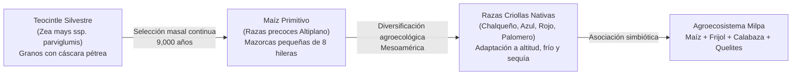

A diferencia de los cereales del Viejo Mundo (como el trigo o el arroz), domesticados en planicies aluviales homogéneas mediante irrigación extensiva, el maíz se diversificó en nichos ecológicos sumamente heterogéneos: desde los valles semiáridos a nivel del mar hasta mesetas volcánicas a más de 2,600 metros de altitud sobre el nivel del mar (msnm). Este proceso dio origen a más de **64 razas nativas** en México y miles de variedades adaptadas por comunidades indígenas y campesinas.

### 2.2. La Problemática Contemporánea
El modelo agroindustrial globalizado del siglo XX y XXI ha impuesto paquetes tecnológicos basados en monocultivos de híbridos transgénicos, fertilizantes químicos de síntesis, pesticidas de amplio espectro y riego forzado. Esto ha generado consecuencias alarmantes:
1. **Erosión Genética y Pérdida de Semillas Nativas:** Sustitución de semillas criollas adaptables por semillas comerciales estandarizadas y dependientes de patentes transnacionales.
2. **Degradación del Suelo:** Salinización, pérdida de materia orgánica, compactación y destrucción de la microbiota simbiótica (*Rhizobium*, micorrizas arbusculares).
3. **Vulnerabilidad ante el Cambio Climático:** Los monocultivos uniformes carecen de resiliencia frente a heladas tempranas, sequías recurrentes, vendavales y granizadas atípicas.
4. **Desarraigo Biocultural en Nuevas Generaciones:** La juventud urbana y rural desconoce la ciencia campesina, la interacción mutualista entre especies y el significado patrimonial de la comida tradicional nixtamalizada.

**Milpa Viva VR** nace como respuesta tecnológica a esta crisis, creando un puente entre la ciencia de datos agrofisiológicos y la memoria viva de la agricultura ancestral en un entorno seguro, interactivo y accesible.

---

# 3. Qué se Busca Enseñar y Objetivos de Aprendizaje

El simulador está diseñado para que el usuario aprenda haciendo (**Learning by Doing**), desarrollando competencias en tres dominios clave:

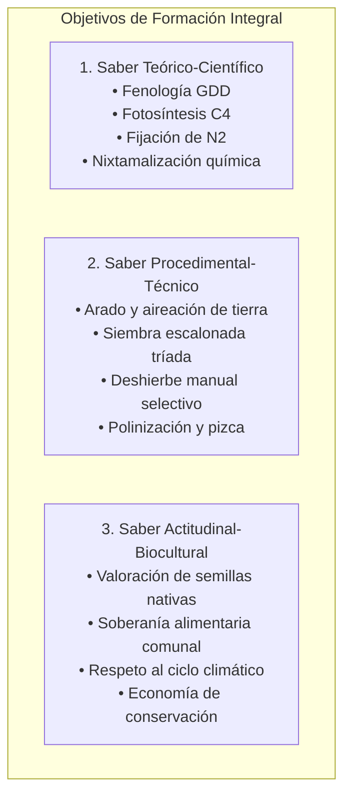

### 3.1. Objetivos Conceptuales (Saber)
- **Comprender la fenología del maíz:** Identificar las fases vegetativas (VE a VT) y reproductivas (R1 jilote a R6 madurez fisiológica), reconociendo cómo la temperatura acumulada (GDD) modula el desarrollo vegetal.
- **Entender el mutualismo agroecológico:** Conocer el papel de la bacteria *Rhizobium* en las raíces del frijol fijando nitrógeno atmosférico, la función de cobertura viva de las hojas anchas de calabaza conservando la humedad y amortiguando malezas, y el maíz como soporte físico.
- **Asimilar la química culinaria tradicional:** Entender que la nixtamalización con hidróxido de calcio no es sólo una receta, sino un proceso de digestibilidad que libera la vitamina $\text{B}_3$ y previene enfermedades como la pelagra.

### 3.2. Objetivos Procedimentales (Saber Hacer)
- Manejar herramientas agronómicas virtuales: azada, regadera, abono orgánico y guante de pizca.
- Emplear las **manos desnudas** para diagnosticar el estado del suelo (palpar textura y humedad VWC), arrancar malezas de raíz sin desgarrar la planta y sacudir polen durante la floración.
- Administrar recursos finitos: semillas nativas, abono orgánico y mazorcas cosechadas en la Troje comunitaria tipo cofre.
- Tomar decisiones preventivas frente a alertas climáticas (colocación de tutores contra vendavales, tendido de petates protectores contra heladas).

### 3.3. Objetivos Actitudinales (Saber Ser / Convivir)
- Desarrollar empatía hacia el trabajo físico y el conocimiento empírico de las familias campesinas mexicanas.
- Valorar la agrobiodiversidad como seguro biológico frente a la incertidumbre climática.
- Fomentar la curiosidad científica en las infancias mediante el asombro y la retroalimentación positiva.

---

# 4. Sustentación Pedagógica, Epistemológica y Biocultural

### 4.1. Marco Pedagógico: Constructivismo y Aprendizaje Situado
La base pedagógica de **Milpa Viva VR** descansa sobre las teorías del **constructivismo genético** (Piaget), la **zona de desarrollo próximo** (Vygotsky) y el **aprendizaje situado** (Lave & Wenger). En lugar de memorizar definiciones áridas sobre la fotosíntesis C4 o la simbiosis de leguminosas en un libro de texto, el estudiante:
1. **Experimenta directamente:** Si riega en exceso un suelo arcilloso, observa cómo la planta sufre hipoxia radicular por encharcamiento; si no deshierba, las malezas compiten por nutrientes N-P-K; si siembra frijol junto al maíz, el vigor foliar aumenta visiblemente.
2. **Cuenta con un andamiaje amigable:** El personaje de **Don Elote** (un espantapájaros sabio basado en la figura de los abuelos campesinos) interviene oportunamente mediante pistas orales y gestuales orientadas a la estación de cultivo afectada, sin interrumpir abruptamente el juego.
3. **Vive una curva de dificultad adaptativa:** El sistema infantil simplifica las decisiones complejas en 3 barras cardinales (Tierra, Agua, Nutrientes), mientras que el modo avanzado despliega telemetría micrometeorológica con 11 variables físicas reales.

### 4.2. Sustentación Epistemológica: El Diálogo de Saberes
El proyecto adopta la epistemología del **diálogo de saberes** propuesta por autores como Enrique Leff y Boaventura de Sousa Santos: la ciencia agronómica moderna no anula ni supera el conocimiento tradicional mesoamericano; ambos saberes se complementan. La física de balance de energía de Penman-Monteith convalida la práctica ancestral de sembrar en cajetes para capturar rocío matutino; la bioquímica molecular convalida el uso de cenizas y cal en el comal.

---

# 5. Dimensiones de Impacto del Proyecto

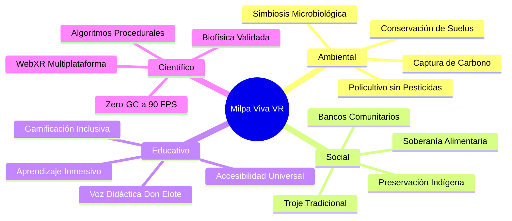

### 5.1. Dimensión Ambiental y Agroecológica
- **Ecológicamente sustentable:** Enseña que un policultivo no requiere pesticidas sintéticos si se conservan insectos benéficos (mariquitas depredadoras de pulgones, avispas nativas polinizadoras).
- **Eficiencia hídrica:** Demuestra cómo la cobertura vegetal de calabaza reduce la evaporación del suelo hasta en un 42%, manteniendo el contenido volumétrico de agua (VWC) en rangos de campo incluso en días calurosos.

### 5.2. Dimensión Social, Comunitaria y Soberanía Alimentaria
- **Rescate de la Troje:** El prototipo modela la troje campesina comunitaria como un cofre de 27 ranuras donde cada mazorca almacenada conserva su trazabilidad genética (variedad criolla y calidad).
- **Banco de Semillas:** Incluye una estación de selección masal donde el jugador desenvuelve y examina mazorcas para apartar los mejores granos de la parte media para la siembra del ciclo venidero, replicando la técnica campesina de mejoramiento participativo.

### 5.3. Dimensión Educativa e Inclusión Infantil
- **Estética atractiva tipo Minecraft:** La tipografía pixelada dura sin antialiasing (`Pixelify Sans`), los paneles con bordes biselados de dos tonos y los ítems apilables en bloques de 64 capturan el interés inmediato del público infantil y juvenil habituado a los videojuegos de construcción.
- **Diseño neurodiverso y universal:** Se eliminaron interfaces abrumadoras en cascada. La información crítica se distribuye espacialmente en el mundo 3D (dioramas, letreros de madera, cinturón diegético) y los toques de color se ajustan para personas con daltonismo (protanopía, deuteranopía, tritanopía).

### 5.4. Dimensión Científica y Tecnológica
- **Simulador botánico WebXR de código abierto:** Funciona directamente desde el navegador web sin requerir descargas pesadas en tiendas cerradas de aplicaciones (App Store o Meta Quest Store), democratizando el acceso a software educativo de alta fidelidad.

---

# 6. Fundamentos Teóricos y Principios Científicos

### 6.1. Fenología y Grados Día de Desarrollo (GDD)
El reloj biológico de las plantas no opera por días calendario fijos, sino por energía térmica acumulada. El simulador implementa el método del Servicio de Extensión Agrícola de la Universidad Estatal de Iowa para *Zea mays*:

$$\text{GDD} = \sum_{i=1}^{n} \max\left(0, \frac{T_{\max, i}^* + T_{\min, i}^*}{2} - T_{\text{base}}\right)$$

Donde las temperaturas diarias están acotadas por los umbrales cardinales de la especie:
$$T_{\max}^* = \min(T_{\max}, T_{\text{corte}}), \quad T_{\min}^* = \max(T_{\min}, T_{\text{base}})$$
Con $T_{\text{base}} = 10.0^\circ\text{C}$ y $T_{\text{corte}} = 30.0^\circ\text{C}$.

| Etapa Fenológica | Clave | GDD Acumulados Aprox. | Manifestación Fisiológica en el Modelo 3D |
| :--- | :---: | :---: | :--- |
| **Emergencia** | VE | 65 – 80 | Coleóptilo rompe el montículo de tierra; plúmula visible. |
| **Segunda Hoja** | V2 | 120 – 140 | 2 hojas expandidas con cuello foliar visible; inicio de raíces nodales. |
| **Sexta Hoja** | V6 | 240 – 260 | Punto de crecimiento sobre el suelo; elongación rápida del tallo. |
| **Floración Masculina** | VT | 650 – 750 | Emergencia de la espiga terminal; dehiscencia de anteras y liberación de polen. |
| **Floración Femenina** | R1 | 750 – 850 | Emisión de estigmas (pelos de elote/jilote); cuajado de granos receptivos. |
| **Elote Tierno** | R3 | 1100 – 1250 | Grano en estado lechoso/masoso; día mínimo de cosecha comestible (145 días). |
| **Madurez Fisiológica** | R6 | 1450 – 1650 | Capa negra en la base del grano; humedad $\le 20\%$; apto para semilla criolla. |

---

### 6.2. Fotosíntesis C4 y Metabolismo Bioquímico del Maíz
El maíz posee una ruta metabólica C4 con anatomía foliar de Kranz que le permite concentrar dióxido de carbono alrededor de la enzima RuBisCO en las células de la vaina vascular. Esto minimiza la fotorrespiración y maximiza la tasa fotosintética bajo alta radiación solar:

$$A = A_{\max} \cdot f_{\text{luz}}(\text{PAR}) \cdot f_{\text{temp}}(T) \cdot f_{\text{CO}_2}(\text{CO}_2) \cdot (1 - \text{estrés})$$

Donde las funciones de modulación parcial implementadas en `src/clima.ts` son:
- **Respuesta a la luz (PAR):**
  $$f_{\text{luz}}(\text{PAR}) = \frac{\text{PAR}}{\text{PAR} + 180}$$
- **Curva térmica asimétrica C4:**
  $$f_{\text{temp}}(T) = \max\left(0, 1 - \left(\frac{T - 28.5}{16.5}\right)^2\right)$$
- **Factor de fertilización por $\text{CO}_2$:**
  $$f_{\text{CO}_2} = \min\left(1.35, \frac{\text{CO}_2}{\text{CO}_2 + 120} \cdot 1.28\right)$$

---

### 6.3. Termodinámica Atmosférica y Evapotranspiración FAO-56 Penman-Monteith
La demanda evaporativa del aire sobre el surco de cultivo se modela mediante la ecuación universal estandarizada de la FAO:

$$\text{ET}_0 = \frac{0.408 \Delta (R_n - G) + \gamma \frac{37}{T + 273} u_2 (e_s - e_a)}{\Delta + \gamma (1 + 0.34 u_2)}$$

Donde:
- $R_n$: Radiación neta en la superficie del cultivo ($\text{MJ/m}^2/\text{día}$).
- $G$: Flujo térmico del suelo ($\text{MJ/m}^2/\text{día}$).
- $T$: Temperatura media del aire ($^\circ\text{C}$).
- $u_2$: Velocidad del viento a 2 m de altura ($\text{m/s}$).
- $e_s - e_a$: Déficit de presión de vapor ($\text{VPD}$, en $\text{kPa}$).
- $\Delta$: Pendiente de la curva de saturación de vapor ($\text{kPa/}^\circ\text{C}$).
- $\gamma$: Constante psicrométrica ($\text{kPa/}^\circ\text{C}$), ajustada a la altitud de 2,240 msnm ($780\text{ hPa}$).

---

### 6.4. Agrobiodiversidad: Las Cuatro Razas Nativas Modeladas

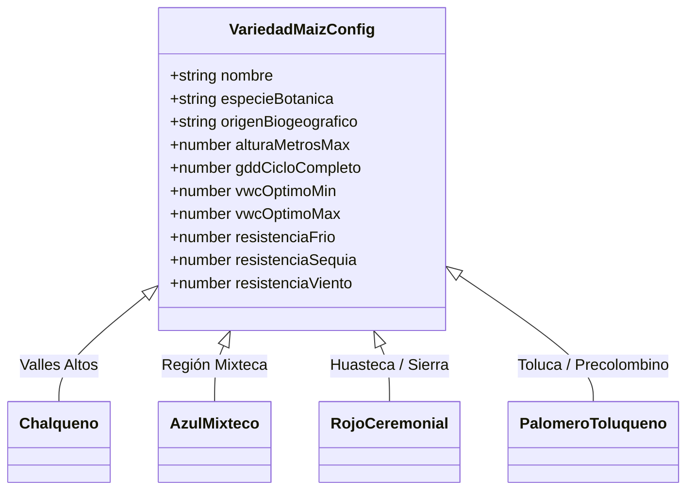

1. **Maíz Chalqueño (*Zea mays* L. raza Chalqueño):**
   - *Biogeografía:* Altiplano Central y Valle de México (2,200 – 2,600 msnm).
   - *Fisiología:* Porte alto (hasta 3.2 m), ciclo largo (155–165 días), grano semidentado blanco/amarillo de alto rendimiento para tortilla suave.
   - *Resiliencia:* Moderada resistencia al frío, susceptible al acame por vendavales debido a su altura.
2. **Maíz Azul Mixteco (*Zea mays* L. raza Cónico / Mixteco):**
   - *Biogeografía:* Sierra Mixteca de Oaxaca y Puebla.
   - *Fisiología:* Pigmentación morada profunda por alta concentración de **antocianinas** antioxidantes.
   - *Resiliencia:* Extraordinaria tolerancia al estrés hídrico (sequía) y suelos pobres poco profundos.
3. **Maíz Rojo Ceremonial (*Zea mays* L. raza Serrano / Cónico Rojo):**
   - *Biogeografía:* Zonas montañosas de Hidalgo, Puebla y Veracruz.
   - *Fisiología:* Mazorcas medianas rojizas, ricas en carotenos y flavonoides; uso tradicional ritual y pozolero.
   - *Resiliencia:* Excelente comportamiento en climas húmedos templados y suelos volcánicos ácidos.
4. **Palomero Toluqueño (*Zea mays* L. raza Palomero Toluqueño):**
   - *Biogeografía:* Valle de Toluca (una de las razas más antiguas y precoces de México).
   - *Fisiología:* Mazorcas cónicas de grano cristalino de endospermo vítreo de alta densidad; explota al calor formando palomitas.
   - *Resiliencia:* Gran resistencia a bajas temperaturas y heladas de altura; porte compacto resistente al viento.

---

### 6.5. Agroecología de «Las Tres Hermanas» (Simbiosis Tríada)

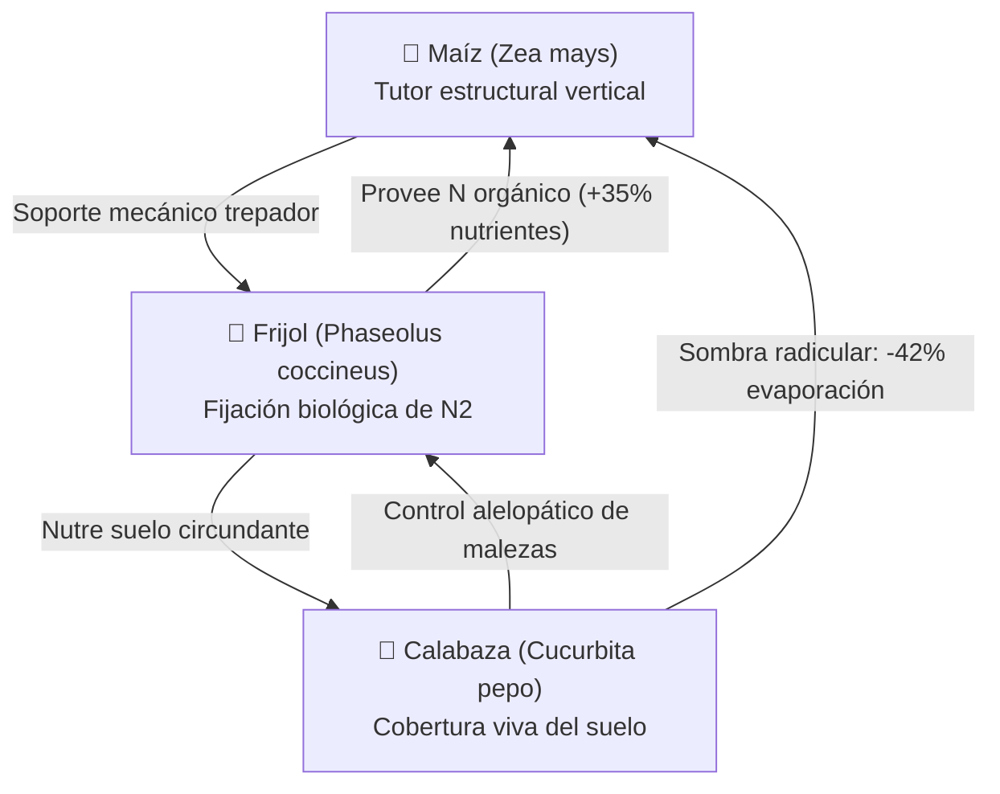

- **Frijol Ayocote (*Phaseolus coccineus*):** Establece simbiosis con bacterias de la especie *Rhizobium leguminosarum* en sus nódulos radiculares. Transforma el nitrógeno atmosférico inerte ($N_2$) en iones amonio ($NH_4^+$) asimilables por la planta de maíz, ahorrando la necesidad de abono mineral sintético.
- **Calabaza Criolla (*Cucurbita pepo*):** Sus hojas gigantescas y rastreras actúan como un *mulch* o mantillo vivo. Bloquean la radiación solar directa sobre la tierra, impidiendo la germinación de semillas de malezas heliófilas y reteniendo la humedad capilar en la rizosfera.

---

### 6.6. Fisicoquímica y Bioquímica de la Nixtamalización Mesoamericana
El simulador incorpora la estación de cocina tradicional «Del Surco al Comal», modelando la reacción fisicoquímica descubierta en Mesoamérica hace más de 3,500 años:

$$\text{Grano de Maíz Seco} + \text{Agua} + \text{Cal de Piedra } \left(\text{Ca(OH)}_2, \sim 1\%\right) \xrightarrow{\Delta H, \, 80^\circ\text{C}} \text{Nixtamal}$$

```mermaid
sequenceDiagram
    autonumber
    actor Jugador
    participant Fogon as Fogón y Olla de Barro
    participant Maiz as Grano de Maíz
    participant Metate as Metate y Mano de Piedra
    Jugador->>Fogon: Depositar grano cosechado + Agua + Cal viva (pH 11-12)
    Fogon->>Maiz: Calor (80°C) + Alcalinidad: Hidrólisis del pericarpio (hollerejo)
    Note over Maiz: Se liberan enlaces de hemicelulosa; la niacina (Vit B3) pasa a ser biodisponible
    Jugador->>Metate: Molienda por fricción rústica
    Metate-->>Jugador: Gelatinización de almidón -> Masa maleable para tortilla
```

1. **Liberación de Niacina (Vitamina $\text{B}_3$):** En el grano crudo, la niacina está enlazada químicamente como *niacetina*, imposible de absorber por el intestino humano. El pH alcalino (11 a 12) hidroliza el enlace éster, permitiendo que el cuerpo la sintetice y previniendo la pelagra.
2. **Balance de Aminoácidos:** La cal enriquece el grano con calcio biodisponible (incrementando el contenido de $\text{Ca}^{2+}$ hasta en un 750%) y mejora el equilibrio de aminoácidos esenciales (lisina, leucina e isoleucina).
3. **Solubilización del Pericarpio:** La cáscara exterior coriácea se disuelve en el *nejayote* (agua de cocción residual), dejando expuesto el endospermo y facilitando la formación de la red elástica de almidones gelatinizados al moler en metate.

---

# 7. Tecnologías Utilizadas y Justificación de la Pila

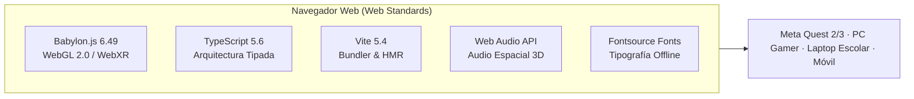

### 7.1. Babylon.js 6.49 (Motor Espacial)
- **Por qué se eligió frente a Three.js o Unity:** Babylon.js posee una implementación madura y nativa de **WebXR Default Experience** con soporte out-of-the-box para Hand Tracking (seguimiento de manos sin mandos), teletransporte parabólico, gestión de sesiones inmersivas y un sistema de físicas integrado sin requerir plugins propietarios.
- **Rendimiento a 90 FPS:** Gracias a su arquitectura de renderizado por lotes y soporte nativo para *Thin Instances*, el simulador puede dibujar 48 matas de maleza, espigas polinizadoras y mazorcas 3D manteniendo el framerate estable exigido por Meta Quest para evitar cinetosis.

### 7.2. TypeScript 5.6 (Rigor de Tipado)
- Todo el dominio agrofisiológico, los estados fenológicos, las herramientas, el inventario y las interacciones de red están estructurados mediante tipos estrictos (`type`, `interface`, `enum`). Esto previene errores de estado en tiempo de ejecución (`null pointers`) durante sesiones inmersivas.

### 7.3. Vite 5.4 (Compilación y Despliegue)
- Tiempos de arranque en frío de menos de 300 ms y reemplazo de módulos en caliente (HMR). Empaqueta la aplicación en archivos estáticos listos para desplegarse en servidores locales de escuelas rurales (incluso en una Raspberry Pi sin conexión a Internet).

### 7.4. Web Audio API Nativo
- Permite sintetizar sonidos en tiempo real (chasquidos de azada, caída de semillas, campanitas pentatónicas de cosecha, burbujeo del nixtamal, viento dinámico y fonemas de Don Elote) mediante nodos osciladores, filtros biquad y nodos `PannerNode` espaciales 3D. Esto elimina la necesidad de cargar megabytes de archivos `.mp3` o `.wav` externos.

### 7.5. Paquetes Tipográficos Offline (`@fontsource`)
- `@fontsource/pixelify-sans` y `@fontsource/vt323` empaquetadas localmente. Garantizan que en visores VR que operan en aulas sin conexión Wi-Fi, la tipografía pixelada dura se renderice siempre idéntica sin fuentes rotas del sistema operativo.

---

# 8. Descripción y Construcción del Prototipo

### 8.1. Arquitectura de Software y Organización Modular

El código fuente está estrictamente particionado en la carpeta `src/`, separando la lógica biofísica, la capa de realidad virtual, la mecánica de inventario y la interfaz de usuario:

```
src/
├── nucleo.ts                     # Constantes agrofisiológicas, tipos de variedades nativas y reglas de juego
├── clima.ts                      # Modelo micrometeorológico, radiación astronómica y FAO-56 Penman-Monteith
├── crecimiento.ts                # Motor de crecimiento por Grados Día de Desarrollo (GDD) y bifurcación fenológica
├── surco_milpa.ts                # Parcela de 4 estaciones: morfología de tallos, espigas, jilotes, raíces y letreros
├── maiz_estilizado.ts            # Planta individual cel-shaded con 14 hojas curvas y contornos procedurales
├── ambiente_estilizado.ts        # Cielo diurno/nocturno, sol astronómico, niebla física y terreno volcánico
├── audio_sintetizador.ts         # Motor de audio procedural y síntesis de fonemas con Web Audio API
├── controlador_jugador.ts        # Controlador FPS para PC: cámara libre, raycasting central de 6.5m y clics
│
├── vr/                           # Subsistema Inmersivo WebXR 6DoF
│   ├── locomocion_vr.ts          # Teletransporte parabólico al surco y lobby, giro snap y viñeta
│   ├── viewmodel_herramientas.ts # Rig 3D cel-shaded de brazos y manos del campesino en primera persona
│   ├── cinturon_herramientas.ts  # Cinturón diegético flotante a la cintura con 6 ranuras interactivas
│   ├── interaccion_manos_6dof.ts # Detección de velocidad cinemática de azada, ángulo de regadera y háptica
│   ├── canasta_cosecha.ts        # Carretilla agrícola con canasta física de recolección y separación varietal
│   ├── mesa_clima_prejuego.ts    # Diorama físico 3D interactivo en el cobertizo con orbe pronosticador
│   ├── reloj_muneca.ts           # Reloj diegético 3D en muñeca no dominante con telemetría de estación
│   └── ui_poke.ts                # Detección de colisión de dedo índice para botones espaciales táctiles
│
├── inventario/                   # Sistema de Inventario y Drops Estilo Minecraft
│   ├── inventario.ts             # Modelo de datos de ranuras, apilado de 64 ítems, clases y persistencia
│   ├── cursor.ts                 # Lógica de clics Minecraft: izq (apilar/cambiar), der (mitad/dejar 1), shift (mover)
│   └── drops.ts                  # Mazorcas físicas 3D con parábola balística, rebote e imán a <= 2.2 metros
│
├── juego/                        # Ecosistema y Módulos de Juego de Milpa Viva
│   ├── almacen_mazorcas.ts       # La Troje campesina comunitaria física 3D con letrero dinámico pixelado
│   ├── triada_viva.ts            # Asociación agronómica de frijol trepador y calabaza rastrera
│   ├── fogon_cocina.ts           # Estación tradicional de nixtamalización, comal de barro y recetas
│   ├── banco_semillas.ts         # Selección masal de semillas criollas y herencia genética en localStorage
│   ├── maleza.ts                 # Thin Instances de malezas y quelites que compiten por nutrientes
│   ├── fauna_milpa.ts            # Gusano cogollero, aves, abejas nativas y mariquitas benéficas
│   ├── polinizacion.ts           # Sacudida manual de polen de la espiga a los jilotes receptivos
│   ├── director_eventos.ts       # Eventos extremos: heladas, tormentas de viento (acame) y sequías
│   ├── codice.ts                 # Códice interactivo ilustrado del maíz con láminas botánicas
│   ├── misiones.ts               # Calendario agrícola ritual y misiones educativas escalonadas
│   └── ajustes.ts                # Sistema de confort VR, modo sentado, viñeta y paletas de daltonismo
│
├── educativo/                    # Andamiaje Educativo y Personajes Guía
│   ├── estado_educativo.ts       # Máquina de estados: labrar, sembrar, regar, nutrir, crecer, cosechar
│   ├── espantapajaros_guia.ts    # Don Elote 2.0: letrero 3D billboard pixelado y animaciones gestuales
│   ├── herramientas_3d.ts        # Mallas 3D de azada, saco de semillas, regadera y abono
│   ├── ui_infantil.ts            # HUD 2D superior compacto, barra de estado de parcela y cola de toasts
│   └── panel_clima.ts            # Consola educativa de 11 sliders meteorológicos
│
├── ui/                           # Utilidades de Interfaz Pixelada
│   ├── texto_pixel.ts            # DynamicTexture con filtro NEAREST y binarización alfa libre de antialias
│   ├── iconos_pixel.ts           # Atlas procedimental 16x16 de sprites pixelados (mazorca, azada, regadera...)
│   └── panel_inventario.ts       # Hotbar inferior unificada de 9 ranuras y Modal de Troje (Cofre)
│
└── estilos/
    └── pixel.css                 # Variables CSS de 4px, paneles biselados, text-shadow dura y look Minecraft
```

---

### 8.2. Diagrama de Arquitectura de Sistemas

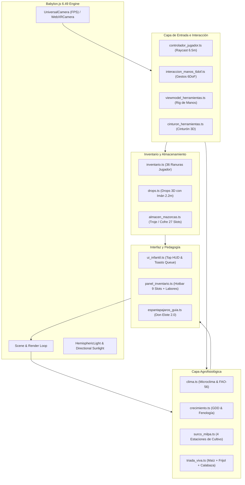

---

### 8.3. Diagrama de Estados Fenológicos de la Planta

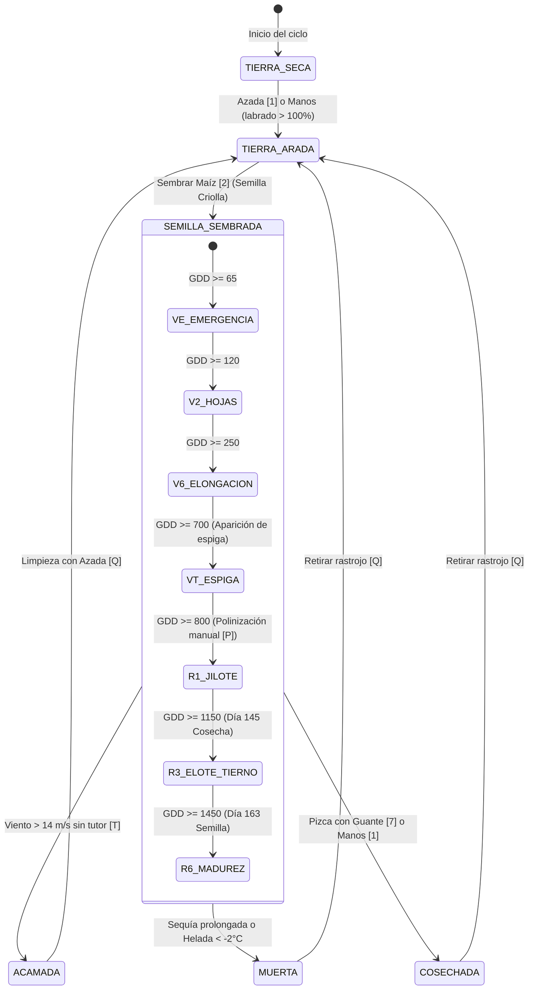

---

### 8.4. Diagrama del Pipeline de Interacción Dual (FPS vs WebXR 6DoF)

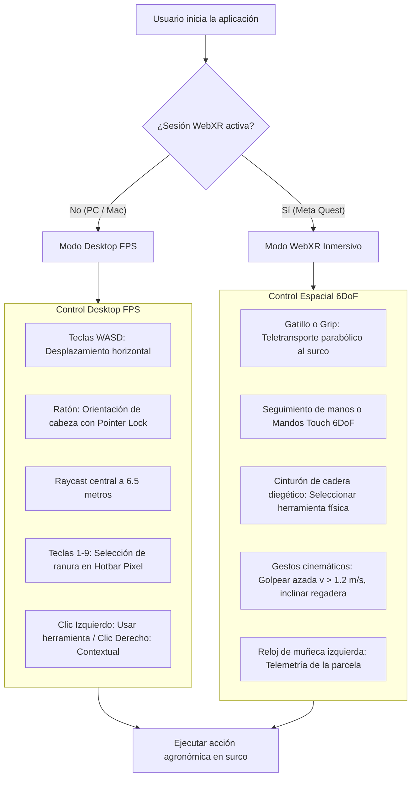

---

### 8.5. Diagrama del Ciclo de Drops, Imán e Inventario Tipo Minecraft

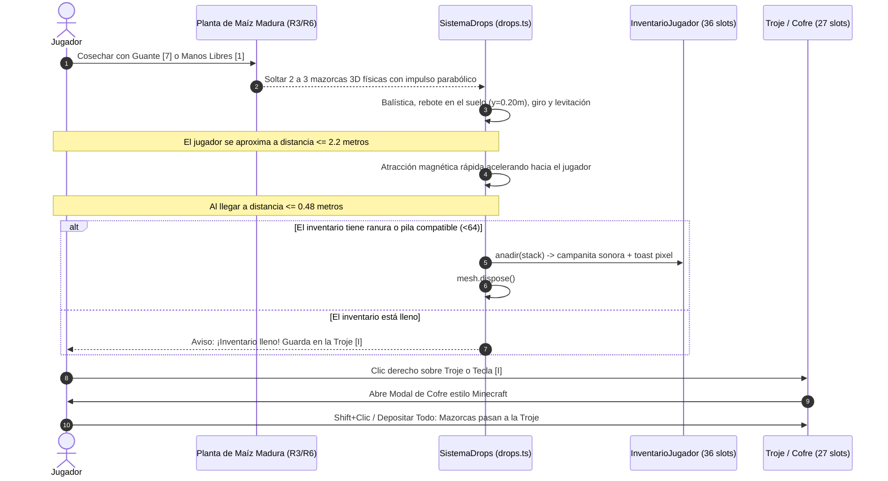

---

# 9. Guía de Interacción y Mecánicas de Juego

### 9.1. El Sistema de Manos Libres (`"mano"`)
En la ranura 1 de la Hotbar se encuentran las **Manos Libres** (icono pixelado de mano campesina). Permiten interactuar sin herramientas intermedias:
- **Palpar el suelo:** Muestra un diagnóstico directo del contenido de humedad volumétrica (VWC) y temperatura de la rizosfera.
- **Pizcar mazorcas maduras:** Permite cosechar el elote directamente desprendiéndolo del tallo sin desgarrar la planta.
- **Deshierbe manual:** Arranca malezas jóvenes y plagas sin lastimar las raíces superficiales.
- **Sacudida de espiga:** Poliniza manualmente durante los días 45 a 110.
- **Mullir tierra:** Aplana montículos arados para dejar la cama de siembra lista.

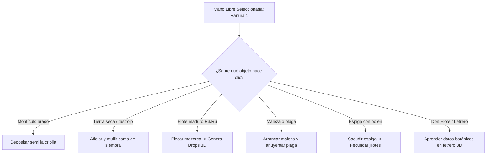

---

### 9.2. Hotbar Unificada Pixelada y Atajos (1–9, Q, Espacio, Labores)
La interfaz inferior ha sido completamente unificada en un solo panel de estilo Minecraft (`HotbarPixel`), eliminando barras superpuestas:

| Tecla / Control | Elemento | Función Agronómica | Capacidad / Límite |
| :---: | :--- | :--- | :---: |
| `1` | ✋ **Manos Libres** | Interactuar directamente con el entorno, palpar, pizcar | Herramienta fija |
| `2` | ⛏️ **Azada Campesina** | Arar, abrir zanjas de aireación y retirar plantas muertas | Herramienta fija |
| `3` | 🌰 **Semillas de Maíz** | Sembrar granos nativos seleccionados de Chalqueño | Pila hasta 64x |
| `4` | 💧 **Regadera de Agua** | Hidratar el suelo para mantener el VWC óptimo (20–35%) | Herramienta fija |
| `5` | 🌿 **Abono Orgánico** | Fertilizar con composta orgánica (NPK equilibrado) | Pila hasta 64x |
| `6` | ☀️ **Sol (+15 Días)** | Avanzar un ciclo solar continuo acelerando fenología | Herramienta fija |
| `7` | 🌽 **Guante de Cosecha** | Recolectar mazorcas maduras en el surco | Herramienta fija |
| `8` | 🫘 **Semilla de Frijol** | Sembrar frijol trepador asociado en la base del maíz | Pila hasta 64x |
| `9` | 🎃 **Semilla de Calabaza** | Sembrar calabaza rastrera asociada para cubrir suelo | Pila hasta 64x |
| `Q` | 🗑️ **[Q] Quitar** | Arrancar planta enferma o limpiar rastrojo cosechado | Acción directa |
| `Espacio` | ▶ **Crecimiento / Pausa** | Alternar time-lapse biológico continuo día con día | Toggle interactivo |
| Click | 🌿 **Labores ▴ / ▾** | Desplegar cajón de labores secundarias ([X], [P], [T], [G]...) | Cajón flotante |

---

### 9.3. Sistema de Drops Voxel, Atracción Magnética y Troje como Cofre
- **Física de los Drops:** Al cosechar una planta con frijol y calabaza asociados, saltan 3 mazorcas 3D al suelo con trayectorias parabólicas aleatorias, amortiguación de rebote al tocar el suelo a $y = 0.20\text{ m}$, y una animación de levitación senoidal y rotación continua idéntica a Minecraft.
- **Atracción Magnética (Imán):** Si el campesino camina y se sitúa a $\le 2.2\text{ m}$ del drop (tras un retardo inicial de 0.45 s), el ítem acelera suavemente hacia el pecho del jugador. A $\le 0.48\text{ m}$, entra automáticamente a las ranuras del inventario.
- **La Troje como Cofre (Tecla `I` o Clic Derecho):** Abre una ventana de doble inventario: arriba las 27 ranuras de almacenamiento de la Troje comunitaria; abajo las 27 ranuras de la mochila del campesino más las 9 de acceso rápido de la Hotbar. Incluye atajos:
  - `Shift + Clic`: Transfiere instantáneamente la pila completa entre inventarios.
  - `Clic Derecho`: Toma la mitad de la pila o deposita una sola unidad en la ranura destino.
  - `Botón "Guardar Mazorcas"`: Mueve automáticamente todas las mazorcas en mano a la troje.
  - `Botón "Ordenar Troje"`: Agrupa y compacta las mazorcas por variedad nativa y calidad.

---

### 9.4. Estaciones de Cobertizo (Mesa de Clima, Fogón, Banco de Semillas, Códice)
El cobertizo rústico inicial actúa como antesala interactiva de aprendizaje antes de ingresar al surco:
1. **Diorama 3D de Clima (`mesa_clima_prejuego.ts`):** Una maqueta interactiva donde el jugador puede pulsar botones 3D de madera para probar 10 escenarios climáticos predefinidos (*Temporal Óptimo*, *Ola de Calor*, *Sequía Extrema*, *Helada Atípica*, *Tormenta Eléctrica*, *Inversión Térmica*, *Noche Fría*, etc.). Un orbe de cristal con letrero pixelado muestra el pronóstico y el riesgo biológico.
2. **Fogón Tradicional de Nixtamalización (`fogon_cocina.ts`):** Estación donde el jugador deposita mazorcas cosechadas en una olla de barro con agua y cal viva, atiza el fuego con leña y muele en metate para preparar 7 platillos mesoamericanos (tortillas comaleras, tlacoyos de frijol ayocote, atole champurrado, tamales ceremoniales, pozole de maíz cacahuacintle, esquites con epazote y corundas michoacanas).
3. **Banco Campesino de Semillas (`banco_semillas.ts`):** Permite practicar la selección masal seleccionando mazorcas por longitud, número de hileras y sanidad del grano para guardarlas en sacos de yute persistidos en el almacenamiento local.
4. **Códice Ilustrado del Maíz (`codice.ts`):** Libro interactivo con láminas botánicas inspiradas en el Códice Florentino y el Códice De la Cruz-Badiano, explicando la historia prehispánica del cultivo.

---

### 9.5. Realidad Virtual 6DoF: Cinturón Diegético, Reloj y Gestos Físicos
En visores Meta Quest, el juego prescinde por completo de punteros 2D flotantes:
- **Cinturón Diegético de Cadera (`cinturon_herramientas.ts`):** Las herramientas descansan en 6 ranuras cilíndricas ubicadas físicamente alrededor de la cintura del avatar ($y = 0.92\text{ m}$ de pie, $0.68\text{ m}$ en modo sentado). El jugador extiende su mano, presiona el gatillo *Grip* y equipa la azada o la regadera como un campesino real.
- **Reloj de Muñeca Agrícola (`reloj_muneca.ts`):** Situado en la muñeca no dominante (izquierda por defecto). Al girar el antebrazo hacia la cara, una pantalla de bajo consumo muestra los días del cultivo, la humedad VWC de la estación más cercana y alertas de tormenta o helada.
- **Gestos Cinemáticos Físicos (`interaccion_manos_6dof.ts`):**
  - Para labrar con la azada, el jugador debe balancear el mando hacia abajo con una velocidad lineal superior a $1.2\text{ m/s}$, produciendo un golpe háptico en el motor de vibración.
  - Para regar, el jugador debe inclinar la regadera más de $38^\circ$ hacia el suelo, activando el flujo físico de gotas de agua.
  - Para polinizar, el jugador sacude físicamente sus manos cerca de la espiga, dispersando partículas doradas de polen.

---

# 10. Matriz de Aprendizaje: Qué Aprende el Usuario durante la Experiencia

| Estación / Labor | Acción del Usuario | Fenómeno Biológico / Cultural Experimentado | Consecuencia Directa en la Simulación |
| :--- | :--- | :--- | :--- |
| **Labrado** | Usar azada o manos desnudas en el montículo. | Aireación del suelo, descompactación y desmenuzado de terrones para permitir infiltración de oxígeno a la raíz. | La porosidad del suelo sube a 100%. Si no se labra, la semilla no puede emerger (anoxia). |
| **Siembra Criolla** | Seleccionar semilla nativa (p. ej. Chalqueño). | Adaptación genética local por altitud y temperatura cardinal ($T_{\text{base}} = 10^\circ\text{C}$). | Se visualiza la germinación y la emergencia del coleóptilo a los 65 GDD acumulados. |
| **Riego Óptimo** | Usar regadera hasta alcanzar 20–35% VWC. | Contenido volumétrico de agua entre Punto de Marchitez Permanente (PMP) y Capacidad de Campo (CC). | La conductancia estomática ($g_s$) se maximiza y la planta realiza fotosíntesis sin marchitarse. |
| **Riego Excesivo** | Regar hasta superar el 45% VWC en suelo arcilloso. | Encharcamiento, anoxia radicular y desplazamiento de oxígeno por agua estancada. | Las hojas se tornan amarillas, el crecimiento se detiene y Don Elote alerta riesgo de asfixia. |
| **Asociación Tríada** | Sembrar Frijol [8] y Calabaza [9] en el surco. | Simbiosis rizobiana fijadora de $N_2$ y cobertura viva sombreadora contra evaporación. | La necesidad de abono disminuye en 35%, la humedad del suelo dura más tiempo y no brotan malezas. |
| **Deshierbe y Plagas** | Arrancar malezas con [X] o manos; ahuyentar orugas. | Competencia interespecífica por radiación y nutrientes; presión trófica de insectos plaga. | La tasa de crecimiento del tallo se recupera y la planta no sufre defoliación. |
| **Polinización** | Sacudir la espiga [P] durante la fase VT–R1. | Fecundación anemófila de los estigmas del jilote (cada pelo fertiliza un grano individual). | La mazorca final se llena completa al 100% sin huecos ni fallas de granazón (*olote chimuelo*). |
| **Tutor de Viento** | Clavar poste tutor [T] ante alerta de vendaval. | Biomecánica del tallo y prevención del acame por fuerza cortante de viento $> 12\text{ m/s}$. | La planta resiste la tormenta sin doblarse ni quebrar su sistema vascular. |
| **Pizca de Mazorcas** | Cosechar con guante o manos a los 145 días (R3). | Madurez fenológica comestible; transformación de azúcares solubles en almidón en el endospermo. | Saltan 3 mazorcas 3D físicas con sonido festivo, listas para guardarse en la Troje comunitaria. |
| **Nixtamalización** | Cocinar en fogón con cal viva y moler en metate. | Hidrólisis alcalina de hemicelulosa, liberación de niacina y gelatinización de almidón. | El jugador obtiene masa tradicional para tortillas, consolidando el ciclo agroalimentario integral. |

---

# 11. Necesidades Logísticas, Infraestructura y Protocolo de Despliegue

### 11.1. Requerimientos de Hardware

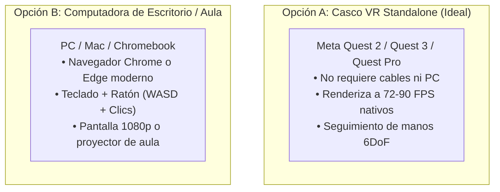

| Componente | Opción Standalone VR (Inmersiva) | Opción Desktop PC (Aula / Laboratorio) |
| :--- | :--- | :--- |
| **Dispositivo** | Meta Quest 2, Meta Quest 3 o Meta Quest Pro. | PC Windows 10/11, macOS (Intel o Apple Silicon), Linux o Chromebook. |
| **Procesador / Gráficos** | Qualcomm Snapdragon XR2 Gen 1 / Gen 2 integrado. | Intel Core i3 / AMD Ryzen 3 con gráficos integrados (Intel UHD / Vega) o superior. |
| **Memoria RAM** | 6 GB LPDDR4X (Quest 2) / 8 GB LPDDR5 (Quest 3). | 4 GB de memoria RAM libre. |
| **Espacio de Almacenamiento** | $\approx 25\text{ MB}$ en caché del navegador (sin instalación de APK). | $\approx 50\text{ MB}$ de almacenamiento en disco para el build web estático. |
| **Controles de Entrada** | 2 Mandos Touch 6DoF o Seguimiento Óptico de Manos (*Hand Tracking*). | Teclado estándar (WASD, números 1–9, Q, Espacio, I, F, M, K) y ratón con rueda. |
| **Audio** | Altavoces espaciales integrados en la correa del visor o auriculares 3.5 mm. | Altavoces estéreo o auriculares estándar. |

---

### 11.2. Requerimientos de Software y Red
- **Navegador Web Compatible:**
  - *En Meta Quest:* Meta Quest Browser v28 o superior (soporte completo de WebXR Device API y WebXR Hand Tracking).
  - *En PC:* Google Chrome v115+, Microsoft Edge v115+, Mozilla Firefox v120+ (con flags WebGL 2.0 activas).
- **Conexión a Internet:**
  - *En despliegue en línea:* Conexión de banda ancha de $5\text{ Mbps}$ para la carga inicial de los paquetes estáticos ($\approx 5\text{ MB}$ transferidos vía compresión Gzip/Brotli).
  - *En despliegue rural/desconectado (Offline):* **100% funcional sin conexión a Internet**. Basta con clonar el repositorio, ejecutar `npm run build` y servir la carpeta `dist/` en una red de área local (LAN) escolar mediante un servidor ligero (como Python `http.server` o Node.js `serve`) montado en una computadora portátil o microordenador Raspberry Pi 4/5.

---

### 11.3. Requerimientos de Espacio Físico y Ergonomía
- **Modalidad De Pie (*Room-Scale*):** Área despejada de al menos $1.5\text{ m} \times 1.5\text{ m}$ libre de muebles, esquinas afiladas o cables para permitir el balanceo natural de brazos al labrar o regar.
- **Modalidad Sentado (*Seated Comfort*):** Compatible con sillas de aula escolar o escritorios. La aplicación detecta automáticamente si la altura del visor es inferior a $1.30\text{ m}$ y recalibra la elevación del cinturón diegético y la altura de la cámara FPS.
- **Protocolo de Higiene:** Para actividades grupales en museos o escuelas con cascos compartidos, se recomienda el uso de fundas de silicona lavables para la interfaz facial y toallitas desinfectantes sin alcohol entre turnos de usuarios.

---

### 11.4. Accesibilidad y Confort Cibernético (Reducción de Cinetosis)
- **Viñeta Periférica Dinámica:** Al girar la vista o teletransportarse bruscamente, los bordes de la pantalla se oscurecen temporalmente en una máscara elíptica suave, reduciendo la estimulación del sistema vestibular periférico y eliminando el mareo por movimiento.
- **Giro Discreto (*Snap Turn*):** Rotación horizontal en incrementos angulares fijos de $30^\circ$ o $45^\circ$, evitando el deslizamiento angular continuo que suele provocar náuseas en usuarios principiantes.
- **Subtítulos y Daltonismo:** Sistema de subtítulos cerrados para personas con discapacidad auditiva y modos de ajuste de balance cromático para daltonismo integrados en el menú de confort (tecla `O`).

---

### 11.5. Protocolo de Taller y Dinámica de Aula Recomendada
Para docentes, divulgadores científicos y mediadores de museos:

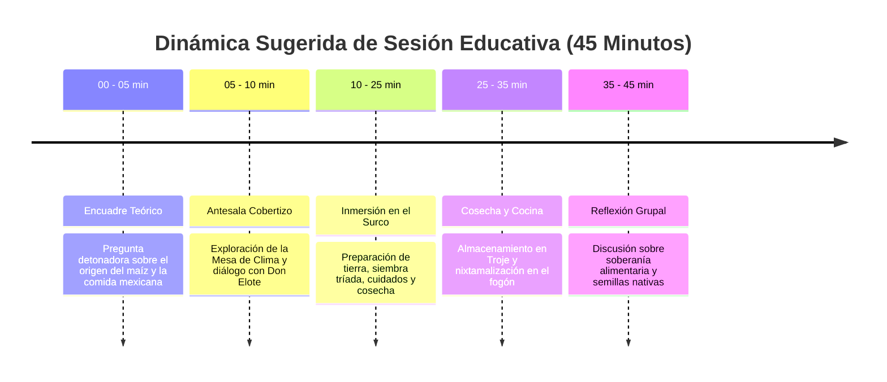

1. **Encuadre Inicial (5 min):** Pregunta detonadora: *¿De dónde viene la tortilla que comemos a diario? ¿Qué pasaría si dejamos de sembrar semillas criollas?*
2. **Fase Inmersiva en el Simulador (20 min):** Los estudiantes recorren el ciclo agrícola completo: labran la tierra, siembran las 4 razas nativas, agregan frijol y calabaza, atienden las alertas climáticas de Don Elote, cosechan las mazorcas con las manos y las llevan a la Troje comunitaria.
3. **Fase de Transformación (10 min):** Los alumnos visitan el fogón de nixtamalización para entender por qué la cal viva hace nutritivo el maíz.
4. **Cierre Reflexivo y Plenaria (10 min):** Debate guiado sobre la importancia de la conservación comunitaria de semillas y el valor biocultural de la milpa frente al cambio climático.

---

# 12. Fuentes Consultadas y Bibliografía

### 12.1. Agronomía, Botánica y Fisiología Vegetal
- **Allen, R. G., Pereira, L. S., Raes, D., & Smith, M. (1998).** *Crop evapotranspiration: Guidelines for computing crop water requirements*. FAO Irrigation and drainage paper 56. Food and Agriculture Organization of the United Nations, Rome.
- **CIMMYT (Centro Internacional de Mejoramiento de Maíz y Trigo). (2019).** *Manual de producción de maíz en el Altiplano Central de México*. El Batán, Texcoco, Estado de México.
- **CONABIO (Comisión Nacional para el Conocimiento y Uso de la Biodiversidad). (2020).** *Proyecto Global de Maíces Nativos de México: Diversidad genética, razas y parientes silvestres*. Ciudad de México, México.
- **Hernández Xolocotzi, E. (1985).** *Biología Agrícola: Principios botánicos y ecológicos de los sistemas agrícolas mesoamericanos*. Editorial Limusa, México.
- **Ritchie, S. W., Hanway, J. J., & Benson, G. O. (1993).** *How a Corn Plant Develops*. Special Report No. 48. Iowa State University of Science and Technology, Cooperative Extension Service, Ames, Iowa.
- **Wellhausen, E. J., Roberts, L. M., & Hernández Xolocotzi, E. (1951).** *Razas de maíz en México: Su origen, características y distribución*. Folleto Técnico No. 5. Oficina de Estudios Especiales, Secretaría de Agricultura y Ganadería, México.

### 12.2. Antropología, Etnobotánica y Soberanía Alimentaria
- **Boege, E. (2008).** *El patrimonio biocultural de los pueblos indígenas de México: Hacia la conservación in situ de la agrobiodiversidad*. Instituto Nacional de Antropología e Historia (INAH) / Comisión Nacional para el Desarrollo de los Pueblos Indígenas (CDI), México.
- **Bonfil Batalla, G. (1987).** *México Profundo: Una civilización negada*. Grijalbo, México. (Capítulo sobre la cultura del maíz y la milpa como matriz civilizatoria).
- **Katz, S. H., Hediger, M. L., & Valleroy, L. A. (1974).** Traditional maize processing techniques in the New World: Anthropological and nutritional significance of nixtamalization. *Science*, 184(4138), 765-773.
- **Warman, A. (1988).** *La historia de un bastardo: Maíz y capitalismo*. Fondo de Cultura Económica, México.

### 12.3. Ingeniería de Software, Gráficos 3D y WebXR
- **Babylon.js Documentation Team. (2024).** *Babylon.js 6.0: The Complete Guide to WebGL, WebGPU, and WebXR Development*. Official Documentation & Source Code. [https://doc.babylonjs.com/](https://doc.babylonjs.com/)
- **W3C Immersive Web Working Group. (2023).** *WebXR Device API: W3C Candidate Recommendation*. World Wide Web Consortium. [https://www.w3.org/TR/webxr/](https://www.w3.org/TR/webxr/)
- **Microsoft Corporation. (2024).** *Designing for Spatial Interaction: Affordances, Ergonomics, and Locomotion in Virtual Environments*. Mixed Reality Design Guidelines.

---

### Conclusión y Disponibilidad
El presente documento constituye la memoria técnica, científica y pedagógica integral del prototipo **Milpa Viva VR v4.0**. El código fuente completo, modelos algorítmicos y recursos procedimentales se encuentran disponibles en este repositorio para fines de docencia, investigación agroecológica, conservación comunitaria de semillas y divulgación del patrimonio biocultural mesoamericano.
