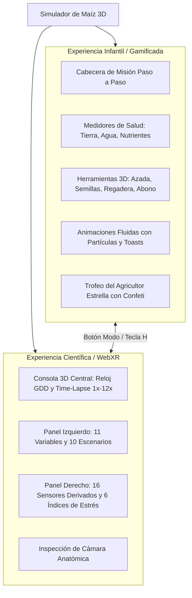
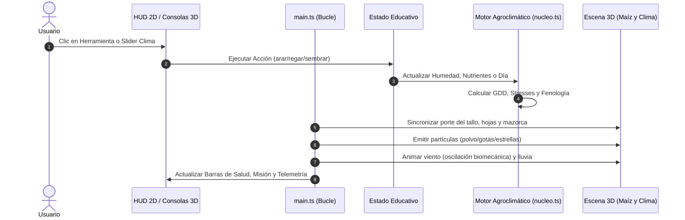

# 🌽 Manual de Funcionamiento Integral del Proyecto
## Simulador Interactivo y Educativo del Maíz (*Zea mays* L. raza Chalqueño)
### Modelo 3D Cel-Shaded Procedural con Babylon.js, TypeScript y WebXR

---

## 📋 Índice General
1. [Introducción y Visión del Proyecto](#1-introducción-y-visión-del-proyecto)
2. [Arquitectura de Modos: Educativo vs Científico](#2-arquitectura-de-modos-educativo-vs-científico)
3. [El Ciclo Educativo Interactivo Paso a Paso](#3-el-ciclo-educativo-interactivo-paso-a-paso)
4. [Motor Agrofisiológico y Modelo Científico](#4-motor-agrofisiológico-y-modelo-científico)
5. [Panel de Condiciones Climatológicas y Ambientales](#5-panel-de-condiciones-climatológicas-y-ambientales)
6. [Motor Visual 3D Estilizado (Cel-Shading y Arte)](#6-motor-visual-3d-estilizado-cel-shading-y-arte)
7. [Física, Animaciones Fluidas y Sistemas de Partículas](#7-física-animaciones-fluidas-y-sistemas-de-partículas)
8. [Consolas Espaciales 3D y Compatibilidad WebXR](#8-consolas-espaciales-3d-y-compatibilidad-webxr)
9. [Estructura del Código y Módulos](#9-estructura-del-código-y-módulos)
10. [Flujo de Datos y Bucle de Simulación](#10-flujo-de-datos-y-bucle-de-simulación)
11. [Guía de Controles y Atajos de Teclado](#11-guía-de-controles-y-atajos-de-teclado)
12. [Instalación, Ejecución y Despliegue](#12-instalación-ejecución-y-despliegue)
13. [Arquitectura y Novedades de la Versión 3.0 WebXR](#13-arquitectura-y-novedades-de-la-versión-30-webxr)

---

## 1. Introducción y Visión del Proyecto

El proyecto **Simulador Botánico WebXR · Maíz Animado Estilizado (v2.0)** es una aplicación interactiva en 3D en tiempo real diseñada para enseñar, divulgar y simular de manera fiel el ciclo biológico completo del maíz (*Zea mays* L. raza Chalqueño), el cultivo cerealero más representativo de Mesoamérica y base de la alimentación en México.

La aplicación combina dos mundos habitualmente separados:
1. **El rigor científico agronómico:** Modelado fenológico estricto por Grados Día de Desarrollo (GDD), fotosíntesis C4, conductancia estomática, evapotranspiración FAO-56 Penman-Monteith, arquitectura radicular por estratos y biomecánica frente al acame por viento.
2. **La narrativa visual y pedagógica:** Estilo artístico *cel-shaded* (caricatura botánica con contornos de tinta oscura), herramientas 3D interactivas paso a paso, sistemas de partículas alegres y dinámicas, y una interfaz amigable diseñada para despertar la curiosidad científica en niños, estudiantes y público general.

---

## 2. Arquitectura de Modos: Educativo vs Científico

La aplicación integra una arquitectura dual sinérgica que permite alternar entre dos experiencias con un solo clic o atajo:



* **Modo Educativo Infantil (por defecto):** Presenta un huerto limpio y amigable. Las consolas 3D complejas están ocultas; el usuario dispone de herramientas en 3D sobre el podio, una barra de misión superior que le enseña qué hacer, medidores de salud con caritas expresivas y una barra de herramientas en la parte inferior.
* **Modo Científico (Consolas 3D):** Despliega 3 consolas holográficas flotantes curvadas dentro del espacio tridimensional de Babylon.js, optimizadas para manipulación espacial en visores de Realidad Virtual (Meta Quest, Apple Vision Pro, SteamVR) o con el ratón.
* **Panel de Control Climatológico:** Accesible en cualquier momento mediante el botón superior `[⛅ Condiciones Clima]` o la tecla **`C`**, permitiendo alterar las variables ambientales tanto en el modo infantil como en el científico.

---

## 3. El Ciclo Educativo Interactivo Paso a Paso

El modo infantil guía al usuario a través del proceso agronómico tradicional de la milpa:


### Paso 1: Arar la Tierra (⛏️ Azada)
* **Objetivo pedagógico:** Aprender que el suelo necesita aflojarse y airearse para que las raíces puedan respirar y penetrar la tierra.
* **Mecánica interactiva:** El niño selecciona la azada en la barra o hace clic directo sobre la azada o el montículo de tierra.
* **Respuesta 3D:** La azada se eleva con anticipación física, asesta un golpe rápido contra el montículo, genera una explosión de nubes de polvo caricaturescas y rebota elásticamente. La textura del suelo genera surcos de labranza y el indicador de *Tierra Suave* sube hasta el 100%.

### Paso 2: Sembrar la Semilla (🌰 Semillas Chalqueñas)
* **Objetivo pedagógico:** Colocar los granos seleccionados en el montículo a la profundidad óptima.
* **Mecánica interactiva:** Clic en la herramienta o en el montículo.
* **Respuesta 3D:** Los granos dorados realizan un salto parabólico con un halo de destellos dorados y se insertan en el centro del montículo. El reloj biológico se inicializa en el Día 4 (`VE: Emergencia de la plántula`).

### Paso 3: Regar el Cultivo (💧 Regadera de Jardín)
* **Objetivo pedagógico:** Mantener la humedad del suelo en el rango ideal (30% - 55%) evitando tanto la deshidratación como el encharcamiento que ahoga las raíces.
* **Mecánica interactiva:** Al activar la regadera, esta vuela hacia el montículo, se inclina 45° y vierte un torrente de gotas brillantes mientras se generan ondas concéntricas de agua en el suelo.
* **Impacto:** Sube la barra de *Nivel de Agua*. Si está entre 35% y 55%, el indicador muestra `¡Ideal! 😊`. Si supera 85%, el montículo genera una lámina reflectante de encharcamiento y advierte al niño sobre la hipoxia radicular.

### Paso 4: Abonar y Nutrir (🌿 Abono Mineral N-P-K)
* **Objetivo pedagógico:** Entender que el maíz es una planta ávida de Nitrógeno (para hojas verdes vigorosas), Fósforo (para raíces fuertes) y Potasio (para llenar la mazorca).
* **Mecánica interactiva:** El saco de abono se desplaza hacia el centro, se inclina en un vaivén de espolvoreo y libera una cascada de estrellas doradas y chispas esmeralda de vitalidad.
* **Impacto:** La barra de *Nutrientes* se eleva al 100% y el maíz adquiere un tono verde exuberante.

### Paso 5: Avanzar el Tiempo y Fotosíntesis (☀️ Sol y Crecimiento)
* **Objetivo pedagógico:** Descubrir cómo los días y la energía solar transforman la pequeña plántula en una planta monumental de más de 3 metros con espiga y mazorca.
* **Mecánica interactiva:** 
  * Botón **`Sol +15D`**: Salta 15 días hacia adelante con cálculo ontogénico instantáneo.
  * Botón **`▶ Crecimiento`**: Inicia la reproducción continua en tiempo acelerado.
  * Durante el crecimiento, la planta consume agua gradualmente; si el nivel baja de 22%, la simulación se pausa amigablemente: *"¡La plantita tiene sed! Dale agüita con la regadera 💧"*.

### Paso 6: Cosechar el Elote (🌽 Mazorca en Leche R3)
* **Objetivo pedagógico:** Reconocer cuándo el elote alcanza su madurez óptima para consumo (etapa R3 o grano masoso).
* **Mecánica interactiva:** Al llegar al Día 150-163, la cámara hace zoom automático hacia la mazorca madura. El usuario hace clic en el botón *Cosechar* o directamente sobre la mazorca 3D.
* **Respuesta 3D:** La mazorca se desprende de la caña con una animación suave, estalla una lluvia de confeti de 5 colores en pantalla, se reproduce el sonido festivo y se despliega el trofeo del **Agricultor Estrella**.

---

## 4. Motor Agrofisiológico y Modelo Científico

El corazón de la simulación está programado en [`src/nucleo.ts`](file:///Users/alexisraymundohernandezpardo/Documents/vr_v2/src/nucleo.ts) y [`src/clima.ts`](file:///Users/alexisraymundohernandezpardo/Documents/vr_v2/src/clima.ts). Emplea las relaciones matemáticas y biométricas de la literatura agronómica especializada:

### 4.1. Escala Ontogénica Ritchie & Hanway
El ciclo de vida del maíz Chalqueño se divide en 13 estadios fenológicos regidos por la acumulación de energía térmica:

| Estadio | Nombre | GDD Acumulados | Días Promedio | Características Biológicas |
|---|---|---|---|---|
| `SEMILLA` | Imbibición | 0 | 0 | Semilla en reposo latente en el suelo |
| `VE` | Emergencia | 55 | 5 - 7 | El coleóptilo rompe la superficie del suelo |
| `V2` | 2 Hojas con cuello | 110 | 12 - 15 | Sistema seminal activo; fotosíntesis inicial |
| `V4` | 4 Hojas con cuello | 220 | 22 - 26 | Punto de crecimiento aún subterráneo; raíces nodales |
| `V6` | 6 Hojas con cuello | 360 | 35 - 40 | El meristemo pasa sobre el nivel del suelo; elongación rápida |
| `V8` | 8 Hojas con cuello | 510 | 48 - 55 | Se definen las hileras potenciales de la mazorca; raíces zanco |
| `V12` | 12 Hojas con cuello | 780 | 70 - 80 | Determinación del número de óvulos por hilera; alta demanda hídrica |
| `VT` | Panoja / Espiga | 1120 | 100 - 110 | La espiga masculina se abre y libera polen al viento |
| `R1` | Estigmas / Jilote | 1230 | 112 - 120 | Los cabellos de elote emergen y son polinizados |
| `R2` | Grano Ampolla | 1410 | 128 - 138 | Granos acuosos y translúcidos; acumulación de azúcares |
| `R3` | Elote / Grano Masoso | 1580 | 148 - 165 | **Momento ideal de cosecha como elote tierno**; almidón lechoso |
| `R4` | Grano Pastoso | 1750 | 175 - 190 | Desecación del totomoxtle; el endospermo se solidifica |
| `R5` | Grano Dentado | 1920 | 200 - 215 | Formación de la corona abollada (*dentado*) |
| `R6` | Madurez Fisiológica | 2050 | 220 - 240 | Aparición de la capa negra (*black layer*) en el pedicelo |

### 4.2. Ecuación de Grados Día de Desarrollo (GDD)
Calculada mediante el método del corte simétrico adaptado para Valles Altos:

$$GDD = \max\left(0, \frac{\min(T_{\max}, 32) + \max(T_{\min}, 8)}{2} - 8\right)$$

* $T_{\text{base}} = 8^\circ\text{C}$: Temperatura mínima por debajo de la cual cesa la división celular del maíz de altura.
* $T_{\text{corte}} = 32^\circ\text{C}$: Umbral superior donde la respiración sobrepasa la ganancia fotosintética.

### 4.3. Evapotranspiración y Fotosíntesis C4
* **Evapotranspiración de Referencia ($ET_0$):** Se calcula con el modelo **FAO-56 Penman-Monteith**, combinando el balance de radiación neta, el déficit de presión de vapor (VPD), la temperatura del aire y la velocidad del viento.
* **Fotosíntesis Neta C4:** Modelada en función de la irradiancia fotosintéticamente activa (PAR), la concentración de $\text{CO}_2$ atmosférico, la temperatura y la conductancia estomática:
  * Óptimo térmico: $28^\circ\text{C}$ a $32^\circ\text{C}$.
  * Punto de saturación lumínica: $> 1200\ \mu\text{mol}\cdot\text{m}^{-2}\cdot\text{s}^{-1}$.
  * Enriquecimiento por $\text{CO}_2$: respuesta hiperbólica que satura alrededor de 900-1100 ppm.

### 4.4. Índices de Estrés Fisiológico y Biomecánico
La simulación monitorea 6 vectores de estrés continuo:
1. **Estrés Hídrico ($E_H$):** Se activa cuando la humedad volumétrica del suelo ($VWC$) desciende del punto de marchitez permanente (PMP = 12%). Provoca enrollamiento foliar en cartucho.
2. **Estrés Térmico ($E_T$):** Se dispara por encima de $35^\circ\text{C}$. Aumenta la respiración y aborta óvulos si ocurre en floración (R1).
3. **Estrés por Frío / Helada ($E_F$):** Por debajo de $4^\circ\text{C}$, causa clorosis; por debajo de $-1^\circ\text{C}$, cristalización de parénquima y necrosis.
4. **Desbalance Edáfico ($E_{pH}$):** Toxicidad catiónica de Aluminio en suelos ácidos ($pH < 5.0$) o bloqueo de micronutrientes en suelos alcalinos ($pH > 7.8$).
5. **Hipoxia Radicular ($E_{Sat}$):** Al superar el 45% VWC por más de 48 horas continuas, el suelo saturado asfixia los pelos absorbentes.
6. **Fatiga y Acame por Viento ($E_V$):** La fuerza del viento genera un momento de flexión que vence el anclaje de las raíces zanco si el viento supera los 15 m/s, inclinando el tallo permanentemente (*acame de raíz* o *rotura de caña*).

---

## 5. Panel de Condiciones Climatológicas y Ambientales

Ubicado de forma flotante y no intrusiva en la esquina superior derecha, el panel [`src/educativo/panel_clima.ts`](file:///Users/alexisraymundohernandezpardo/Documents/vr_v2/src/educativo/panel_clima.ts) permite a profesores, estudiantes e investigadores alterar las variables que gobiernan el mundo virtual:

### 5.1. 10 Escenarios Agroclimáticos de Acceso Inmediato
1. **Temporal Óptimo:** $24^\circ\text{C}$, 62% HR, suelo al 32% (Capacidad de Campo), lluvia moderada de 2 mm/h. El maíz se desarrolla en plenitud.
2. **Canícula / Sequía:** $38^\circ\text{C}$, 20% HR, 0 mm/h lluvia, suelo seco al 8% (inferior a PMP). Las hojas se enrollan para no perder agua.
3. **Helada de Otoño:** $1.5^\circ\text{C}$, 85% HR, nublado. Ralentización metabólica severa.
4. **Tormenta / Acame:** Viento a 19 m/s, lluvia torrencial a 38 mm/h, nubes oscuras. La lluvia inclina su trayectoria y el maíz se pandea con riesgo de volteo.
5. **Suelo Ácido (Aluminio):** pH 4.5. Retraso radicular y follaje amarillento.
6. **Ola de Calor:** $42^\circ\text{C}$, irradiancia máxima, transpiración al límite.
7. **Atardecer en los Valles:** Hora solar 18.5 h, luz dorada rasante, cielo coloreado en tonalidades cálidas.
8. **Suelo Alcalino:** pH 8.4 con clorosis férrica.
9. **Invernadero de $\text{CO}_2$:** 1150 ppm de $\text{CO}_2$, fotosíntesis acelerada.
10. **Noche Fresca:** Hora solar 22.0 h, oscuridad ambiental con bioluminiscencia suave.

### 5.2. Los 11 Deslizadores Continuos
Cada slider cuenta con etiquetas legibles, valor numérico en tiempo real, unidades agronómicas estandarizadas e interacción inmediata con la escena 3D:
* **Temperatura:** $-5^\circ\text{C}$ a $50^\circ\text{C}$
* **Humedad Relativa:** $0\%$ a $100\%$
* **Presión Atmosférica:** $700$ a $1050\ \text{hPa}$
* **Hora Solar:** $0.0$ a $24.0\ \text{h}$ (vinculada al cenit del sol virtual)
* **Nubosidad:** $0\%$ a $100\%$
* **Precipitación / Lluvia:** $0$ a $50\ \text{mm/h}$
* **Velocidad del Viento:** $0$ a $25\ \text{m/s}$
* **Humedad del Suelo:** $0\%$ a $60\%\ \text{VWC}$
* **pH del Suelo:** $3.5$ a $9.0$
* **Concentración de $\text{CO}_2$:** $200$ a $2000\ \text{ppm}$
* **Partículas PM2.5:** $0$ a $300\ \mu\text{g/m}^3$

---

## 6. Motor Visual 3D Estilizado (Cel-Shading y Arte)

El estilo visual fue rediseñado por completo para lograr la apariencia de **ilustración botánica de caricatura con tinta y acuarela**:

### 6.1. Materiales Toon Cel-Shaded y Tintas Oscuras
* Cada elemento de la planta y el huerto posee un material estándar configurado con reflectancias difusas saturadas, especularidad atenuada y un contorno marcado de tinta oscura (`#25330f` / `#2a3417`).
* La técnica de contorno (*outline rendering*) otorga a cada tallo, hoja, mazorca y herramienta una silueta gráfica nítida e inconfundible que no pierde definición ante la distancia o la resolución del dispositivo.

### 6.2. Anatomía Procedural del Maíz (`src/maiz_estilizado.ts`)
* **Tallo Segmentado:** Tubo curvado con anillos toroidales en cada nudo, modulando su altura desde 0.15 m en plántula hasta 3.6 m en madurez.
* **Hojas Acintadas Curvadas:** Creadas con mallas tipo cinta (`MeshBuilder.CreateRibbon`) para asegurar una curvatura aerodinámica realista. Poseen nervadura central definida (`#a6e063`) y bordes de contorno.
* **Mecánica de Enrollamiento Foliar:** Ante estrés hídrico, las cintas de las hojas colapsan matemáticamente hacia el eje central, simulando la acción de las células buliformes que reducen el área expuesta al sol.
* **Mazorca / Elote Femenino:** 
  * Olote cónico recubierto por una textura dinámica procedural con 16 hileras de granos esféricos dorados con sombreado de contorno.
  * Brácteas de totomoxtle en capas que se van abriendo a medida que el elote madura.
  * Filamentos de jilote (*estigmas*) en tonos rojizos y dorados que caen en cascada.
* **Espiga / Panícula Masculina:** 
  * Raquis central que remata en 11 ramificaciones curvadas.
  * Cientos de anteras colgantes que liberan partículas de polen cuando el viento agita la planta.
* **Raíces Zanco (*Brace Roots*):** Conjunto de contrafuertes tubulares que emergen de los nudos basales y se anclan en el suelo para contrarrestar el par de vuelco del viento.

### 6.3. Entorno Atmosférico (`src/ambiente_estilizado.ts`)
* **Podio Cilíndrico de Césped:** Base verde vibrante (`#8fd44a`) coronada por 80 briznas 3D cónicas que oscilan aleatoriamente.
* **Montículo de Milpa:** Montículo central de aporque (`#7a4c22`) con deformación para acoger las semillas y surcos de siembra.
* **Sol Caricaturesco:** Esfera luminosa amarilla (`#ffd53a`) rodeada de un disco de halo translúcido cálido que recorre el cielo siguiendo la hora solar.
* **Nubes de Algodón:** Agrupaciones procedurales de esferas blancas que viajan a la velocidad indicada por el viento.
* **Lluvia Dinámica en Escena:** Emisor atmosférico de 600 partículas alargadas tipo *streak* que caen desde el cielo y cuya trayectoria se desvía horizontalmente de forma proporcional al viento ($g_x = \text{viento} \cdot 0.9$).

---

## 7. Física, Animaciones Fluidas y Sistemas de Partículas

Las interacciones no son instantáneas ni rígidas; están articuladas mediante curvas de aceleración física e interpolaciones cinemáticas implementadas en [`src/educativo/herramientas_3d.ts`](file:///Users/alexisraymundohernandezpardo/Documents/vr_v2/src/educativo/herramientas_3d.ts) y [`src/educativo/particulas_educativas.ts`](file:///Users/alexisraymundohernandezpardo/Documents/vr_v2/src/educativo/particulas_educativas.ts):

### 7.1. Curvas de Animación
* **`CubicEase` (In-Out):** Para trayectorias de vuelo suaves y naturales de la regadera y el saco de abono.
* **`BackEase` (Overshoot):** Para el retroceso y rebote elástico tras asestar el golpe de la azada contra la tierra.
* **`CircleEase`:** Para la desaceleración suave en la recogida de la mazorca cosechada.

### 7.2. Catálogo de Sistemas de Partículas
1. **Nubes de Polvo de Tierra (`psPolvo`):** Se activan en el punto de contacto de la azada. Emiten círculos translúcidos color crema-ocre (`#fef08a`) que se expanden de 0.2 m a 0.7 m mientras se desvanecen.
2. **Gotas de Agua Celestes (`psGotas`):** Emergen de la boquilla de la regadera en un chorro cónico hacia el suelo, con gravedad acelerada y destellos blancos.
3. **Ondas Concéntricas en Tierra (`psOndas`):** Discos concéntricos con textura de anillo acuático que se ensanchan a ras del suelo donde caen las gotas de la regadera.
4. **Chispas Esmeralda y Estrellas Doradas (`psChispas` / `psEstrellas`):** Lluvia de partículas brillantes que caen sobre las hojas y el montículo al fertilizar con abono, simbolizando la absorción de nutrientes.
5. **Halo Dorado de Siembra:** Anillo luminoso que envuelve las semillas de maíz durante su inmersión en la tierra.
6. **Confeti Festivo de Cosecha (`psConfeti`):** Sistema de 5 emisores con cintas rectangulares en azul cielo, amarillo sol, verde hoja, naranja calabaza y magenta festivo que estallan al cosechar la mazorca.
7. **Oscilación en Reposo (*Idle Bobbing*):** Cuando las herramientas descansan sobre el césped, flotan con una oscilación senoidal sutil ($y = y_0 + \sin(t \cdot 2.2) \cdot 0.04$), indicando que están listas para interactuar.

---

## 8. Consolas Espaciales 3D y Compatibilidad WebXR

En el modo científico o al activar visores de Realidad Virtual (botón inferior izquierdo o tecla **`H`**), el simulador materializa 3 consolas 3D curvas diseñadas en Babylon GUI:

```
                  ┌──────────────────────────────┐
                  │    CONSOLA CENTRAL TIME-LAPSE │
                  │  [Día 163] [GDD: 1580] [R3]  │
                  │  Slider 1-240d  |  1x 3x 6x  │
                  └──────────────┬───────────────┘
                                 │
     ┌───────────────────────────┴───────────────────────────┐
     ▼                                                       ▼
┌─────────────────────────────┐         ┌─────────────────────────────┐
│   PANEL IZQUIERDO: CLIMA    │         │  PANEL DERECHO: TELEMETRÍA  │
│ 10 Botones de Escenarios    │         │ 16 Sensores Derivados (FAO) │
│ 11 Sliders con Unidades     │         │ 6 Barras de Estrés Activo   │
│ [☀️ Ciclo Solar Automático] │         │ Rendimiento Fotosintético   │
└─────────────────────────────┘         └─────────────────────────────┘
```

### 8.1. Interacción en VR
* **Soporte Nativo WebXR:** Inicializado mediante `scene.createDefaultXRExperienceAsync` con colisión en el suelo del huerto.
* **Punteros Láser Espaciales:** Los mandos de Quest/VR proyectan un haz trazador para oprimir los botones 3D, arrastrar los deslizadores de clima y rotar la planta.

---

## 9. Estructura del Código y Módulos

El proyecto está organizado de manera modular y tipada en TypeScript:

```
vr_v2/
├── index.html                           # Estructura HTML base con viewport y estilos raíz
├── index.standalone.html                # Versión autónoma en un solo archivo con CDN
├── package.json                         # Dependencias (Babylon.js, Vite, TypeScript)
├── tsconfig.json                        # Configuración de compilación TS
├── vite.config.ts                       # Configuración del servidor de desarrollo Vite
├── FUNCIONAMIENTO_PROYECTO.md           # Este manual técnico completo
├── README.md                            # Guía introductoria rápida
│
└── src/
    ├── main.ts                          # Orquestador: escena, cámaras, render loop y teclado
    ├── nucleo.ts                        # Motor fisiológico puro (Zadoks, GDD, C4, letalidad)
    ├── clima.ts                         # 11 variables climáticas, 10 presets, FAO-56, 16 sensores
    ├── crecimiento.ts                   # Reloj temporal 1-240 días y caché de instantáneas
    ├── maiz_estilizado.ts               # Generador 3D procedural del maíz con sombreado Toon
    ├── ambiente_estilizado.ts           # Huerto, césped, montículo, nubes, sol y lluvia dinámica
    ├── paneles_vr.ts                    # 3 Consolas holográficas espaciales 3D en Babylon GUI
    │
    └── educativo/
        ├── estado_educativo.ts          # Máquina de estados pedagógica (fases, salud, acciones)
        ├── herramientas_3d.ts           # Mallas 3D procedurales de herramientas y cinemática
        ├── particulas_educativas.ts     # Sistemas de partículas (polvo, gotas, ondas, confeti)
        ├── ui_infantil.ts               # HUD 2D para niños (misión, barras, botones, toast, trofeo)
        └── panel_clima.ts               # Cajón flotante de control de clima con sliders y presets
```

### Descripción de Módulos Clave:
* **[`src/main.ts`](file:///Users/alexisraymundohernandezpardo/Documents/vr_v2/src/main.ts):** Coordina los módulos, registra el bucle de renderizado `registerBeforeRender`, conecta las acciones del usuario y gestiona la cámara orbital y las transiciones automáticas de enfoque.
* **[`src/educativo/estado_educativo.ts`](file:///Users/alexisraymundohernandezpardo/Documents/vr_v2/src/educativo/estado_educativo.ts):** Mantiene las variables de tierra arada (0-100%), humedad de suelo infantil (0-100%), nutrientes (0-100%), día actual, fase de la misión y valida si una acción está permitida.
* **[`src/educativo/herramientas_3d.ts`](file:///Users/alexisraymundohernandezpardo/Documents/vr_v2/src/educativo/herramientas_3d.ts):** Construye mediante primitivas y materiales Toon la azada de madera y acero, la regadera con aspersor, las semillas chalqueñas y el saco de abono.
* **[`src/ambiente_estilizado.ts`](file:///Users/alexisraymundohernandezpardo/Documents/vr_v2/src/ambiente_estilizado.ts):** Modela el escenario botánico exterior, administra las luces y sombras proyectadas, la reflectancia de agua estancada y el emisor de lluvia sensible al viento.

---

## 10. Flujo de Datos y Bucle de Simulación

El ciclo de ejecución en cada cuadro de renderizado (60 FPS) sigue el siguiente flujo:



1. **Entrada:** El usuario interactúa mediante la barra de herramientas, hace clic directo sobre un objeto 3D o arrastra un slider de clima.
2. **Estado:** Se actualiza el `EstadoEducativo` o el `ClimateState`.
3. **Cálculo Fisiológico:** Se computan las métricas derivadas (GDD, fotosíntesis neta, balance hídrico).
4. **Sincronización 3D:** El modelo del maíz adapta su geometría (longitud del tallo, número de hojas visibles, apertura de brácteas del elote, rotación foliar por viento y acame).
5. **Efectos:** Se disparan los emisores de partículas correspondientes.
6. **HUD:** Se refrescan las barras de vida, etiquetas numéricas y mensajes guía.

---

## 11. Guía de Controles y Atajos de Teclado

### 11.1. Interacción con Ratón y Pantalla Táctil
* **Girar la vista:** Arrastrar con clic izquierdo sobre cualquier parte vacía de la pantalla.
* **Zoom / Acercar:** Mover la rueda del ratón o pellizcar con dos dedos en pantallas táctiles.
* **Desplazar encuadre:** Arrastrar con clic derecho.
* **Clic en Objetos 3D:**
  * Clic en el **montículo de tierra** $\rightarrow$ Ejecuta la herramienta actualmente seleccionada.
  * Clic directo en la **azada**, **regadera** o **abono** $\rightarrow$ La selecciona y acciona inmediatamente.
  * Clic en la **mazorca** $\rightarrow$ La cosecha si ya alcanzó el estadio de madurez R3.

### 11.2. Atajos de Teclado
| Tecla | Acción |
|---|---|
| **`Espacio`** | Iniciar / Pausar reproducción automática del crecimiento |
| **`1`** | Seleccionar y usar la **Azada** (⛏️ Arar) |
| **`2`** | Seleccionar y usar las **Semillas** (🌰 Sembrar) |
| **`3`** | Seleccionar y usar la **Regadera** (💧 Regar) |
| **`4`** | Seleccionar y usar el **Abono** (🌿 Nutrir) |
| **`5`** | Avanzar tiempo (**Sol +15 Días** ☀️) |
| **`6`** | **Cosechar** elote maduro (🌽) |
| **`C`** | Abrir / Cerrar el **Panel de Condiciones Climatológicas** (⛅) |
| **`H`** | Alternar visibilidad de las **Consolas Científicas 3D** (🔬) |
| **`R`** | Alternar **Rotación Orbital Automática** de la cámara |

---

## 12. Instalación, Ejecución y Despliegue

### Requisitos Previos
* **Node.js** v18 o superior instalado en el equipo.
* **Navegador web moderno** compatible con WebGL2 y WebXR (Google Chrome, Microsoft Edge, Safari o Firefox).

### Pasos de Instalación y Ejecución
1. **Abrir la terminal** en la carpeta del proyecto:
   ```bash
   cd /Users/alexisraymundohernandezpardo/Documents/vr_v2
   ```

2. **Iniciar el servidor de desarrollo local:**
   ```bash
   npm run dev
   ```
   El servidor estará disponible de inmediato en `http://localhost:5173/`.

3. **Compilar el paquete para producción:**
   ```bash
   npm run build
   ```
   Genera una versión optimizada, minificada y lista para servir en la carpeta `dist/`.

4. **Previsualizar la compilación de producción:**
   ```bash
   npm run preview
   ```

5. **Modo Standalone (Sin servidor Node ni compilación):**
   Puedes abrir directamente en el navegador el archivo [`index.standalone.html`](file:///Users/alexisraymundohernandezpardo/Documents/vr_v2/index.standalone.html) para ejecutar la experiencia completa sin necesidad de instalar dependencias locales.

---

## 13. Arquitectura y Novedades de la Versión 3.0 WebXR

La versión 3.0 consolida el simulador en una experiencia inmersiva espacial completa orientada a la **milpa tradicional mexicana y manipulación 6DoF en Realidad Virtual**:

### A. Hilera de Milpa de 6 Estaciones (`SurcoMilpa`)
* **Camellón agronómico continuo de 5.2m** que alberga 6 estaciones de siembra independientes en $X \in [-2.0, -1.2, -0.4, 0.4, 1.2, 2.0]$.
* **4 Razas Nativas Calibradas**:
  * **Chalqueño:** Porte monumental de hasta 3.5m, grano cremoso/dorado (`#fbbf24`), alta respuesta a nutrientes.
  * **Azul (Cónico):** Porte medio (2.4m), mazorca púrpura oscuro (`#4338ca`), concentración elevada de antocianinas.
  * **Rojo:** Porte medio (2.6m), grano carmesí (`#b91c1c`), resistencia a sequía y estrés térmico.
  * **Palomero:** Raza ancestral pura (1.8m), grano perlado/naranja (`#f97316`), mazorcas esbeltas.
* **Cultivos Asociados Mesoamericanos:** Frijol (fijación biológica de nitrógeno) y Calabaza (mulch vivo retenedor de humedad).
* **Carteles 3D rústicos individuales:** Cada planta cuenta con un letrero de madera interactivo que renderiza dinámicamente en textura 2D el estado fenológico, días, agua VWC% y nutrientes NPK%.

### B. Pipeline Continuo de 60 Renders Matemáticos (`Buffer60Renders`)
* Sustituye la reconstrucción geométrica por tablas LUT matemáticas precalculadas de 60 estados (`LUT_ALTURA_NORMA`, `LUT_HOJAS_COUNT`, `LUT_HOJA_CURL`, `LUT_ESPIGA_APERTURA`, `LUT_ELOTE_ESCALA`, `LUT_TOTOMOX_ABRE`, `LUT_RAICES_ZANCO`).
* Garantiza una tasa estable de **60 FPS en visores WebXR autónomos** eliminando pausas de recolección de basura (*Garbage Collector*).

### C. Cobertizo Rústico y Mesa de Clima Pre-Juego 3D (`MesaClimaPrejuego`)
* Situado en $z = -3.8\text{m}$, ofrece un diorama interactivo antes de ingresar al campo de cultivo.
* Dispone de controles físicos tridimensionales: termómetro de mercurio con botones, palanca mecánica de lluvia, fuelle de viento, cubetas de muestras de suelo, un orbe de pronóstico y dificultad del valle (1 a 3 estrellas), y el pulsador gigante `[ 🌱 ¡IR AL CAMPO! ]`.

### D. Manipulación WebXR 6DoF, Carretilla y Canasta de Cosecha
* Soporte nativo para mandos de Realidad Virtual (Meta Quest / SteamVR) con interacción háptica, velocidad de golpe para arado con azada, inclinación de vertido con la regadera y arranque manual de mazorcas.
* **Carretilla Agrícola (`CarritoAgricola3D`):** Vehículo de 4 ruedas con física de rodamiento que sigue al agricultor a lo largo de las estaciones.
* **Canasta de Cosecha (`CanastaRecoleccion3D`):** Canasta de mimbre tridimensional que acumula físicamente las mazorcas cosechadas con la coloración genética correspondiente.
* **Locomoción Confortable:** Discos de teleportación anti-mareo para desplazarse instantáneamente entre plantas o regresar al cobertizo.

### E. Valle Mesoamericano 360° y Guía Interactivo "Don Elote"
* Anillo escénico de volcanes (Popocatépetl, Iztaccíhuatl, Ajusco, Nevado de Toluca) con coronas de nieve reactivas a temperaturas frías ($\le 5^\circ\text{C}$).
* **Don Elote (`EspantapajarosGuia`):** Espantapájaros 3D estilizado que acompaña al usuario con animaciones de saludo, balanceo por viento y globos de diálogo tridimensionales en el mundo virtual.

---

*Manual elaborado y actualizado para el Simulador Botánico WebXR · Milpa Tradicional y Maíz Animado v3.0.*
