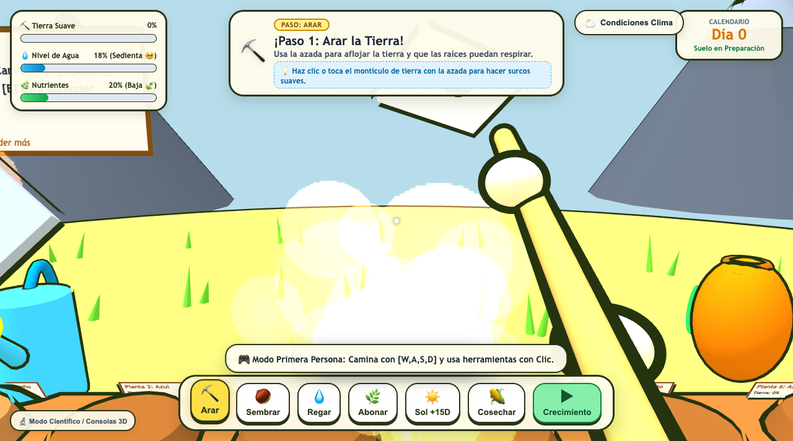
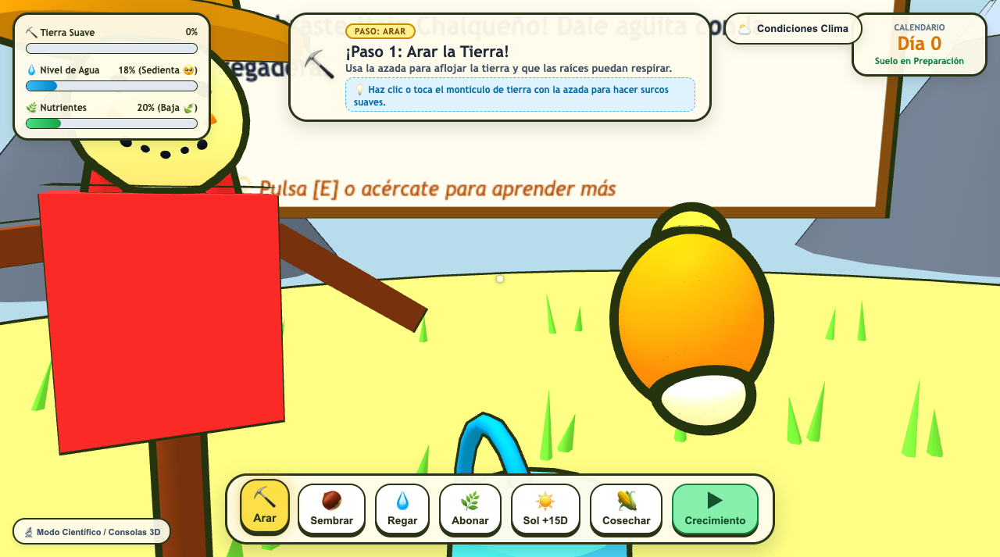

# 🌽 Simulador Botánico WebXR · Milpa Tradicional y Maíz Animado (v3.0)
## *Zea mays* L. — 4 Razas Nativas, Modo Videojuego en Primera Persona (FPS), Audio Procedural y Don Elote

Bienvenido a la versión **v3.0 Inmersiva** del **Simulador Interactivo y Educativo del Maíz Mexicano**. Ahora puedes **moverte libremente como en un videojuego**, sostener y blandir las herramientas en primera persona (azada, saco de semillas, regadera, abono y mano de cosecha), labrar surcos tridimensionales en la tierra, y aprender sabiduría y leyendas ancestrales platicando con el entrañable espantapájaros **"Don Elote"**.



> [!NOTE]
> Para consultar el manual técnico exhaustivo con la arquitectura matemática, pipeline de 60 estados, ontogenia vegetal y descripción de cada clase, consulta el documento principal:  
> **👉 [FUNCIONAMIENTO_PROYECTO.md](FUNCIONAMIENTO_PROYECTO.md)**

---

## 🎮 Jugabilidad y Manipulación Física en Primera Persona

### 1. Movimiento Libre de Videojuego (FPS)
* **`W, A, S, D`** (o Flechas): Camina libremente por el huerto, acércate al cobertizo o recorre la hilera de milpa.
* **`Shift`**: Corre a mayor velocidad (4.6 m/s).
* **Ratón (Pointer Lock)**: Haz clic en el lienzo para bloquear el cursor y mover la cámara con el ratón como en un juego de exploración o FPS. Pulsa `Esc` para liberar el cursor.
* **`Q` / `E`**: Gira la cámara a la izquierda o derecha usando únicamente el teclado.
* **Balanceo de cabeza y pasos (Head Bobbing & Footsteps)**: Animación fisiológica al caminar y trotar con sonido procedural de hierba.

### 2. Manipulación Física de Herramientas (Viewmodel en Mano)
* Al seleccionar una herramienta (`1` a `6`), **tus manos caricaturescas la sostienen en pantalla**:
  * ⛏️ **Azada (`1`)**: Sostén el mango de madera pulida y propina golpes enérgicos hacia el suelo con clic izquierdo o barra espaciadora. Cada impacto afloja la tierra, genera polvo y talla surcos 3D sobre el montículo.
  * 🌰 **Semillas (`2`)**: Saca el saquito de yute con granos nativos y lánzalos al surco abierto; las semillas quedan visibles en la tierra hasta que brotan.
  * 💧 **Regadera (`3`)**: Inclina la regadera metálica para verter agua con chorro y sonido continuo; el suelo absorbe humedad, se oscurece y forma charcos reflectantes.
  * 🌿 **Abono (`4`)**: Esparce compost orgánico rico en nutrientes con lluvia de chispas y estrellas.
  * 🌽 **Cosechar (`6`)**: Estira la mano hacia la mazorca madura para arrancarla con un crujido sonoro y mandarla a la canasta de mimbre.
* **`V`**: Alterna entre el **Modo Primera Persona (Juego)** y el **Modo Orbital (Inspección libre 360°)**.

---

## 🧑‍🌾 Sabiduría Ancestral con "Don Elote"



Don Elote cuenta con rostro animado (ojos de botón de carbón, sonrisa cosida, bigotito de pelos de elote y paliacate rojo) y un sintetizador de voz con fonemas de caricatura:
* **Seguimiento inteligente**: Cuando te acercas a menos de 7 metros, gira suavemente su cabeza y cuerpo para mirarte de frente.
* **Pulsa `[E]` o haz clic en Don Elote** para que comparta fascinantes datos científicos e históricos:
  * 🍿 **Maíz Palomero Toluqueño**: La raza más antigua (5,000 años). Su endospermo duro atrapa humedad que al calentarse explota creando el *momochtli* sagrado mexica para Xiuhtecuhtli.
  * 💜 **Maíz Azul Cónico**: Alto en antocianinas antioxidantes que protegen del frío volcánico; base de los tlacoyos y la magia química de la nixtamalización.
  * ❤️ **Maíz Rojo**: Venerado como *Tlatlauhquicintli* (sangre de la tierra), con flavonoides resistentes a sequía extrema.
  * 🌽 **Maíz Chalqueño**: El coloso de 3.5 metros de los Valles Altos, rey del elote hervido y el pozole.
  * 🌿 **La Tríada de la Milpa**: La simbiosis perfecta entre Maíz (poste), Frijol (fijador de nitrógeno) y Calabaza (tapete vivo anti-maleza).

---

## 🔊 Sintetizador de Audio Procedural WebAudio (Zero Descargas)

La aplicación incorpora un motor de audio por síntesis matemática en tiempo real (`src/audio_sintetizador.ts`), garantizando 0 dependencias externas y 0 latencia:
* **Golpe de azada**: Sub-bass thud (120Hz $\rightarrow$ 32Hz) + crunch de partículas de tierra.
* **Regadera**: Modulación LFO de burbujeo con filtro pasabanda en 1100Hz.
* **Semillas**: Impactos resonantes de madera y granos cayendo al surco.
* **Abono**: Acorde arpegiado mayor brillante (C5 - E5 - G5 - C6).
* **Cosecha**: *Snap* crujiente de tallo con campanilleo posterior.
* **Voz de Don Elote**: Formantes vocálicos y cadencias cómicas.
* **Pasos**: Crujido de hierba filtrado en frecuencias bajas.

---

## ⌨️ Tabla de Controles del Videojuego

| Control | Acción |
| :--- | :--- |
| **`W, A, S, D`** | Moverse por el huerto en primera persona |
| **`Shift`** | Correr |
| **`Ratón / Clic lienzo`** | Mirar alrededor (bloquea el cursor) / `Esc` para liberar |
| **`Q` / `E`** | Girar vista a la izquierda / derecha con el teclado |
| **`Clic Izquierdo` / `Espacio`** | **Usar herramienta física** sobre el suelo o hablar con Don Elote |
| **`E`** | **Hablar con Don Elote** y escuchar datos fascinantes |
| **`V`** | **Alternar entre Primera Persona (Juego) y Modo Orbital** |
| **`1`** a **`6`** | Equipar herramienta en mano: Azada (`1`), Semilla (`2`), Regadera (`3`), Abono (`4`), Sol +15D (`5`), Cosechar (`6`) |
| **`Tab`** | Teletransportarse a la siguiente estación del surco (1 a 6) |
| **`L`** | Regresar al Cobertizo con la mesa de clima 3D |
| **`Enter`** | Salir del cobertizo e ingresar al campo de cultivo |
| **`C`** | Abrir / Cerrar Panel Flotante de Condiciones Climatológicas |
| **`H`** | Mostrar / Ocultar Consolas Científicas 3D |

---

## 🚀 Inicio Rápido

```bash
# Iniciar servidor de desarrollo local
npm run dev

# Servidor HTTP directo
npm run dev:http

# Compilar para producción (TypeScript + Vite)
npm run build
```
Accede desde tu navegador o visor WebXR a **`http://localhost:5173/`**.
